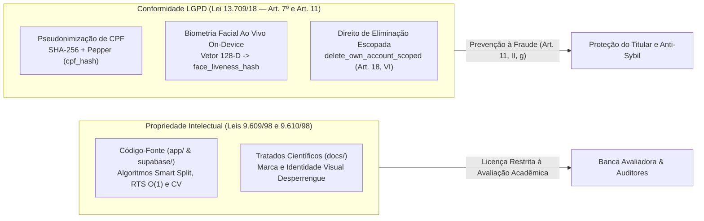

# Governança Jurídica, Propriedade Intelectual e Conformidade Regulatória (`LICENSE.md`)

**Copyright © 2026 Equipe de Engenharia e Pesquisa Desperrengue (Ciência da Computação — PUC Minas). Todos os direitos reservados (*All Rights Reserved*).**

---

## 1. Fundamentação Teórica e Enquadramento Jurídico

Este instrumento normativo rege a titularidade intelectual, o regime de proteção de software, a custódia criptográfica de dados pessoais sensíveis e os limites de utilização do ecossistema computacional **Desperrengue**, abrangendo:

1. O código-fonte cliente multiplataforma em [`app/`](app/) (arquitetura reativa Flutter/Dart, *Worker Isolates* de visão computacional e motor vetorial `%PDF-1.4`);
2. As **21 migrações relacionais**, funções PL/pgSQL `SECURITY DEFINER`, triggers de complexidade $O(1)$ e suítes formais de contrato em [`supabase/`](supabase/);
3. Os algoritmos proprietários de **Particionamento Orçamentário Assimétrico (*Anti-Bypass Smart Split*)**, **Custódia Financeira Condicional Transacional em 3 Camadas (*Smart Escrow*)**, **Prova de Vida Biométrica Ativa Desafio-Resposta (*Active Liveness*)** e **Hashing Perceptual de Gradiente sobre Região de Interesse (`dHash` 64-Bit + `MAD`)**;
4. Os tratados arquiteturais, especificações matemáticas e diagramas contidos em [`docs/`](docs/) e na raiz do repositório.

O sistema subordina-se à proteção integral conferida pela **Lei do Software (Lei Federal nº 9.609/1998)**, pela **Lei de Direitos Autorais (Lei Federal nº 9.610/1998)**, pelo **Marco Civil da Internet (Lei Federal nº 12.965/2014)** e pela **Lei Geral de Proteção de Dados Pessoais — LGPD (Lei Federal nº 13.709/2018)**.

---

## 2. Arquitetura de Governança Legal e Proteção de Dados Biométricos (LGPD Art. 11)

### 2.1. Tratamento de Dados Biométricos e Pseudonimização Criptográfica

Em estrita observância ao **Art. 11, inciso II, alínea "g" da LGPD** (tratamento de dados pessoais sensíveis indispensável para prevenção à fraude e garantia da segurança do titular em processos de identificação e autenticação de cadastro em sistemas eletrônicos):

- **Processamento *On-Device* em Memória Isolada**: A decomposição espectral $YCbCr$, a aferição da Razão de Aspecto Ocular ($\text{EAR}$), a estimativa de rotação $\text{Yaw}$ e a extração do descritor facial L2-normalizado de 128 dimensões ocorrem localmente em *Worker Isolates* ([`document_ocr_and_liveness_service.dart`](app/lib/core/services/document_ocr_and_liveness_service.dart)), sem envio de fluxos brutos de vídeo a APIs comerciais de terceiros.
- **Irreversibilidade Criptográfica (`cpf_hash` e `face_liveness_hash`)**: O Cadastro de Pessoas Físicas (CPF) é validado pelo algoritmo Módulo 11 (`public.is_valid_cpf`) e imediatamente transformado em resumo criptográfico irreversível `SHA-256` acrescido de *pepper* de domínio (`DSP-CPF-PEPPER-2026`), armazenando-se para exibição apenas a string mascarada `***.XXX.XXX-**` (`cpf_masked`).
- **Exclusão Escopada (`Art. 18, VI da LGPD`)**: A função transacional `public.delete_own_account_scoped` assegura ao titular a eliminação granular de seus dados pessoais por papel (`client` ou `provider`), preservando exclusivamente os lançamentos contábeis imutáveis exigidos pela legislação tributária e civil.

---

## 3. Escopo da Licença Concedida (Restrita, Não Exclusiva e Revogável)

Concede-se, a título gratuito, licença **não exclusiva, intransferível e revogável** estritamente para:

1. **Inspeção e Avaliação Acadêmica e Científica**: Docentes, pesquisadores e membros de bancas examinadoras estão autorizados a clonar, compilar, executar as suítes de verificação formal (`flutter test`, asserções SQL) e auditar a arquitetura para fins de avaliação científica.
2. **Estudo Técnico Individual**: Leitura do código-fonte e das especificações matemáticas publicadas neste repositório oficial para fins educacionais.
3. **Contribuição Supervisionada**: Submissão de *Pull Requests* por colaboradores autorizados, observando rigorosamente o protocolo definido em [`.github/CONTRIBUTING.md`](.github/CONTRIBUTING.md).

---

## 4. Vedações Expressas

Sem autorização prévia, formal e por escrito dos titulares dos direitos patrimoniais, **é estritamente proibido**:

- Explorar comercialmente o software, seus algoritmos financeiros (*Smart Split* / *3-Layer Escrow*) ou seus módulos de visão computacional e geração de PDF;
- Redistribuir, sublicenciar, vender, alugar ou publicar cópias totais ou parciais do código fora do repositório oficial;
- Implantar instância paralela do backend ou do aplicativo para prestação de serviços a terceiros;
- Utilizar a denominação **"Desperrengue"**, seus ícones adaptativos, logotipos ou infraestrutura de domínio (`desperrengue.tech`);
- Realizar engenharia reversa voltada à evasão das travas antifraude (`RN-AF-01` a `RN-AF-14`) ou das políticas de *Row Level Security* (RLS).

---

## 5. Licenciamento de Componentes de Terceiros e Limitação de Responsabilidade

As bibliotecas de código aberto declaradas em [`app/pubspec.yaml`](app/pubspec.yaml) (incluindo o SDK *Flutter*, `flutter_riverpod`, `supabase_flutter`, `camera`, `image`, `geolocator` e `crypto`) permanecem regidas por suas respectivas licenças originais (BSD, MIT, Apache-2.0).

**O SOFTWARE É FORNECIDO "NO ESTADO EM QUE SE ENCONTRA" (*AS IS*), SEM GARANTIAS IMPLÍCITAS DE COMERCIALIZAÇÃO OU ADEQUAÇÃO A PROPÓSITOS EXTERNOS AO ESCOPO ESPECIFICADO.** Para solicitações de licenciamento comercial ou parcerias institucionais B2B, estabelece-se o canal oficial `suporte@desperrengue.tech`.
