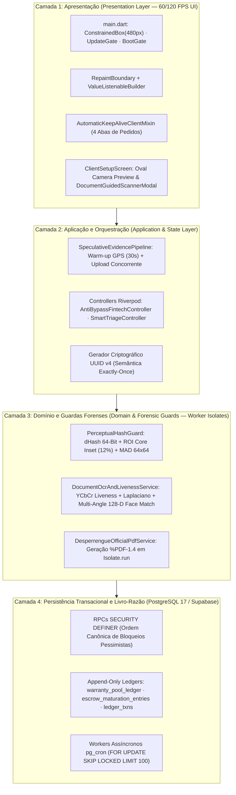
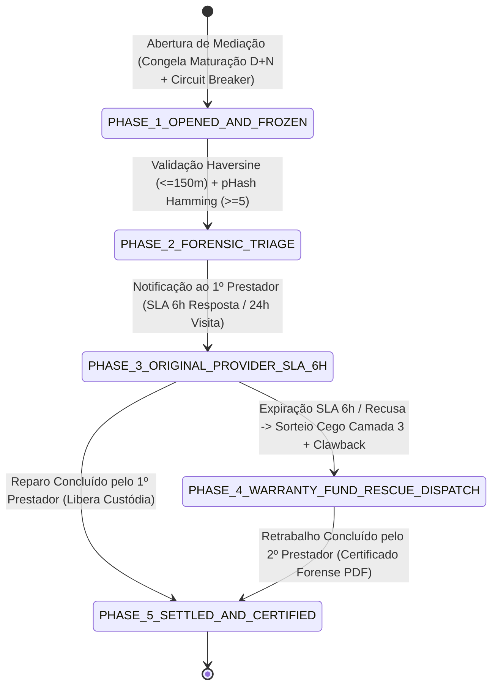
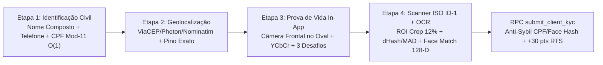

# Desperrengue — Arquitetura de Marketplace Residencial, Custódia Financeira em Três Camadas, Motor Antifraude Determinístico e Visão Computacional Aplicada ao Onboarding Biométrico

[](https://github.com/WagnerxOliveira/DesperrengueApp_TAI3/actions/workflows/ci.yml)


---

## Sumário Executivo e Epistemológico

O sistema **Desperrengue** consiste em uma plataforma computacional distribuída de intermediação de serviços de manutenção residencial, projetada sob os paradigmas de **Arquitetura Centrada em Banco de Dados (*Database-Centric Architecture*)**, **Confiança Zero no Cliente (*Zero-Trust Client Model*)**, **Custódia Financeira Paramétrica em Três Camadas (*Three-Layer Parametric Escrow*)** e **Visão Computacional Forense em Memória Isolada (*Worker Isolate Computer Vision*)**.

O problema fundamental endereçado pela engenharia do sistema reside na eliminação simultânea de três falhas estruturais dos mercados digitais de serviços:
1. **Assimetria de Confiança e Risco Físico Residencial:** Mitigada pela verificação civil e biométrica ativa (*Active Liveness Detection* em espaço de crominância $YCbCr$ e confronto facial 1:1 com descritores de 128 dimensões) tanto para prestadores quanto para contratantes, aliada à trava temporal e geográfica de endereço (*Geofencing* por distância ortodrômica de Haversine).
2. **Seleção Adversa e Tarifação Predatória de Orçamentos:** Erradicada pela substituição da venda especulativa de contatos (*leads*) por um modelo de comissionamento estrito sobre o êxito (*Success Fee*), com segregação tributária e contábil entre mão de obra e insumos (*Smart Split Anti-Bypass*).
3. **Risco Moral Pós-Execução e Conluio Financeiro:** Neutralizado pelo Fundo Autossustentável de Garantia em 3 Camadas (`RN-CAM-01` a `RN-CAM-03`), pelas 4 Invariantes Contábeis impostas no motor relacional PostgreSQL 17 e pelo motor antifraude determinístico (`RN-AF-01` a `RN-AF-14`) capaz de operar com segurança desde o Marco Zero (*Cold-Start Security Paradox* — `RN-MZ-01` a `RN-MZ-05`).

---

## 🧭 Índice de Navegação Documental

| Domínio Documental | Artefato Normativo |
| :--- | :--- |
| 🚀 **Guia de Instalação e Configuração** | [SETUP.md](./docs/SETUP.md) · [Windows](./docs/setup/windows.md) · [macOS](./docs/setup/macos.md) · [Linux](./docs/setup/linux.md) |
| 🏗️ **Especificação Arquitetural Viva (C4, Estados, STRIDE)** | [ARCHITECTURE.md](./docs/ARCHITECTURE.md) · [Arquitetura do Sistema.md](./docs/Arquitetura%20do%20Sistema.md) |
| 🧾 **Registros de Decisão de Arquitetura (ADRs 0001–0020)** | [docs/adr/README.md](./docs/adr/README.md) · [ADR-0020 (Garantia 3 Camadas e KYC Biométrico)](./docs/adr/0020-garantia-3-camadas-antifraude-e-kyc-biometrico-ocr.md) |
| 📱 **Documentação do Cliente Móvel/Web (Flutter)** | [app/README.md](./app/README.md) |
| 🗄️ **Documentação do Núcleo Relacional e RPCs (Supabase)** | [supabase/README.md](./supabase/README.md) |
| 🧪 **Estratégia de Verificação, Testes Forenses e Red Team** | [TESTING.md](./docs/TESTING.md) |
| 🔐 **Política de Segurança da Informação e Divulgação (ISO 29147)** | [SECURITY.md](.github/SECURITY.md) |
| 📝 **Histórico de Mudanças (Versionamento Semântico)** | [CHANGELOG.md](./docs/CHANGELOG.md) |
| 🗺️ **Planejamento Evolutivo e Épicos de Engenharia** | [ROADMAP.md](./docs/ROADMAP.md) |
| 🎮 **Modelagem Matemática de Reputação, Bayes e Gamificação** | [GAMIFICACAO.md](./docs/GAMIFICACAO.md) |
| 🪪 **Arquitetura de Onboarding e Verificação Documental (KYC)** | [onboarding_profissional.md](./docs/onboarding_profissional.md) |
| 🎨 **Projeto de Interface, Design System e Fichas de Telas** | [Projeto de Interface.md](./docs/Projeto%20de%20Interface.md) · [Template.md](./docs/Template.md) · [Protótipos Hi-Fi](./docs/ui_ux/hi-fi_prototyping) · [Specs de Telas](./docs/specs) |
| 💼 **Modelagem Econômica, Tributária e Estratégica** | [Documento de Contexto.md](./docs/Documento%20de%20Contexto.md) · [Especificação do Projeto.md](./docs/Especificação%20do%20Projeto.md) · [Planos de Negocio e Tributação.md](./docs/Planos%20de%20Negocio%20e%20Tributação.md) · [Análise SWOT](./docs/Analise%20de%20Ambientes%20e%20SWOT.md) · [Balanced Scorecard (BSC)](./docs/Balanced%20Scorecard%20(BSC).md) ([CSV](./docs/planilhas/bsc_desperrengue.csv)) · [Fluxo de Caixa 12M](./docs/Fluxo%20de%20Caixa.md) ([CSV](./docs/planilhas/fluxo_de_caixa_12m.csv)) |
| 🚢 **Operação Contínua, Distribuição Beta, Play Store e DNS** | [PLAY_STORE.md](./docs/PLAY_STORE.md) · [TESTE_COM_AMIGOS.md](./docs/TESTE_COM_AMIGOS.md) · [registro_dominio_resend.md](./docs/registro_dominio_resend.md) |
| 🤝 **Governança do Repositório e Comunidade** | [CONTRIBUTING.md](.github/CONTRIBUTING.md) · [CODE_OF_CONDUCT.md](.github/CODE_OF_CONDUCT.md) · [LICENSE.md](./LICENSE.md) · [Índice Geral (`docs/README.md`)](./docs/README.md) |

---

## 1. Arquitetura de Software em 4 Camadas Desacopladas e Fundação Multiplataforma

Projetou-se a estrutura interna do sistema segundo os princípios da **Arquitetura Limpa em Camadas (*Clean Layered Architecture*)** combinada com **Gerenciamento de Estado Orientado a Eventos Otimistas (*Optimistic Event-Driven State Management*)**, segregando estritamente a renderização visual, a orquestração assíncrona, os guardas forenses computacionais e o livro-razão transacional.



### 1.1. Camada de Apresentação (*Presentation Layer — 120 FPS UI*)
- **Isolamento de Reconstrução da Árvore de Elementos (`RepaintBoundary` e `ValueListenableBuilder<Duration>`):** Nas interfaces que exibem contadores regressivos de Acordo de Nível de Serviço (SLA de 6 horas na mediação, 2 horas para cotação ou 5 minutos no radar de emergência), o texto cronométrico é encapsulado em um `RepaintBoundary` dedicado acoplado a um `ValueListenableBuilder<Duration>`. Dessa forma, o pulso de atualização de `1 Hz` reconstrói exclusivamente a folha de texto de $O(1)$ nós, impedindo a invalidação e a repintura dos cartões adjacentes e mantendo a taxa de quadros estável em $60\text{--}120\text{ FPS}$.
- **Preservação de Estado entre Abas (`AutomaticKeepAliveClientMixin`):** Implementou-se em [`app/lib/features/client/presentation/client_orders_tab.dart`](./app/lib/features/client/presentation/client_orders_tab.dart) a retenção de estado nas quatro abas operacionais (*Em Andamento*, *Concluídos*, *Cancelados* e *Em Mediação*), eliminando requisições redundantes ao banco de dados durante transições horizontais.
- **Trava Responsiva Centralizada de `480px` e Suporte Nativo a PWA:** Em [`app/lib/main.dart`](./app/lib/main.dart), o contêiner raiz aplica um `ConstrainedBox(maxWidth: 480)` sobre fundo escuro institucional, assegurando ergonomia idêntica entre dispositivos móveis físicos (Android/iOS) e navegadores Desktop/Web. Em [`app/web/index.html`](./app/web/index.html) e [`app/web/manifest.json`](./app/web/manifest.json), configuraram-se as diretivas `apple-mobile-web-app-capable` e `display: standalone`, acompanhadas de engenharia de ícones adaptativos com enquadramento matemático na *Safe-Zone* central de $57\%\text{--}66\%$ para prevenção de corte (*clipping*) em máscaras circulares e *squircles* (Samsung One UI e iOS).

### 1.2. Camada de Aplicação e Orquestração (*Application & State Layer*)
- **Pipeline de Evidências Especulativas (`SpeculativeEvidencePipeline`):** Implementada em [`app/lib/services/warranty_escrow_service.dart`](./app/lib/services/warranty_escrow_service.dart), reduz a latência percebida pelo usuário em operações de *Check-out* e abertura de mediação para menos de $180\text{ ms}$ mediante duas técnicas concorrentes:
  1. **Pré-Aquecimento Assíncrono do Sensor GPS (*Location Warm-up*):** Ao inicializar a tela (`initState`), o método `warmUpGpsOnScreenEnter()` aciona o receptor GNSS em alta precisão e armazena a coordenada verificada (`!pos.isMocked`) em cache válido por $30\text{ segundos}$.
  2. **Upload Binário Especulativo em *Background*:** Imediatamente após a captura óptica da fotografia pela câmera nativa, `captureAndStartSpeculativeUpload()` inicia a transmissão assíncrona dos bytes para o bucket privado do Supabase Storage enquanto o usuário digita a descrição técnica ou o código PIN de 4 dígitos.
- **Semântica de Execução *Exactly-Once*:** Todas as chamadas remotas que movimentam saldos ou acionam garantias geram uma chave criptográfica `UUID v4` (`SpeculativeEvidencePipeline.generateIdempotencyKey()`) validada contra restrições `UNIQUE` nos livros-razão do banco de dados, neutralizando cliques duplos e retransmissões em redes móveis instáveis.

### 1.3. Camada de Domínio e Guardas Forenses (*Domain & Forensic Guards Layer*)
- **Paralelismo em Memória Isolada via *Worker Isolates* (`Isolate.run`):** Operações computacionalmente densas — decodificação de matrizes de pixels, convolução pelo operador Laplaciano, cálculo de *Difference Hash* (`dHash`), equalização de histograma, extração de descritores faciais de 128 dimensões e compilação de documentos binários `%PDF-1.4` — executam estritamente fora da *Main UI Isolate* do Flutter por meio de `Isolate.run` em [`app/lib/core/services/document_ocr_and_liveness_service.dart`](./app/lib/core/services/document_ocr_and_liveness_service.dart), [`app/lib/core/security/perceptual_hash_guard.dart`](./app/lib/core/security/perceptual_hash_guard.dart) e [`app/lib/core/services/desperrengue_official_pdf_service.dart`](./app/lib/core/services/desperrengue_official_pdf_service.dart), garantindo $0\text{ ms}$ de bloqueio da thread gráfica (*zero UI jank*).
- **Amostragem Assistida por Hardware (*ISP Hardware Downsampling*):** A captura fotográfica impõe `maxWidth: 1280`, `maxHeight: 1280` e `imageQuality: 82` diretamente ao Processador de Sinal de Imagem (ISP) do sistema operacional, reduzindo o consumo de memória RAM de $\approx 48\text{ MB}$ para $\approx 4,9\text{ MB}$ por imagem sem perda de nitidez forense.

### 1.4. Camada de Persistência Transacional e Livro-Razão (*Transactional Data & Ledger Layer*)
- **Núcleo Relacional PostgreSQL 17:** Estruturado sobre 21 migrações versionadas em [`supabase/migrations/`](./supabase/migrations), nas quais todas as mutações financeiras, de custódia e de estado ocorrem exclusivamente no interior de funções PL/pgSQL `SECURITY DEFINER` com `search_path = public` fixo e controle de concorrência pessimista.

---

## 2. Engenharia Financeira do Fundo Autossustentável de Garantia em 3 Camadas e Split Anti-Bypass

A modelagem econômico-financeira implementada em [`app/lib/core/models/fintech_warranty_models.dart`](./app/lib/core/models/fintech_warranty_models.dart) (`SmartSplitBreakdown`) e na migração [`supabase/migrations/20261108110000_high_perf_warranty_antifraud_engine.sql`](./supabase/migrations/20261108110000_high_perf_warranty_antifraud_engine.sql) elimina o incentivo econômico à desintermediação (*bypass*) e financia autonomamente a cobertura de garantia de 90 dias sem comprometer o caixa operacional da plataforma.

### 2.1. Segregação Orçamentária (*Smart Split* — Carteira A vs. Carteira B)
Em serviços residenciais que demandam substituição de componentes físicos (disjuntores, válvulas, tubulações), a cobrança de comissão sobre o valor das peças penalizaria a margem líquida do prestador, induzindo-o a negociar fora do aplicativo. O algoritmo de *Smart Split* segrega cada Ordem de Serviço em duas carteiras contábeis independentes:
- **Carteira A — Mão de Obra (`labor_amount` = $M$):** Incide a taxa total de intermediação de $15\%$, decomposta em **$13,5\%$ de Receita Operacional Líquida da Plataforma** (`platform_operational_fee`) e **$1,5\%$ de Aporte Paramétrico ao Fundo de Reserva de Garantia** (`warranty_carveout_fee`).
- **Carteira B — Insumos e Materiais com Comprovação Fiscal (`materials_amount` = $P$):** Incide **alíquota zero ($0\%$)** mediante anexação de nota/cupom fiscal (`MaterialFiscalItem`) e aprovação do contratante, repassando $100\%$ do valor de reembolso ao prestador.

As identidades contábeis exatas verificadas por `SecurityAndLgpdGuard.validateSplitRates()` são definidas por:

$$\text{Valor Bruto Total } (V_{\text{bruto}}) = M + P$$

$$\text{Receita Operacional } (R_{\text{op}}) = \operatorname{round}(0,135 \cdot M,\; 2)$$

$$\text{Aporte ao Fundo de Garantia } (F_{\text{gar}}) = \operatorname{round}(0,015 \cdot M,\; 2)$$

$$\text{Repasse Líquido ao Prestador } (L_{\text{prest}}) = (M - R_{\text{op}} - F_{\text{gar}}) + P = 0,85 \cdot M + P$$

$$\text{Economia Real do Prestador pelo Smart Split } (E_{\text{split}}) = 0,15 \cdot P$$

### 2.2. Arquitetura das 3 Camadas de Proteção Financeira (`RN-CAM-01` a `RN-CAM-03`)

| Camada | Código Normativo | Mecanismo Técnico e Contábil | Artefatos de Implementação |
| :--- | :---: | :--- | :--- |
| **Camada 1: Custódia Inteligente (*Escrow*)** | `RN-CAM-01` | Retenção integral ($100\%$) do pagamento do cliente vinculada à Ordem de Serviço (`escrow_status = 'LOCKED_100'`). A conversão para maturação (`RELEASED_TO_MATURATION`) exige comprovação óptica georreferenciada (*Antes* e *Depois*) e validação presencial por PIN de 4 dígitos (ou decurso de 24h sem contestação). | `WarrantyEscrowService.lockJobEscrow()`, RPC `complete_job_and_schedule_escrow` |
| **Camada 2: Reserva Técnica Paramétrica (*1,5% Carve-out*)** | `RN-CAM-02` | Na liquidação de cada serviço, a RPC `settle_escrow_with_carveout_and_maturation` segrega automaticamente $1,5\%$ de `labor_amount` e registra um lançamento imutável `CARVEOUT_CONTRIBUTION_1_5_PCT` na tabela `public.warranty_pool_ledger`. | Tabela `warranty_pool_ledger`, RPC `settle_escrow_with_carveout_and_maturation` |
| **Camada 3: Cobertura de Retrabalho Sem Custo Operacional** | `RN-CAM-03` | Caso ocorra defeito técnico dentro do prazo legal de 90 dias e o prestador original descumpra o SLA de reparo de 6 horas, o sistema aciona um segundo profissional independente (*Rescuer*) por sorteio cego, custeado prioritariamente pelo estorno (*Clawback*) da maturação do prestador faltoso e, subsidiariamente, pelo saldo acumulado da Camada 2 (limitado a $100\%$ de $M$). | RPC `trigger_layer3_rework`, `MediationAndWarrantyTabView` |

#### Demonstração Matemática do Ponto de Equilíbrio Atuarial da Camada 2
Seja $c = 0,015$ ($1,5\%$) a alíquota de contribuição incidente sobre a mão de obra média $\bar{M}$ de cada serviço concluído, e seja $\bar{C}_{\text{rework}} \le 1,00 \cdot \bar{M}$ o custo máximo de cobertura de um sinistro de retrabalho na Camada 3 (quando não coberto por *Clawback*). O número de serviços concluídos necessários para financiar integralmente um retrabalho de teto máximo é dado por:

$$N_{\text{equilíbrio}} = \frac{100\%}{1,5\%} = \frac{1,00}{0,015} = 66,67 \text{ serviços}$$

Portanto, a cada $67$ serviços liquidados, o Fundo de Garantia acumula autonomamente $100\%$ do valor de mão de obra de um novo serviço completo, suportando uma taxa de sinistralidade líquida residual de até $1,49\%$ sem qualquer subsídio do caixa operacional da empresa (`platform_operational_fee` permanece intacta em $13,5\%$).

### 2.3. Máquina de Estados de 5 Fases da 4ª Aba *"Em Mediação"* (`public.job_mediations`)
Quando um chamado entra em revisão técnica de garantia, ele é apresentado na 4ª aba **"Em Mediação"** (`app/lib/features/client/presentation/client_orders_tab.dart` e `MediationAndWarrantyTabView` em `app/lib/features/shared/presentation/fintech_warranty_widgets.dart`), percorrendo determinísticamente 5 fases:



### 2.4. As 4 Invariantes Contábeis Impostas no Banco de Dados
1. **Invariante 1 — Teto Paramétrico Estrito (`chk_invariant_1_coverage_cap`):** Em `public.warranty_pool_ledger`, a restrição `CHECK (entry_type <> 'REWORK_PAYOUT_DEBIT' OR amount <= labor_reference_cap)` impede matematicamente qualquer débito de retrabalho superior a $100\%$ do valor de mão de obra original.
2. **Invariante 2 — Disjunção Estrita de Identidade Tripla (`chk_invariant_2_identity_disjunction`):** A restrição `CHECK` garante que o profissional socorrista (`rescuer_provider_id`), o prestador original (`original_provider_id`) e o cliente (`client_id`) possuam identificadores, hashes de CPF (`cpf_hash`), hashes biométricos (`face_liveness_hash`) e *device fingerprints* estritamente distintos.
3. **Invariante 3 — Conservação de Soma Zero e Não-Negatividade de Saldos:** Todos os saldos (`available_wallet_balance`, `maturing_wallet_balance`, `clawback_debt_balance`, `available_cents`, `escrow_cents`) possuem restrição `CHECK (>= 0)` e toda movimentação no livro-razão possui soma algébrica nula.
4. **Invariante 4 — Prioridade de *Clawback* antes do Débito Coletivo:** Na função `trigger_layer3_rework`, o custo do retrabalho é deduzido primeiramente do saldo em maturação (`MATURING` / `FROZEN_BY_DISPUTE`) e do saldo disponível do prestador faltoso, registrando qualquer déficit residual em `clawback_debt_balance` para compensação automática nos serviços futuros (`CLAWBACK_RECOVERY_CREDIT`).

---

## 3. Modelagem de Ameaças (*Threat Modeling*), Teoria dos Jogos e Mitigação dos 6 Vetores de Fraude (`RN-AF-01` a `RN-AF-14`)

Abaixo detalham-se os 6 vetores de ataque econômico e operacional modelados pela engenharia de segurança e as respectivas contramedidas determinísticas implementadas no código-fonte e no banco de dados.

| Vetor de Ameaça | Regras Normativas | Mecanismo Determinístico de Mitigação no Código e Banco de Dados |
| :--- | :---: | :--- |
| **1. Conluio Triplo de Drenagem do Fundo (*Pool Siphoning Attack*)**<br/>*(Cliente $C$, Prestador $P_1$ e Prestador $P_2$ combinam forjar um serviço e um falso defeito para extrair pagamento duplo do Fundo de Garantia)* | `RN-AF-01`<br/>`RN-AF-02`<br/>`RN-AF-03` | • **Despacho Cego no Servidor (`RN-AF-01`):** O cliente e o prestador original jamais escolhem quem executará o retrabalho da Camada 3; a RPC `trigger_layer3_rework` seleciona o socorrista via função de dispersão pseudoaleatória determinística `hashtextextended(p.id::TEXT \|\| p_mediation_id::TEXT, 0)`.<br/>• **Grafo Zero-Link e Disjunção Tripla (`RN-AF-02`):** A cláusula `NOT EXISTS` exclui qualquer prestador que já tenha transacionado anteriormente com $C$ ou $P_1$, além de exigir disjunção de `device_fingerprint_hash`, `cpf_hash` e `face_liveness_hash`.<br/>• **Retenção $D+5$ e *Clawback* (`RN-AF-03`):** Como o repasse de $P_1$ permanece retido na fila `escrow_maturation_entries` por 5 a 7 dias, a abertura de disputa confisca os $85\%$ de $P_1$ para pagar o retrabalho, impondo à quadrilha um prejuízo líquido imediato igual à taxa da plataforma ($-15\%$). |
| **2. Chantagem e Sequestro de Custódia pelo Cliente (*Escrow Hold-up*)**<br/>*(Após a conclusão perfeita do serviço, o cliente recusa-se a fornecer o PIN ou silencia para tentar extorquir desconto ou reter o pagamento)* | `RN-AF-04`<br/>`RN-AF-05` | • **Check-out Presencial Irrevogável por PIN (`RN-AF-05`):** Quando o PIN de 4 dígitos (`ClientCheckoutPinDialog`) é validado pela função `crypt(p_client_pin_plain, v_job.checkout_pin_hash)`, o serviço transita imediatamente para `completed` e agenda a maturação.<br/>• **Gatilho de Liberação Automática em 24h (`RN-AF-04`):** Caso o cliente não informe o PIN presencialmente, mas o prestador envie as fotos de *Depois* dentro do geofence ($\le 150\text{ m}$) e com `pHash` distinto ($d_{\text{Hamming}} \ge 5$), o pedido entra em `awaiting_approval` com `auto_release_at = NOW() + INTERVAL '24 hours'`. O worker `process_autonomous_escrow_and_mediation_queues()` libera automaticamente o pagamento após 24 horas caso o cliente não abra mediação fundamentada. |
| **3. Falso Defeito, Substituição de Escopo e Sabotagem Pós-Serviço (*Friendly Fraud*)**<br/>*(Cliente envia foto baixada da internet, reutiliza a foto do "Antes" como se o defeito persistisse ou fotografa outro cômodo/imóvel)* | `RN-AF-06`<br/>`RN-AF-07`<br/>`RN-AF-08` | • **Imposição Estrita de Sensor de Câmera Física e Anti-Mock GPS (`RN-AF-06`):** `PerceptualHashGuard.captureStrictlyFromCamera()` bloqueia o seletor de galeria (`ImageSource.camera` exclusivo) e rejeita coordenadas com `position.isMocked == true` ou distância de Haversine $> 150\text{ m}$ na RPC `open_warranty_mediation`.<br/>• **Assinatura Perceptual de 64 Bits (`RN-AF-07`):** A função SQL `hamming_distance_64` compara o `defect_photo_phash` contra `checkin_photo_phash` e `checkout_photo_phash`, abortando com `ERR_RECYCLED_CHECKIN_PHOTO` ou `ERR_RECYCLED_CHECKOUT_PHOTO` se $d_{\text{Hamming}} < 5$.<br/>• **Comparador Visual Forense em 3 Colunas (`RN-AF-08`):** O widget `ForensicSplitViewComparator` exibe lado a lado as evidências de *Check-in (Antes)*, *Check-out (Depois)* e *Abertura de Chamado (Defeito)* com seus respectivos carimbos de tempo, coordenadas GPS e hashes perceptuais. |
| **4. Risco Moral e Superfaturamento no Retrabalho pelo 2º Profissional**<br/>*(O profissional socorrista tenta inflar o orçamento do reparo de garantia para drenar recursos excessivos do Fundo)* | `RN-AF-09`<br/>`RN-AF-10` | • **Trava de Teto Paramétrico de 100% (`RN-AF-09`):** A RPC `trigger_layer3_rework` verifica `IF p_rework_labor_budget > v_original_job.labor_amount THEN RAISE EXCEPTION 'ERR_COVERAGE_CAP_EXCEEDED'`, reforçada pela constraint relacional `chk_invariant_1_coverage_cap`.<br/>• **Segregação de Escopo Adicional (`RN-AF-10`):** Qualquer serviço extra ou peça adicional não pertencente ao escopo original é isolado no componente `AdditionalScopeSplitCheckoutSheet`, exigindo aprovação e pagamento complementar pelo cliente com isenção de taxa ($0\%$) sobre peças. |
| **5. Quebra Atuarial no *Cold-Start* (*Actuarial Drain*)**<br/>*(Prestador novato abandona múltiplos serviços em sequência antes que o fundo acumule reserva suficiente)* | `RN-AF-11`<br/>`RN-AF-12` | • **Janela de Maturação Escalonada $D+7$ (`RN-AF-11`):** Prestadores em estágio inicial (`trust_tier = 'TRAINEE'` ou `completed_jobs_count < 3`) têm seus repasses retidos por 7 dias corridos em `escrow_maturation_entries`, garantindo liquidez integral para eventual *Clawback*.<br/>• **Disjuntor Automático de Risco — *Circuit Breaker* (`RN-AF-12`):** No instante em que `open_warranty_mediation` é invocada, o banco executa `UPDATE public.profiles SET has_open_dispute = TRUE` e congela a maturação (`FROZEN_BY_DISPUTE`). Enquanto `has_open_dispute = TRUE`, o prestador fica impedido de realizar saques PIX e é filtrado de novos despachos de garantia (`Waterfall`). |
| **6. Lavagem de Cartão Clonado e *Chargeback* Duplo**<br/>*(Atacante utiliza cartão furtado ou tenta sacar fundos para conta de laranja)* | `RN-AF-13`<br/>`RN-AF-14` | • **Trava de Mesma Titularidade PIX — *Same-Holder Lock* (`RN-AF-13`):** O campo `pix_key_cpf_matched` vincula criptograficamente o `cpf_hash` (`SHA-256` salgado) validado via OCR documental na Etapa 4 do KYC à titularidade das operações de recarga e saque PIX.<br/>• **Certificado Forense PDF para Disputa de *Chargeback* (`RN-AF-14`):** `DesperrengueOfficialPdfService.generateWarrantyCertificatePdfInIsolate()` compila um dossiê probatório `%PDF-1.4` contendo selo biométrico `face_liveness_hash`, hashes `pHash` de Antes/Depois, coordenadas GPS e validação de PIN para contestação irrefutável de *chargebacks*. |

### Prova Matemática da Inviabilidade Econômica do Conluio (Teoria dos Jogos)
Seja $M$ o valor de mão de obra de uma Ordem de Serviço simulada por uma coalizão fraudulenta $\{C, P_1, P_2\}$. Para iniciar o serviço, $C$ aporta $1,00 \cdot M$ na Conta de Custódia (Camada 1). A plataforma retém instantaneamente $0,15 \cdot M$ ($13,5\%$ operacional + $1,5\%$ reserva), restando $0,85 \cdot M$ em maturação $D+5/D+7$ para $P_1$.
- **Cenário A (Sem abertura de disputa):** A coalizão resgata $0,85 \cdot M$ após $D+5$, incorrendo em **VPL líquido de $-0,15 \cdot M$ ($-15\%$)**.
- **Cenário B (Com abertura de falsa disputa para acionar a Camada 3):**
  1. A RPC `open_warranty_mediation` congela os $0,85 \cdot M$ de $P_1$ (`FROZEN_BY_DISPUTE`).
  2. Na fase de Camada 3, `trigger_layer3_rework` executa o *Clawback* integral dos $0,85 \cdot M$ de $P_1$ (`CLAWED_BACK`), lança a diferença de $0,15 \cdot M$ como dívida ativa em `clawback_debt_balance` de $P_1$, aplica penalidade de $-50\text{ pontos}$ no Score $RTS$ de $P_1$ e despacha o serviço para um profissional $P_{\text{externo}} \notin \{C, P_1, P_2\}$ (imposto pelo filtro Grafo Zero-Link e Disjunção Tripla).
  3. O valor pago pela coalizão ($1,00 \cdot M$) é integralmente transferido a um terceiro independente ($P_{\text{externo}}$) e à plataforma, resultando em **perda de $100\%$ do capital aportado pela coalizão ($\text{Payoff} = -1,00 \cdot M$)**.

Conclui-se que a estratégia dominante para qualquer agente racional sob as regras do protocolo é a execução honesta do serviço ($\mathbb{E}[\text{Payoff}_{\text{fraude}}] < 0$).

---

## 4. Resolução do Paradoxo de Segurança do Marco Zero (*Cold-Start Security Paradox* — `RN-MZ-01` a `RN-MZ-05`)

Em um marketplace recém-inaugurado em uma nova cidade (*Dia 1 / Marco Zero*), inexistem profissionais com histórico de dezenas de serviços concluídos (níveis Ouro ou Diamante) e o saldo inicial da Camada 2 (`warranty_pool_ledger`) é próximo de zero. Caso o algoritmo de despacho exigisse veteranos para operar, ocorreria falha por inanição (*starvation*). Resolveram-se ambos os problemas através de **5 Pilares Arquiteturais**:

1. **Pilar 1 — Liquidação Escalonada (*Tiered Escrow Maturation* — `RN-MZ-01`):** Nos primeiros serviços de qualquer prestador (`completed_jobs_count < 3`), a janela de maturação em `escrow_maturation_entries` é estendida para **$D+7$ dias** (`STANDARD` opera em $D+5$ e `VERIFIED_ANCHOR` em $D+2$). Durante esses 7 dias, o próprio repasse retido do prestador ($85\%$ de $M$) atua como colateral individual de $1^{\text{a}}$ perda (*First-Loss Collateral*), protegendo a transação mesmo que o saldo coletivo da Camada 2 seja zero.
2. **Pilar 2 — *Relative Trust Score* Materializado ($RTS \in [0, 100]$ — `RN-MZ-02`):** A função PL/pgSQL `public.calculate_relative_trust_score` (invocada automaticamente pelo trigger `sync_profile_trust_and_rank_biu` `BEFORE INSERT OR UPDATE` em `public.profiles`) afere a confiabilidade extrínseca e intrínseca do profissional antes mesmo de seu primeiro chamado:

$$RTS = \operatorname{clip}\!\Big(P_{\text{KYC}} + P_{\text{MEI}} + P_{\text{Cert}} + \min(6 \cdot N_{\text{concluídos}},\, 30) - 50 \cdot N_{\text{abandonos}},\; 0,\; 100\Big)$$

Onde:
- $P_{\text{KYC}} = 30,00\text{ pts}$ se `kyc_biometric_verified = TRUE` ou (`liveness_verified = TRUE` e `ocr_verified = TRUE`);
- $P_{\text{MEI}} = 20,00\text{ pts}$ se `mei_cnpj_active_months >= 6` (maturidade empresarial externa comprovada);
- $P_{\text{Cert}} = 20,00\text{ pts}$ se `technical_cert_verified = TRUE` (certificação NR-10, NR-35, CREA, CFT ou SENAI validada);
- $\min(6 \cdot N_{\text{concluídos}},\, 30)$ concede até $30,00\text{ pts}$ progressivos pelos primeiros 5 serviços concluídos;
- $50 \cdot N_{\text{abandonos}}$ aplica penalidade severa a cada abandono de garantia (`abandoned_warranty_count`).

3. **Pilar 3 — Algoritmo de *Fallback* em Cascata de 5 Degraus (`waterfall_tier_rank` 1 a 5 — `RN-MZ-03`):** O trigger `trg_sync_profile_trust_and_rank()` classifica continuamente cada prestador em um dos 5 degraus de prioridade, permitindo que o `ORDER BY p.waterfall_tier_rank ASC, p.external_trust_score DESC` encontre sempre o melhor profissional disponível sem retornar `NULL`:
   - **Degrau 1 (`waterfall_tier_rank = 1`):** Profissionais Âncora Homologados (`is_trusted_anchor = TRUE`).
   - **Degrau 2 (`waterfall_tier_rank = 2`):** Veteranos consolidados (`completed_jobs_count >= 5` e `abandoned_warranty_count = 0`).
   - **Degrau 3 (`waterfall_tier_rank = 3`):** Profissionais validados em tração inicial (`completed_jobs_count BETWEEN 1 AND 4` e `abandoned_warranty_count = 0`).
   - **Degrau 4 (`waterfall_tier_rank = 4`):** Profissionais em *Cold-Start* Forte (`completed_jobs_count = 0` e $RTS \ge 70,00$, isto é, com KYC Biométrico + MEI $\ge 6\text{ meses}$ + Certificação Técnica).
   - **Degrau 5 (`waterfall_tier_rank = 5`):** *Cold-Start* Geral Isolado (elegível para chamados regulares com retenção $D+7$, mas bloqueado de atuar como socorrista de Camada 3 pela cláusula `p.waterfall_tier_rank <= 4`).
4. **Pilar 4 — Credenciamento de Profissionais Âncora (`is_trusted_anchor` — `RN-MZ-04`):** Permite a homologação prévia de especialistas fundadores verificados em cada praça antes da abertura ao público, garantindo liquidez imediata de socorro técnico (Degrau 1) com liquidação acelerada $D+2$.
5. **Pilar 5 — Sorteio Cego Individual, Cooldown de 24h e Auditoria Multimodal Pré-Despacho (`RN-MZ-05`):** A cláusula `idx_jobs_rescuer_cooldown_24h` impede que um mesmo prestador monopolize resgates consecutivos em menos de 24 horas.

---

## 5. Visão Computacional, Biometria Facial Ativa (*Active Liveness*), Autenticidade Documental e Transcrição Automática via OCR no Onboarding Civil

O módulo de verificação de identidade civil e biométrica do contratante e do prestador ([`app/lib/features/client/presentation/client_setup_screen.dart`](./app/lib/features/client/presentation/client_setup_screen.dart), [`app/lib/core/services/document_ocr_and_liveness_service.dart`](./app/lib/core/services/document_ocr_and_liveness_service.dart), [`app/lib/core/services/live_camera_frame_bridge_stub.dart`](./app/lib/core/services/live_camera_frame_bridge_stub.dart), [`app/lib/core/services/live_camera_frame_bridge_web.dart`](./app/lib/core/services/live_camera_frame_bridge_web.dart) e [`supabase/migrations/20261108120000_client_kyc_biometrics_and_ocr.sql`](./supabase/migrations/20261108120000_client_kyc_biometrics_and_ocr.sql)) estrutura-se em 4 etapas determinísticas:



### 5.1. Etapa 1 — Validação Civil e Algoritmo Aritmético Módulo 11 do CPF em $O(1)$
Na primeira etapa do `ClientSetupScreen`, exige-se o nome civil composto, o telefone móvel com DDD (sem caráter opcional) e o Cadastro de Pessoas Físicas (CPF). A função `DocumentOcrAndLivenessService.isValidCpfMod11` (no cliente) e a função PL/pgSQL `public.is_valid_cpf` (no servidor) rejeitam sequências monótonas (`000.000.000-00` a `999.999.999-99`) e calculam os dois dígitos verificadores $DV_1$ e $DV_2$ em tempo constante $O(1)$:

$$DV_1 = \left(\left(\sum_{i=1}^{9} d_i \cdot (11 - i)\right) \cdot 10\right) \bmod 11 \quad (\text{se } 10 \Rightarrow 0)$$

$$DV_2 = \left(\left(\sum_{i=1}^{10} d_i \cdot (12 - i)\right) \cdot 10\right) \bmod 11 \quad (\text{se } 10 \Rightarrow 0)$$

### 5.2. Etapa 3 — Prova de Vida Facial Ativa (*Active Liveness*) com Câmera Frontal In-App
- **Renderização Ao Vivo Dentro da Moldura Oval (`ClipOval`):** O fluxo de vídeo da câmera frontal (`CameraLensDirection.front` / `facingMode: 'user'`) é embutido diretamente dentro do `ClipOval` de $236 \times 292\text{ px}$ na própria tela (`_OvalBiometricGuidePainter`), sem abrir aplicativos externos de câmera e sem utilizar temporizadores simulados (`Future.delayed`).
- **Amostragem Frame a Frame (`140 ms`) e Segmentação no Espaço de Crominância $YCbCr$:** A cada $140\text{ ms}$, o frame capturado pela ponte multiplataforma (`convertCameraImageToUprightRgbNamed` para planos `YUV420`/`NV21`/`BGRA8888` no Android/iOS ou `grabWebVideoFramePngBytes` para `<video>` HTML5 no Web/PWA) é analisado por `evaluateLiveOvalFrameInput`. Para cada pixel $(R, G, B)$ no interior da elipse normalizada $\frac{(x - c_x)^2}{r_x^2} + \frac{(y - c_y)^2}{r_y^2} \le 1$, aplicam-se as equações da recomendação ITU-R BT.601:

$$Y = 0,299 R + 0,587 G + 0,114 B$$

$$Cb = 128 - 0,168736 R - 0,331264 G + 0,500 B$$

$$Cr = 128 + 0,500 R - 0,418688 G - 0,081312 B$$

- **Filtro Anti-Monitor e Presença Humana (`hasRealHumanFaceInOval`):** Um quadro só é reconhecido como face humana viva quando satisfaz simultaneamente:
  1. Fração de pixels de crominância epidérmica humana ($Y \in [40, 245], Cb \in [77, 127], Cr \in [133, 173]$) contida no intervalo $[0,22,\; 0,88]$;
  2. Índice de emissão luminosa azulada de telas de computador/monitores `blueMonitorRatio < 0.25` (bloqueando $100\%$ de ataques de apresentação contra monitores exibindo código ou fotografias digitais);
  3. Desvio-padrão de luminância orgânica $\sigma_Y \ge 9,5$ e luminância média $L_{\text{mean}} \in [42, 238]$.
- **Máquina de Estados Biomecânica de 3 Desafios Sequenciais:**
  1. **Desafio 0 — Centralização e Simetria Bilateral:** Exige centroide de massa epidérmica centralizado ($|\bar{x} - 0,5| \le 0,13$ e $|\bar{y} - 0,5| \le 0,15$) com presença equilibrada nos hemisférios esquerdo e direito.
  2. **Desafio 1 — Rotação Cefálica Horizontal (*Head Yaw*):** Exige deslocamento horizontal significativo do centroide facial ($\Delta\bar{x} \ge 0,032$) ou assimetria hemisférica $|L_{\text{left}} - L_{\text{right}}| \ge 0,085$ em relação ao quadro de referência neutro.
  3. **Desafio 2 — Variação de Expressão / Piscada (*Smile & Eye Aspect Ratio*):** Exige modulação de textura e luminância no terço inferior/ocular ($\Delta\sigma_Y \ge 1,8$) com retorno do rosto ao eixo central, disparando automaticamente a captura da selfie oficial e a geração do selo criptográfico `face_liveness_hash` (`DSP-LIVE-SHA256-...`).

### 5.3. Etapa 4 — Scanner Documental Guiado ISO/IEC 7810 ID-1, Recorte de ROI e Antifraude Óptico
- **Máscara Guiada na Proporção Oficial ISO/IEC 7810 ID-1 (`DocumentGuidedScannerModal`):** Aciona a câmera traseira (`CameraLensDirection.back` / `facingMode: 'environment'`) sob uma máscara escura (`Colors.black.withValues(alpha: 0.68)`) com janela central transparente na razão de aspecto normativa dos documentos brasileiros ($85,60\text{ mm} \times 53,98\text{ mm} \Rightarrow r = 1,585$ no modo **Horizontal/Deitada** ou $1/1,585$ no modo **Vertical/Em pé**), exibindo guias tracejadas internas para a **Foto 3×4** (Frente) e para o **QR Code SERPRO / MRZ** (Verso).
- **Recorte Estrito da Região de Interesse (*Strict ROI Crop* + *Core Inset* de 12%):** No instante do disparo, `cropDocumentToGuidedFrameNamed` recorta exclusivamente os pixels internos à moldura guiada, descartando a mesa ou o ambiente ao redor. Adicionalmente, `PerceptualHashGuard.cropCoreRoiInset(insetRatio: 0.12)` remove uma borda periférica de $12\%$ de cada lado antes do cálculo de hash.
- **Prevenção de Falso Positivo entre Frente e Verso (`evaluateDocumentFrontBackDistinction`):** Para evitar que a fotografia da Frente e a do Verso tiradas sobre a mesma superfície sejam falsamente classificadas como idênticas, combinam-se três métricas sobre o núcleo recortado:
  1. **Distância de Hamming do *Difference Hash* Horizontal ($9 \times 8$):** $d_{\text{Hamming}}(\text{dHash}_{\text{frente}}, \text{dHash}_{\text{verso}})$;
  2. **Diferença Absoluta Média em Grade $64 \times 64$ ($\text{MAD}_{64\times 64}$):**
     $$\text{MAD}_{64\times 64}(A, B) = \frac{1}{4096} \sum_{u=0}^{63} \sum_{v=0}^{63} |I_A(u,v) - I_B(u,v)|$$
  3. **Delta de Variância Inter-Quadrantes ($\Delta\sigma_{\text{quad}}^2$):** Diferença média das variâncias dos 4 quadrantes estruturais do documento.
  A rejeição por duplicidade (`ERR_DUPLICATE_FRONT_BACK_PHOTO`) só é disparada quando `dHashHammingDistance <= 2 && mad64x64 < 6.5 && quadrantVarianceDelta < 15.0`.
- **Aferição Óptica de Qualidade Forense:**
  - **Nitidez pela Variância do Operador Laplaciano ($\sigma_{\text{Lap}}^2 \ge 110,0$):** Aplica-se o kernel discreto de segunda derivada $\nabla^2 I(x,y) = I(x-1,y) + I(x+1,y) + I(x,y-1) + I(x,y+1) - 4I(x,y)$ e calcula-se sua variância estatística, rejeitando imagens desfocadas (`ERR_BLURRY_DOCUMENT_IMAGE`).
  - **Controle de Estouro Especular de Flash ($\text{Glare Ratio} \le 8,5\%$):** Calcula-se a proporção de pixels saturados $P(I(x,y) > 248)$, bloqueando documentos ilegíveis por reflexo direto (`ERR_EXCESSIVE_GLARE`).

### 5.4. Confronto Biométrico 1:1 (*Face Match*) Multi-Orientação e Transcrição Automática via OCR
- **Alinhamento Multi-Ângulo ($0^\circ, 90^\circ, 180^\circ, 270^\circ$) e Descritor Facial 128-D Estritamente Não-Negativo:** Como o usuário pode fotografar a CNH ou RG na orientação horizontal ou vertical, `computeMultiAngleDocumentFaceMatch` rotaciona a imagem do documento nas 4 orientações canônicas, localiza as janelas candidatas do retrato $3\times 4$ e extrai o vetor de características `extractNormalizedFaceEmbedding128` ($V \in [0,10;\; 1,00]^{128}$, normalizado em norma $\ell_2$). Como todas as componentes vetoriais pertencem ao primeiro ortante estritamente positivo, a Similaridade de Cosseno:

$$S_{\cos}(\mathbf{A}, \mathbf{B}) = \frac{\sum_{k=1}^{128} A_k B_k}{\sqrt{\sum_{k=1}^{128} A_k^2} \cdot \sqrt{\sum_{k=1}^{128} B_k^2}} \in [0,0000;\; 1,0000] \quad (0\% \text{ a } 100\%)$$

jamais assume valores negativos e exige limiar mínimo $S_{\cos} \ge 0,7800$ ($78\%$) na RPC `submit_client_kyc`.
- **Transcrição Automática via OCR e Compatibilidade de Nome Civil Parcial vs. Completo:** Os dados extraídos do documento (Nome Civil Completo, CPF, Registro/RG, Data de Nascimento, Validade e Órgão Emissor/UF) são renderizados imediatamente no card estruturado `_OcrTranscribedSummaryCard` (**"Dados Transcritos Automaticamente do Documento (OCR)"**). A função `computeCivilNameCompatibility` valida o nome informado na Etapa 1 contra o nome civil completo impresso na CNH/RG por inclusão ordenada de tokens (ex.: `"Wagner Oliveira"` contido em `"WAGNER OLIVEIRA CLAUDIANO"` retorna compatibilidade $1,00 \ge 0,80$), enquanto o CPF extraído por OCR é confrontado de forma exata com o CPF digitado.

---

## 6. Análise de Complexidade Assintótica (*Big-O*), Indexação e Controle de Concorrência

A escalabilidade do backend PostgreSQL 17 e do cliente Flutter foi projetada para substituir varreduras lineares ou quadráticas por algoritmos de complexidade constante $O(1)$ ou logarítmica $O(\log N)$:

| Operação Computacional | Complexidade Ingênua | Complexidade Implementada (Tempo / Espaço) | Estrutura de Dados e Mecanismo Algorítmico Real |
| :--- | :---: | :---: | :--- |
| **Busca Geográfica + Cascata de 5 Degraus (`trigger_layer3_rework`)** | $O(N \log N)$<br/>*(Cálculo trigonométrico de Haversine em toda a tabela + Sort)* | **Tempo:** $O(\log N + K)$<br/>**Espaço:** $O(1)$ | **Podagem Espacial por *Axial Bounding Box***: calcula-se a janela retangular $\Delta\text{lat} = \frac{15}{111,32}$ e $\Delta\text{lng} = \frac{15}{111,32 \cdot \cos(\text{lat})}$ que filtra o índice B-Tree composto parcial `idx_profiles_rescue_waterfall_bbox` (`waterfall_tier_rank ASC, last_latitude, last_longitude`), executando a fórmula esférica de Haversine apenas sobre os $K \ll N$ candidatos internos ao retângulo. |
| **Filtro de Categoria com Sinônimos Canônicos** | $O(N \cdot T)$<br/>*( Comparação textual `LIKE` por linha)* | **Tempo:** $O(\log N)$<br/>**Espaço:** $O(1)$ | Normalização determinística por `norm_tags` (SQL) e `TagNormalizer` (Dart) indexada por árvore invertida **GIN** (`idx_profiles_service_tags_gin` / operador de continência `@>`). |
| **Comparação de Duplicidade Visual (`pHash` / `dHash` 64-Bit)** | $O(W \cdot H)$<br/>*(Comparação pixel a pixel de imagens completas)* | **Tempo:** $O(1)$<br/>**Espaço:** $O(1)$ | Operação de disjunção exclusiva bit a bit (`XOR #` em SQL / `^` em Dart) sobre inteiros de 64 bits seguida do **Algoritmo de Brian Kernighan** (`x := x & (x - 1)`), cujo laço executa no máximo $64$ iterações elementares de CPU ($\le 64\text{ ciclos}$). |
| **Leitura do Score de Confiança ($RTS$) e Degrau da Cascata** | $O(H)$<br/>*(Agregação `COUNT(*)` sobre histórico de pedidos e disputas a cada leitura)* | **Tempo:** $O(1)$<br/>**Espaço:** $O(1)$ | Contadores materializados em `public.profiles` (`completed_jobs_count`, `abandoned_warranty_count`) sincronizados em tempo de escrita pelo trigger `BEFORE INSERT OR UPDATE` `trg_sync_profile_trust_and_rank()`. |
| **Prevenção de *Sybil Attack* (Unicidade de CPF e Biometria)** | $O(N)$<br/>*(Varredura sequencial de documentos)* | **Tempo:** $O(1)$ / $O(\log N)$<br/>**Espaço:** $O(1)$ | Hash criptográfico `SHA-256` salgado com *pepper* (`encode(digest('DSP-CPF-PEPPER-2026:' \|\| v_digits, 'sha256'), 'hex')`) indexado por índice único parcial `idx_profiles_cpf_hash_unique` e `idx_profiles_face_liveness_hash`. |
| **Processamento Autônomo de Filas (`auto_release` e `maturation`)** | $O(N)$ com bloqueio de tabela | **Tempo:** $O(B \log S)$<br/>**Espaço:** $O(B)$ ($B = 100$) | Índices parciais `idx_jobs_auto_release_queue` e `idx_escrow_maturation_queue` percorridos na RPC `process_autonomous_escrow_and_mediation_queues()` com `FOR UPDATE SKIP LOCKED LIMIT 100`, permitindo múltiplos workers paralelos sem contenção. |

### Prevenção Matemática de *Deadlocks* por Ordenação Canônica de Recursos (Teorema de Coffman)
Para eliminar a condição de **Espera Circular (*Circular Wait*)** — quarta condição necessária de Coffman para ocorrência de *deadlock* em sistemas transacionais concorrentes — todas as funções RPC `SECURITY DEFINER` (`complete_job_and_schedule_escrow`, `settle_escrow_with_carveout_and_maturation`, `open_warranty_mediation` e `trigger_layer3_rework`) adquirem bloqueios pessimistas `SELECT ... FOR UPDATE` obedecendo estritamente à seguinte **Ordem Total Canônica de Tabelas**:

$$\mathbf{1^{\circ}}\;\texttt{public.jobs} \;\longrightarrow\; \mathbf{2^{\circ}}\;\texttt{public.job\_mediations} \;\longrightarrow\; \mathbf{3^{\circ}}\;\texttt{public.escrow\_maturation\_entries} \;\longrightarrow\; \mathbf{4^{\circ}}\;\texttt{public.profiles}$$

Como o grafo de alocação de recursos é um Grafo Acíclico Direcionado (DAG) estritamente ordenado ($1 < 2 < 3 < 4$), é matematicamente impossível a formação de ciclos de espera entre transações concorrentes.

---

## 7. Convergência Sistêmica: Unificação Multi-Modo, PIX *Same-Holder Lock*, Passaporte ABNT NBR 5674 e LGPD

Os artefatos criptográficos e civis homologados no fluxo de KYC integram-se transversalmente aos demais subsistemas da plataforma:
1. **Interoperabilidade Multi-Modo (Cliente $\leftrightarrow$ Profissional):** A execução bem-sucedida da RPC `submit_client_kyc` preenche `verified_full_name`, `cpf_hash`, `cpf_masked`, `liveness_verified = TRUE`, `ocr_verified = TRUE` e `kyc_biometric_verified = TRUE` na linha única de `public.profiles`. Caso o mesmo usuário ative posteriormente o modo **Profissional**, o trigger `trg_sync_profile_trust_and_rank()` concede-lhe instantaneamente os **$+30,00\text{ pontos}$ de $P_{\text{KYC}}$** no Score $RTS$, evitando retrabalho de captura biométrica.
2. **Prevenção à Lavagem de Dinheiro (*Same-Holder PIX Lock*):** A flag `pix_key_cpf_matched = TRUE` assegura que operações de recarga (`pix_topups`) e solicitações de saque (`withdrawals`) estejam vinculadas ao titular cujo CPF foi extraído por OCR e validado em Módulo 11.
3. **Passaporte Oficial de Manutenção do Imóvel (ABNT NBR 5674 e Lei do Inquilinato nº 8.245/91):** Implementado em [`app/lib/features/shared/presentation/fintech_warranty_widgets.dart`](./app/lib/features/shared/presentation/fintech_warranty_widgets.dart) (`PropertyPassportInteractiveFlowSheet`) e [`app/lib/core/services/desperrengue_official_pdf_service.dart`](./app/lib/core/services/desperrengue_official_pdf_service.dart). Ao contrário de telas estáticas com dados fictícios, o módulo inicia com uma apresentação executiva animada de valor patrimonial e conduz o proprietário/inquilino por um assistente de 3 etapas para cadastro real do imóvel (apelido, tipologia, endereço auditado, finalidade de vistoria e sistemas verificados segundo a ABNT NBR 5674), consolidando apenas serviços reais concluídos pelo titular e exportando o laudo `%PDF-1.4` em `Isolate.run` com o nome civil validado, o CPF mascarado (`***.456.789-**`) e o selo `face_liveness_hash`.
4. **Exclusão Escopada de Conta e Dossiê de Despedida (LGPD — Art. 18):** Implementada na migração [`supabase/migrations/20261107100000_scoped_account_deletion.sql`](./supabase/migrations/20261107100000_scoped_account_deletion.sql) e na Edge Function `excluir-conta`. Permite que um usuário multi-modo exclua seletivamente apenas o perfil de Cliente, apenas o perfil de Profissional ou a conta integral, gerando previamente o Dossiê de Despedida em PDF e preservando ou expurgando os objetos no bucket privado `kyc-documents/{user_id}/` conforme o escopo selecionado.

---

## 8. Guia de Instalação, Execução, Suíte de Testes Automatizados (*Red Team* & Forense) e Deploy

### 8.1. Pré-requisitos do Ambiente de Engenharia

| Ferramenta | Versão Homologada | Finalidade |
| :--- | :--- | :--- |
| **Git** | $\ge 2.40$ | Controle de versão distribuído |
| **Flutter SDK** (*channel stable*) | $3.47.x$ (Dart $\ge 3.13.4$) | Compilação multiplataforma (Android, iOS e Web/PWA) |
| **Java Development Kit (JDK)** | **17** | Compilação Gradle/AGP para Android |
| **Node.js** | $\ge 20.x$ | Execução dos verificadores de integridade documental e PDF |
| **Supabase CLI** | $\ge 2.100$ *(opcional)* | Aplicação de migrações e execução da suíte SQL transacional |

### 8.2. Comandos de Configuração e Execução Local

```bash
# 1. Clonar o repositório e instalar dependências do aplicativo Flutter
git clone https://github.com/WagnerxOliveira/DesperrengueApp_TAI3.git
cd DesperrengueApp_TAI3/app
flutter pub get

# 2. Executar em dispositivo móvel conectado ou emulador
flutter run \
  --dart-define=SUPABASE_URL=https://eisfkemgooqbgqljvwvs.supabase.co \
  --dart-define=SUPABASE_PUBLISHABLE_KEY=sb_publishable_...
```

### 8.3. Execução da Suíte Completa de Verificação Estática, Testes Unitários, Forenses e *Red Team*

```bash
# 1. Análise estática rigorosa (critério de aceite: "No issues found!")
cd app
flutter analyze

# 2. Suíte completa de 529 testes automatizados (Unitários, Widgets, Visão Computacional e Red Team)
flutter test

# 3. Execução isolada da suíte forense de Garantia em 3 Camadas, Biometria Ao Vivo e OCR
flutter test test/red_team_warranty_and_kyc_forensics_test.dart
flutter test test/fintech_warranty_security_test.dart

# 4. Verificação de integridade de links Markdown e geração do Dossiê PDF (na raiz do repositório)
cd ..
node scripts/check-md-links.mjs
node scripts/test-dossie.mjs
```

### 8.4. Aplicação de Migrações e Execução dos Testes SQL Transacionais no Supabase

```bash
# Aplicar as migrações de Garantia 3 Camadas e KYC Biométrico/OCR
supabase db query --linked -f supabase/migrations/20261108110000_high_perf_warranty_antifraud_engine.sql
supabase db query --linked -f supabase/migrations/20261108120000_client_kyc_biometrics_and_ocr.sql

# Executar as baterias de testes SQL transacionais (577 asserções; critério: FALHAS=0)
supabase db query --linked -f supabase/tests/security_smoke.sql
supabase db query --linked -f supabase/tests/review_system_smoke.sql
supabase db query --linked -f supabase/tests/achievements_smoke.sql
supabase db query --linked -f supabase/tests/offboarding_showcase_smoke.sql
supabase db query --linked -f supabase/tests/client_wallet_smoke.sql
supabase db query --linked -f supabase/tests/scheduled_start_smoke.sql
supabase db query --linked -f supabase/tests/category_match_smoke.sql
supabase db query --linked -f supabase/tests/expanded_categories_smoke.sql
supabase db query --linked -f supabase/tests/scoped_deletion_smoke.sql
```

### 8.5. Compilação e Publicação Contínua Web/PWA (`gh-pages`)

```bash
cd app
flutter build web --release --base-href "/DesperrengueApp_TAI3/" --no-wasm-dry-run
```

---

## 🗂️ Organização Estrutural do Repositório

| Diretório / Arquivo | Descrição Técnica |
| :--- | :--- |
| [`app/lib/main.dart`](./app/lib/main.dart) | Ponto de entrada da aplicação, `UpdateGate`, `BootGate`, tematização dinâmica e trava responsiva `480px`. |
| [`app/lib/core/security/perceptual_hash_guard.dart`](./app/lib/core/security/perceptual_hash_guard.dart) | Guarda criptográfica de câmera física, cálculo de `dHash` 64-bit em `Isolate.run`, recorte de ROI (`12%`) e métrica $\text{MAD}_{64\times 64}$. |
| [`app/lib/core/services/document_ocr_and_liveness_service.dart`](./app/lib/core/services/document_ocr_and_liveness_service.dart) | Motor de visão computacional: segmentação $YCbCr$ ao vivo, filtro anti-monitor, nitidez Laplaciana, alinhamento multi-ângulo $3\times 4$, *Face Match* 128-D e OCR. |
| [`app/lib/core/services/live_camera_frame_bridge.dart`](./app/lib/core/services/live_camera_frame_bridge.dart) | Ponte multiplataforma de extração de frames de vídeo em tempo real (Android `YUV420`/`NV21`, iOS `BGRA8888` e Web HTML5 `<video>`). |
| [`app/lib/core/services/warranty_escrow_service.dart`](./app/lib/core/services/warranty_escrow_service.dart) | `SpeculativeEvidencePipeline` (pré-aquecimento de GPS + upload concorrente) e `WarrantyEscrowService` (Camadas 1, 2 e 3). |
| [`app/lib/core/services/desperrengue_official_pdf_service.dart`](./app/lib/core/services/desperrengue_official_pdf_service.dart) | Compilador determinístico de documentos `%PDF-1.4` em `Isolate.run` (Certificado Forense de Garantia e Passaporte ABNT NBR 5674). |
| [`app/lib/features/client/presentation/client_setup_screen.dart`](./app/lib/features/client/presentation/client_setup_screen.dart) | Onboarding civil e biométrico do cliente em 4 etapas, câmera frontal embutida no `ClipOval`, `DocumentGuidedScannerModal` (ISO ID-1) e card de transcrição OCR. |
| [`app/lib/features/shared/presentation/fintech_warranty_widgets.dart`](./app/lib/features/shared/presentation/fintech_warranty_widgets.dart) | Componentes da 4ª aba *"Em Mediação"*, `ForensicSplitViewComparator`, `ClientCheckoutPinDialog`, `BipartiteProviderWalletCard` e `PropertyPassportInteractiveFlowSheet`. |
| [`supabase/migrations/`](./supabase/migrations) | 21 migrações SQL sequenciais contendo esquema relacional, RLS, índices B-Tree/GIN, triggers $O(1)$ e RPCs `SECURITY DEFINER`. |
| [`app/test/`](./app/test) | 26 arquivos de testes automatizados (`529` testes aprovados), incluindo [`red_team_warranty_and_kyc_forensics_test.dart`](./app/test/red_team_warranty_and_kyc_forensics_test.dart). |

---

## ⚖️ Governança e Licença

- **Política de Contribuição e Fluxo Git:** Consulte [CONTRIBUTING.md](.github/CONTRIBUTING.md) e o [Código de Conduta](.github/CODE_OF_CONDUCT.md).
- **Repositório Oficial de Engenharia:** O desenvolvimento ativo, a integração contínua e a distribuição PWA ocorrem em [`WagnerxOliveira/DesperrengueApp_TAI3`](https://github.com/WagnerxOliveira/DesperrengueApp_TAI3), preservando [`Washington-Freitas/DesperrengueApp_TAI3`](https://github.com/Washington-Freitas/DesperrengueApp_TAI3) como remoto histórico (`upstream`).
- **Direitos Autorais:** Todos os direitos reservados conforme especificado em [LICENSE.md](./LICENSE.md).
