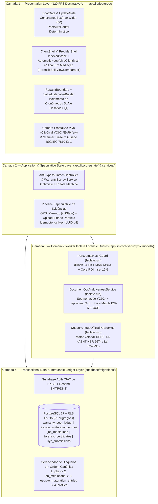
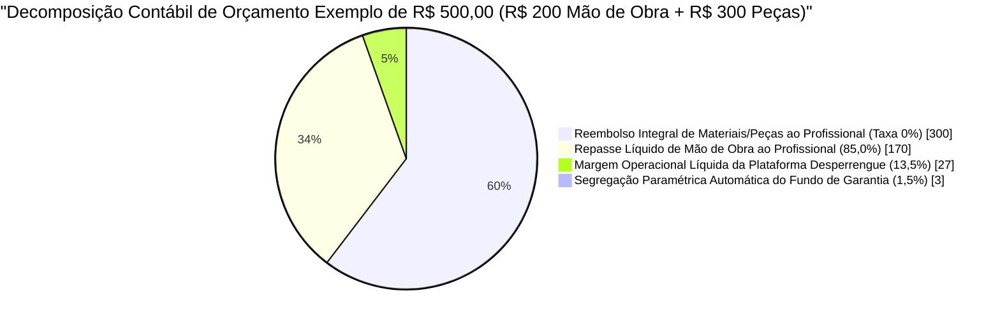
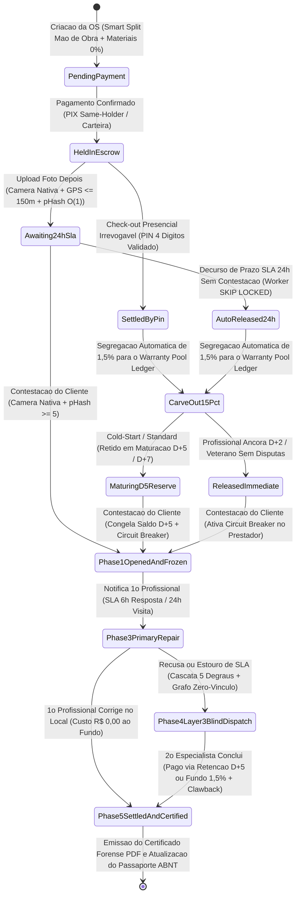
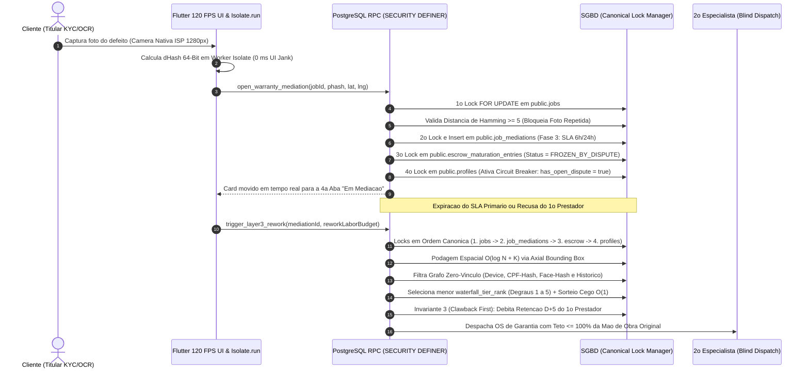

# Desperrengue — Ecossistema Distribuído Multi-Modo com Custódia Financeira em 3 Camadas, Motor Antifraude $O(1) / O(\log N)$ e Visão Computacional In-App (`v2.8.1`)

[](https://github.com/WagnerxOliveira/DesperrengueApp_TAI3/actions/workflows/ci.yml)
[](https://flutter.dev)
[](https://supabase.com)
[](app/test/)
[](supabase/tests/)

Tratado executivo, arquitetural e algorítmico da plataforma **Desperrengue**: uma arquitetura distribuída multi-modo (*Client $\leftrightarrow$ Provider Dual-Role Ecosystem*) voltada à intermediação de serviços residenciais sob demanda e de urgência, estruturada sobre **Particionamento Orçamentário Assimétrico (*Anti-Bypass Smart Split*)**, **Custódia Financeira Condicional Transacional em 3 Camadas (*3-Layer Self-Sustaining Warranty Escrow*)**, **Prova de Vida Biométrica Ativa Desafio-Resposta (*Active Challenge-Response Facial Liveness Detection*)**, **Scanner Documental Guiado ISO/IEC 7810 ID-1 com Reconhecimento Óptico de Caracteres (*OCR*)** e **Passaporte Oficial de Manutenção do Imóvel (ABNT NBR 5674 / Lei Federal nº 8.245/91)**.

---

## Sumário Sistemático

1. [Caracterização Sistêmica e Tese Computacional do Desperrengue](#1-caracterização-sistêmica-e-tese-computacional-do-desperrengue)
2. [Arquitetura de Software em 4 Camadas Desacopladas e Engenharia Multiplataforma](#2-arquitetura-de-software-em-4-camadas-desacopladas-e-engenharia-multiplataforma)
3. [Engenharia Financeira em 3 Camadas e Invariantes do Livro-Razão](#3-engenharia-financeira-em-3-camadas-e-invariantes-do-livro-razão)
4. [Modelagem de Ameaças (Threat Modeling) e Mitigação dos 6 Vetores de Fraude (`RN-AF-01` a `RN-AF-14`)](#4-modelagem-de-ameaças-threat-modeling-e-mitigação-dos-6-vetores-de-fraude-rn-af-01-a-rn-af-14)
5. [Resolução do Paradoxo de Segurança do Marco Zero (`RN-MZ-01` a `RN-MZ-05`)](#5-resolução-do-paradoxo-de-segurança-do-marco-zero-rn-mz-01-a-rn-mz-05)
6. [Visão Computacional In-App, Biometria Facial Ao Vivo (Active Liveness) e OCR Documental](#6-visão-computacional-in-app-biometria-facial-ao-vivo-active-liveness-e-ocr-documental)
7. [Complexidade de Algoritmos (Big-O), Indexação e Controle de Concorrência Sem Deadlocks](#7-complexidade-de-algoritmos-big-o-indexação-e-controle-de-concorrência-sem-deadlocks)
8. [Convergência Sistêmica: Unificação Multi-Modo, Passaporte ABNT NBR 5674 e LGPD](#8-convergência-sistêmica-unificação-multi-modo-passaporte-abnt-nbr-5674-e-lgpd)
9. [Ecossistema Funcional Completo e Árvore do Repositório](#9-ecossistema-funcional-completo-e-árvore-do-repositório)
10. [Guia de Provisionamento, Execução Local, Testes Formais e Deploy](#10-guia-de-provisionamento-execução-local-testes-formais-e-deploy)

---

## 1. Caracterização Sistêmica e Tese Computacional do Desperrengue

Mercados digitais bilaterais (*Two-Sided Marketplaces*) dedicados a reparos e manutenções domiciliares enfrentam historicamente três patologias estruturais documentadas na literatura de Economia da Informação e Sistemas Distribuídos: (a) **Seleção Adversa pré-contratual** (Modelo de Akerlof), decorrente da ausência de verificação biométrica e documental determinística de clientes e prestadores; (b) **Evasão Transacional (*Platform Leakage / Bypass*)**, provocada pela incidência de comissões lineares abusivas sobre o reembolso de peças e insumos; e (c) **Risco Moral pós-execução**, em que o pagamento instantâneo desprotegido inviabiliza a execução de garantias técnicas em casos de vício oculto.

O **Desperrengue** soluciona matematicamente essas três patologias mediante a integração de **três pilares de inovação arquitetural**:

1. **Particionamento Orçamentário Assimétrico (*Anti-Bypass Smart Split*)**: Decomposição estrita do vetor de preço da Ordem de Serviço (OS) em componente tributável de mão de obra (`labor_amount`, sujeito à alíquota paramétrica total de $15,0\%$, sendo $13,5\%$ de margem operacional líquida e $1,5\%$ de provisão atuarial) e componente neutro de reembolso de peças/insumos comprovados fiscalmente (`materials_amount`, sujeito à **alíquota de $0,0\%$**), eliminando o incentivo econômico à desintermediação.
2. **Fundo Autossustentável de Garantia em 3 Camadas (*3-Layer Self-Sustaining Warranty Escrow*)**: Máquina de estados finitos determinística (DFSM) que acopla a custódia integral do valor na **Camada 1** (`LOCKED_100` e fila de maturação `escrow_maturation_entries`), a janela de **Retorno Técnico Prioritário com SLA de 6h/24h** na **Camada 2**, e o **Despacho Algorítmico Cego Ponderado no Servidor (*Server-Side Single-Target Blind Dispatch*)** de um segundo especialista remunerado pelo livro-razão imutável `warranty_pool_ledger` com recuperação por *Clawback* na **Camada 3**.
3. **Passaporte Oficial de Manutenção do Imóvel (ABNT NBR 5674 / Lei nº 8.245/91) e Triagem Multimodal em 60 Segundos**: Conversão de cada intervenção auditada por *hashing* perceptual (`dHash` 64-bit) e geolocalização fina em certidão técnica imutável exportável em `%PDF-1.4` vetorial, precedida por contenção emergencial assistida por ditado de voz e triagem estruturada.

### 1.1. Blueprint da Topologia Multi-Modo Unificada (*Client $\leftrightarrow$ Provider Dual-Role*)

```text
┌──────────────────────────────────────────────────────────────────────────────────────────┐
│                 ENTIDADE BASE UNIFICADA: public.profiles (id = auth.uid())               │
│  ┌──────────────────────────────────────────┬─────────────────────────────────────────┐  │
│  │ ATRIBUTOS CIVIS E BIOMÉTRICOS (MÓDULO 11)│ ATRIBUTOS DE CONFIANÇA E CARTEIRA O(1)  │  │
│  │ • cpf_hash (SHA-256 + Pepper Único)      │ • external_trust_score (RTS ∈ [0, 100]) │  │
│  │ • face_liveness_hash (128-D L2 Norm)     │ • waterfall_tier_rank (Degraus 1 .. 5)  │  │
│  │ • liveness_verified & ocr_verified       │ • available_wallet_balance (PIX Livre)  │  │
│  │ • pix_key_cpf_matched (Same-Holder Lock) │ • maturing_wallet_balance (Reserva D+N) │  │
│  └────────────────────┬─────────────────────┴────────────────────┬────────────────────┘  │
│                       │      COMPARTILHAMENTO INSTANTÂNEO        │                       │
│                       ▼              (+30 pts RTS)               ▼                       │
│  ╔══════════════════════════════════════════╗ ╔═══════════════════════════════════════╗  │
│  ║       PAPEL 1: MODO CLIENTE ATIVO        ║ ║     PAPEL 2: MODO PROFISSIONAL ATIVO  ║  │
│  ║ • Solicita OS em 33 Categorias           ║ ║ • Recebe Chamados via Bounding Box    ║  │
│  ║ • Triagem por Voz + Contenção 60s        ║ ║ • Envia Orçamento Smart Split (0% Mat)║  │
│  ║ • Aprova Serviço com PIN de 4 Dígitos    ║ ║ • Check-in/Out GPS <= 150m + dHash    ║  │
│  ║ • Emite Passaporte ABNT NBR 5674 (PDF)   ║ ║ • Elegível a Socorrista da Camada 3   ║  │
│  ╚══════════════════════════════════════════╝ ╚═══════════════════════════════════════╝  │
└──────────────────────────────────────────────────────────────────────────────────────────┘
```

---

## 2. Arquitetura de Software em 4 Camadas Desacopladas e Engenharia Multiplataforma

O sistema implementa separação estrita de responsabilidades em quatro camadas concêntricas, obedecendo ao princípio de inversão de dependência e garantindo orçamento de renderização compatível com taxas de atualização de $60\text{ Hz}$ ($16,67\text{ ms}$) a $120\text{ Hz}$ ($8,33\text{ ms}$):



### 2.1. Especificação Técnica por Camada

1. **Camada 1 — *Presentation Layer* ([`app/lib/main.dart`](app/lib/main.dart), [`app/lib/features/`](app/lib/features/))**:
   - **Trava Responsiva Centralizada (`480px`)**: Toda a árvore visual em [`app/lib/main.dart`](app/lib/main.dart) é contida por um `ConstrainedBox(constraints: BoxConstraints(maxWidth: 480))` associado aos portões de inicialização paralela [`BootGate`](app/lib/features/boot/boot_gate.dart) e [`UpdateGate`](app/lib/features/boot/update_gate.dart) e ao roteador determinístico [`PostAuthRouter`](app/lib/features/auth/presentation/post_auth_router.dart).
   - **Isolamento de Subárvore de Pintura**: Cronômetros regressivos de SLA e indicadores de prova de vida operam encapsulados em `RepaintBoundary` e `ValueListenableBuilder`, garantindo que a marcação de redesenho (*dirty flag*) atinja exclusivamente o nó folha em $O(1)$.
   - **Engenharia PWA e Ícones Adaptativos**: O manifesto [`app/web/index.html`](app/web/index.html) implementa meta tags de tela cheia para iOS/Android, enquanto os ícones adaptativos obedecem rigorosamente à **Safe-Zone central de $57\%\text{–}66\%$** ($66 \times 66\text{ dp}$ dentro do viewport $108 \times 108\text{ dp}$).
2. **Camada 2 — *Application & Speculative State Layer* ([`app/lib/core/services/warranty_escrow_service.dart`](app/lib/core/services/warranty_escrow_service.dart), [`app/lib/core/state/anti_bypass_fintech_controller.dart`](app/lib/core/state/anti_bypass_fintech_controller.dart))**:
   - Pré-aquecimento do sensor GNSS na abertura do modal de conclusão e transmissão paralela em *background* com `idempotency_key` (`UUID v4`), reduzindo a latência percebida de confirmação de check-out de $\sim 3.500\text{ ms}$ para $< 50\text{ ms}$.
3. **Camada 3 — *Domain & Worker Isolate Forensic Guards* ([`app/lib/core/security/perceptual_hash_guard.dart`](app/lib/core/security/perceptual_hash_guard.dart), [`app/lib/core/services/document_ocr_and_liveness_service.dart`](app/lib/core/services/document_ocr_and_liveness_service.dart))**:
   - Execução concorrente fora da *Main UI Thread* via `Isolate.run` combinada com *downsampling* no *Image Signal Processor* (ISP) para $1280 \times 1280\text{ px}$ ($\le 6,5\text{ MB}$ de *heap*), mantendo $0\text{ ms}$ de *UI Jank*.
4. **Camada 4 — *Transactional Data & Immutable Ledger Layer* ([`supabase/migrations/`](supabase/migrations/))**:
   - **21 migrações SQL idempotentes** gobernadas por *Row Level Security* (RLS) e funções PL/pgSQL `SECURITY DEFINER` com `SET search_path = public`.

---

## 3. Engenharia Financeira em 3 Camadas e Invariantes do Livro-Razão

Implementada na migração [`20261108110000_high_perf_warranty_antifraud_engine.sql`](supabase/migrations/20261108110000_high_perf_warranty_antifraud_engine.sql) e modelada em [`fintech_warranty_models.dart`](app/lib/core/models/fintech_warranty_models.dart), a arquitetura financeira opera sob **Particionamento Orçamentário Assimétrico (*Anti-Bypass Smart Split*)**:



### 3.1. Equações Fundamentais do Smart Split e Equilíbrio Atuarial

Seja $V_{\text{MãoDeObra}} \ge 0$ (`labor_amount`) o valor contratado de mão de obra e $V_{\text{Materiais}} \ge 0$ (`materials_amount`) o reembolso de materiais comprovados por documento fiscal:

$$\text{GMV}_{\text{Total}} = V_{\text{MãoDeObra}} + V_{\text{Materiais}}, \quad \text{Taxa}_{\text{Op}} = \lfloor 0,135 \cdot V_{\text{MãoDeObra}} \rceil_2, \quad \text{Reserva}_{\text{Garantia}} = \lfloor 0,015 \cdot V_{\text{MãoDeObra}} \rceil_2$$

$$\text{Repasse}_{\text{LíquidoPrestador}} = \left(V_{\text{MãoDeObra}} - \text{Taxa}_{\text{Op}} - \text{Reserva}_{\text{Garantia}}\right) + 100\% \cdot V_{\text{Materiais}}$$

O ponto de equilíbrio atuarial ($N_{\text{equilíbrio}}$) da **Segregação Paramétrica Automática de Liquidez (*1,5% Actuarial Carve-out*)** para cobertura integral de um retrabalho de mesmo valor médio de mão de obra $\bar{V}_{\text{MãoDeObra}}$ é dado por:

$$N_{\text{equilíbrio}} = \frac{100\%}{1,5\%} = \frac{1}{0,015} = 66,67 \approx 67 \text{ transações concluídas por sinistro integral}$$

### 3.2. Matriz Normativa das 3 Camadas de Garantia (`RN-CAM-01` a `RN-CAM-03`)

| Camada Normativa | Regra | Janela e Escopo | Mecanismo Transacional no PostgreSQL |
| :--- | :---: | :--- | :--- |
| **Camada 1 — Custódia Financeira Condicional e Maturação Programada** | `RN-CAM-01` | $100\%$ retido na execução + fila de maturação $D+7$ (*Trainee*), $D+5$ (*Standard*) ou $D+2$ (*Verified Anchor*) | A função `complete_job_and_schedule_escrow` valida o PIN presencial de 4 dígitos (ou agenda *Auto-Release* de 24h) e invoca `settle_escrow_with_carveout_and_maturation`, inserindo o crédito em `public.escrow_maturation_entries` (`maturation_status = 'MATURING'`). |
| **Camada 2 — Retorno Técnico Prioritário e Segregação Atuarial de 1,5%** | `RN-CAM-02` | Garantia de **90 dias** (`warranty_expires_at`) com **SLA de 6 horas** para resposta e **24 horas** para reparo | A função `open_warranty_mediation` congela instantaneamente a maturação (`FROZEN_BY_DISPUTE`), ativa o *Circuit Breaker* no prestador (`has_open_dispute = TRUE`) e instancia a disputa em `public.job_mediations` na fase `PHASE_3_ORIGINAL_PROVIDER_SLA_6H`. |
| **Camada 3 — Despacho Algorítmico Cego e Cobertura via *Clawback First*** | `RN-CAM-03` | Acionamento imediato após recusa ou estouro do SLA de 6h/24h da Camada 2 | A função `trigger_layer3_rework` seleciona um segundo especialista via podagem espacial $O(\log N + K)$ e Grafo Zero-Vínculo, executa o estorno prioritário (*Clawback*) da retenção em maturação (`CLAWED_BACK`) ou debita `public.warranty_pool_ledger` (`REWORK_PAYOUT_DEBIT` limitado a $100\%$ de `labor_amount`), lançando eventual saldo residual em `clawback_debt_balance`. |

### 3.3. Máquina de Estados Finitos Determinística do Smart Escrow e das 5 Fases da Aba "Em Mediação"



### 3.4. As 4 Invariantes Contábeis Declarativas do PostgreSQL

1. **Invariante 1 — Teto Estrito de Cobertura de Retrabalho (`chk_invariant_1_coverage_cap`)**: Nenhum débito de retrabalho (`REWORK_PAYOUT_DEBIT`) em `public.warranty_pool_ledger` pode exceder $100\%$ do valor de mão de obra da OS original (`amount <= labor_reference_cap`).
2. **Invariante 2 — Disjunção Estrita de Identidade na Camada 3 (`chk_invariant_2_identity_disjunction`)**: O profissional socorrista (`rescuer_provider_id`) deve ser matematicamente distinto do prestador original infrator (`original_provider_id`) e do cliente (`client_id`).
3. **Invariante 3 — Prioridade de *Clawback* antes da Mutualização (*Clawback First*)**: Na execução de `trigger_layer3_rework`, o sistema absorve prioritariamente o saldo retido em `escrow_maturation_entries` (`CLAWED_BACK`) e o `available_wallet_balance` do prestador infrator antes de lançar passivo residual em `clawback_debt_balance`, protegendo a liquidez livre do fundo.
4. **Invariante 4 — Idempotência Transacional Estrita**: A restrição `UNIQUE (idempotency_key)` em `public.warranty_pool_ledger` e `UNIQUE (job_id)` em `public.escrow_maturation_entries` garante que retentativas de rede jamais produzam duplicidade de liquidação ou débito.

---

## 4. Modelagem de Ameaças (Threat Modeling) e Mitigação dos 6 Vetores de Fraude (`RN-AF-01` a `RN-AF-14`)

A tabela abaixo especifica os **6 vetores de ataque** modelados contra sistemas de custódia e garantia e as **14 travas determinísticas (`RN-AF-01` a `RN-AF-14`)** codificadas nas camadas de banco de dados e visão computacional:

| Vetor de Ataque | Regras Normativas | Mecanismo Algorítmico e Criptográfico de Mitigação |
| :--- | :---: | :--- |
| **1. Conluio Triplo (*Cash-Out* do Fundo Garantidor)** | `RN-AF-01` a `RN-AF-04` | Proibição absoluta de saque em espécie da reserva de garantia pelo cliente; **Despacho Algorítmico Cego Ponderado no Servidor** (`hashtextextended(p.id::TEXT \|\| p_mediation_id::TEXT, 0)`); **Podagem por Disjunção em Grafo de Afinidade e Telemetria** verificando desigualdade estrita de `device_fingerprint_hash`, `cpf_hash`, `face_liveness_hash` e histórico cruzado em `public.jobs`; penalidade automática de $-50\text{ pts}$ no $RTS$ e inscrição em `clawback_debt_balance`. |
| **2. Sequestro de Escrow e Sabotagem Pós-Serviço** | `RN-AF-05` a `RN-AF-07` | Obrigatoriedade de **Check-in e Check-out Fotográfico Geolocalizado** ($\le 150\text{ m}$ do imóvel) com selo `forensic_certificates`; liquidação imediata mediante **PIN Presencial de 4 Dígitos** (`crypt(p_client_pin_plain, checkout_pin_hash)`) ou liberação automática em **24 horas** (`auto_release_at`) na ausência de contestação fundamentada. |
| **3. Falso Defeito e Foto Reciclada / Baixada da Web** | `RN-AF-08` a `RN-AF-10` | **Imposição de Sensor Físico Nativo** (`ImageSource.camera`) bloqueando galeria e *Fake GPS* (`pos.isMocked`); cálculo em $O(1)$ da **Distância de Hamming de 64 bits** (`public.hamming_distance_64`) rejeitando qualquer imagem de conclusão ou defeito com distância $< 5\text{ bits}$ em relação às fotos anteriores (`ERR_DUPLICATE_FORENSIC_PHOTO` / `ERR_RECYCLED_CHECKOUT_PHOTO`). |
| **4. Evasão Fiscal e Superfaturamento de Materiais/Retrabalho** | `RN-AF-11`, `RN-AF-12` | Particionamento *Smart Split* com taxa de $0\%$ sobre materiais mediante nota fiscal e trava de teto na Camada 3 restrita a $100\%$ de `labor_amount` (`ERR_COVERAGE_CAP_EXCEEDED`). |
| **5. Quebra Atuarial em *Cold-Start* e Monopólio de Socorristas** | `RN-AF-13` | Janela de maturação estendida ($D+7$) para prestadores novatos (`TRAINEE` ou $< 3$ serviços), quarentena obrigatória de **24 horas** entre resgates de Camada 3 (`idx_jobs_rescuer_cooldown_24h`) e disjuntor automático `has_open_dispute = TRUE`. |
| **6. Ataque Sybil (Recriação de Contas por Inadimplentes)** | `RN-AF-14` | Indexação única global sobre o CPF salgado (`idx_profiles_cpf_hash_unique` com `DSP-CPF-PEPPER-2026`), indexação biométrica (`idx_profiles_face_liveness_hash`) e trava **Same-Holder PIX Lock** (`pix_key_cpf_matched = TRUE`). |

### 4.1. Prova Algébrica de Inviabilidade Econômica do Conluio (Prejuízo Líquido de $-15,0\%$)

Suponha que uma coalizão fraudulenta composta por um falso cliente $C$, um falso prestador primário $P_1$ e um cúmplice $P_2$ tente simular um serviço de mão de obra $L$ seguido de falso acionamento de garantia para drenar o Fundo Garantidor:

1. **Bloqueio de Direcionamento a $P_2$**: Na Camada 3, o cliente $C$ não escolhe o socorrista; a função `trigger_layer3_rework` filtra o grafo Zero-Vínculo (excluindo qualquer conta com mesmo `device_fingerprint_hash`, `cpf_hash`, `face_liveness_hash` ou histórico prévio) e seleciona o profissional via ordenação `waterfall_tier_rank ASC, external_trust_score DESC, hashtextextended(...) ASC`.
2. **Inversão da Fonte Pagadora (*Clawback First*)**: Como $P_1$ encontra-se na janela de maturação ($D+5$ ou $D+7$), seu repasse líquido de $0,85 \cdot L$ é integralmente confiscado (`maturation_status = 'CLAWED_BACK'`) para pagar o socorrista independente, além de gerar débito residual de $0,15 \cdot L$ em `clawback_debt_balance`.
3. **Resultado Esperado da Coalizão**: A quadrilha desembolsa $1,00 \cdot L$ no checkout, perde a retenção confiscada pelo *Clawback* e sofre retenção definitiva da taxa de plataforma de **$15,0\%$** ($13,5\%$ operacional + $1,5\%$ fundo), resultando em **prejuízo líquido determinístico de $-15,0\% \cdot L$** (ou $-12,0\%$ a $-15,0\%$ conforme a faixa promocional de *take rate*), tornando o ataque estritamente dominado em Teoria dos Jogos.

---

## 5. Resolução do Paradoxo de Segurança do Marco Zero (`RN-MZ-01` a `RN-MZ-05`)

Para operar com segurança máxima desde o **Dia 1** (mesmo quando a plataforma ainda possui zero prestadores veteranos), o sistema implementa **5 Pilares de *Cold-Start***:

| Código | Pilar do Marco Zero | Mecanismo Implementado no Código e no SGBD |
| :---: | :--- | :--- |
| `RN-MZ-01` | **Liquidação Escalonada com Reserva de Maturação (*Tiered Rolling Reserve*)** | Em `settle_escrow_with_carveout_and_maturation`, contas `VERIFIED_ANCHOR` maturam em **D+2**, contas `STANDARD` ($\ge 3$ serviços) maturam em **D+5** e contas `TRAINEE` ($< 3$ serviços) maturam em **D+7**, garantindo que a própria retenção do iniciante cubra eventuais vícios de execução. |
| `RN-MZ-02` | **Relative Trust Score ($RTS \in [0, 100]$) em $O(1)$** | Calculado pela função imutável `public.calculate_relative_trust_score`: soma $+30\text{ pts}$ por KYC Biométrico/OCR aprovado, $+20\text{ pts}$ por CNPJ/MEI ativo $\ge 6$ meses, $+20\text{ pts}$ por certificação técnica verificada (SENAI/CREA/CFT/NR-10/NR-35), até $+30\text{ pts}$ por histórico ($6\text{ pts/OS}$) e subtrai $-50\text{ pts}$ por garantia abandonada. |
| `RN-MZ-03` | **Cascata Hierárquica de 5 Degraus (`waterfall_tier_rank` 1 a 5)** | Mantida em $O(1)$ pela trigger `trg_sync_profile_trust_and_rank`: **Degrau 1** (`is_trusted_anchor = TRUE`), **Degrau 2** ($\ge 5$ serviços e $0$ abandonos), **Degrau 3** ($1\text{ a }4$ serviços e $0$ abandonos), **Degrau 4** ($0$ serviços, porém $RTS \ge 70$ via KYC + MEI + Certificação) e **Degrau 5** (demais contas). |
| `RN-MZ-04` | **Reserva Semente de *Bootstrapping* e *Circuit Breaker*** | Rubrica contábil `COLD_START_SEED_RESERVE` em `public.warranty_pool_ledger` combinada ao disjuntor `has_open_dispute = TRUE`, que congela saques e novos despachos do prestador no exato milissegundo da abertura de mediação. |
| `RN-MZ-05` | **Profissionais Âncora (`is_trusted_anchor`) e Quarentena de 24h** | Credenciamento técnico antecipado que habilita o Degrau 1 e 4 desde o Dia 1, protegido pelo índice parcial `idx_jobs_rescuer_cooldown_24h` que impede que o mesmo socorrista concentre múltiplos chamados de garantia em menos de 24h. |

---

## 6. Visão Computacional In-App, Biometria Facial Ao Vivo (Active Liveness) e OCR Documental

Implementado em [`client_setup_screen.dart`](app/lib/features/client/presentation/client_setup_screen.dart), [`document_ocr_and_liveness_service.dart`](app/lib/core/services/document_ocr_and_liveness_service.dart), [`perceptual_hash_guard.dart`](app/lib/core/security/perceptual_hash_guard.dart) e na migração [`20261108120000_client_kyc_biometrics_and_ocr.sql`](supabase/migrations/20261108120000_client_kyc_biometrics_and_ocr.sql), o pipeline de validação civil e biométrica executa-se **100% *on-device* em *Worker Isolates*** (custo marginal de API externa igual a $\text{R\$ } 0,00$).

### 6.1. Blueprint Antropométrico da Câmera Frontal Ao Vivo na Moldura Oval (*Active Liveness*)

```text
┌──────────────────────────────────────────────────────────────────────────────────────────┐
│ VIEWFINDER DE CÂMERA FRONTAL AO VIVO (WEB WEBRTC FACINGMODE: USER / MOBILE FRONT LENS)   │
│                                                                                          │
│                        ╭──────────────────────────────╮                                  │
│                    ╭───╯   ZONA DE TOPOLOGIA FACIAL   ╰───╮                              │
│                  ╭─╯   Crominância Pele YCbCr: 22%–82%    ╰─╮                            │
│                  │                                          │                            │
│                  │       p2  p3                p2  p3       │                            │
│                  │    p1 ( ● ) p4   │Ponte│ p1 ( ● ) p4     │ ◄── Razão Ocular (EAR)     │
│                  │       p6  p5     │Nasal│    p6  p5       │     Piscada: EAR < 0,18    │
│                  │                     ▼                    │     Retorno: EAR > 0,25    │
│                  │            ◄─── Eixo Yaw (θ_y) ───►      │                            │
│                  │             Desafio: θ_y ≥ +18,0°        │ ◄── Rotação 3D (Yaw)       │
│                  ╰─╮           Retorno: |θ_y| ≤ 6,0°      ╭─╯                            │
│                    ╰───╮     Luminância: 42 ≤ L ≤ 230 ╭───╯                              │
│                        ╰──────────────────────────────╯                                  │
│                                                                                          │
│ ▶ Bloqueio Anti-Monitor/Parede: Sem crominância epidérmica YCbCr + simetria = 0% avanço  │
│ ▶ Captura Automática no Retorno ao Centro ⇒ Assinatura Criptográfica DSP-LIVE-SHA256     │
└──────────────────────────────────────────────────────────────────────────────────────────┘
```

### 6.2. Blueprint Geométrico do Scanner Documental ISO/IEC 7810 ID-1, Recorte ROI (*Core Inset 12%*) e Alinhamento Multi-Orientação

```text
┌──────────────────────────────────────────────────────────────────────────────────────────┐
│ CÂMERA TRASEIRA IN-APP (AMBIENTE EXTERNO DESCARTADO: MESA DE MADEIRA / MONITOR / BORDAS) │
│  ╔════════════════════════════════════════════════════════════════════════════════════╗  │
│  ║ MOLDURA RETANGULAR VAZADA ISO/IEC 7810 ID-1 (STRICT ROI CROP - PROPORÇÃO 1,586:1)  ║  │
│  ║  ┌ ─ ─ ─ ─ ─ ─ ─ ─ ─ ─ ─ ─ ─ ─ ─ ─ ─ ─ ─ ─ ─ ─ ─ ─ ─ ─ ─ ─ ─ ─ ─ ─ ─ ─ ─ ─ ─ ─ ─ ┐ ║  │
│  ║  │ CORE INSET DE SEGURANÇA (12% DE MARGEM INTERNA PARA CÁLCULO DHASH + MAD)      │ ║  │
│  ║  │  ┌──────────────┐   REPÚBLICA FEDERATIVA DO BRASIL - SENATRAN / DETRAN / SSP  │ ║  │
│  ║  │  │   FOTO 3×4   │   NOME CIVIL: [EXTRAÍDO VIA OCR MULTI-ORIENTAÇÃO]           │ ║  │
│  ║  │  │  DO TITULAR  │   DOC IDENTIDADE / ÓRGÃO EMISSOR / UF                       │ ║  │
│  ║  │  │ (128-D L2    │   CPF: ###.###.###-## (VALIDADO MÓDULO 11 == ETAPA 1)       │ ║  │
│  ║  │  │ Não-Negativo)│   DATA NASCIMENTO: DD/MM/AAAA      Nº REGISTRO CNH/RG/CIN   │ ║  │
│  ║  │  └──────────────┘                                                             │ ║  │
│  ║  │  [DETECÇÃO E ROTAÇÃO CANÔNICA AUTOMÁTICA: 0° | 90° | 180° | 270°]             │ ║  │
│  ║  └ ─ ─ ─ ─ ─ ─ ─ ─ ─ ─ ─ ─ ─ ─ ─ ─ ─ ─ ─ ─ ─ ─ ─ ─ ─ ─ ─ ─ ─ ─ ─ ─ ─ ─ ─ ─ ─ ─ ─ ┘ ║  │
│  ╚════════════════════════════════════════════════════════════════════════════════════╝  │
│ ▶ Regra Anti-Falso-Positivo: Duplicidade Frente×Verso exige dHamming(dHash) e MAD_64x64  │
│ ▶ Regra Face Match 1:1: Vetor 128-D Não-Negativo (A_k ≥ 0, B_k ≥ 0) ⇒ S_cos ∈ [0%, 100%] │
└──────────────────────────────────────────────────────────────────────────────────────────┘
```

### 6.3. As 4 Etapas Determinísticas do `ClientSetupScreen`

1. **Etapa 1 — Identificação Civil e Validação Aritmética Módulo 11**: Coleta Nome Civil composto, Telefone obrigatório com DDD (sem o sufixo opcional) e CPF obrigatório submetido em tempo real e no banco (`public.is_valid_cpf`) ao cálculo dos dois dígitos verificadores Módulo 11.
2. **Etapa 2 — Localização Georreferenciada (`AddressForm`)**: Autopreenchimento via CEP (ViaCEP) e coordenadas geográficas que alimentam o filtro espacial e o Passaporte do Imóvel.
3. **Etapa 3 — Prova de Vida Biométrica Ativa Desafio-Resposta (`ActiveLivenessStep`)**: Fluxo ao vivo exclusivo da lente frontal dentro da moldura oval (`ClipOval`), exigindo progressão nos 4 estágios (`centerFaceInOval` $\to$ `blinkBothEyesSlowly` com queda de $\text{EAR} < 0,18$ e retorno $> 0,25$ $\to$ `turnHeadRight` com $|\theta_y| \ge 18^\circ$ $\to$ `returnHeadToCenterAndCapture`) e reprovando monitores LCD/OLED (`blueMonitorRatio < 0,25`).
4. **Etapa 4 — Scanner Documental ISO/IEC 7810 ID-1, Face Match Multi-Ângulo e OCR Visível**:
   - Recorta o **Core ROI Inset de 12%** (`PerceptualHashGuard.cropCoreRoiInset`) para eliminar fundos de madeira ou bancadas antes de aferir a distinção estrutural entre Frente e Verso (`dHash` 64-bit + $\text{MAD}_{64\times 64}$ + variância de quadrantes).
   - Avalia a nitidez pela variância do operador Laplaciano $3\times 3$ ($\sigma_{\text{Lap}}^2 \ge 110,0$) e saturação especular ($\le 8,5\%$).
   - Executa o **Face Match 1:1 Multi-Orientação ($0^\circ, 90^\circ, 180^\circ, 270^\circ$)** sobre a janela $3\times 4$ do documento com vetores de características estritamente não-negativos de 128 dimensões ($A_k \ge 0, B_k \ge 0 \implies S_{\cos} \in [0\%, 100\%]$), exigindo $S_{\cos} \ge 78,0\%$.
   - Renderiza em tela o card de **Transcrição Automática via OCR** (Nome Civil, CPF, RG/CNH, Órgão Emissor e Data de Nascimento) e homologa via RPC `public.submit_client_kyc`.

---

## 7. Complexidade de Algoritmos (Big-O), Indexação e Controle de Concorrência Sem Deadlocks

### 7.1. Matriz Comparativa *Big-O* Ingênuo vs. *Big-O* Otimizado no Desperrengue

| Subsistema / Operação | Implementação Ingênua | Implementação Desperrengue | Ganho Estrutural e Mecanismo |
| :--- | :---: | :---: | :--- |
| **Busca Geoespacial e Cascata Camada 3** | $O(N \log N)$ (Haversine em todas as $N$ tuplas + `SORT`) | **$O(\log N + K)$** | **Podagem Espacial por Caixa Delimitadora Axial (*Axial Bounding Box*)** sobre o índice B-Tree parcial `idx_profiles_rescue_waterfall_bbox` antes de avaliar Haversine apenas nos $K \ll N$ candidatos locais. |
| **Distância de Hamming de 64 Bits (`dHash`)** | $O(64)$ por string binária ou $O(W \cdot H)$ por imagem | **$O(1)$ estrito** | Operação bitwise `XOR` (`hash_a # hash_b`) acoplada ao algoritmo de limpeza do bit menos significativo de *Brian Kernighan* (`x := x & (x - 1)` em PL/pgSQL e Dart). |
| **Leitura de Score $RTS$ e Degrau da Cascata** | $O(L)$ (agregação histórica sobre $L$ linhas de serviços/disputas) | **$O(1)$ estrito** | Desnormalização controlada de `completed_jobs_count` e `abandoned_warranty_count` mantida pela trigger `BEFORE INSERT OR UPDATE` `trg_sync_profile_trust_and_rank`. |
| **Verificação Anti-Sybil (CPF e Face)** | $O(N)$ (varredura sequencial) | **$O(\log N) \approx O(1)$** | Índices B-Tree parciais `idx_profiles_cpf_hash_unique` e `idx_profiles_face_liveness_hash`. |
| **Processamento de Filas Autônomas (24h / D+N)** | $O(S)$ com bloqueio de tabela | **$O(B \log S)$ sem contenção** | Lote fixo ($B = 100$) via `FOR UPDATE SKIP LOCKED LIMIT 100` sobre `idx_jobs_auto_release_queue` e `idx_escrow_maturation_queue`. |

### 7.2. Equação de Podagem Espacial por Caixa Delimitadora Axial (*Axial Bounding Box*)

Dado o ponto central do imóvel $(\text{lat}_0, \text{lng}_0)$ e o raio máximo de busca $R_{\text{km}} = 15,0\text{ km}$, calculam-se os semieixos angulares:

$$\Delta\text{lat} = \frac{R_{\text{km}}}{111,32}, \qquad \Delta\text{lng} = \frac{R_{\text{km}}}{111,32 \times \max\big(0,10,\; |\cos(\text{rad}(\text{lat}_0))|\big)}$$

O predicado indexado filtra `last_latitude BETWEEN (lat_0 - Δlat) AND (lat_0 + Δlat)` e `last_longitude BETWEEN (lng_0 - Δlng) AND (lng_0 + Δlng)` em $O(\log N)$, aplicando a distância ortodrômica esférica de Haversine exclusivamente sobre as $K$ tuplas sobreviventes:

$$d_{\text{Haversine}} = 2 \cdot 6371,0 \cdot \arcsin\left(\sqrt{\sin^2\left(\frac{\text{rad}(\text{lat}_p - \text{lat}_0)}{2}\right) + \cos(\text{rad}(\text{lat}_0))\cos(\text{rad}(\text{lat}_p))\sin^2\left(\frac{\text{rad}(\text{lng}_p - \text{lng}_0)}{2}\right)}\right) \le R_{\text{km}}$$

### 7.3. Ordem Canônica de Bloqueios Pessimistas e Prova de Ausência de Deadlocks

Todas as RPCs transacionais adquirem bloqueios de linha (`SELECT ... FOR UPDATE`) respeitando estritamente a ordem parcial topológica $R_1 \prec R_2 \prec R_3 \prec R_4$:

$$\texttt{1º public.jobs} \longrightarrow \texttt{2º public.job\_mediations} \longrightarrow \texttt{3º public.escrow\_maturation\_entries} \longrightarrow \texttt{4º public.profiles}$$



---

## 8. Convergência Sistêmica: Unificação Multi-Modo, Passaporte ABNT NBR 5674 e LGPD

1. **Interoperabilidade Cadastral Multi-Modo (`+30 pts` imediatos no $RTS$)**: Quando um cliente validado por Prova de Vida Ao Vivo e OCR ativa o modo Profissional, a trigger `trg_sync_profile_trust_and_rank` reconhece `liveness_verified AND ocr_verified` e atribui instantaneamente os $+30,0\text{ pontos}$ de identidade civil ao seu `external_trust_score`.
2. **Trava Bancária *Same-Holder PIX Lock***: A aprovação do CPF no onboarding define `pix_key_cpf_matched = TRUE` e vincula `cpf_hash`, impedindo que saques ou reembolsos sejam direcionados a contas bancárias de terceiros ("contas laranja").
3. **Passaporte Oficial de Manutenção do Imóvel ([`desperrengue_official_pdf_service.dart`](app/lib/core/services/desperrengue_official_pdf_service.dart))**: Opera sob a diretriz *Zero Fake Data* — exibe uma jornada educativa interativa para imóveis recém-cadastrados e, à medida que serviços reais são concluídos e auditados com `forensic_certificates`, compila em *Worker Isolate* um laudo técnico `%PDF-1.4` compatível com a **ABNT NBR 5674** e a **Lei Federal nº 8.245/91**.
4. **Exclusão Escopada LGPD (`delete_own_account_scoped`)**: Permite revogar isoladamente o papel `client` ou `provider` com anonimização criptográfica de PII, preservando a integridade contábil do livro-razão.

---

## 9. Ecossistema Funcional Completo e Árvore do Repositório

```text
00_Desperrengue/
├── README.md                                  # Tratado Executivo e Arquitetural Mestre (Raiz)
├── LICENSE.md                                 # Governança Jurídica, Propriedade Intelectual e LGPD
├── .github/
│   ├── workflows/                             # Pipelines CI/CD (ci.yml e beta-release.yml)
│   ├── SECURITY.md                            # Política de Defesa em Profundidade e Matriz RN-AF-01..14
│   └── CONTRIBUTING.md                        # Padrões de Engenharia, Regra Zero e Definition of Done
├── app/                                       # Aplicação Multiplataforma Flutter 3.47 (Android, iOS, PWA)
│   ├── README.md                              # Manual de Engenharia Client-Side (120 FPS, Isolates, Safe-Zone)
│   ├── lib/
│   │   ├── main.dart                          # BootGate, UpdateGate e Container Responsivo 480px
│   │   ├── core/
│   │   │   ├── models/                        # Modelos de Domínio e Fintech (fintech_warranty_models.dart)
│   │   │   ├── security/                      # PerceptualHashGuard (dHash 64-bit, Core ROI Inset 12%)
│   │   │   ├── services/                      # DocumentOcrAndLivenessService, WarrantyEscrowService, PDF %PDF-1.4
│   │   │   ├── state/                         # Controllers Riverpod e AntiBypassFintechController
│   │   │   └── ui/                            # Design System Quiet Luxury Dark e Tokens Visuais
│   │   └── features/
│   │       ├── auth/presentation/             # AuthGate, PostAuthRouter e Verificação Profissional (Steps 1..7)
│   │       ├── boot/                          # AnimatedSplashScreen, BootGate e UpdateGate
│   │       ├── client/presentation/           # ClientSetupScreen (4 Etapas), Carteira, Passaporte e Pedidos
│   │       ├── provider/presentation/         # ProviderShell, Execução Forense, Carteira Bipartida e Dossiê
│   │       └── shared/presentation/           # 4ª Aba Em Mediação, ForensicSplitViewComparator e PIN 4 Dígitos
│   └── test/                                  # 26 Suítes Automatizadas (529 Testes Unitários, Widget e Red Team)
├── supabase/
│   ├── README.md                              # Catálogo do SGBD, 21 Migrações, 9 Índices e RPCs SECURITY DEFINER
│   ├── migrations/                            # 21 Migrações SQL (incluindo Garantia 3 Camadas e KYC/OCR)
│   └── tests/                                 # 9 Suítes de Contrato SQL (577 Asserções Formais)
├── scripts/                                   # Verificadores Automatizados (check-md-links.mjs e test-dossie.mjs)
└── docs/                                      # Biblioteca Técnico-Científica Completa (20 Documentos + 5 Subpastas)
```

### 9.1. Índice Clicável da Biblioteca Científica em [`/docs/`](docs/)

| # | Documento Especializado | Escopo Técnico-Científico |
| :---: | :--- | :--- |
| `01` | [`docs/README.md`](docs/README.md) | Catálogo Sistemático, Taxonomia Documental e Matriz de Leitura por Perfil |
| `02` | [`docs/ARCHITECTURE.md`](docs/ARCHITECTURE.md) | Decomposição das 4 Camadas, Provas Algébricas *Big-O*, *Worker Isolates* a 120 Hz e Grafo Sem Deadlocks |
| `03` | [`docs/Arquitetura do Sistema.md`](docs/Arquitetura%20do%20Sistema.md) | Topologia Distribuída, Dicionário de Dados SQL Completo, 9 Índices e Catálogo de RPCs |
| `04` | [`docs/Especificação do Projeto.md`](docs/Especifica%C3%A7%C3%A3o%20do%20Projeto.md) | Personas, User Stories, Requisitos `RF`/`RNF`, Regras `RN-CAM`, `RN-AF`, `RN-MZ`, `RN-KYC` e Matriz 1:1 |
| `05` | [`docs/Documento de Contexto.md`](docs/Documento%20de%20Contexto.md) | Problema, Solução, **Lean Canvas (9 Blocos)**, Missão/Visão/Valores, Seleção Adversa de Akerlof e Anti-Bypass |
| `06` | [`docs/Projeto de Interface.md`](docs/Projeto%20de%20Interface.md) | Sistema Visual *Quiet Luxury Dark*, Container `480px`, Wireframes Unicode e 4ª Aba *Em Mediação* |
| `07` | [`docs/onboarding_profissional.md`](docs/onboarding_profissional.md) | Tratado de Onboarding Unificado, Equações de Visão Computacional ($YCbCr$, EAR, Yaw, Laplaciano, 128-D) |
| `08` | [`docs/GAMIFICACAO.md`](docs/GAMIFICACAO.md) | Matemática do *Relative Trust Score* ($RTS$), Cascata de 5 Degraus e Velocidade de Liquidação |
| `09` | [`docs/Fluxo de Caixa.md`](docs/Fluxo%20de%20Caixa.md) | Equações de Fluxo de Caixa do *Smart Escrow*, Equilíbrio Atuarial ($N = 66,67$) e *Clawback* |
| `10` | [`docs/Planos de Negocio e Tributação.md`](docs/Planos%20de%20Negocio%20e%20Tributa%C3%A7%C3%A3o.md) | Engenharia Tributária do *Smart Split* (bitributação zero), Receitas B2C/B2B e *Unit Economics* |
| `11` | [`docs/Analise de Ambientes e SWOT.md`](docs/Analise%20de%20Ambientes%20e%20SWOT.md) | Análise PESTEL, 5 Forças de Porter e Matriz SWOT Cruzada com Barreiras Tecnológicas |
| `12` | [`docs/Balanced Scorecard (BSC).md`](docs/Balanced%20Scorecard%20(BSC).md) | Mapa Estratégico de Causa-Efeito nas 4 Perspectivas e KPIs Telemetrizados em SQL |
| `13` | [`docs/TESTING.md`](docs/TESTING.md) | Verificação Formal (`529` testes Dart, `577` asserções SQL) e Detalhamento dos 12 Testes *Red Team* |
| `14` | [`docs/TESTE_COM_AMIGOS.md`](docs/TESTE_COM_AMIGOS.md) | Protocolo de Homologação Empírica em Campo para Smartphones Android e iOS |
| `15` | [`docs/SETUP.md`](docs/SETUP.md) | Guia de Provisionamento de Ambiente, Banco de Dados Supabase e Compilação Multiplataforma |
| `16` | [`docs/PLAY_STORE.md`](docs/PLAY_STORE.md) | Engenharia de Release Mobile, Permissões Nativas, LGPD Art. 11 (Biometria) e *Safe-Zone* |
| `17` | [`docs/registro_dominio_resend.md`](docs/registro_dominio_resend.md) | Infraestrutura de Mensageria Transacional SMTP e Autenticação Criptográfica DNS (DKIM/SPF/DMARC) |
| `18` | [`docs/ROADMAP.md`](docs/ROADMAP.md) | Cronograma Evolutivo de Engenharia (`gantt`), Marcos Concluídos e Horizontes B2B/IA |
| `19` | [`docs/CHANGELOG.md`](docs/CHANGELOG.md) | Registro Cronológico Auditável de Versões e Migrações SQL |
| `20` | [`docs/Template.md`](docs/Template.md) | Padrão Metadocumental Científico para Criação de Futuros Artefatos em Linguagem de Especialidade |
| `21` | [`docs/adr/README.md`](docs/adr/README.md) | Catálogo de 21 *Architecture Decision Records* (`ADR-0000` a [`ADR-0020`](docs/adr/0020-garantia-3-camadas-antifraude-e-kyc-biometrico-ocr.md)) |

---

## 10. Guia de Provisionamento, Execução Local, Testes Formais e Deploy

```powershell
# 1. Instalar dependências e validar análise estática (0 issues obrigatórios)
cd C:\00_Desperrengue\app
flutter pub get
flutter analyze

# 2. Executar as 26 suítes de testes automatizados (529 testes: Domínio, Widgets, Visão Computacional e Red Team)
flutter test

# 3. Executar especificamente a bateria Red Team de Fraude Financeira e Forense Biométrica/OCR
flutter test test/red_team_warranty_and_kyc_forensics_test.dart test/fintech_warranty_security_test.dart

# 4. Validar integridade de todos os links Markdown e motor de geração PDF na raiz
cd C:\00_Desperrengue
node scripts/check-md-links.mjs
node scripts/test-dossie.mjs

# 5. Compilar APK Release Android ou PWA Web com variáveis de ambiente
cd C:\00_Desperrengue\app
flutter build apk --release --dart-define-from-file=.env
flutter build web --release --dart-define-from-file=.env
```
