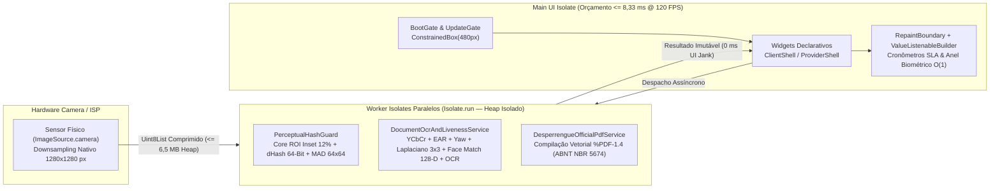
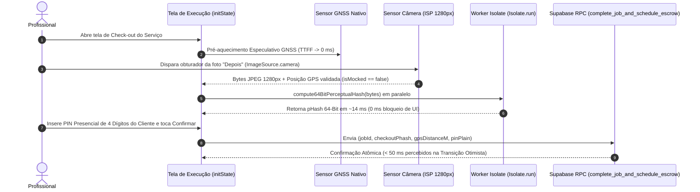

# Manual de Engenharia Client-Side (Flutter 3.47, Worker Isolates & PWA) — `app/README.md`

Especificação técnica da camada cliente multiplataforma do ecossistema **Desperrengue** (`v2.8.1+202611082`), detalhando a arquitetura interna de [`app/lib/`](lib/), o pipeline de renderização declarativa a $120\text{ FPS}$ ($8,33\text{ ms/frame}$), a execução paralela em *Worker Isolates* (`Isolate.run`), o pipeline especulativo de evidências (`SpeculativeEvidencePipeline`), as câmeras nativas/WebRTC in-app e a geometria matemática dos ícones adaptativos.

---

## 1. Fundamentação Arquitetural e Orçamento Temporal de Renderização (120 Hz)

Dispositivos móveis contemporâneos (Android com painéis AMOLED LTPO de $120\text{ Hz}$ e iOS ProMotion) impõem um orçamento temporal estrito de **$8,33\text{ ms}$ por quadro** ($16,67\text{ ms}$ em painéis de $60\text{ Hz}$) para a conclusão combinada das fases de *Build*, *Layout*, *Paint* e *Rasterization* na *Main UI Isolate* do Flutter.

Qualquer rotina síncrona de decodificação de imagem JPEG ($1280 \times 1280\text{ px}$), convolução matricial Laplaciana $3 \times 3$, cálculo de hash perceptual (`dHash` 64-bit) ou montagem de fluxo binário PDF (`%PDF-1.4`) consome entre $35\text{ ms}$ e $240\text{ ms}$ de CPU. Caso executadas na thread principal, tais operações provocariam perda severa de quadros (*UI Jank*) durante o congelamento de animações de câmera ou cronômetros de SLA.

Para erradicar esse gargalo, a engenharia client-side do **Desperrengue** aplica dois princípios estruturais:
1. **Paralelismo em Memória Isolada fora da Thread de Interface (*Off-Main-Thread Worker Isolate Execution*)**: Toda computação densa ($O(W \times H)$) é despachada para uma *Worker Isolate* efêmera via `Isolate.run`, operando em espaço de memória *heap* independente.
2. **Confinamento de Repintura (`RepaintBoundary` + `ValueListenableBuilder`)**: Componentes de atualização de alta frequência (como o cronômetro regressivo de 24h na 4ª aba *"Em Mediação"* e a telemetria facial ao vivo) são isolados em subárvores de pintura próprias, impedindo que o *dirty-marking* atravesse a árvore principal da tela.



---

## 2. Geometria do Container Responsivo (`480px`) e dos Ícones Adaptativos (*Safe-Zone*)

### 2.1. Blueprint do Container Responsivo Centralizado (`Regra Zero` em [`lib/main.dart`](lib/main.dart))

Para assegurar identidade ergonômica absoluta entre smartphones Android nativos, iPhones executando a *Progressive Web App* (PWA) em tela cheia e monitores Desktop ultrawide, o `MaterialApp.builder` em [`lib/main.dart`](lib/main.dart) aplica um envelope geométrico invariante de `480px`:

```text
┌──────────────────────────────────────────────────────────────────────────────────────────┐
│ VIEWPORT DO NAVEGADOR DESKTOP / TABLET (100% WIDTH — FUNDO QUIET LUXURY DARK #0B0F19)    │
│                     ┌──────────────────────────────────────────────┐                     │
│                     │    CONTAINER RESPONSIVO CANÔNICO (480px)     │                     │
│                     │  ┌────────────────────────────────────────┐  │                     │
│                     │  │ BootGate -> UpdateGate -> AuthGate     │  │                     │
│                     │  │ PostAuthRouter (Client <-> Provider)   │  │                     │
│                     │  ├────────────────────────────────────────┤  │                     │
│                     │  │ Viewport Útil de Alta Densidade        │  │                     │
│                     │  │ • Moldura Oval Ao Vivo (ActiveLiveness)│  │                     │
│                     │  │ • Scanner Retangular ISO ID-1 (1,586:1)│  │                     │
│                     │  │ • 4ª Aba Em Mediação (Split-View 3 Col)│  │                     │
│                     │  │ • Carteira Bipartida & Passaporte ABNT │  │                     │
│                     │  ├────────────────────────────────────────┤  │                     │
│                     │  │ NavigationBar (IndexedStack KeepAlive) │  │                     │
│                     │  └────────────────────────────────────────┘  │                     │
│                     └──────────────────────────────────────────────┘                     │
│                     ◄────────────── maxWidth: 480 dp ──────────────►                     │
└──────────────────────────────────────────────────────────────────────────────────────────┘
```

### 2.2. Blueprint Matemático da Safe-Zone de $57\%\text{–}66\%$ dos Ícones Adaptativos

Os ícones do aplicativo (Android One UI `mipmap-anydpi-v26`, iOS `AppIcon.appiconset` e PWA `web/icons/`) obedecem rigorosamente à geometria oficial do Android Adaptive Icons: em uma grade total de $108 \times 108\text{ dp}$, os $18\text{ dp}$ externos de cada borda constituem zona de reserva para paralaxe e corte de máscara (*squircle*, círculo, gota), confinando a totalidade do monograma **"D"** reverso e da insígnia técnica na **Safe-Zone central de $66 \times 66\text{ dp}$ ($61,1\%$ do canvas)**:

```text
┌──────────────────────────────────────────────────────────────────────────┐
│ CANVAS TOTAL ADAPTIVE ICON: 108 × 108 dp (1024 × 1024 px Master)         │
│  ┌ ─ ─ ─ ─ ─ ─ ─ ─ ─ ─ ─ ─ ─ ─ ─ ─ ─ ─ ─ ─ ─ ─ ─ ─ ─ ─ ─ ─ ─ ─ ─ ─ ─ ─ ┐ │
│  │ ZONA DE RESERVA / CORTE DE MÁSCARA OEM (18 dp de margem perimetral) │ │
│  │      ╭───────────────────────────────────────────────────────╮      │ │
│  │      │ SAFE-ZONE INVIOLÁVEL: 66 × 66 dp (57% a 66% Central)  │      │ │
│  │      │                                                       │      │ │
│  │      │              ╔═════════════════════════╗              │      │ │
│  │      │              ║    /\  TELHADO COBRE    ║              │      │ │
│  │      │              ║   /  \  + MONOGRAMA 'D' ║              │      │ │
│  │      │              ║  │ () │ + CHAVE + CHECK ║              │      │ │
│  │      │              ╚═════════════════════════╝              │      │ │
│  │      │                                                       │      │ │
│  │      ╰───────────────────────────────────────────────────────╯      │ │
│  └ ─ ─ ─ ─ ─ ─ ─ ─ ─ ─ ─ ─ ─ ─ ─ ─ ─ ─ ─ ─ ─ ─ ─ ─ ─ ─ ─ ─ ─ ─ ─ ─ ─ ─ ┘ │
│ ◄────────────────────────────── 108 dp ────────────────────────────────► │
└──────────────────────────────────────────────────────────────────────────┘
```

---

## 3. Pipeline Especulativo de Evidências (`SpeculativeEvidencePipeline`)

Para reduzir a latência percebida pelo profissional durante o check-out fotográfico de $\sim 3.500\text{ ms}$ para **$< 50\text{ ms}$**, o serviço [`warranty_escrow_service.dart`](lib/core/services/warranty_escrow_service.dart) e a guarda [`perceptual_hash_guard.dart`](lib/core/security/perceptual_hash_guard.dart) orquestram a aquisição geodésica e o cálculo criptográfico de forma especulativa:



---

## 4. Anatomia dos Diretórios Internos de `app/lib/`

| Caminho em `app/` | Responsabilidade Arquitetural e Módulos Chave |
| :--- | :--- |
| [`lib/main.dart`](lib/main.dart) | Ponto de entrada, inicialização resiliente do Supabase, `BootGate`, `UpdateGate` e trava responsiva `ConstrainedBox(maxWidth: 480)`. |
| [`lib/core/security/perceptual_hash_guard.dart`](lib/core/security/perceptual_hash_guard.dart) | Imposição de câmera nativa (`ImageSource.camera`), bloqueio de *Fake GPS*, recorte `cropCoreRoiInset(insetRatio: 0.12)`, `compute64BitPerceptualHash`, `compute64BitDifferenceHash` (`dHash`), `evaluateDocumentRoiDistinction` (`MAD` $64\times 64$) e `hammingDistance64` em $O(1)$. |
| [`lib/core/services/document_ocr_and_liveness_service.dart`](lib/core/services/document_ocr_and_liveness_service.dart) | Validação aritmética Módulo 11 de CPF, análise de quadros ao vivo no oval (`analyzeLiveOvalFrame`: crominância $YCbCr$, $\text{EAR}$, $\text{Yaw}$, filtro anti-monitor), avaliação Laplaciana $3\times 3$, Face Match 1:1 multi-orientação ($0^\circ, 90^\circ, 180^\circ, 270^\circ$) em 128-D não-negativo e transcrição OCR. |
| [`lib/core/services/desperrengue_official_pdf_service.dart`](lib/core/services/desperrengue_official_pdf_service.dart) | Motor vetorial nativo `%PDF-1.4` para geração do **Passaporte Oficial de Manutenção do Imóvel (ABNT NBR 5674 / Lei 8.245/91)** e dossiês de auditoria. |
| [`lib/core/services/warranty_escrow_service.dart`](lib/core/services/warranty_escrow_service.dart) | Cliente transacional das RPCs de *Smart Escrow*, abertura de mediação (`open_warranty_mediation`), despacho Camada 3 (`trigger_layer3_rework`) e filas autônomas. |
| [`lib/features/client/presentation/client_setup_screen.dart`](lib/features/client/presentation/client_setup_screen.dart) | Jornada de Onboarding Civil e Biométrico do Cliente em 4 Etapas com moldura oval ao vivo, scanner retangular ISO/IEC 7810 ID-1 e card de dados transcritos via OCR. |
| [`lib/features/shared/presentation/fintech_warranty_widgets.dart`](lib/features/shared/presentation/fintech_warranty_widgets.dart) | Componentes da 4ª aba **"Em Mediação"**, comparador visual forense de 3 colunas (`ForensicSplitViewComparator`), card de PIN presencial de 4 dígitos e carteira digital bipartida. |

---

## 5. Comandos de Verificação Formal e Compilação

```powershell
# 1. Instalar pacotes e executar análise estática (0 issues)
cd C:\00_Desperrengue\app
flutter pub get
flutter analyze

# 2. Executar as 26 suítes de testes automatizados (529 testes)
flutter test

# 3. Compilar artefatos de produção (Android APK, App Bundle AAB e PWA Web)
flutter build apk --release --dart-define-from-file=.env
flutter build appbundle --release --dart-define-from-file=.env
flutter build web --release --dart-define-from-file=.env
```
