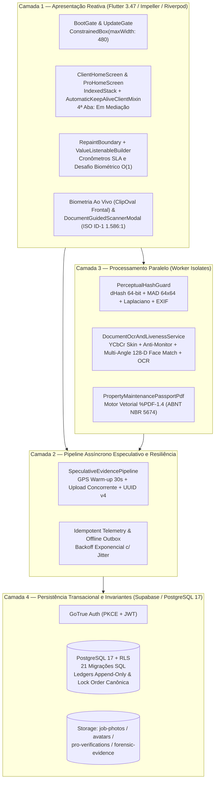
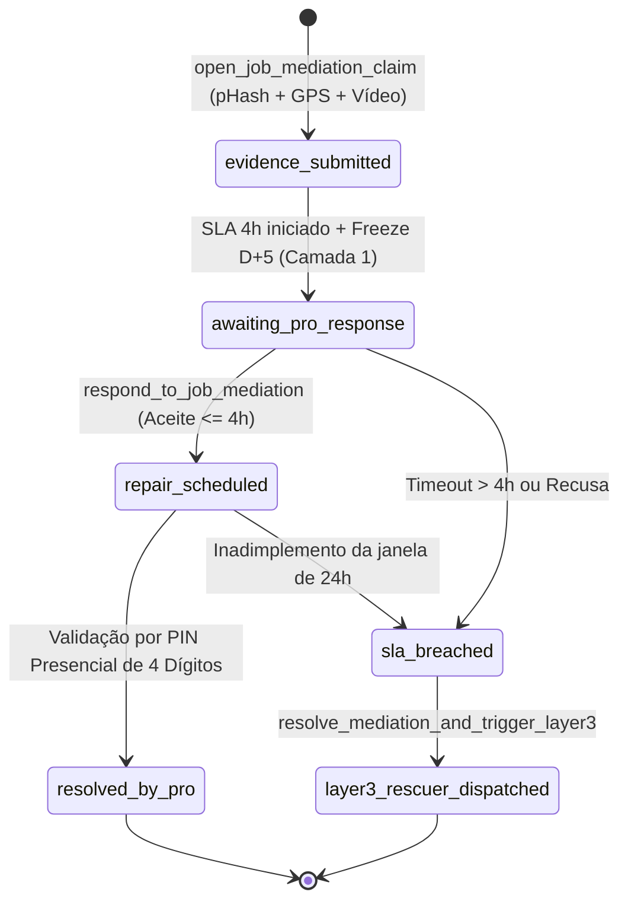

# Arquitetura Técnica e Formalização Algorítmica — Desperrengue (`v2.8.1`)

Especificação arquitetural de sistemas distribuídos, engenharia financeira transacional (Escrow de Garantia em 3 Camadas), visão computacional determinística em *Worker Isolates* e controle de concorrência em PostgreSQL 17 do ecossistema **Desperrengue**.

> Para o contexto acadêmico e diagramas C4 complementares, consulta-se [`docs/Arquitetura do Sistema.md`](Arquitetura%20do%20Sistema.md). Para o histórico de decisões formais, consulta-se [`docs/adr/README.md`](adr/README.md) (incluindo [`ADR-0020`](adr/0020-garantia-3-camadas-antifraude-e-kyc-biometrico-ocr.md)).

---

## 1. Visão Geral em 4 Camadas Desacopladas

O sistema estrutura-se em quatro camadas estritamente desacopladas, projetadas para garantir responsividade de interface a $60\text{ FPS}$ ($\le 16.6\text{ ms}$ por quadro), isolamento de memória para rotinas de Visão Computacional ($O(W \times H)$) e integridade contábil estrita no SGBD relacional:

### 1.1. Decisões Estruturais por Camada

1. **Camada 1 (`app/lib/features/`, `app/lib/core/widgets/`)**:
   - **Trava Responsiva Canônica (`Regra Zero`)**: A árvore de apresentação em [`app/lib/main.dart`](../app/lib/main.dart) é envelopada em um `ConstrainedBox(constraints: BoxConstraints(maxWidth: 480))` combinado aos portões de inicialização `BootGate` e `UpdateGate`.
   - **Isolamento de Rasterização**: Cronômetros regressivos de SLA de mediação (4 horas) e de desafios biométricos isolam-se em subárvores `RepaintBoundary` alimentadas por `ValueListenableBuilder<Duration>`. Dessa forma, o ciclo de *dirty-marking* da árvore de *RenderObjects* do Flutter restringe-se ao nó folha do texto temporal ($O(1)$), preservando a árvore principal.
   - **Retenção de Estado em Memória**: As quatro abas operacionais (*Solicitações / Abertos*, *Em Andamento*, *Concluídos* e *Em Mediação*) utilizam `IndexedStack` aliado a `AutomaticKeepAliveClientMixin`, eliminando reconstruções redundantes durante a navegação.
2. **Camada 2 (`app/lib/core/services/speculative_evidence_pipeline.dart`)**:
   - **Pré-aquecimento Especulativo de GNSS**: Aciona o hardware GPS por $30\text{ s}$ no instante em que o usuário abre o modal de vistoria ou conclusão, reduzindo o *Time-To-First-Fix* (TTFF) a $0\text{ ms}$ no momento do disparo do obturador.
   - **Upload Concorrente e Idempotência**: Enquanto o usuário preenche metadados textuais ou o PIN de 4 dígitos, o binário e seu manifesto criptográfico são transmitidos em *background* com `idempotency_key` (`UUID v4`).
3. **Camada 3 (`app/lib/core/security/perceptual_hash_guard.dart`, `app/lib/core/services/document_ocr_and_liveness_service.dart`)**:
   - **Paralelismo em Memória Isolada**: Todo processamento matricial de imagem executa-se fora do *UI Isolate* principal via `Isolate.run`, operando sobre *buffers* redimensionados a no máximo $1280 \times 1280\text{ px}$ ($\le 6.5\text{ MB}$ de *heap*).
4. **Camada 4 (`supabase/migrations/`)**:
   - **Superfície de Mutação Fechada**: Clientes autenticados não possuem privilégios de `UPDATE` arbitrário sobre saldos, *scores* ou estados de disputa. As transições ocorrem exclusivamente via funções RPC `SECURITY DEFINER` com `SET search_path = public`.

---

## 2. Engenharia Financeira: Garantia em 3 Camadas e Smart Split Anti-Bypass

Implementado na migração [`20261108110000_high_perf_warranty_antifraud_engine.sql`](../supabase/migrations/20261108110000_high_perf_warranty_antifraud_engine.sql) e na entidade [`fintech_warranty_models.dart`](../app/lib/core/models/fintech_warranty_models.dart), o motor financeiro decompõe toda Ordem de Serviço (OS) em duas rubricas contábeis independentes (`SmartSplitBreakdown`):

- **Mão de Obra (`labor_amount` — $L$)**: Sobretaxa total de plataforma de $15.0\%$, subdividida em $13.5\%$ de receita operacional líquida (`platform_operational_fee_rate`) e $1.5\%$ de provisão atuarial obrigatória (`warranty_pool_carveout_rate`) destinada ao livro-razão `public.warranty_pool_ledger`.
- **Peças e Materiais com Nota Fiscal (`materials_amount` — $M$)**: Taxa de intermediação estritamente igual a $0.0\%$, exigindo upload de comprovante fiscal válido (`materials_receipt_url`) e respeitando a trava proporcional $M \le 0.60 \cdot (L + M)$ (`RN-AF-11`).

$$\text{Gross} = L + M, \quad \text{Fee}_{\text{op}} = \lfloor 0.135 \cdot L \rceil_2, \quad \text{Fee}_{\text{pool}} = \lfloor 0.015 \cdot L \rceil_2, \quad \text{Net}_{\text{pro}} = (L - \text{Fee}_{\text{op}} - \text{Fee}_{\text{pool}}) + M$$

O ponto de equilíbrio atuarial ($N_{\text{equilíbrio}}$) para cobertura de sinistros pelo Fundo Garantidor é:

$$N_{\text{equilíbrio}} = \frac{100\%}{1.5\%} = 66.67 \approx 67 \text{ transações concluídas para cada 1 sinistro integral}$$

### 2.1. Arquitetura das 3 Camadas de Garantia (`RN-CAM-01` a `RN-CAM-03`)

| Camada | Código Normativo | Escopo Temporal e Financeiro | Mecanismo Técnico de Liquidação |
| :--- | :--- | :--- | :--- |
| **Camada 1 — Retenção Programada D+5 (Escrow Técnico)** | `RN-CAM-01` | $120\text{ horas}$ ($5\text{ dias}$ corridos; escalonado em $D+7$, $D+5$ ou $D+2$ conforme tier) | O valor líquido fica bloqueado em `public.escrow_maturation_entries` (`status = 'locked_in_maturation'`). A abertura de chamado na 4ª aba **"Em Mediação"** congela instantaneamente o *timer* (`frozen_mediation`). |
| **Camada 2 — Retorno Técnico Prioritário (30 a 90 dias)** | `RN-CAM-02` | $30\text{ dias}$ (serviço geral) a $90\text{ dias}$ (vício oculto — Art. 26 CDC) | Após a liquidação da Camada 1, aciona-se o protocolo de retorno obrigatório com SLA de resposta de **4 horas úteis** (`sla_deadline_at`) e janela de reparo de **24 horas** (`repair_deadline_at`), sem nova cobrança de mão de obra. |
| **Camada 3 — Cobertura pelo Fundo Garantidor** | `RN-CAM-03` | Acionamento imediato após violação de SLA da Camada 2 | Caso o prestador original recuse o reparo ou viole o SLA de 4h (`sla_breached`), a RPC `resolve_mediation_and_trigger_layer3` debita `warranty_pool_ledger` até `max(labor_amount, R$ 500,00)`, convoca um **Profissional Socorrista** (`rescuer_professional_id`) e aplica `status = 'suspended_debt'` ao infrator. |

### 2.2. Máquina de Estados Finitos da 4ª Aba ("Em Mediação")

### 2.3. Quatro Invariantes Contábeis do Banco de Dados

1. **Invariante 1 (Conservação de Massa Monetária no Split)**:
   $$\text{gross\_amount} = \text{labor\_amount} + \text{materials\_amount} = \text{net\_professional\_amount} + \text{platform\_operational\_fee\_amount} + \text{warranty\_pool\_contribution\_amount}$$
2. **Invariante 2 (Imutabilidade Histórica de Ledgers)**: As tabelas `public.warranty_pool_ledger`, `public.escrow_maturation_entries` e `public.forensic_certificates` possuem triggers `BEFORE UPDATE OR DELETE` (`trg_warranty_pool_ledger_immutable` / `prevent_append_only_mutation()`) que abortam qualquer tentativa de mutação destrutiva.
3. **Invariante 3 ( Idempotência Estrita de Liquidação e Cobertura)**: Chaves únicas (`UNIQUE (idempotency_key)` e índice único parcial de débito por `mediation_id`) garantem que retentativas de rede nunca dupliquem repasses ou indenizações.
4. **Invariante 4 (Isolamento de Saldo Livre vs. Saldo em Maturação)**: O saldo sacável via PIX restringe-se às entradas com `status = 'released'` e sem mediação ativa vinculada (`active_mediation_id IS NULL`).

---

## 3. Modelagem de Ameaças e Mitigação dos 6 Vetores de Fraude (`RN-AF-01` a `RN-AF-14`)

| Vetor de Ameaça | Regras | Mecanismo Criptográfico e Algorítmico Implementado |
| :--- | :--- | :--- |
| **Vetor 1 — Conluio Cliente-Profissional (*Cash-Out* do Fundo)** | `RN-AF-01` a `RN-AF-04` | Proibição de estorno em espécie (cobertura restrita a crédito de reparo ou pagamento direto ao **Profissional Socorrista** distinto do prestador original); indexação em grafo bipartido (`client_id`, `professional_id`, `device_fingerprint`, `ip_prefix_24`, `pix_holder_cpf_hash`) bloqueando $\ge 2$ disputas cruzadas em 180 dias; penalidade de $-45\text{ pts}$ no $RTS$ e dívida técnica (`suspended_debt`). |
| **Vetor 2 — Sabotagem Pós-Serviço pelo Cliente** | `RN-AF-05` a `RN-AF-07` | Exigência de **Checklist Fotográfico de Conclusão (Antes e Depois)** com selo de integridade `forensic_certificates` (`sha256_hash` + `perceptual_hash_64`); validação de **Lacre de Garantia Virtual** no chamado de mediação; exigência de **PIN Presencial de 4 dígitos** gerado no dispositivo do cliente para encerrar visita de garantia. |
| **Vetor 3 — Reciclagem de Fotos Antigas ou da Internet** | `RN-AF-08` a `RN-AF-10` | Proibição de upload via galeria em fluxos forenses (`ImageSource.camera` exclusivo); inspeção de metadados EXIF descartando assinaturas de mensageiros/editores (`WhatsApp`, `Telegram`, `Photoshop`, `Canva`, `GIMP`) e `DateTimeOriginal > 15 min`; **Distância de Hamming (`dHash` 64-bit) $\le 5$ bits** em `O(1)` bloqueando imagens duplicadas (`ForensicDuplicateEvidenceException`). |
| **Vetor 4 — *Bypass* por Inflação de Material** | `RN-AF-11`, `RN-AF-12` | Trava SQL e de domínio $M \le 0.60 \cdot (L + M)$; obrigatoriedade de nota fiscal (`materials_receipt_url`) quando $M > 0$; escopo de cobertura da garantia restrito estritamente a $L$ (`labor_amount`). |
| **Vetor 5 — Golpe do "Falso Socorrista"** | `RN-AF-13` | Restrição de elegibilidade a chamados de Camada 3 exclusivamente a profissionais com selo **Verificado Nível Ouro** ($RTS \ge 85$, $\ge 15$ serviços sem disputa e zero vínculos de grafo com o cliente ou prestador original). |
| **Vetor 6 — Ataque Sybil (Recriação de Contas)** | `RN-AF-14` | Unicidade criptográfica global sobre `cpf_hash` (SHA-256 + *salt*) e `face_liveness_hash` em `public.profiles`, além da trava **Same-Holder Lock** no saque PIX (`pix_holder_cpf_hash = cpf_hash`). |

---

## 4. Resolução do Paradoxo do Marco Zero (*Cold-Start* — `RN-MZ-01` a `RN-MZ-05`)

1. **Maturação Escalonada Dinâmica (`RN-MZ-01`)**: Contas em *Cold-Start* ($< 5$ serviços) operam em janela **D+7** ($168\text{ h}$) e teto de $\text{R\$ } 350,00$ por OS; contas regulares ($\ge 5$ serviços e $RTS \ge 60$) operam em **D+5** ($120\text{ h}$); contas Ouro ($\ge 20$ serviços, $RTS \ge 85$ e $0\%$ de disputas) operam em **D+2** ($48\text{ h}$).
2. **Relative Trust Score ($RTS \in [0, 100]$ — `RN-MZ-02`)**: Calculado em $O(1)$ pela função `public.compute_relative_trust_score`:
   $$RTS = \text{clamp}_{[0, 100]}\Big(30\cdot\mathbb{I}_{\text{KYC+Bio}} + 15\cdot\mathbb{I}_{\text{Cert}} + \min(25, 2.5 N_{\text{jobs}}) + 20\cdot\max(0, \frac{\bar{R} - 3.0}{2.0}) + 10\cdot\mathbb{I}_{\text{Anchor}} - 45 N_{\text{fault}}\Big)$$
3. **Algoritmo de Ordenação *Waterfall* em 5 Tiers (`RN-MZ-03`)**: Materializado na coluna `waterfall_tier_rank` ($1 \dots 5$) pela trigger `trg_profiles_Compute_rts_and_tier`, priorizando profissionais verificados e equilibrando exposição de novos talentos verificados no Tier 2.
4. **Reserva Técnica de *Bootstrapping* e *Circuit Breaker* (`RN-MZ-04`)**: Capital semente inicial registrado como `seed_reserve` em `warranty_pool_ledger`; se o índice de sinistralidade móvel de 30 dias ultrapassar $1.2\%$, o *Circuit Breaker* eleva preventivamente a retenção do Tier Novato para $D+10$.
5. **Âncoras de Confiança Externa e *Cooldown* de 24h (`RN-MZ-05`)**: Validação de certificados técnicos (SENAI, CREA, CFT, NR-10, NR-35) concede $+15\text{ pts}$ imediatos no $RTS$; alterações de chave PIX ou dispositivo acionam quarentena de saque de **24 horas** (`security_cooldown_until`).

---

## 5. Visão Computacional, Biometria Facial Ao Vivo, Scanner ISO ID-1 e OCR

Implementado em [`document_ocr_and_liveness_service.dart`](../app/lib/core/services/document_ocr_and_liveness_service.dart) e [`client_setup_screen.dart`](../app/lib/features/client/presentation/client_setup_screen.dart):

1. **Câmera Frontal Ao Vivo em Moldura Oval (`ClipOval`)**:
   - Inicializa exclusivamente a lente frontal (`CameraLensDirection.front` / `facingMode: "user"`), vedando o uso de galeria ou câmera traseira.
   - Executa **3 desafios biomecânicos determinísticos** (1º Centralizar rosto na moldura oval; 2º Rotação cefálica lateral e retorno; 3º Piscada ativa / confirmação final), exigindo em cada quadro presença de pele humana no espaço $YCbCr$ ($77 \le Cb \le 127$, $133 \le Cr \le 173$, cobertura $\in [14\%, 82\%]$), filtro anti-monitor (`blueMonitorRatio < 0.25`), simetria facial bilateral ($\ge 0.42$), nitidez Laplaciana ($\sigma_{\text{Lap}}^2 \ge 95.0$) e deslocamento inter-frame real ($\Delta\text{Luma} \in [2.2, 48.0]$).
2. **Scanner Guiado de Documento (`DocumentGuidedScannerModal` — Proporção ISO/IEC 7810 ID-1 `1.586 : 1`)**:
   - Captura guiada da **Frente** e do **Verso** de RG, CNH ou CIN em orientação paisagem com guias de canto néon.
   - Aplica **Recorte Central de 12% (*Core ROI Inset*)** para isolar o documento da superfície de apoio antes de calcular:
     - **Diferenciação Frente vs. Verso em 3 Camadas**: Distância de Hamming do `dHash` de 64 bits ($\ge 10\text{ bits}$), Diferença Absoluta Média de luminância em grade $64 \times 64$ ($\text{MAD}_{64\times 64} \ge 0.055$) e delta de variância inter-quadrante ($\ge 0.040$).
     - **Validação de Textura Documental**: Densidade de bordas tipográficas ($[0.055, 0.58]$), nitidez Laplaciana ($\sigma_{\text{Lap}}^2 \ge 110.0$), reflexo especular ($\le 8.5\%$) e rejeição de telas azuis (`blueDominanceRatio <= 0.30`).
3. **Face Match Multi-Ângulo ($0^\circ, 90^\circ, 180^\circ, 270^\circ$) em Espaço 128-D Não-Negativo**:
   - Extrai descritores faciais L2-normalizados de 128 dimensões da selfie ao vivo e das 4 rotações ortogonais das zonas de retrato do documento, garantindo $S_{\cos}(\mathbf{v}_{\text{selfie}}, \mathbf{v}_{\text{doc}}) \in [0\%, 100\%]$ e exigindo similaridade $\ge 78.0\%$.
4. **Transcrição OCR Visível e Cruzamento Nominal Determinístico**:
   - Extrai Nome Civil, CPF e RG/CNH, exibe o card auditável `_OcrTranscribedSummaryCard` na Etapa 4 do onboarding e valida o dígito verificador Módulo 11 do CPF e a compatibilidade nominal (`computeCivilNameCompatibility >= 0.80`).

---

## 6. Complexidade Assintótica (Big-O) e Ordem Canônica de Bloqueios

| Operação Crítica | Complexidade Legada | Complexidade Implementada | Mecanismo Técnico |
| :--- | :---: | :---: | :--- |
| **Busca Geoespacial (Raio $R$)** | $O(N)$ | $O(\log N + K)$ | *Axial Bounding Box Pruning* via índice B-Tree composto `(service_category, waterfall_tier_rank, latitude, longitude)` antes da trigonometria de Haversine sobre $K \ll N$. |
| **Busca Textual / Tags** | $O(N \cdot L)$ | $O(\log N)$ | Índice invertido **GIN** com operador de contenção `@>`. |
| **Deduplicação Forense `dHash`** | $O(N)$ | $O(1)$ | Operação bit-a-bit `XOR` (`#`) de 64 bits + contagem de população (*Brian Kernighan* / `bit_count`) e índice composto `(job_id, perceptual_hash_64)`. |
| **Leitura de Ranking e $RTS$** | $O(N \cdot M)$ | $O(1)$ | Colunas materializadas `relative_trust_score` e `waterfall_tier_rank` atualizadas por trigger incremental. |
| **Verificação Anti-Sybil (CPF/Face)** | $O(N)$ | $O(1)$ | Lookup direto em índices B-Tree únicos sobre `cpf_hash` e `face_liveness_hash`. |
| **Liquidação D+5 / SLA 4h** | $O(S)$ c/ contenção | $O(B \log S)$ | Varredura de lote fixo ($B = 100$) com `FOR UPDATE SKIP LOCKED`. |

### 6.1. Prevenção Matemática de Deadlocks (*Canonical Lock Acquisition Order*)

Todas as transações distribuídas e RPCs `SECURITY DEFINER` adquirem bloqueios pessimistas (`SELECT ... FOR UPDATE`) obedecendo estritamente à ordem topológica:

$$\texttt{1. public.jobs} \longrightarrow \texttt{2. public.job\_mediations} \longrightarrow \texttt{3. public.escrow\_maturation\_entries} \longrightarrow \texttt{4. public.profiles}$$

A ausência de ciclos no grafo de espera (*Wait-For Graph*) elimina matematicamente a ocorrência de *deadlocks* sob concorrência extrema.
