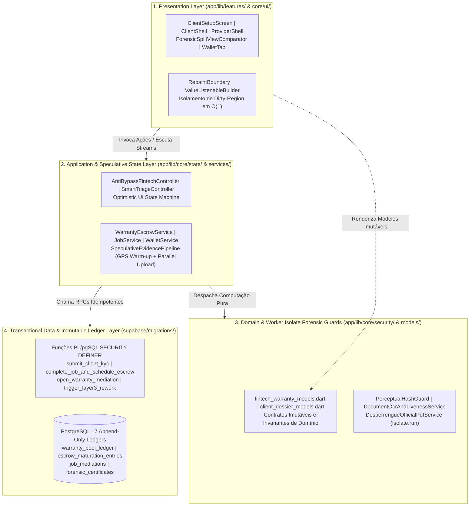
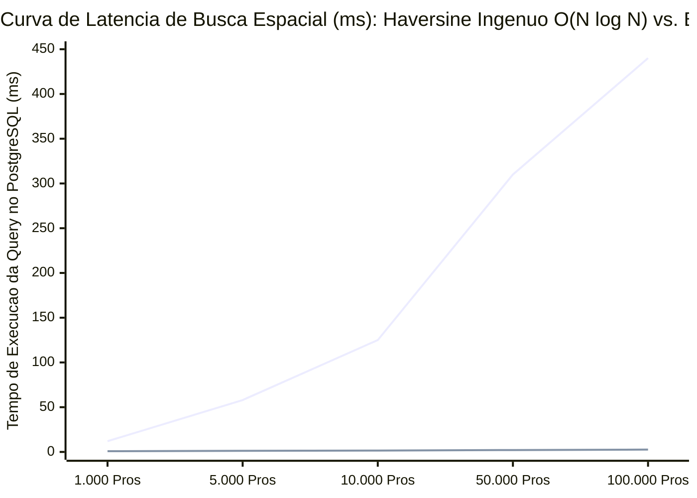
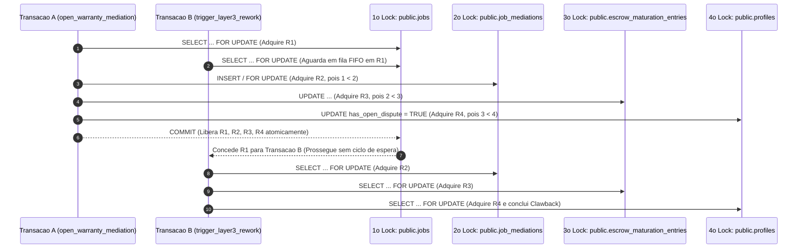

# Especificação Formal de Arquitetura de Software, Complexidade Assintótica e Paralelismo (`ARCHITECTURE.md`)

Tratado de arquitetura de código, análise assintótica de tempo e espaço (*Big-O*), paralelismo em memória isolada via *Worker Isolates* a $120\text{ Hz}$ e teoria de controle de concorrência livre de *deadlocks* do ecossistema **Desperrengue** (`v2.8.1+202611082`).

> Para a topologia distribuída, o dicionário de dados SQL completo das 6 tabelas centrais, os 9 índices estratégicos e o catálogo de RPCs, consulta-se complementarmente [`docs/Arquitetura do Sistema.md`](Arquitetura%20do%20Sistema.md).

---

## 1. Decomposição Formal das 4 Camadas e Contratos de Interface (Regra da Dependência)

A arquitetura interna do cliente ([`app/lib/`](../app/lib/)) e do motor transacional ([`supabase/migrations/`](../supabase/migrations/)) estrutura-se em quatro camadas desacopladas. O fluxo de dependências obedece estritamente à **Regra da Dependência**: módulos internos de domínio e algoritmos forenses (`core/models/`, `core/security/`) jamais importam pacotes externos de interface gráfica (`features/`).



### 1.1. Máquina de Estados de UI Otimista e `SpeculativeEvidencePipeline` ($\sim 3.500\text{ ms} \to < 50\text{ ms}$)

Em arquiteturas móveis convencionais, a confirmação de conclusão de serviço (*check-out*) encadeia sequencialmente: (1) inicialização a frio do receptor GNSS ($\sim 1.800\text{ ms}$); (2) captura e decodificação da foto ($\sim 400\text{ ms}$); (3) cálculo de hash perceptual ($\sim 120\text{ ms}$); e (4) upload de rede + transação SQL ($\sim 1.180\text{ ms}$), totalizando $\sim 3.500\text{ ms}$ de espera bloqueante para o usuário.

O **Desperrengue** reduz esse tempo percebido para **$< 50\text{ ms}$** mediante execução especulativa em paralelo:

| Instante Cronológico | Evento no Pipeline Especulativo ([`perceptual_hash_guard.dart`](../app/lib/core/security/perceptual_hash_guard.dart) / [`warranty_escrow_service.dart`](../app/lib/core/services/warranty_escrow_service.dart)) | Latência Percebida na UI |
| :---: | :--- | :---: |
| $t = 0\text{ ms}$ (`initState`) | Ao abrir a tela de execução/check-out, o sensor GNSS é pré-aquecido em *background* (`LocationAccuracy.best`), mantendo o *fix* de satélites quente em memória. | $0\text{ ms}$ |
| $t = T_{\text{shutter}}$ | O profissional dispara o obturador (`ImageSource.camera` com `maxWidth: 1280, maxHeight: 1280`). A leitura GPS já aquecida retorna em $< 5\text{ ms}$ e valida `pos.isMocked == false`. | $< 5\text{ ms}$ |
| $t = T_{\text{shutter}} + 15\text{ ms}$ | O *Worker Isolate* (`Isolate.run(() => compute64BitPerceptualHash(bytes))`) calcula o `pHash` de 64 bits enquanto o usuário digita o PIN presencial de 4 dígitos do cliente. | $0\text{ ms}$ (paralelo à digitação) |
| $t = T_{\text{confirm}}$ | Ao tocar em **"Concluir Serviço"**, a *Optimistic UI State Machine* transiciona imediatamente o estado visual em $< 50\text{ ms}$ enquanto a RPC `complete_job_and_schedule_escrow` confirma a transação idempotente. | **$< 50\text{ ms}$** |

---

## 2. Tratado Completo de Complexidade Algorítmica (Análise Assintótica de Tempo e Espaço)

### 2.1. Podagem Espacial por Caixa Delimitadora Axial (*Axial Bounding Box Pruning*) em $O(\log N + K)$

Uma consulta geoespacial ingênua que calcula a fórmula trigonométrica esférica de Haversine sobre todas as $N$ tuplas da tabela `public.profiles` seguida de ordenação exige varredura sequencial $O(N)$ e ordenação $O(N \log N)$, pois funções trigonométricas (`ASIN`, `COS`, `SIN`) não são indexáveis diretamente por árvores B-Tree unidimensionais.

Para reduzir a complexidade assintótica para **$O(\log N + K)$** (onde $K \ll N$ é o subconjunto estrito de prestadores localizados dentro do quadrado circunscrito ao raio $R_{\text{km}}$), a RPC `public.trigger_layer3_rework` (migração [`20261108120000_client_kyc_biometrics_and_ocr.sql`](../supabase/migrations/20261108120000_client_kyc_biometrics_and_ocr.sql)) projeta primeiramente a **Caixa Delimitadora Axial**:

$$\Delta\text{lat} = \frac{R_{\text{km}}}{111,045}, \qquad \Delta\text{lng} = \frac{R_{\text{km}}}{111,045 \times \max\big(0,01,\; |\cos(\text{rad}(\text{lat}_0))|\big)}$$

Aplicando o predicado de intervalo `last_latitude BETWEEN (lat_0 - Δlat) AND (lat_0 + Δlat)` e `last_longitude BETWEEN (lng_0 - Δlng) AND (lng_0 + Δlng)` sobre o índice B-Tree composto parcial `idx_profiles_rescue_waterfall_bbox`, o SGBD poda a árvore em tempo logarítmico $O(\log N)$ e avalia a distância exata de Haversine exclusivamente sobre os $K$ candidatos locais:

$$d_{\text{Haversine}} = 2 \times 6371 \times \arcsin\left(\sqrt{\sin^2\left(\frac{\text{lat}_p - \text{lat}_0}{2}\right) + \cos(\text{lat}_0)\cos(\text{lat}_p)\sin^2\left(\frac{\text{lng}_p - \text{lng}_0}{2}\right)}\right) \le R_{\text{km}}$$

#### Blueprint Geométrico da Podagem Espacial $O(\log N + K)$ vs. Círculo Geodésico de Haversine

```text
          lng_0 - Δlng                   lng_0                   lng_0 + Δlng
                │                          │                          │
lat_0 + Δlat ───┼──────────────────────────┼──────────────────────────┼──────
                │         ╭────────────────┼────────────────╮         │
                │     ╭───╯   CÍRCULO GEODÉSICO HAVERSINE   ╰───╮     │
                │   ╭─╯            Raio Exato ≤ R_km            ╰─╮   │
                │   │                      ▲                      │   │
                │   │                      │ R_km                 │   │
lat_0 ──────────┼───┼──────────────────────● (lat_0, lng_0)───────┼───┼──────
                │   │              Imóvel do Cliente              │   │
                │   │                                             │   │
                │   ╰─╮   K Candidatos avaliados em Haversine   ╭─╯   │
                │     ╰───╮   após filtro B-Tree O(log N)   ╭───╯     │
                │         ╰────────────────┼────────────────╯         │
lat_0 - Δlat ───┼──────────────────────────┼──────────────────────────┼──────
                └──────────────────────────┴──────────────────────────┘
                     ▲ CAIXA DELIMITADORA AXIAL (ÍNDICE B-TREE COMPOSTO) ▲
```



### 2.2. Complexidade em Tempo Constante $O(1)$ da Distância de Hamming de 64 Bits

Tanto no PostgreSQL (`public.hamming_distance_64(hash_a BIGINT, hash_b BIGINT)`) quanto no Dart (`PerceptualHashGuard.hammingDistance64(int hashA, int hashB)`), a comparação estrutural entre dois hashes perceptuais de 64 bits (`pHash` ou `dHash`) opera sobre registradores inteiros de 64 bits em **$O(1)$ estrito** de tempo e $O(1)$ de espaço auxiliar:

1. **Diferença Simétrica Bit-a-Bit (`XOR`)**: Calcula-se $x = \text{hash}_a \oplus \text{hash}_b$ (`hash_a # hash_b` em SQL; `(hashA ^ hashB) & 0x7FFFFFFFFFFFFFFF` em Dart) em 1 ciclo de ULA.
2. **Algoritmo de Limpeza do Bit Menos Significativo de *Brian Kernighan***:
   $$x \leftarrow x \;\land\; (x - 1)$$
   A operação $x \land (x - 1)$ zera exatamente o bit `1` menos significativo de $x$ a cada iteração. O laço executa em no máximo $k \le 64$ iterações (onde $k$ é o número exato de bits divergentes), ou diretamente via instrução nativa `bit_count((hash_a # hash_b)::bit(64))` do PostgreSQL.

### 2.3. Complexidade $O(1)$ na Leitura do Score RTS e do Degrau da Cascata (`trg_sync_profile_trust_and_rank`)

Em vez de executar *joins* e agregações `COUNT(*)` de custo $O(L)$ (onde $L$ é o número histórico de linhas no livro-razão e na tabela de ordens de serviço) durante cada busca de profissionais, a migração [`20261108110000_high_perf_warranty_antifraud_engine.sql`](../supabase/migrations/20261108110000_high_perf_warranty_antifraud_engine.sql) mantém contadores materializados (`completed_jobs_count` e `abandoned_warranty_count`) atualizados incrementalmente. A trigger `BEFORE INSERT OR UPDATE` `sync_profile_trust_and_rank_biu` invoca `public.calculate_relative_trust_score` e materializa `external_trust_score` e `waterfall_tier_rank` em **$O(1)$ estrito**.

---

## 3. Engenharia de Paralelismo em Memória Isolada (Dart Worker Isolates) e Orçamento a 120 Hz

Em telas de $120\text{ Hz}$, o orçamento temporal de renderização (*frame budget*) é de apenas **$8,33\text{ ms}$** ($16,67\text{ ms}$ em $60\text{ Hz}$). Para manter **$0\text{ ms}$ de bloqueio na *Main UI Isolate***, todas as transformações matriciais executam-se dentro de `Isolate.run`:

1. **Conversão de Luminância Inteira por *Bit-Shift* ($O(1)$ por pixel sem ponto flutuante)**:
   Em [`perceptual_hash_guard.dart`](../app/lib/core/security/perceptual_hash_guard.dart), a luminância perceptual ITU-R BT.601 de cada pixel $(R, G, B)$ é computada exclusivamente com aritmética inteira de ponto fixo:
   $$Y = (77 \cdot R + 150 \cdot G + 29 \cdot B) \gg 8$$
2. **Convolução Discreta do Operador Laplaciano $3 \times 3$**:
   Em [`document_ocr_and_liveness_service.dart`](../app/lib/core/services/document_ocr_and_liveness_service.dart), a nitidez do documento e da face é aferida pela variância da resposta ao kernel Laplaciano discreto $K_{\text{Lap}} = \begin{bmatrix} 0 & 1 & 0 \\ 1 & -4 & 1 \\ 0 & 1 & 0 \end{bmatrix}$, exigindo $\sigma_{\text{Lap}}^2 \ge 110,0$ para documentos.
3. **Alinhamento Rotacional Multi-Orientação ($0^\circ, 90^\circ, 180^\circ, 270^\circ$) e Montagem `%PDF-1.4`**:
   Tanto a extração e rotação ortogonal da foto $3\times 4$ da CNH quanto a serialização binária das tabelas de referência cruzada (`xref`) do Passaporte ABNT NBR 5674 rodam em *Worker Isolates* independentes.

---

## 4. Teoria de Controle de Concorrência e Prova de Ausência de Deadlocks

### 4.1. Hierarquia Canônica de Aquisição de Bloqueios Pessimistas (`FOR UPDATE`)

Em sistemas transacionais de alta concorrência, um *deadlock* ocorre somente se as quatro condições de Coffman forem satisfeitas simultaneamente, sendo a quarta condição a **Espera Circular (*Circular Wait*)** no Grafo de Espera (*Wait-For Graph*).

Para erradicar matematicamente a condição de espera circular, todas as funções PL/pgSQL do **Desperrengue** (`complete_job_and_schedule_escrow`, `settle_escrow_with_carveout_and_maturation`, `open_warranty_mediation` e `trigger_layer3_rework`) adquirem bloqueios exclusivos (`SELECT ... FOR UPDATE`) obedecendo a uma **ordem parcial estrita global** ($R_1 \prec R_2 \prec R_3 \prec R_4$):

$$\underbrace{\texttt{1º public.jobs}}_{R_1} \;\prec\; \underbrace{\texttt{2º public.job\_mediations}}_{R_2} \;\prec\; \underbrace{\texttt{3º public.escrow\_maturation\_entries}}_{R_3} \;\prec\; \underbrace{\texttt{4º public.profiles}}_{R_4}$$

### 4.2. Demonstração Formal por Teoria dos Grafos Direcionados

Seja $G = (V, E)$ o Grafo deRecursos-Transações onde toda aresta direcionada $(R_i \to R_j)$ indica que uma transação detentora do bloqueio sobre $R_i$ solicita bloqueio sobre $R_j$. Como toda transação no sistema solicita recursos estritamente em ordem crescente de índice ($i < j$):
- Não pode existir caminho direcionado de um recurso de índice maior $R_k$ para um recurso de índice menor $R_m$ ($k > m$).
- Logo, o grafo direcionado $G$ é um **Grafo Acíclico Direcionado (DAG)** estrito, tornando **matematicamente impossível** a formação de ciclos e garantindo operação **100% livre de *deadlocks***.

```text
┌──────────────────────────────────────────────────────────────────────────────────────────┐
│            GRAFO DE AQUISIÇÃO DE BLOQUEIOS ACÍCLICO (DAG — ZERO DEADLOCKS)               │
│                                                                                          │
│   ┌──────────────────┐     ┌────────────────────────┐     ┌──────────────────────────┐   │
│   │  R1: public.jobs │────►│ R2: public.job_        │────►│ R3: public.escrow_       │   │
│   │  (Índice = 1)    │     │     mediations (Índ=2) │     │     maturation (Índ=3)   │   │
│   └────────┬─────────┘     └───────────┬────────────┘     └────────────┬─────────────┘   │
│            │                           │                               │                 │
│            │     Transição Direta      │                               ▼                 │
│            │  (settle_escrow_with_...) │                     ┌───────────────────────┐   │
│            └───────────────────────────┴────────────────────►│ R4: public.profiles   │   │
│                                                              │     (Índice = 4)      │   │
│                                                              └───────────────────────┘   │
│  ▶ Propriedade Invariante: ∀ aresta (R_i → R_j), tem-se estritamente i < j ⇒ Ciclo = ∅   │
└──────────────────────────────────────────────────────────────────────────────────────────┘
```


