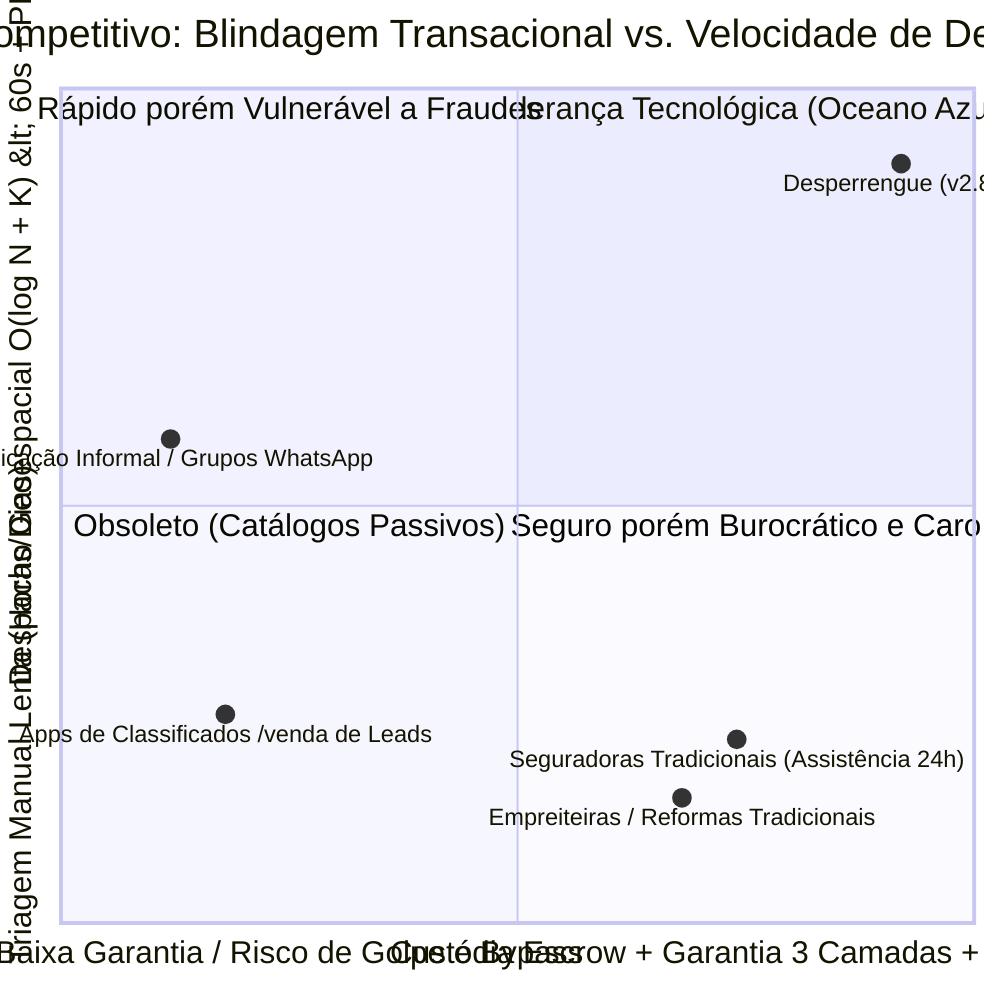

# Análise Macroambiental (PESTEL), Cinco Forças de Porter e Matriz SWOT Cruzada — Desperrengue (`v2.8.1`)

> **Classificação Epistemológica:** Tratado de Inteligência Competitiva, Organização Industrial e Estratégia Tecnológica  
> **Modelos Analíticos:** Framework PESTEL · Modelo das 5 Forças Competitivas de Michael Porter (1979) · Matriz SWOT Cruzada (TOWS)  
> **Implementação Auditada:** [`20261108110000_high_perf_warranty_antifraud_engine.sql`](../supabase/migrations/20261108110000_high_perf_warranty_antifraud_engine.sql) · [`20261108120000_client_kyc_biometrics_and_ocr.sql`](../supabase/migrations/20261108120000_client_kyc_biometrics_and_ocr.sql) · [`document_ocr_and_liveness_service.dart`](../app/lib/core/services/document_ocr_and_liveness_service.dart)

---

## 1. Análise Macroambiental Estruturada (PESTEL)

A operação de um marketplace de serviços residenciais de missão crítica no Brasil é governada por seis vetores macroambientais (Político, Econômico, Social, Tecnológico, Ecológico/Patrimonial e Legal) cujo impacto direto foi incorporado à arquitetura de software do **Desperrengue**:

| Dimensão PESTEL | Fator Macroestrutural Identificado | Resposta Arquitetural Implementada no Desperrengue (`v2.8.1`) |
| :--- | :--- | :--- |
| **P — Político-Tributário** | Complexidade tributária municipal (ISSQN LC 116/03) e risco de bitributação sobre repasses a prestadores autônomos/MEIs. | **Particionamento Orçamentário Assimétrico (*Smart Split*):** Segregação na fonte entre reembolso de peças ($0\%$ de taxa), custódia de terceiros ($V_{\text{MO}}$ líquida) e receita própria de intermediação ($12\%\text{–}15\%$). |
| **E — Econômico** | Alta sensibilidade do prestador à compressão de margem e necessidade de liquidez imediata em cenário de juros elevados. | **Liquidação Escalonada por Mérito ($RTS$):** Profissionais de alta reputação ($RTS \ge 85$) recebem via PIX em `D+0` (zero custo de capital de giro), enquanto peças são 100% isentas de comissão. |
| **S — Sociocultural** | Déficit agudo de segurança pública urbana e receio de permitir o ingresso de desconhecidos no ambiente doméstico. | **KYC Bilateral Simétrico + Liveness 3D + PIN Presencial de 4 Dígitos:** Tanto o cliente quanto o prestador passam por validação biométrica facial ativa e OCR documental antes de operar em campo. |
| **T — Tecnológico** | Proliferação de fraudes digitais por *deepfakes*, fotos de telas de computador (*replay attacks*) e *spoofing* de GPS/evidências. | **Motor Forense *On-Device* ($\text{R\$ } 0,00$):** `ImagePicker(CameraDevice.rear)` estrito, `dHash` 64 bits + `MAD` em ROI central ($80\%$) com distância de Hamming $O(1)$ e Liveness com desafios físicos aleatórios. |
| **E — Ecológico / Patrimonial** | Depreciação acelerada de imóveis urbanos por falta de manutenção preventiva documentada conforme normas da ABNT. | **Passaporte Oficial de Manutenção do Imóvel ([`ABNT NBR 5674`](../app/lib/core/services/desperrengue_official_pdf_service.dart)):** Certificação criptográfica SHA-256 (`DSP-PASS-*`) que prolonga a vida útil das instalações prediais e valoriza o ativo imobiliário. |
| **L — Legal / Regulatório** | Rigor da **LGPD (Lei nº 13.709/2018, Art. 11)** sobre dados biométricos sensíveis e do **CDC (Lei nº 8.078/1990)** sobre garantia de serviços. | Processamento biométrico efêmero *on-device*, anonimização de CPF por hash irreversível (`SHA-256 + Pepper`) e **Garantia de 3 Camadas** com SLA determinístico de mediação ($24\text{h}$). |

---

## 2. Diagrama Estrutural das 5 Forças Competitivas de Porter

A análise de Organização Industrial segundo Michael Porter demonstra como os fossos tecnológicos (*technological moats*) do **Desperrengue** neutralizam as pressões competitivas que inviabilizaram catálogos de anúncios de primeira geração:

```
┌──────────────────────────────────────────────────────────────────────────────────────────────┐
│                 MODELO DAS 5 FORÇAS DE PORTER APLICADO AO DESPERRENGUE                       │
├──────────────────────────────────────────────────────────────────────────────────────────────┤
│                                                                                              │
│                        ┌────────────────────────────────────────────┐                        │
│                        │   1. AMEAÇA DE NOVOS ENTRANTES (BAIXA)     │                        │
│                        │ • Barreira Algorítmica: KYC/Liveness 3D    │                        │
│                        │   on-device a R$ 0,00 + Motor Antifraude   │                        │
│                        │   SQL com 14 travas e Grafo Zero-Linkage.  │                        │
│                        └─────────────────────┬──────────────────────┘                        │
│                                              │                                               │
│                                              ▼                                               │
│  ┌───────────────────────────────────┐ ┌───────────┐ ┌────────────────────────────────────┐  │
│  │ 2. PODER DOS PRESTADORES (MÉDIO)  │ │           │ │  3. PODER DOS CLIENTES (MODERADO)  │  │
│  │ • Mitigado pelo Smart Split (0%   │ │ RIVALIDADE│ │ • Lock-in Patrimonial: O histórico │  │
│  │   em peças) e pelo Score RTS:     ├─► INTERNA   ◄─┤   auditado do imóvel (Passaporte   │  │
│  │   sair da plataforma implica      │ │ NO SETOR  │ │   ABNT NBR 5674) e a Garantia de   │  │
│  │   perder liquidação PIX D+0 e     │ │  (ALTA)   │ │   3 Camadas só existem dentro das  │  │
│  │   prioridade no Tier 1 (0s).      │ │           │ │   transações feitas no aplicativo. │  │
│  └───────────────────────────────────┘ └─────┬─────┘ └────────────────────────────────────┘  │
│                                              │                                               │
│                                              ▲                                               │
│                        ┌─────────────────────┴──────────────────────┐                        │
│                        │ 4. AMEAÇA DE SUBSTITUTOS / BYPASS (BAIXA)  │                        │
│                        │ • O "acerto por fora" via WhatsApp elimina │                        │
│                        │   a proteção contra calote, o Fundo de     │                        │
│                        │   Garantia de Retrabalho e o selo SHA-256. │                        │
│                        └────────────────────────────────────────────┘                        │
└──────────────────────────────────────────────────────────────────────────────────────────────┘
```

---

## 3. Gráfico de Posicionamento Competitivo (`quadrantChart`)

O gráfico de quadrantes a seguir posiciona o **Desperrengue** frente aos três arquétipos concorrentes do mercado brasileiro ao longo de dois eixos ortogonais: **Eixo X (Nível de Segurança Transacional, Blindagem Antifraude e Garantia Real)** e **Eixo Y (Velocidade de Despacho e Liquidez Financeira para o Prestador)**:



---

## 4. Matriz SWOT (FOFA) e Estratégias Cruzadas (TOWS)

### 4.1. Levantamento Sistemático dos 4 Quadrantes

| Quadrante | Fatores Estruturais Auditados |
| :--- | :--- |
| **Forças Internas (*Strengths*)** | **S1.** Motor de KYC e Prova de Vida 3D *On-Device* com custo marginal de $\text{R\$ } 0,00$ por validação.<br/>**S2.** Fundo de Garantia em 3 Camadas autossustentado por *Carve-Out* atuarial de $1,5\%$ sobre $V_{\text{MO}}$ (equilíbrio em $67$ jobs).<br/>**S3.** Blindagem contra os 6 vetores de fraude (`dHash + MAD` 64 bits $O(1)$, Despacho Cego, Grafo *Zero-Linkage*, *Clawback* e *Circuit Breaker*).<br/>**S4.** Busca geoespacial $O(\log N + K)$ com *Axial Bounding Box* e pipeline de check-out especulativo (`< 50 ms`).<br/>**S5.** Passaporte Oficial de Manutenção do Imóvel ([`ABNT NBR 5674`](../app/lib/core/services/desperrengue_official_pdf_service.dart)) com assinatura criptográfica SHA-256. |
| **Fraquezas Internas (*Weaknesses*)** | **W1.** Necessidade de densidade geográfica mínima de prestadores verificados para sustentar SLA `< 60s` em novos municípios (*Cold-Start* geográfico).<br/>**W2.** Exigência de smartphone com câmera funcional para execução dos desafios biométricos e captura de evidências `Before/After`. |
| **Oportunidades Externas (*Opportunities*)** | **O1.** Digitalização do mercado de vistorias imobiliárias (Lei do Inquilinato) e seguros residenciais via laudos certificados.<br/>**O2.** Insatisfação generalizada de profissionais autônomos com plataformas que cobram por "moedas de orçamento" sem garantia de fechamento.<br/>**O3.** Expansão de condomínios residenciais horizontais e verticais que demandam cadastro pré-auditado de prestadores com controle biométrico. |
| **Ameaças Externas (*Threats*)** | **T1.** Tentativas culturais de desintermediação (*acerto por fora*) após o primeiro contato presencial.<br/>**T2.** Evolução de ataques de falsificação biométrica e conluio organizado contra carteiras digitais.<br/>**T3.** Volatilidade macroeconômica afetando o orçamento familiar para reformas não emergenciais. |

### 4.2. Matriz Estratégica Cruzada (TOWS — Ações Ofensivas, Defensivas e de Conversão)

| Cruzamento Estratégico | Diretriz Executiva e Mecanismo Algorítmico Associado |
| :--- | :--- |
| **Estratégia Ofensiva ($S1 + S2 + O2$)<br/>*Captura Massiva da Oferta Qualificada*** | Utilizar o custo zero de KYC ($S1$) e o modelo sem venda de leads com **Taxa $0\%$ sobre peças** ($S2$) para atrair os melhores eletricistas, encanadores e técnicos do mercado ($O2$), concedendo +30 pontos imediatos no $RTS$ após aprovação biométrica. |
| **Estratégia Ofensiva Institucional ($S5 + O1 + O3$)<br/>*Padrão De Facto em Imobiliárias e Condomínios*** | Posicionar o **Passaporte Oficial de Manutenção (`ABNT NBR 5674`)** ($S5$) como documento padrão de vistoria de saída em imobiliárias ($O1$) e credencial de acesso rápido em portarias de condomínios ($O3$). |
| **Estratégia Defensiva Antifraude ($S3 + T1 + T2$)<br/>*Neutralização Matemática de Golpes e Bypass*** | Combinar o *Smart Split* (que torna irracional o *bypass* por isentar peças e garantir liquidação PIX `D+0` aos Tiers 1 e 2) ($T1$) com as 14 travas forenses (`dHash + MAD`, Grafo *Zero-Linkage*, *Clawback* e *Circuit Breaker*) para tornar o valor esperado de qualquer ataque estritamente negativo ($\mathbb{E}[\text{Payoff}] < 0$) ($T2$). |
| **Estratégia de Conversão Regional ($W1 + S4 + O3$)<br/>*Expansão Hiperlocal Densificada*** | Mitigar o *Cold-Start* geográfico ($W1$) concentrando o lançamento em manchas urbanas de alta densidade condominial ($O3$), onde a podagem axial $O(\log N + K)$ ($S4$) garante liquidez de atendimento em raio de $5\text{ km}$ desde a primeira semana de operação. |
