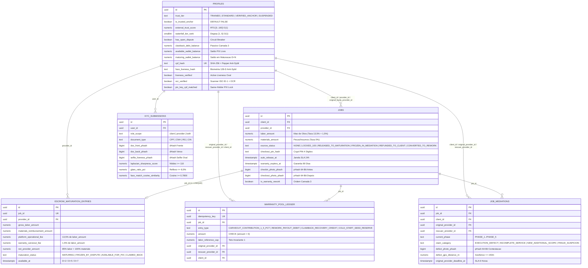

# Arquitetura do Sistema, Topologia Distribuída e Dicionário de Dados SQL (`Arquitetura do Sistema.md`)

Modelagem sistêmica, topologia física e lógica Cliente-Servidor-Edge, dicionário de dados relacional completo das 6 tabelas centrais, mapa dos 9 índices estratégicos e catálogo de funções RPC (`SECURITY DEFINER`) do ecossistema **Desperrengue** (`v2.8.1+202611082`).

> Para as demonstrações algébricas de complexidade assintótica (*Big-O*), *Worker Isolates* a $120\text{ Hz}$ e prova formal de ausência de *deadlocks*, consulta-se [`docs/ARCHITECTURE.md`](ARCHITECTURE.md).

---

## 1. Topologia Física e Lógica do Sistema Distribuído

O ecossistema **Desperrengue** integra cinco subsistemas distribuídos interconectados por canais criptografados TLS 1.3 / WSS:

1. **Cliente Móvel e Web PWA (Flutter 3.47 — Android / iOS / Web)**: Executa a interface declarativa em container responsivo de `480px`, os *Worker Isolates* de visão computacional (`PerceptualHashGuard`, `DocumentOcrAndLivenessService`) e o motor vetorial de PDF (`DesperrengueOfficialPdfService`).
2. **Camada de Autenticação e Mensageria Transacional (Supabase Auth + Resend SMTP/DNS)**: Gerencia fluxos OAuth2/PKCE, tokens JWT assinados e despacho de códigos OTP via zona DNS autenticada (`DKIM`, `SPF` e `DMARC` no domínio `desperrengue.tech`).
3. **Motor Relacional e Contábil (PostgreSQL 17 + `pgcrypto`)**: Hospeda as **21 migrações SQL**, os livros-razão imutáveis (*Append-Only Ledgers*), as triggers $O(1)$ e as funções `SECURITY DEFINER` com hierarquia canônica de bloqueios.
4. **Barramento de Eventos em Tempo Real (Supabase Realtime via WebSockets)**: Propaga instantaneamente atualizações de ordens de serviço, mensagens de chat, transições da 4ª aba *"Em Mediação"* e confirmações de recarga PIX.
5. **Armazenamento Seguro de Objetos (Supabase Storage + RLS)**: Segrega evidências públicas de portfólio e dossiês privados de verificação biométrica/documental (`kyc_submissions`) sob políticas RLS vinculadas a `auth.uid()`.

### 1.1. Blueprint da Topologia Distribuída Cliente-Servidor-Edge

```text
┌──────────────────────────────────────────────────────────────────────────────────────────┐
│                  CLIENTE MULTIPLATAFORMA (FLUTTER 3.47 ANDROID / iOS / PWA)              │
│  ┌────────────────────────────┬────────────────────────────┬──────────────────────────┐  │
│  │ UI Declarativa 120 FPS     │ Worker Isolates (Off-Main) │ Speculative Pipeline     │  │
│  │ Container 480px + KeepAlive│ YCbCr + EAR/Yaw + dHash/OCR│ GPS Warm-up + UUID v4    │  │
│  └─────────────┬──────────────┴─────────────┬──────────────┴─────────────┬────────────┘  │
└────────────────┼────────────────────────────┼────────────────────────────┼───────────────┘
                 │ WSS (Realtime)             │ HTTPS (REST / RPC JSONB)   │ HTTPS (Signed)
                 ▼                            ▼                            ▼
┌──────────────────────────────────────────────────────────────────────────────────────────┐
│                      PLATAFORMA BACKEND DISTRIBUÍDA (SUPABASE CLOUD)                     │
│  ┌─────────────────────────┐  ┌──────────────────────────────────────┐  ┌─────────────┐  │
│  │ Supabase Auth (GoTrue)  │  │ PostgREST + RPCs SECURITY DEFINER    │  │ Storage RLS │  │
│  │ + Resend SMTP (sa-east) │  │ • submit_client_kyc                  │  │ Buckets KYC │  │
│  │ DKIM / SPF / DMARC      │  │ • complete_job_and_schedule_escrow   │  │ & Evidências│  │
│  └────────────┬────────────┘  │ • settle_escrow_with_carveout_...    │  └──────┬──────┘  │
│               │               │ • open_warranty_mediation            │         │         │
│               │               │ • trigger_layer3_rework              │         │         │
│               ▼               └──────────────────┬───────────────────┘         │         │
│  ╔═══════════════════════════════════════════════▼═════════════════════════════▼══════╗  │
│  ║             MOTOR RELACIONAL E CONTÁBIL POSTGRESQL 17 (extensão pgcrypto)          ║  │
│  ║  • Tabelas: profiles | jobs | warranty_pool_ledger | escrow_maturation_entries     ║  │
│  ║             job_mediations | forensic_certificates | kyc_submissions               ║  │
│  ║  • Worker Assíncrono: process_autonomous_escrow_and_mediation_queues (SKIP LOCKED) ║  │
│  ╚════════════════════════════════════════════════════════════════════════════════════╝  │
└──────────────────────────────────────────────────────────────────────────────────────────┘
```

---

## 2. Diagrama Entidade-Relacionamento das 6 Tabelas Centrais (`erDiagram`)



---

## 3. Dicionário de Dados Relacional Completo e As 4 Invariantes Declarativas

### 3.1. Tabela `public.profiles` (Identidade Civil Unificada, Confiança $O(1)$ e Carteira Bipartida)

| Coluna | Tipo SQL | `DEFAULT` | Restrição `CHECK` / Índice | Semântica Técnica |
| :--- | :--- | :--- | :--- | :--- |
| `trust_tier` | `TEXT` | `'STANDARD'` | `IN ('TRAINEE', 'STANDARD', 'VERIFIED_ANCHOR', 'SUSPENDED')` | Classificação atuarial que governa a janela de maturação ($D+7, D+5, D+2$). |
| `is_trusted_anchor` | `BOOLEAN` | `FALSE` | `NOT NULL` | Flag de Profissional Âncora credenciado no Marco Zero (Degrau 1). |
| `external_trust_score` | `NUMERIC(5,2)` | `0.00` | `>= 0 AND <= 100` | *Relative Trust Score* ($RTS$) materializado em $O(1)$ pela trigger `trg_sync_profile_trust_and_rank`. |
| `waterfall_tier_rank` | `SMALLINT` | `5` | `BETWEEN 1 AND 5` | Degrau pré-calculado na Cascata de Despacho da Camada 3. |
| `has_open_dispute` | `BOOLEAN` | `FALSE` | `NOT NULL` | Disjuntor transacional (*Circuit Breaker*) ativado em `open_warranty_mediation`. |
| `clawback_debt_balance` | `NUMERIC(12,2)` | `0.00` | `>= 0` | Passivo de recuperação de garantia compensado automaticamente em futuros serviços. |
| `available_wallet_balance` | `NUMERIC(12,2)` | `0.00` | `>= 0` | Saldo livre liquidado, disponível para saque PIX imediato. |
| `maturing_wallet_balance` | `NUMERIC(12,2)` | `0.00` | `>= 0` | Saldo retido em janela de maturação ($D+2, D+5, D+7$). |
| `cpf_hash` | `TEXT` | `NULL` | `UNIQUE` (`idx_profiles_cpf_hash_unique`) | Hash `SHA-256` salgado (`DSP-CPF-PEPPER-2026`) para bloqueio Anti-Sybil em $O(1)$. |
| `face_liveness_hash` | `TEXT` | `NULL` | Indexado (`idx_profiles_face_liveness_hash`) | Assinatura biométrica da Prova de Vida Ao Vivo para disjunção de identidade. |
| `liveness_verified` | `BOOLEAN` | `FALSE` | `NOT NULL` | Confirma aprovação nos desafios físicos de câmera frontal no oval ($YCbCr$/EAR/Yaw). |
| `ocr_verified` | `BOOLEAN` | `FALSE` | `NOT NULL` | Confirma aprovação do scanner documental ISO ID-1, Face Match $\ge 0,78$ e OCR. |
| `pix_key_cpf_matched` | `BOOLEAN` | `FALSE` | `NOT NULL` | Trava *Same-Holder PIX Lock* garantindo titularidade bancária idêntica ao CPF validado. |

### 3.2. Tabela `public.jobs` (Smart Split, Custódia e Hashes Forenses)

| Coluna | Tipo SQL | `DEFAULT` | Restrição `CHECK` | Semântica Técnica |
| :--- | :--- | :--- | :--- | :--- |
| `labor_amount` | `NUMERIC(12,2)` | `0.00` | `>= 0` | Componente de mão de obra sujeito à alíquota de $13,5\%$ operacional + $1,5\%$ garantia. |
| `materials_amount` | `NUMERIC(12,2)` | `0.00` | `>= 0` | Componente de reembolso de peças e materiais com **alíquota de $0,0\%$**. |
| `escrow_status` | `TEXT` | `'NONE'` | `IN ('NONE', 'LOCKED_100', 'RELEASED_TO_MATURATION', 'FROZEN_IN_MEDIATION', 'REFUNDED_TO_CLIENT', 'CONVERTED_TO_REWORK')` | Estado da custódia financeira condicional da OS. |
| `checkout_pin_hash` | `TEXT` | `NULL` | Bcrypt / Crypt hash | Hash do PIN presencial de 4 dígitos para liquidação imediata no local. |
| `auto_release_at` | `TIMESTAMPTZ` | `NULL` | Indexado em fila | Timestamp de liberação automática após 24 horas sem contestação. |
| `warranty_expires_at` | `TIMESTAMPTZ` | `NULL` | `NOW() + 90 days` | Prazo de vigência da garantia legal e técnica de 90 dias. |
| `checkin_photo_phash` / `checkout_photo_phash` | `BIGINT` | `NULL` | 64-Bit Int | Hashes perceptuais de 64 bits das evidências de entrada (*Antes*) e saída (*Depois*). |
| `checkin_gps_distance_m` / `checkout_gps_distance_m` | `NUMERIC(8,2)` | `NULL` | `<= 150.0` | Distância geodésica em metros em relação às coordenadas do imóvel no check-in/out. |

### 3.3. Tabelas `public.warranty_pool_ledger`, `public.escrow_maturation_entries`, `public.job_mediations` e `public.kyc_submissions`

- **`public.warranty_pool_ledger`**: Livro-razão imutável com `entry_type IN ('CARVEOUT_CONTRIBUTION_1_5_PCT', 'REWORK_PAYOUT_DEBIT', 'CLAWBACK_RECOVERY_CREDIT', 'COLD_START_SEED_RESERVE')`, blindado pelas constraints declarativas **`chk_invariant_1_coverage_cap`** (`amount <= labor_reference_cap`) e **`chk_invariant_2_identity_disjunction`** (`rescuer_provider_id <> original_provider_id AND rescuer_provider_id <> client_id`).
- **`public.escrow_maturation_entries`**: Fila de maturação com `maturation_status IN ('MATURING', 'FROZEN_BY_DISPUTE', 'AVAILABLE_FOR_PIX', 'CLAWED_BACK')`, registrando `gross_labor_amount`, `materials_reimbursement_amount`, `platform_operational_fee`, `warranty_carveout_fee` e `net_provider_amount`.
- **`public.job_mediations`**: Autômato das 5 fases da aba *"Em Mediação"* (`PHASE_1_OPENED_AND_FROZEN` a `PHASE_5_SETTLED_AND_CERTIFIED`), armazenando `defect_photo_phash`, `defect_gps_distance_m` e `original_provider_deadline_at` (SLA de 6 horas).
- **`public.kyc_submissions`**: Registro forense de auditoria contendo `doc_front_phash`, `doc_back_phash`, `selfie_liveness_phash`, `liveness_challenges_passed` (`JSONB`), `ocr_extracted_payload` (`JSONB`), `laplacian_sharpness_score` ($\ge 110,0$), `glare_ratio_pct` ($\le 8,5\%$) e `face_match_cosine_similarity` ($\ge 0,7800$).

```mermaid
stateDiagram-v2
    direction LR
    [*] --> PHASE_1_OPENED_AND_FROZEN : open_warranty_mediation (Congela D+5 + Circuit Breaker)
    PHASE_1_OPENED_AND_FROZEN --> PHASE_2_FORENSIC_TRIAGE : Validacao Automatica pHash >= 5 e GPS <= 150m
    PHASE_2_FORENSIC_TRIAGE --> PHASE_3_ORIGINAL_PROVIDER_SLA_6H : Notifica Prestador Original (Prazo 6h)
    PHASE_3_ORIGINAL_PROVIDER_SLA_6H --> PHASE_5_SETTLED_AND_CERTIFIED : Reparo Primario Concluido c/ PIN 4 Digitos
    PHASE_3_ORIGINAL_PROVIDER_SLA_6H --> PHASE_4_WARRANTY_FUND_RESCUE_DISPATCH : Estouro SLA 6h / Recusa -> trigger_layer3_rework
    PHASE_4_WARRANTY_FUND_RESCUE_DISPATCH --> PHASE_5_SETTLED_AND_CERTIFIED : 2o Especialista Conclui (Clawback + Fundo 1,5%)
    PHASE_5_SETTLED_AND_CERTIFIED --> [*]
```



---

## 4. Mapa Visual dos 9 Índices Estratégicos de Alta Seletividade

```text
┌──────────────────────────────────────────────────────────────────────────────────────────┐
│                MAPA ARQUITETURAL DOS 9 ÍNDICES ESTRATÉGICOS (POSTGRESQL 17)              │
├────┬─────────────────────────────────────────┬──────────────────────┬────────────────────┤
│ #  │ Nome do Índice no Esquema public        │ Estrutura & Predicado│ Complexidade Alvo  │
├────┼─────────────────────────────────────────┼──────────────────────┼────────────────────┤
│ 01 │ idx_profiles_rescue_waterfall_bbox      │ B-Tree Composto Parc.│ O(log N + K) Geo   │
│    │ (waterfall_tier_rank, lat, lng)         │ WHERE is_provider... │ Podagem BoundingBox│
├────┼─────────────────────────────────────────┼──────────────────────┼────────────────────┤
│ 02 │ idx_jobs_client_provider_link           │ B-Tree Composto      │ O(log M) Grafo     │
│    │ (client_id, provider_id)                │ Histórico Direto     │ Zero-Vínculo (C->P)│
├────┼─────────────────────────────────────────┼──────────────────────┼────────────────────┤
│ 03 │ idx_jobs_provider_client_link           │ B-Tree Composto      │ O(log M) Grafo     │
│    │ (provider_id, client_id)                │ Histórico Inverso    │ Zero-Vínculo (P->C)│
├────┼─────────────────────────────────────────┼──────────────────────┼────────────────────┤
│ 04 │ idx_jobs_rescuer_cooldown_24h           │ B-Tree Parcial       │ O(log R) Quarentena│
│    │ (provider_id, created_at DESC)          │ WHERE is_warranty... │ Anti-Monopólio 24h │
├────┼─────────────────────────────────────────┼──────────────────────┼────────────────────┤
│ 05 │ idx_jobs_auto_release_queue             │ B-Tree Parcial       │ O(B log S) Worker  │
│    │ (auto_release_at ASC)                   │ WHERE awaiting_app...│ Auto-Release 24h   │
├────┼─────────────────────────────────────────┼──────────────────────┼────────────────────┤
│ 06 │ idx_escrow_maturation_queue             │ B-Tree Parcial       │ O(B log S) Worker  │
│    │ (available_at ASC)                      │ WHERE status=MATURING│ Liquidação D+N PIX │
├────┼─────────────────────────────────────────┼──────────────────────┼────────────────────┤
│ 07 │ idx_mediations_sla_6h_queue             │ B-Tree Parcial       │ O(B log S) Worker  │
│    │ (original_provider_deadline_at ASC)     │ WHERE PHASE_1/PHASE_3│ Monitoramento SLA  │
├────┼─────────────────────────────────────────┼──────────────────────┼────────────────────┤
│ 08 │ idx_profiles_cpf_hash_unique            │ UNIQUE B-Tree Parcial│ O(1) Anti-Sybil    │
│    │ (cpf_hash)                              │ WHERE NOT NULL       │ Unicidade Civil CPF│
├────┼─────────────────────────────────────────┼──────────────────────┼────────────────────┤
│ 09 │ idx_profiles_face_liveness_hash         │ B-Tree Parcial       │ O(1) Anti-Sybil    │
│    │ (face_liveness_hash)                    │ WHERE NOT NULL       │ Disjunção Facial   │
└────┴─────────────────────────────────────────┴──────────────────────┴────────────────────┘
```

---

## 5. Catálogo Completo de Funções e RPCs (`SECURITY DEFINER`)

| Função / RPC (`public.*`) | Assinatura de Entrada | Retorno | Fluxo Interno e Garantias de Segurança |
| :--- | :--- | :--- | :--- |
| `is_valid_cpf` | `(p_cpf TEXT)` | `BOOLEAN` | Higieniza não-dígitos, rejeita sequências monotônicas (`^(\d)\1{10}$`) e valida os 2 dígitos verificadores Módulo 11 em $O(1)$. |
| `hamming_distance_64` | `(hash_a BIGINT, hash_b BIGINT)` | `INTEGER` | Calcula `x := hash_a # hash_b` e executa o laço de Brian Kernighan `x := x & (x - 1)` em $O(1)$. |
| `calculate_relative_trust_score` | `(p_kyc_verified, p_mei_months, p_tech_cert, p_completed_jobs, p_abandoned_warranties)` | `NUMERIC(5,2)` | Computa o $RTS \in [0, 100]$ somando $+30$ (KYC), $+20$ (MEI $\ge 6$m), $+20$ (Cert), até $+30$ (OS) e subtraindo $-50$ por abandono. |
| `submit_client_kyc` | `(p_cpf_raw, p_typed_full_name, p_ocr_full_name, ..., p_doc_front_phash, p_doc_back_phash, p_selfie_phash, p_liveness_score, p_face_liveness_hash, p_ocr_confidence, p_laplacian_sharpness, p_glare_ratio_pct, p_face_match_similarity, ...)` | `JSONB` | Valida CPF Módulo 11, verifica unicidade Anti-Sybil de `cpf_hash`, exige Hamming Frente/Verso $\ge 5$, Laplaciano $\ge 110$, Glare $\le 8,5\%$, Liveness $\ge 85\%$ e Face Match $\ge 0,78$, grava em `kyc_submissions` e aprova `profiles` ativando `kyc_biometric_verified = TRUE` e `pix_key_cpf_matched = TRUE`. |
| `complete_job_and_schedule_escrow` | `(p_job_id, p_provider_id, p_checkout_phash, p_checkout_gps_distance_m, p_client_pin_plain)` | `JSONB` | Adquire Lock 1 (`jobs`), exige geofence $\le 150\text{ m}$ e Hamming $\ge 5$ contra foto de check-in; se o PIN de 4 dígitos for válido, liquida imediatamente para maturação; caso contrário, agenda `auto_release_at = NOW() + 24h`. |
| `settle_escrow_with_carveout_and_maturation` | `(p_job_id UUID)` | `VOID` | Adquire Locks Canônicos (`jobs -> profiles`), calcula $13,5\%$ operacional + $1,5\%$ garantia sobre `labor_amount` ($0\%$ sobre `materials_amount`), compensa `clawback_debt_balance` se houver, credita `warranty_pool_ledger` e agenda maturação $D+2 / D+5 / D+7$. |
| `open_warranty_mediation` | `(p_job_id, p_client_id, p_claim_category, p_defect_description, p_defect_photo_url, p_defect_photo_phash, p_defect_gps_distance_m)` | `UUID` | Adquire Locks Canônicos (`1. jobs -> 2. job_mediations -> 3. escrow_maturation_entries -> 4. profiles`), exige geofence $\le 150\text{ m}$ e Hamming $\ge 5$ contra check-in/out, congela maturação (`FROZEN_BY_DISPUTE`) e ativa `has_open_dispute = TRUE`. |
| `trigger_layer3_rework` | `(p_mediation_id, p_rework_labor_budget, p_idempotency_key)` | `UUID` | Verifica idempotência, adquire os 4 Locks Canônicos, valida teto $\le 100\%$ de `labor_amount`, seleciona socorrista via *Axial Bounding Box* + Grafo Zero-Vínculo (Device, CPF, Face e Histórico) + Cooldown 24h, executa *Clawback First* sobre a maturação do infrator e cria a OS de retrabalho. |
| `process_autonomous_escrow_and_mediation_queues` | `()` | `JSONB` | Worker não-bloqueante (`FOR UPDATE SKIP LOCKED LIMIT 100`) que converte serviços sem disputa após 24h e libera saldos maturados ($D+N$) para `AVAILABLE_FOR_PIX`. |
