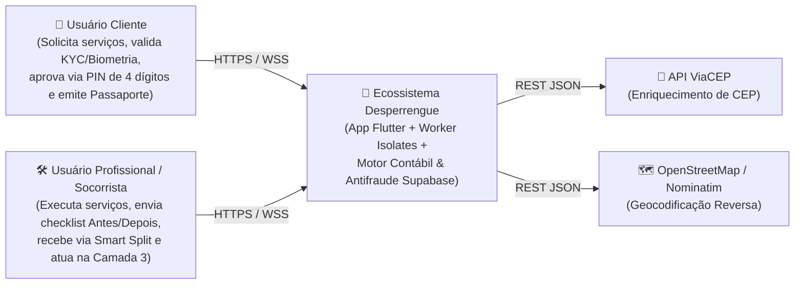
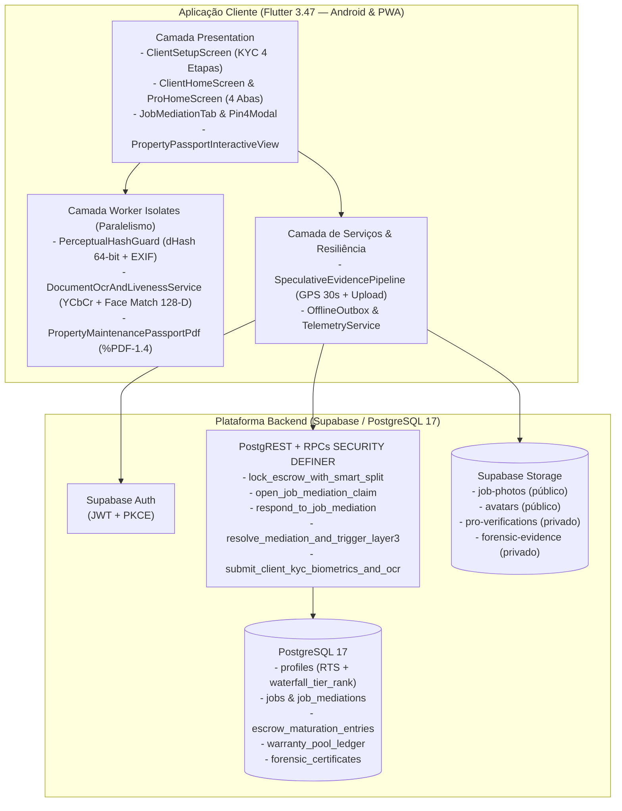
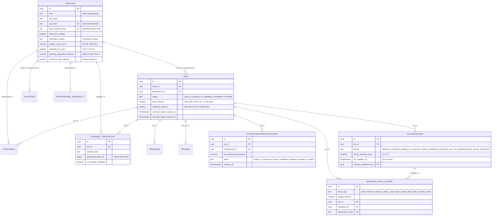

# Arquitetura do Sistema — Desperrengue (`v2.8.1`)

Documento de especificação arquitetural do sistema **Desperrengue**, estruturado segundo o modelo **C4** (Contexto, Contêineres, Componentes e Código/Dados) e alinhado à versão de produção `v2.8.1+202611082`.

> Para a especificação matemática do motor de Garantia em 3 Camadas, análise assintótica *Big-O* e pipeline de Visão Computacional, consulta-se [`docs/ARCHITECTURE.md`](ARCHITECTURE.md) e o [`ADR-0020`](adr/0020-garantia-3-camadas-antifraude-e-kyc-biometrico-ocr.md).

---

## 1. Visão Geral e Matriz Tecnológica

O **Desperrengue** é uma plataforma *multi-sided* de contratação de serviços residenciais imediatos e agendados com **Fundo de Garantia Auto-Sustentável em 3 Camadas**, **Smart Split Anti-Bypass (15% mão de obra / 0% peças com NF)**, **Biometria Facial Ao Vivo + Scanner Documental ISO ID-1** e **Passaporte Oficial de Manutenção do Imóvel (ABNT NBR 5674)**.

| Camada | Tecnologia Adotada | Papel Arquitetural no Ecossistema |
| :--- | :--- | :--- |
| **Cliente Mobile & Web (PWA)** | Flutter `3.47.x` (Dart `>=3.4.0 <4.0.0`), Material 3 | Base de código unificada para Android (APK/AAB) e Web (PWA em GitHub Pages com trava responsiva `480px`). |
| **Gerenciamento de Estado** | `flutter_riverpod` (`^2.5.1`) | Injeção de dependências determinística, *streams* reativos e isolamento de testes de widgets. |
| **Visão Computacional & Isolates** | `Isolate.run`, `camera`, `image_picker`, `PerceptualHashGuard`, `DocumentOcrAndLivenessService` | Execução paralela em memória isolada de `dHash` 64-bit, `MAD` $64\times 64$, Laplaciano, segmentação de pele $YCbCr$, Face Match 128-D multi-ângulo e OCR documental. |
| **Autenticação** | Supabase Auth (GoTrue) | Fluxo OAuth2/PKCE, confirmação de e-mail, recuperação de senha e emissão de JWTs assinados. |
| **Banco de Dados & Motor Contábil** | PostgreSQL 17 (Supabase) — **21 migrações SQL** | Persistência relacional com *Row Level Security* (RLS), *Append-Only Ledgers*, funções `SECURITY DEFINER` e ordenação canônica de bloqueios. |
| **Armazenamento de Objetos** | Supabase Storage (`job-photos`, `avatars`, `pro-verifications`, `forensic-evidence`) | Buckets segregados com políticas RLS por prefixo `auth.uid()` e URLs assinadas temporárias para dossiês KYC e forenses. |
| **Motor Documental PDF** | `PropertyMaintenancePassportPdf` (`%PDF-1.4` nativo) | Geração vetorial determinística em memória de certificados ABNT NBR 5674 e Lei do Inquilinato (Lei 8.245/91). |
| **Qualidade & CI/CD** | GitHub Actions (`ci.yml`, `pages-pwa.yml`, `release-apk.yml`, `supabase-migrate.yml`) | Execução automatizada de **529 testes Flutter**, **577 asserções SQL**, **17 testes de PDF** e verificação de links Markdown. |

---

## 2. Diagrama de Contexto (C4 — Nível 1)

---

## 3. Diagrama de Contêineres e Componentes (C4 — Níveis 2 e 3)

---

## 4. Modelo Entidade-Relacionamento Completo (`v2.8.1`)

O esquema relacional consolida **21 migrações versionadas** em [`supabase/migrations/`](../supabase/migrations/), abrangendo o ciclo de vida operacional, o motor contábil de garantia em 3 camadas, a custódia forense e o KYC biométrico unificado:

---

## 5. Governança de Segurança, Desempenho e Conformidade Legal

1. **Unificação Cadastral Multi-Modo**: Como `client` e `professional` compartilham a mesma linha em `public.profiles` (`id = auth.uid()`), a aprovação no onboarding biométrico do cliente (`client_kyc_verified = true`, `cpf_hash` e `face_liveness_hash`) propaga automaticamente $+30\text{ pontos}$ para o $RTS$ ao alternar para o modo Profissional.
2. **Exclusão Escopada LGPD (`delete_own_account_scoped`)**: Implementada na migração [`20261107100000_scoped_account_deletion.sql`](../supabase/migrations/20261107100000_scoped_account_deletion.sql), permite a revogação granular de um papel (`client` ou `professional`) com anonimização de PII ou a purga integral da conta quando se trata do último papel ativo.
3. **Passaporte Oficial de Manutenção do Imóvel**: Em conformidade com a **ABNT NBR 5674** e a **Lei Federal nº 8.245/91**, sintetiza apenas ordens de serviço reais e auditadas em documento vetorial `%PDF-1.4` com selos SHA-256, sem qualquer injeção de dados fictícios.
