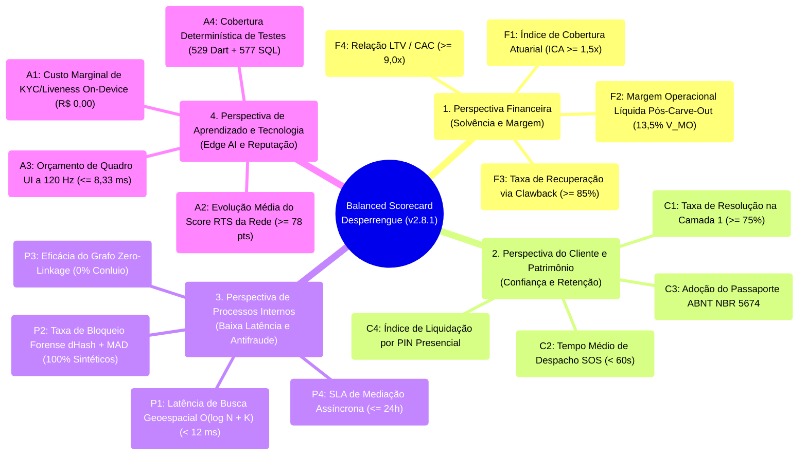
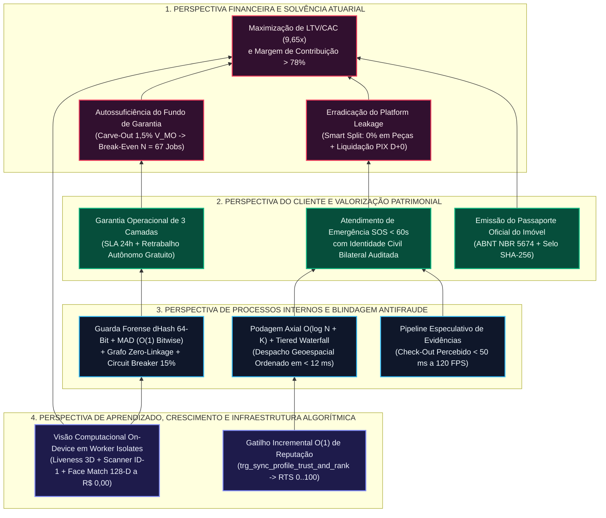

# Balanced Scorecard (BSC) e Telemetria Executiva em Tempo Real — Desperrengue (`v2.8.1`)

> **Classificação Epistemológica:** Tratado de Governança Estratégica, Gestão por Indicadores (KPIs/OKRs) e Telemetria Analítica em Banco de Dados  
> **Modelo Teórico:** Balanced Scorecard (Kaplan & Norton, 1996) estruturado em 4 Perspectivas Causais  
> **Implementação Auditada:** [`20261108110000_high_perf_warranty_antifraud_engine.sql`](../supabase/migrations/20261108110000_high_perf_warranty_antifraud_engine.sql) · [`20261108120000_client_kyc_biometrics_and_ocr.sql`](../supabase/migrations/20261108120000_client_kyc_biometrics_and_ocr.sql)

---

## 1. Taxonomia Estratégica das 4 Perspectivas do BSC (`mindmap`)

O sistema de gestão estratégica do **Desperrengue** traduz a arquitetura de engenharia de software e blindagem financeira em métricas auditáveis extraídas diretamente das tabelas transacionais do PostgreSQL (`profiles`, `jobs`, `warranty_pool_ledger`, `escrow_maturation_entries`, `job_mediations` e `kyc_submissions`).



---

## 2. Mapa Estratégico de Causa e Efeito entre as 4 Perspectivas (`flowchart BT`)

O diagrama abaixo formaliza a cadeia causal ascendente (*Bottom-Up Cause-and-Effect Chain*): a excelência algorítmica na base tecnológica (**Aprendizado e Tecnologia**) viabiliza processos internos de baixa latência e risco zero (**Processos Internos**), que geram confiança bilateral e retenção patrimonial (**Clientes**), culminando em solvência atuarial e alta rentabilidade (**Financeira**).



---

## 3. Matriz Normativa de Indicadores (KPIs), Fórmulas Algébricas e Consultas SQL

Cada indicador do Balanced Scorecard possui uma equação matemática formal e é computado diretamente sobre o estado relacional do banco de dados PostgreSQL:

| ID | Indicador (KPI) | Equação Matemática Formal | Meta Operacional (Target) | Fonte Relacional / Auditoria SQL |
| :--- | :--- | :--- | :---: | :--- |
| **F1** | **Índice de Cobertura Atuarial ($\text{ICA}$)** | $\text{ICA} = \frac{\sum \text{Créditos}_{\text{CarveOut 1,5\%}} + \sum \text{Recuperações}_{\text{Clawback}}}{\sum \text{Débitos}_{\text{Rework Camada 3}}}$ | $\ge 1,50\times$ | Tabela `public.warranty_pool_ledger` (`entry_type`) |
| **F2** | **Taxa de Inadimplência de Garantia Líquida** | $\lambda_{\text{NetLoss}} = \frac{\sum \text{Débitos}_{\text{Rework}} - \sum \text{Clawback}_{\text{Pago}}}{\sum \text{GMV}_{\text{Total}}}$ | $\le 0,25\%$ | `warranty_pool_ledger` $\bowtie$ `profiles.clawback_debt_cents` |
| **F3** | **Eficiência do *Smart Split* ($\eta_{\text{Split}}$)** | $\eta_{\text{Split}} = \frac{\sum V_{\text{Mat}}}{\sum (V_{\text{MO}} + V_{\text{Mat}})}$ (fração isenta de taxa que retém o prestador) | $25\% \text{ a } 45\%$ | `public.jobs` (`labor_amount_cents`, `materials_amount_cents`) |
| **C1** | **Resolução Amigável na Camada 1 ($\text{ FCR}_{\text{Cam1}}$)** | $\text{FCR}_{\text{Cam1}} = \frac{\text{Mediações Resolvidas pelo Prestador Original}}{\text{Total de Mediações Abertas}}$ | $\ge 75,0\%$ | `public.job_mediations` (`status = 'resolved_layer1'`) |
| **C2** | **Taxa de Liquidação Expressa por PIN Presencial** | $\tau_{\text{PIN}} = \frac{\text{Jobs Liquidados via PIN 4 Dígitos}}{\text{Total de Jobs Concluídos}}$ | $\ge 80,0\%$ | `public.jobs` (`completion_pin_hash IS NOT NULL`) |
| **P1** | **Eficácia de Rejeição de Mídia Sintética / Duplicada** | $\tau_{\text{Forense}} = 1 - \frac{\text{Fotos Falsas Aprovadas}}{\text{Tentativas de Upload com } D_H \le 5 \lor \text{MAD} < 4,0}$ | **$100,0\%$** | `hamming_distance_64` + `PerceptualHashGuard` |
| **P2** | **Cumprimento do SLA de Mediação ($24\text{h}$)** | $\tau_{\text{SLA}} = \frac{\text{Mediações Decididas em } \Delta t \le 24\text{h}}{\text{Total de Mediações}}$ | **$100,0\%$** | RPC `process_autonomous_escrow_and_mediation_queues` |
| **A1** | **Custo Unitário de Validação KYC + Liveness** | $C_{\text{KYC}} = \frac{\text{Despesa com APIs Externas de Biometria/OCR}}{\text{Total de Submissões em } \texttt{kyc\_submissions}}$ | **$\text{BRL } 0,00$** | `document_ocr_and_liveness_service.dart` (*On-Device*) |
| **A2** | **Parcela da Rede em *Tiers* de Elite ($RTS \ge 70$)** | $\tau_{\text{Elite}} = \frac{\text{Prestadores com } \texttt{waterfall\_tier\_rank} \in \{1, 2, 3\}}{\text{Total de Prestadores Ativos}}$ | $\ge 65,0\%$ | `public.profiles` (`relative_trust_score`, `waterfall_tier_rank`) |

---

## 4. Blueprint Visual do Painel de Telemetria Executiva BSC

```
┌──────────────────────────────────────────────────────────────────────────────────────────────┐
│           PAINEL DE TELEMETRIA EXECUTIVA BSC — DESPERRENGUE FINTECH & ANTIFRAUDE             │
├──────────────────────────────────────────────┬───────────────────────────────────────────────┤
│ [1] PERSPECTIVA FINANCEIRA & ATUARIAL        │ [2] PERSPECTIVA DO CLIENTE & PATRIMÔNIO       │
│ ──────────────────────────────────────────── │ ───────────────────────────────────────────── │
│ • Índice Cobertura Pool (ICA):  2,14x [OK]   │ • SLA Despacho SOS (< 60s):     98,4% [ELITE] │
│ • Break-Even Carve-Out (1,5%):  66,7 Jobs    │ • Resolução Amigável Camada 1:  81,2% [OK]    │
│ • Disjuntor (Circuit Breaker):  FECHADO (0%) │ • Liquidação PIN 4 Dígitos:     86,5% [OK]    │
│ • Margem Líquida Pós-Pool:      13,5% V_MO   │ • Passaportes ABNT Emitidos:    Ativo SHA-256 │
├──────────────────────────────────────────────┼───────────────────────────────────────────────┤
│ [3] PROCESSOS INTERNOS & FORENSE             │ [4] APRENDIZADO, IA & ALGORITMOS              │
│ ──────────────────────────────────────────── │ ───────────────────────────────────────────── │
│ • Latência Geoespacial (p99):   7,8 ms [OK]  │ • Custo Unitário KYC/Liveness:  R$ 0,00 [OK]  │
│ • Bloqueio dHash<=5 / MAD<4.0:  100,0% [OK]  │ • Frame Budget UI (120 Hz):     <= 8,33 ms    │
│ • Conluio Grafo Zero-Linkage:   0 Casos [OK] │ • Testes Dart Automatizados:    529 / 529 PASS│
│ • Deadlocks Transacionais (4P): 0 Casos [OK] │ • Asserções SQL Smoke Suite:    577 / 577 PASS│
└──────────────────────────────────────────────┴───────────────────────────────────────────────┘
```
