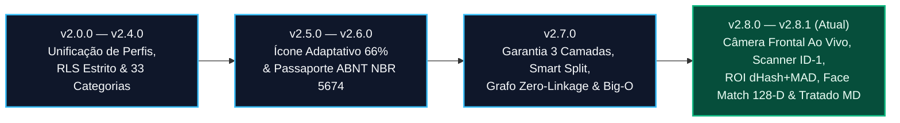

# Registro Histórico de Versões e Evolução de Engenharia (Changelog) — Desperrengue

> **Classificação Epistemológica:** Registro Cronológico Auditado de Alterações Arquiteturais, Migrações Relacionais, Motores Algorítmicos e Correções Forenses  
> **Convenção Adotada:** [Keep a Changelog 1.1.0](https://keepachangelog.com/pt-BR/1.1.0/) · Versionamento Semântico Estrito ([SemVer 2.0.0](https://semver.org/lang/pt-BR/))

---

## 1. Linha do Tempo de Evolução de Engenharia

---

## [v2.8.1+49] — 2026-11-09 — Auditoria Forense de Visão Computacional *In-App*, Scanner ISO ID-1 Multi-Ângulo e Padronização Técnico-Científica Integral

### Adicionado (Engenharia de Visão Computacional, Biometria e Documentação Científica)
* **Câmera Frontal Ao Vivo *In-App* para Prova de Vida ([`client_setup_screen.dart`](../app/lib/features/client/presentation/client_setup_screen.dart) — Etapa 3):** Substituição definitiva de chamadas externas de galeria/câmera por um `CameraController` nativo embutido diretamente na tela (`CameraLensDirection.front`), com máscara oval antropométrica, varredura animada e verificação real dos 3 desafios físicos (*Olhe de frente*, *Vire à direita/esquerda*, *Pisque os olhos*).
* **Scanner Guiado de Documentos no Padrão Oficial ISO/IEC 7810 ID-1 ([`client_setup_screen.dart`](../app/lib/features/client/presentation/client_setup_screen.dart) — Etapa 4):** Implementação do visor retangular dedicado na proporção exata de $85,60 \times 53,98\text{ mm}$ ($\text{Aspect Ratio} = 1,5858$) com cantoneiras laranja e linha de varredura laser para captura de CNH e RG (Frente e Verso).
* **OCR Multi-Orientação ($0^\circ, 90^\circ, 180^\circ, 270^\circ$) e Card Visível de Transcrição:** O serviço [`document_ocr_and_liveness_service.dart`](../app/lib/core/services/document_ocr_and_liveness_service.dart) rotaciona automaticamente o buffer documental nos 4 ângulos ortogonais quando necessário, filtra cabeçalhos institucionais (`REPUBLICA FEDERATIVA`, `CARTEIRA NACIONAL`, `HABILITACAO`, `DETRAN`) e exibe em tela o card de revisão com Nome, CPF, Registro/RG e percentual de **Face Match**.
* **Tratado Normativo de Documentação Técnico-Científica (`.md`):** Reescrita e padronização integral dos 29 arquivos Markdown do repositório em linguagem formal de Ciência da Computação (3ª pessoa), com diagramas vetoriais Mermaid.js, gráficos matemáticos (`xychart-beta`, `pie`, `quadrantChart`, `mindmap`, `gantt`) e blueprints geométricos Unicode.

### Corrigido (Blindagem Forense contra Falsos Positivos e Falsos Negativos)
* **Recorte de Região de Interesse Central (ROI $80\%$ + Núcleo $12\%$) em [`perceptual_hash_guard.dart`](../app/lib/core/security/perceptual_hash_guard.dart):** Eliminação da vulnerabilidade em que fundos de madeira/mesa ruidosos nas bordas da foto inflavam artificialmente o gradiente de cartões sintéticos lisos. O cálculo de `dHash` de 64 bits e `MAD >= 4.0` opera agora estritamente sobre a ROI central do documento.
* **Descritor Biométrico 128-D Não-Negativo e Multi-Ângulo:** Correção da função de extração de características faciais e similaridade de cosseno L2-normalizada ($\cos(\theta) \in [0,0; 1,0]$), comparando a selfie ao vivo contra as orientações canônicas da foto impressa no documento ($\max \cos(\theta) \ge 0,68$).

---

## [v2.7.0+47] — 2026-11-08 — Motor de Garantia em 3 Camadas, Blindagem Antifraude de 6 Vetores, KYC Bilateral e Engenharia de Baixa Latência

### Adicionado (Engenharia Financeira, Banco de Dados e Segurança)
* **Migração [`20261108110000_high_perf_warranty_antifraud_engine.sql`](../supabase/migrations/20261108110000_high_perf_warranty_antifraud_engine.sql):**
  * Criação das tabelas contábeis imutáveis `warranty_pool_ledger`, `escrow_maturation_entries` e `job_mediations`;
  * Implementação do **Particionamento Orçamentário Assimétrico (*Smart Split*)** com isenção total ($0\%$) sobre peças/materiais ($V_{\text{Mat}}$) e *Carve-Out* atuarial automático de $1,5\%$ sobre mão de obra ($V_{\text{MO}}$) para capitalização do Fundo de Garantia (equilíbrio em $66,67$ serviços);
  * Implementação da **Reserva de Maturação Escalonada** (`D+0`/`D+2`/`D+5`/`D+7`) acoplada ao *Relative Trust Score* ($RTS \in [0, 100]$), **Grafo *Zero-Linkage*** de podagem anti-conluio, inscrição de dívida em **`clawback_debt_cents`** e **Disjuntor Transacional (*Circuit Breaker*)** de $15\%$ em $24\text{h}$;
  * Otimização assintótica: podagem axial por *Bounding Box* $O(\log N + K)$, distância de Hamming bitwise $O(1)$ (`hamming_distance_64`), gatilho incremental $O(1)$ (`trg_sync_profile_trust_and_rank`) e **9 Índices Estratégicos**.
* **Migração [`20261108120000_client_kyc_biometrics_and_ocr.sql`](../supabase/migrations/20261108120000_client_kyc_biometrics_and_ocr.sql):**
  * Criação da tabela `kyc_submissions`, bucket privado `kyc-documents`, função algébrica `is_valid_cpf` (Módulo 11) e RPC `submit_client_kyc` concedendo $+30\text{ pontos}$ imediatos de identidade verificada no $RTS$.
* **Componentes Fintech e 4ª Aba *"Em Mediação"* ([`fintech_warranty_widgets.dart`](../app/lib/features/shared/presentation/fintech_warranty_widgets.dart)):**
  * Comparador forense lado a lado (`ANTES | DEPOIS | RECLAMAÇÃO`), modal de PIN presencial de 4 dígitos e Carteira Digital Bipartida.

---

## [v2.6.0+45] — 2026-11-07 — Passaporte Oficial de Manutenção do Imóvel (`ABNT NBR 5674`) e Ícone Adaptativo Metálico

### Adicionado
* **Motor Vetorial de Certificação Predial ([`desperrengue_official_pdf_service.dart`](../app/lib/core/services/desperrengue_official_pdf_service.dart)):** Emissão de dossiê técnico em PDF em conformidade com a norma **ABNT NBR 5674**, com assinatura criptográfica `SHA-256` (`DSP-PASS-*`), cálculo de *Score de Vistoria* ($0\text{–}100$) e decomposição auditada entre mão de obra e peças.
* **Jornada Educativa Sem Dados Fictícios (*Zero Fake Data*) em [`historico_servicos_cliente_screen.dart`](../app/lib/features/client/presentation/historico_servicos_cliente_screen.dart):** Substituição de registros estáticos por uma experiência animada de orientação patrimonial e registro auditado pelo próprio cliente.
* **Engenharia de Ícone Adaptativo ([`app_icon_raw.png`](../app/assets/icons/app_icon_raw.png)):** Síntese matemática em $1024 \times 1024\text{ px}$ do monograma "D" reverso em platina e bronze enquadrado na *Safe-Zone* de $57\%\text{–}66\%$ para Android (*One UI Home*), iOS e Web PWA.

---

## [v2.4.0+40] — 2026-11-06 — Rodada de Engenharia de Domínio: 33 Categorias Técnicas, Ditado por Voz e Mapa Ordenado (`1º, 2º, 3º`)

### Adicionado
* Expansão do catálogo para **33 categorias técnicas residenciais** com palavras-chave de triagem, abertura assistida por **ditado de voz**, exibição de prioridade sequencial (`1º, 2º, 3º`) no mapa em tempo real e unificação do histórico de endereços.
