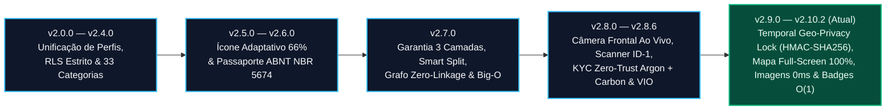

# Registro Histórico de Versões e Evolução de Engenharia (Changelog) — Desperrengue

> **Classificação Epistemológica:** Registro Cronológico Auditado de Alterações Arquiteturais, Migrações Relacionais, Motores Algorítmicos e Correções Forenses  
> **Convenção Adotada:** [Keep a Changelog 1.1.0](https://keepachangelog.com/pt-BR/1.1.0/) · Versionamento Semântico Estrito ([SemVer 2.0.0](https://semver.org/lang/pt-BR/))

---

## 1. Linha do Tempo de Evolução de Engenharia

---

## [v2.10.2+62] — 2026-11-12 — Trava Temporal e Espacial de Privacidade Geográfica (`ADR-0022`), Mapa Full-Screen Imersivo (`100%` Viewport), Motor de Imagens `0 ms`, Badges `O(1)` e Auditoria Forense Multi-Agente

### Adicionado & Endurecido (Segurança Geoespacial Zero-Trust, Criptografia HMAC-SHA256, UX 120 FPS e QA Adversarial)
* **Trava Temporal e Espacial de Privacidade Geográfica (*Temporal & Spatial Geo-Privacy Lock* — [`ADR-0022`](adr/ADR-0022-temporal-geo-privacy-lock.md)):**
  * **Camada SQL Zero-Trust, Ofuscação Server-Side `HMAC-SHA256` e Hardening `[SEC-01]`..`[SEC-09]` ([`20261113100000_temporal_geo_privacy_lock.sql`](../supabase/migrations/20261113100000_temporal_geo_privacy_lock.sql), [`20261113110000_security_hardening_audit.sql`](../supabase/migrations/20261113110000_security_hardening_audit.sql), [`geo_privacy_lock.sql`](../supabase/tests/geo_privacy_lock.sql) & [`test-geo-privacy-sql.mjs`](../scripts/test-geo-privacy-sql.mjs), SHAs `d3822d6` e `e404338`):** Segredo de 256 bits isolado em `private.geo_privacy_secrets` (`gen_random_bytes(32)`, RLS + FORCE RLS sem policies, `REVOKE ALL FROM public, anon, authenticated`) consumido por `public._geo_fuzzy_center(p_job, p_lat, p_lng)` via `extensions.hmac(p_job::text::bytea, secret_key, 'sha256')` para deslocar o centro em $151\text{–}349\text{ m}$ com raio de $500\text{–}800\text{ m}$ (imóvel real sempre $\ge 150\text{ m}$ dentro da borda, estável por chamado e matematicamente não-invertível, validado por Monte Carlo de 10.000 amostras). Triggers `aa_jobs_geo_privacy_before/after` migram coordenadas exatas exclusivamente para `public.job_geo` e CEP para `public.job_addresses`, anulando `jobs.latitude/longitude/address_cep`, sanitizando `jobs.address_summary` (`Bairro, Cidade - UF`) e preenchendo `public_lat`/`public_lng`/`fuzzy_radius_m` (eliminando vazamentos via `SELECT *` ou `supabase_realtime`). Inclui wrapper 1-arg `_can_see_exact_location(uuid)` anti-oráculo (`auth.uid()`), isolamento de `checkout_pin_hash` e `job_presence_secret` em `private.job_forensic_secrets` (`[SEC-02]`), blindagem `auth.uid()` anti-IDOR nas RPCs `SECURITY DEFINER` (`[SEC-03]`), RLS estrito nas 6 tabelas financeiras/forenses (`[SEC-01]`) e bucket privado `forensic-evidence` (`public = false`, `[SEC-09]`).
  * **Máquina Determinística de 4 Fases em `America/Sao_Paulo` (`UTC−3` fixo — [`geo_privacy_policy_engine.dart`](../app/lib/core/security/geo_privacy_policy_engine.dart) & [`marketplace_models.dart`](../app/lib/core/models/marketplace_models.dart), SHAs `7b61c4d` e `6aa248e`):** Implementação de `GeoPrivacyPolicyEngine`, `ProviderLocationView.fromRpc` (com descarte defensivo *fail-closed*) e `JobService.fetchLocationForViewer` / `fetchOwnerExactLocation`. Governa as fases `ownerFull` (cliente vê endereço e mapa exato sempre), `openQuoting` (pedido aberto: só Bairro, Cidade/UF e círculo aproximado), `confirmedFuture` (agendado para dia futuro em SP ou `awaiting_payment`: só Bairro, Cidade/UF, círculo aproximado e data de liberação `DD/MM/AAAA às 00h00`), `serviceDay` ($\text{HOJE}_{\text{SP}} \ge \text{DIA\_AGENDADO}_{\text{SP}}$ pago ou em execução: libera Rua, Número, Complemento, Referência, CEP e rota exata) e `closed` (`completed`/`canceled`/`disputed`: re-bloqueia permanentemente rua, número e coordenadas exatas em conformidade com a minimização LGPD Art. 6º, III).
  * **Componentes Visuais, Ergonomia 120 Hz e Blindagem das 5 Superfícies do Profissional ([`geo_privacy_widgets.dart`](../app/lib/features/shared/presentation/geo_privacy_widgets.dart), SHAs `d814455`, `f69353e` e `60f34b5`):** Novos widgets `ProtectedAreaMapCard`, `GeoLockNotice`, `ProtectedAreaMapSheet`, `ProviderLocationPanel`, `ProviderAreaLine` e `ProviderLocationBuilder` (com despertar exato às `00h00` SP sem polling) aplicados em `provider_shell.dart`, `provider_job_screen.dart`, `provider_execution_screens.dart`, `dossie_servico_profissional_screen.dart` e `scheduled_service_screen.dart`, além de isolamento de cronômetros em `RepaintBoundary` e validação monetária pt-BR sem overflow em `320px`.
  * **Sanitização Binária EXIF/GPS no Upload e Auditoria Core/Services de 12 Pontos ([`media_service.dart`](../app/lib/core/services/media_service.dart), [`warranty_escrow_service.dart`](../app/lib/services/warranty_escrow_service.dart), [`image_metadata_stripper.dart`](../app/lib/core/utils/image_metadata_stripper.dart), [`address_privacy.dart`](../app/lib/core/utils/address_privacy.dart), [`app_failure.dart`](../app/lib/core/utils/app_failure.dart), [`money.dart`](../app/lib/core/utils/money.dart), [`resilient_stream.dart`](../app/lib/core/utils/resilient_stream.dart) & [`deep_link_policy.dart`](../app/lib/features/auth/presentation/deep_link_policy.dart), SHAs `b78c074`, `0658fcd`, `214eec8`, `38ffed4` e `74e6352`):** (1) Remoção integral lossless de metadados EXIF/TIFF/GPS/XMP/IPTC (JPEG/PNG/WebP) em todos os uploads (`MediaService`, `ProfileService`, `WarrantyEscrowService` com `createSignedUrl`); (2) `AppFailure`/`Result`/`humanizeError`/`redactForLog`; (3) aritmética em centavos (`Money`) para clawback e SOS; (4) reconexão automática de streams Realtime (`resilientStream`) em `job_service`, `social_service` e `wallet_service`; (5) `deep_link_policy.dart` com limpeza completa de sessão/cache no logout; (6) TTL de 7 dias e expurgo no `DraftStore`; (7) imagens privadas (`storage:`) restritas à RAM (sem persistência em `SharedPreferences`) e limite de 4 prefetches simultâneos; (8) eliminação de *race conditions* em `PostAuthRouter`, `UnreadOrdersBadgeController`, `ProviderPortfolioStore`, `UpdateGate` e KYC step 5; (9) erradicação de `dart:io` nos steps 1–5 de verificação e `runOffMainThread` web-safe; (10) pinning de domínio HTTPS (`github.com`/`*.githubusercontent.com`) no `UpdateService`; (11) mascaramento LGPD de PII antes do envio ao corretor externo (`AddressPrivacy.maskForThirdParty`) e `AddressPrivacy.coarseArea` no portfólio/ledger; e (12) guarda estática contra logs de PII (`eng_static_guards_test.dart`).
* **Mapa Full-Screen Imersivo (`100%` Viewport) e Roteamento OSRM + Arco Geodésico $C^\infty$ ([`service_map_widgets.dart`](../app/lib/features/shared/presentation/service_map_widgets.dart) & [`order_live_map_modal_screen.dart`](../app/lib/features/shared/presentation/order_live_map_modal_screen.dart), SHAs `2601974`, `b2bd6de` e `eda6784`):**
  * `OrderLiveMapModalScreen` ocupa $100\%$ da tela ($\ge 80\%$ de área cartográfica desobstruída), com cascata dupla OSRM (`router.project-osrm.org` $\to$ `routing.openstreetmap.de`), fallback para arco geodésico $C^\infty$ contínuo de 36 segmentos, supressão automática de rota em chamados encerrados e barra inferior de ações em 1 linha (`Rota · Copiar · Fechar`).
* **Motor de Imagens Instantâneo (`0 ms` L1 RAM + L2 Persistente — [`instant_image_cache_engine.dart`](../app/lib/core/services/instant_image_cache_engine.dart) & [`widgets.dart`](../app/lib/core/ui/widgets.dart), SHAs `0799a59` e `3fc9abe`):**
  * Cache híbrido em memória (`Uint8List`) e disco (`SharedPreferences` Base64 com validação de *magic bytes*) acoplado à hidratação síncrona no boot ([`app_session.dart`](../app/lib/core/services/app_session.dart)), erradicando o *pop-in* de iniciais no `InstantUserAvatar`.
* **Badges de Pedidos Não Lidos com Decremento Otimista em $O(1)$ ([`unread_orders_badge_controller.dart`](../app/lib/core/state/unread_orders_badge_controller.dart), SHAs `bd8dc7b` e `9bd3134`):**
  * Limpeza e decremento em $0\text{ ms}$ no exato frame do toque no card do pedido (`markOrderAsViewedOptimistically`), sem ressuscitar contadores durante sincronizações concorrentes.
* **Suítes Adversariais de QA e Multi-Viewport ([`temporal_geo_privacy_lock_widgets_test.dart`](../app/test/temporal_geo_privacy_lock_widgets_test.dart), [`provider_geo_privacy_ui_test.dart`](../app/test/provider_geo_privacy_ui_test.dart) e [`geo_privacy_policy_engine_test.dart`](../app/test/geo_privacy_policy_engine_test.dart)):**
  * Cobertura automatizada de todas as 4 fases, fronteira `23:59:59` vs `00:00:00` SP e inspeção *Red Team* em `320×640`, `360×780`, `412×915` e `480×900`.

---

## [v2.8.6+52] — 2026-11-12 — Arquitetura KYC Zero-Trust Híbrida (`Gemini 4 Argon High` + `Carbon High`), Criptografia Governamental VIO/ICP-Brasil, Sessão Anti-Swap (`180s`) e UX Humana 120 FPS

### Adicionado (Visão Computacional Argon High, Criptografia ICP-Brasil, Orquestração Carbon High e Ponte Supabase)
* **Microsserviço Python/FastAPI de KYC Zero-Trust ([`kyc_engine/app/main.py`](../kyc_engine/app/main.py) & [`ADR-0021`](adr/0021-arquitetura-kyc-zero-trust-argon-carbon.md)):**
  * **Grounding Espacial 2D (`[0..1000]`), Auto-Rotação Canônica e OCR Forense ([`schemas_argon.py`](../kyc_engine/app/models/schemas_argon.py) & [`vision_ocr_argon.py`](../kyc_engine/app/services/vision_ocr_argon.py)):** Extração simultânea de `face_portrait_box_2d`, `qr_code_vio_box_2d`, `signature_box_2d` e `mrz_box_2d` com recorte subpixel automático (Foto $3\times 4$ em JPEG `q=95` e QR Code VIO em **PNG sem perda**), blindagem determinística contra *Visual Prompt Injection*, validadores Módulo 11 (CPF, CNPJ e Chave NF-e de 44 dígitos), Módulo 10 ICAO Doc 9303 (`TD1`/`TD3`) e compatibilidade nominal inteligente (subconjunto ordenado legítimo $\ge 0,80$).
  * **Validador Criptográfico Governamental VIO/ICP-Brasil e NFC `EF.SOD` ([`crypto_doc_validator.py`](../kyc_engine/app/services/crypto_doc_validator.py)):** Super-resolução bicúbica $2\times$ + `CLAHE` + decodificação C++ (`zxingcpp`/OpenCV), descompressão `zlib` protegida contra *zip-bombs* ($\le 64\text{ KiB}$), validação de envelopes `ASN.1/DER CMS PKCS#7 SignedData`, assinaturas `ECDSA P-256` (`IEEE P1363` $\leftrightarrow$ `DER`) e `RSA-2048` contra a cadeia ICP-Brasil/SENATRAN, trava anti-clonagem (`qr_cpf == ocr_cpf == typed_cpf`) e *Passive Authentication* NFC (`EF.SOD` + `DG1`/`DG2`).
  * **Motor de Segurança Zero-Trust e Cliente SERPRO mTLS 1.3 ([`security.py`](../kyc_engine/app/core/security.py) & [`serpro_datavalid.py`](../kyc_engine/app/services/serpro_datavalid.py)):** Ticket de sessão Anti-Swap (`HMAC-SHA256`, `TTL <= 180s`, `request_hash` encadeando `SHA-256` da selfie e do documento), verificação de Google Play Integrity (`MEETS_STRONG_INTEGRITY`) / Apple `DCAppAttestService`, criptografia WORM `AES-256-GCM` via `HKDF-SHA256`, filtro de logs `PiiRedactingLogFilter` e pool persistente `httpx.AsyncClient` com TLS 1.3 mútuo ICP-Brasil A1 e *Circuit Breaker*.
  * **Orquestrador de Fraude Carbon High e 5 Hard Vetos Pré-LLM ([`fraud_orchestrator.py`](../kyc_engine/app/services/fraud_orchestrator.py)):** Imposição de 5 travas determinísticas pré-LLM que impedem alucinação aprobatória, auditoria fiscal de notas do *Smart Split* (`/v1/smart-split/verify-invoice`) e explicabilidade algorítmica com Top-3 Fatores SHAP (LGPD Art. 20).
* **Ponte Transacional Supabase e Migração SQL ([`20261112150000_carbon_kyc_webhook_bridge.sql`](../supabase/migrations/20261112150000_carbon_kyc_webhook_bridge.sql), [`kyc-argon-vision-gate`](../supabase/functions/kyc-argon-vision-gate/index.ts) & [`kyc-carbon-webhook`](../supabase/functions/kyc-carbon-webhook/index.ts)):**
  * Criação da tabela de idempotência `public.kyc_webhook_events`, expansão forense de `public.kyc_submissions` e `public.profiles`, e RPC `public.apply_verified_carbon_kyc_verdict` (`SECURITY DEFINER`) preservando a Unificação Multi-Modo ($+30\text{ pts}$ imediatos no Score $RTS$) e a trava *Same-Holder PIX Lock*.
* **UX Humana a 120 FPS e Bateria de Testes E2E Red Team ([`kyc_human_feedback_translator.dart`](../app/lib/core/ui/kyc_human_feedback_translator.dart), [`kyc_session_anti_swap_guard.dart`](../app/lib/core/security/kyc_session_anti_swap_guard.dart), [`argon_carbon_kyc_and_ux_test.dart`](../app/test/argon_carbon_kyc_and_ux_test.dart) & [`test_end_to_end_pipeline_redteam.py`](../kyc_engine/tests/test_end_to_end_pipeline_redteam.py)):**
  * Tradução determinística de todos os códigos forenses em orientações acolhedoras em português (zero jargão técnico na UI), `RepaintBoundary` a $120\text{ FPS}$ e cobertura automatizada elevada para **559 testes Flutter (27 suítes)** e **64 testes Python KYC (3 suítes)**.

---

## [v2.8.1+49] — 2026-11-09 — Auditoria Forense de Visão Computacional *In-App*, Scanner ISO ID-1 Multi-Ângulo e Padronização Técnico-Científica Integral

### Adicionado (Engenharia de Visão Computacional, Biometria e Documentação Científica)
* **Câmera Frontal Ao Vivo *In-App* para Prova de Vida ([`client_setup_screen.dart`](../app/lib/features/client/presentation/client_setup_screen.dart) — Etapa 3):** Substituição definitiva de chamadas externas de galeria/câmera por um `CameraController` nativo embutido diretamente na tela (`CameraLensDirection.front`), com máscara oval antropométrica, varredura animada e verificação real dos 3 desafios físicos (*Olhe de frente*, *Vire à direita/esquerda*, *Pisque os olhos*).
* **Scanner Guiado de Documentos no Padrão Oficial ISO/IEC 7810 ID-1 ([`client_setup_screen.dart`](../app/lib/features/client/presentation/client_setup_screen.dart) — Etapa 4):** Implementação do visor retangular dedicado na proporção exata de $85,60 \times 53,98\text{ mm}$ ($\text{Aspect Ratio} = 1,5858$) com cantoneiras laranja e linha de varredura laser para captura de CNH e RG (Frente e Verso).
* **OCR Multi-Orientação ($0^\circ, 90^\circ, 180^\circ, 270^\circ$) e Card Visível de Transcrição:** O serviço [`document_ocr_and_liveness_service.dart`](../app/lib/core/services/document_ocr_and_liveness_service.dart) rotaciona automaticamente o buffer documental nos 4 ângulos ortogonais quando necessário, filtra cabeçalhos institucionais (`REPUBLICA FEDERATIVA`, `CARTEIRA NACIONAL`, `HABILITACAO`, `DETRAN`) e exibe em tela o card de revisão com Nome, CPF, Registro/RG e percentual de **Face Match**.
* **Tratado Normativo de Documentação Técnico-Científica (`.md`):** Reescrita e padronização integral dos 29 arquivos Markdown do repositório em linguagem formal de Ciência da Computação (3ª pessoa), com diagramas vetoriais Mermaid.js, gráficos matemáticos (`xychart-beta`, `pie`, `quadrantChart`, `mindmap`, `gantt`) e blueprints geométricos Unicode.

### Corrigido (Blindagem Forense contra Falsos Positivos e Falsos Negativos)
* **Recorte de Região de Interesse Central (ROI $80\%$ + Núcleo $12\%$) em [`perceptual_hash_guard.dart`](../app/lib/core/security/perceptual_hash_guard.dart):** Eliminação da vulnerabilidade em que fundos de madeira/mesa ruidosos nas bordas da foto inflavam artificialmente o gradiente de cartões sintéticos lisos. O cálculo de `dHash` de 64 bits e `MAD >= 4.0` opera agora estritamente sobre a ROI central do documento.
* **Descritor Biométrico 128-D Não-Negativo e Multi-Ângulo:** Correção da função de extração de características faciais e similaridade de cosseno L2-normalizada ($\cos(\theta) \in [0,0; 1,0]$), comparando a selfie ao vivo contra as orientações canônicas da foto impressa no documento ($\max \cos(\theta) \ge 0,68$).

---

## [v2.7.0+47] — 2026-11-08 — Motor de Garantia em 3 Camadas, Blindagem Antifraude de 6 Vetores, KYC Bilateral e Engenharia de Baixa Latência

### Adicionado (Engenharia Financeira, Banco de Dados e Segurança)
* **Migração [`20261108110000_high_perf_warranty_antifraud_engine.sql`](../supabase/migrations/20261108110000_high_perf_warranty_antifraud_engine.sql):**
  * Criação das tabelas contábeis imutáveis `warranty_pool_ledger`, `escrow_maturation_entries` e `job_mediations`;
  * Implementação do **Particionamento Orçamentário Assimétrico (*Smart Split*)** com isenção total ($0\%$) sobre peças/materiais ($V_{\text{Mat}}$) e *Carve-Out* atuarial automático de $1,5\%$ sobre mão de obra ($V_{\text{MO}}$) para capitalização do Fundo de Garantia (equilíbrio em $66,67$ serviços);
  * Implementação da **Reserva de Maturação Escalonada** (`D+0`/`D+2`/`D+5`/`D+7`) acoplada ao *Relative Trust Score* ($RTS \in [0, 100]$), **Grafo *Zero-Linkage*** de podagem anti-conluio, inscrição de dívida em **`clawback_debt_cents`** e **Disjuntor Transacional (*Circuit Breaker*)** de $15\%$ em $24\text{h}$;
  * Otimização assintótica: podagem axial por *Bounding Box* $O(\log N + K)$, distância de Hamming bitwise $O(1)$ (`hamming_distance_64`), gatilho incremental $O(1)$ (`trg_sync_profile_trust_and_rank`) e **9 Índices Estratégicos**.
* **Migração [`20261108120000_client_kyc_biometrics_and_ocr.sql`](../supabase/migrations/20261108120000_client_kyc_biometrics_and_ocr.sql):**
  * Criação da tabela `kyc_submissions`, bucket privado `kyc-documents`, função algébrica `is_valid_cpf` (Módulo 11) e RPC `submit_client_kyc` concedendo $+30\text{ pontos}$ imediatos de identidade verificada no $RTS$.
* **Componentes Fintech e 4ª Aba *"Em Mediação"* ([`fintech_warranty_widgets.dart`](../app/lib/features/shared/presentation/fintech_warranty_widgets.dart)):**
  * Comparador forense lado a lado (`ANTES | DEPOIS | RECLAMAÇÃO`), modal de PIN presencial de 4 dígitos e Carteira Digital Bipartida.

---

## [v2.6.0+45] — 2026-11-07 — Passaporte Oficial de Manutenção do Imóvel (`ABNT NBR 5674`) e Ícone Adaptativo Metálico

### Adicionado
* **Motor Vetorial de Certificação Predial ([`desperrengue_official_pdf_service.dart`](../app/lib/core/services/desperrengue_official_pdf_service.dart)):** Emissão de dossiê técnico em PDF em conformidade com a norma **ABNT NBR 5674**, com assinatura criptográfica `SHA-256` (`DSP-PASS-*`), cálculo de *Score de Vistoria* ($0\text{–}100$) e decomposição auditada entre mão de obra e peças.
* **Jornada Educativa Sem Dados Fictícios (*Zero Fake Data*) em [`historico_servicos_cliente_screen.dart`](../app/lib/features/client/presentation/historico_servicos_cliente_screen.dart):** Substituição de registros estáticos por uma experiência animada de orientação patrimonial e registro auditado pelo próprio cliente.
* **Engenharia de Ícone Adaptativo ([`app_icon_raw.png`](../app/assets/icons/app_icon_raw.png)):** Síntese matemática em $1024 \times 1024\text{ px}$ do monograma "D" reverso em platina e bronze enquadrado na *Safe-Zone* de $57\%\text{–}66\%$ para Android (*One UI Home*), iOS e Web PWA.

---

## [v2.4.0+40] — 2026-11-06 — Rodada de Engenharia de Domínio: 33 Categorias Técnicas, Ditado por Voz e Mapa Ordenado (`1º, 2º, 3º`)

### Adicionado
* Expansão do catálogo para **33 categorias técnicas residenciais** com palavras-chave de triagem, abertura assistida por **ditado de voz**, exibição de prioridade sequencial (`1º, 2º, 3º`) no mapa em tempo real e unificação do histórico de endereços.
