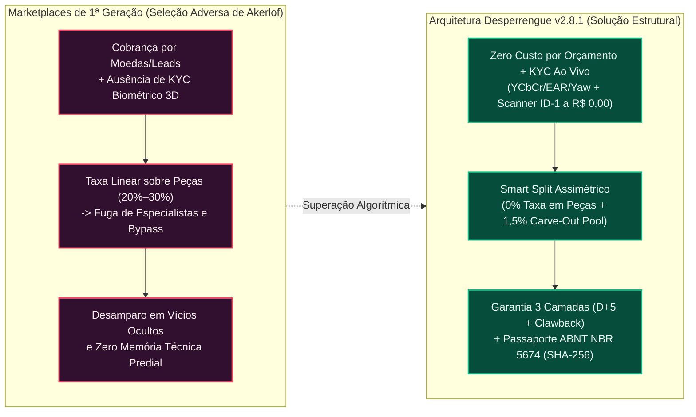
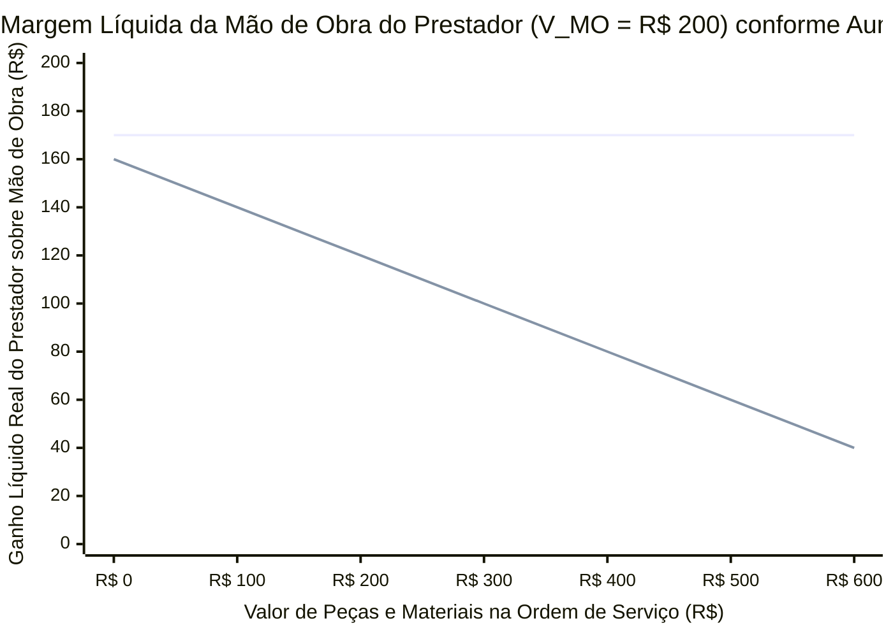
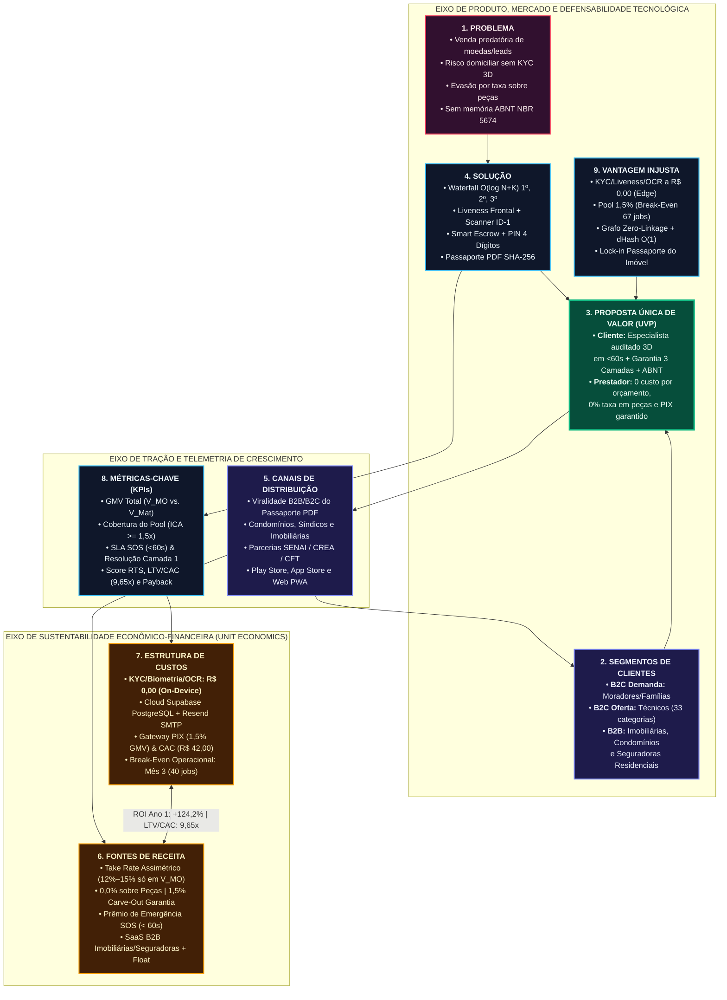
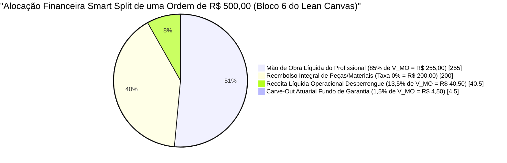
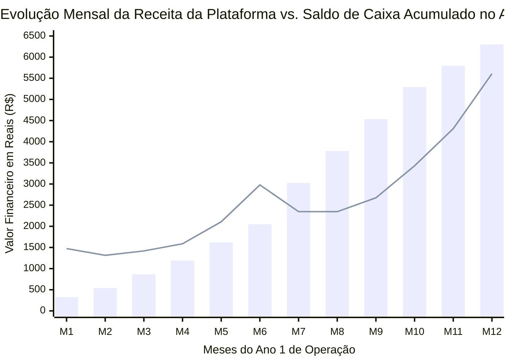
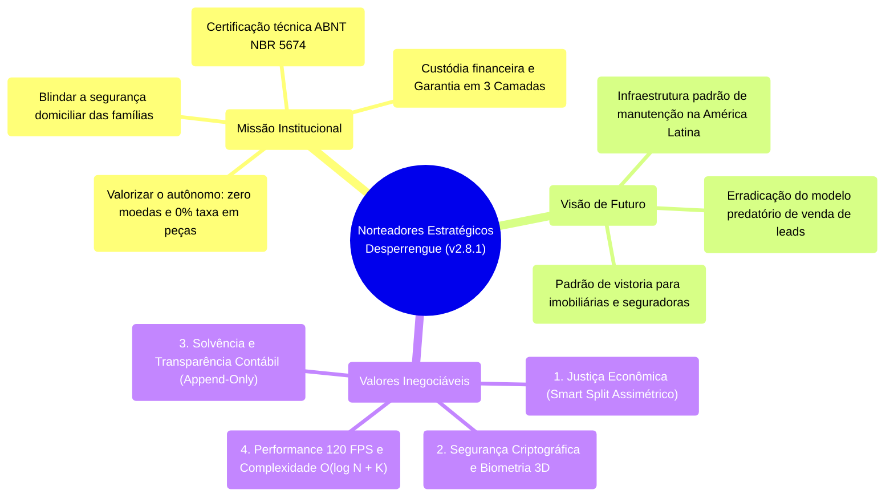

# Documento de Contexto, Fundamentação Econômica, Lean Canvas e Norteadores Estratégicos — Desperrengue (`v2.8.1`)

> **Classificação Epistemológica:** Tratado de Economia da Informação, Modelagem Estratégica de Negócios (*Lean Canvas* — Ash Maurya), Teoria de Compatibilidade de Incentivos e Governança Institucional  
> **Referencial Teórico:** George Akerlof (*The Market for "Lemons"*, 1970) · Ash Maurya (*Running Lean*, 2012) · Lei do Inquilinato (Lei nº 8.245/1991) · Norma Técnica **ABNT NBR 5674**  
> **Implementação Auditada:** [`20261108110000_high_perf_warranty_antifraud_engine.sql`](../supabase/migrations/20261108110000_high_perf_warranty_antifraud_engine.sql) · [`20261108120000_client_kyc_biometrics_and_ocr.sql`](../supabase/migrations/20261108120000_client_kyc_biometrics_and_ocr.sql) · [`document_ocr_and_liveness_service.dart`](../app/lib/core/services/document_ocr_and_liveness_service.dart) · [`desperrengue_official_pdf_service.dart`](../app/lib/core/services/desperrengue_official_pdf_service.dart)

---

## 1. Introdução e Problema de Pesquisa (O Fenômeno de Seleção Adversa de Akerlof)

O setor brasileiro de manutenção predial e serviços residenciais caracteriza-se por elevada demanda inelástica, porém opera sob severa fricção informacional e informalidade. Em sua obra seminal *The Market for "Lemons": Quality Uncertainty and the Market Mechanism* (1970), George Akerlof demonstra que, em mercados marcados por **assimetria informacional pré-contratual**, a incapacidade de o contratante distinguir *ex ante* entre profissionais de alta qualificação técnica ($Q_{\text{alta}}$) e agentes oportunistas ou não qualificados ($Q_{\text{baixa}}$) força a convergência dos preços para uma média depreciada ($\bar{P}$), expulsando os melhores especialistas do mercado.

Nas plataformas de classificados e aplicativos de intermediação de primeira geração (baseados na venda de *leads* ou "moedas de orçamento"), verificam-se quatro falhas estruturais graves:

1. **Penalização Financeira do Trabalhador Autônomo (Venda de *Leads* sem Garantia):** Prestadores são obrigados a comprar pacotes de "moedas" antecipadamente apenas para desbloquear o contato de um cliente, sem qualquer garantia de fechamento do serviço, gerando prejuízo líquido recorrente para o trabalhador.
2. **Insegurança Física e Domiciliar do Cliente (*Ataques Sybil* e Falsidade Ideológica):** A ausência de prova de vida biométrica 3D e de validação criptográfica de documentos permite que indivíduos mal-intencionados ingressem em residências sem triagem civil confiável ou recriem perfis após execuções defeituosas.
3. **Desintermediação Induzida por Bitributação de Insumos (*Platform Leakage / Bypass*):** A cobrança de comissões lineares (`20%` a `30%`) sobre o valor bruto total do serviço — incluindo peças e materiais comprados pelo técnico — confisca a margem da mão de obra e força as partes a transacionarem fora da plataforma.
4. **Desamparo Pós-Serviço (*Risco Moral*) e Perda de Memória Técnica do Imóvel:** Pagamentos diretos sem custódia (*Escrow*) deixam o morador desprotegido contra vícios ocultos que surgem horas após a saída do técnico, além de não gerarem lastro documental padronizado segundo a norma **ABNT NBR 5674** para vistorias imobiliárias e seguradoras.

---

## 2. A Solução Proposta e a Demonstração Matemática da Compatibilidade de Incentivos

O **Desperrengue** soluciona simultaneamente as falhas de seleção adversa, risco moral e evasão (*bypass*) por meio de uma arquitetura de **Oferta Direcionada em Cascata (*Tiered Waterfall*)**, **Custódia Condicional (*Smart Escrow*)** e **Particionamento Orçamentário Assimétrico (*Anti-Bypass Smart Split*)**.

Considere uma Ordem de Serviço cujo Volume Bruto Transacionado é decomposto na soma entre a parcela de **Mão de Obra** ($V_{\text{MO}}$) e a parcela de **Materiais/Peças comprovados por nota** ($V_{\text{Mat}}$):

$$\text{GMV}_{\text{Total}} = V_{\text{MO}} + V_{\text{Mat}}$$

Em plataformas legadas com comissão linear $\tau_{\text{legado}} = 0,20$ (`20%`) incidente indiscriminadamente sobre o valor total:

$$\text{Retenção}_{\text{legado}} = 0,20 \cdot \left(V_{\text{MO}} + V_{\text{Mat}}\right)$$

Se um reparo elétrico envolve $V_{\text{MO}} =$ `R$ 200,00` e $V_{\text{Mat}} =$ `R$ 300,00` ($\text{GMV}_{\text{Total}} =$ `R$ 500,00`), a cobrança linear confisca `R$ 100,00` — o que representa **exatos `50,0%` da remuneração pelo trabalho intelectual e operacional do técnico** (`R$ 100,00` $\div$ `R$ 200,00`).

No **Desperrengue**, a equação de retenção incide **exclusivamente sobre a mão de obra** ($\tau_{\text{App}} \in [0,12;\, 0,15]$, sendo `1,5%` segregado automaticamente via *Carve-Out* para capitalizar o Fundo de Garantia) e aplica **alíquota estrita de `0,0%` sobre materiais**:

$$\text{Retenção}_{\text{Desperrengue}} = \tau_{\text{App}} \cdot V_{\text{MO}} + 0,00 \cdot V_{\text{Mat}}$$

No mesmo exemplo ($\tau_{\text{App}} = 0,15$), a retenção total cai de `R$ 100,00` para apenas **`R$ 30,00`** (`6,0%` do GMV total, sendo `R$ 27,00` receita líquida da plataforma e `R$ 3,00` alocados ao Fundo de Garantia). Simultaneamente, permanecer dentro da plataforma entrega utilidade líquida estritamente superior ($U_{\text{InApp}}$ $>$ $U_{\text{Bypass}}$) para ambos os polos:

* **Para o Cliente:** Garantia Operacional em 3 Camadas (com retrabalho gratuito por segundo especialista em caso de falha) e emissão automática do **Passaporte Oficial de Manutenção do Imóvel (`ABNT NBR 5674`)** com assinatura criptográfica SHA-256 (`DSP-PASS-*`).
* **Para o Profissional:** Orçamentos `100%` gratuitos (zero compra de moedas), proteção contra inadimplência via *Smart Escrow*, isenção integral sobre peças (`0%`), evolução no *Relative Trust Score* ($RTS$) e liquidação via PIX instantâneo (`D+0`) nos Tiers de elite.

### 2.1. Gráfico Matemático: Confisco de Margem em Plataformas Legadas vs. *Smart Split* Desperrengue

O gráfico `xychart-beta` abaixo demonstra como o modelo tradicional destrói a margem líquida do trabalhador à medida que a proporção de peças ($V_{\text{Mat}}$) cresce em uma ordem de serviço com $V_{\text{MO}} =$ `R$ 200,00` fixos, enquanto o *Smart Split* do **Desperrengue** preserva inalterada a remuneração líquida de `R$ 170,00` (`85%` de $V_{\text{MO}}$) independentemente do valor dos materiais:

---

## 3. Lean Canvas — Arquitetura Estratégica em 9 Blocos (Ash Maurya)

A modelagem de negócios do **Desperrengue** estrutura-se nos **9 blocos canônicos do *Lean Canvas*** (Ash Maurya, *Running Lean*), integrando engenharia financeira, visão computacional *on-device* e certificação predial em um sistema autossustentável.

### 3.1. Diagrama Vetorial de Acoplamento Sistêmico dos 9 Blocos do Lean Canvas

---

### 3.2. Quadro Visual Canônico do Lean Canvas (Matriz Executiva de Largura Total)

A matriz abaixo reproduz a disposição geométrica exata do pôster oficial do **Lean Canvas** (5 colunas superiores acopladas às 2 bases financeiras inferiores), renderizada de forma 100% responsiva e sem cortes horizontais:

<table>
  <thead>
    <tr>
      <th width="20%" align="left">1. PROBLEMA</th>
      <th width="20%" align="left">4. SOLUÇÃO</th>
      <th width="20%" align="left">3. PROPOSTA ÚNICA DE VALOR (UVP)</th>
      <th width="20%" align="left">9. VANTAGEM INJUSTA</th>
      <th width="20%" align="left">2. SEGMENTOS DE CLIENTES</th>
    </tr>
  </thead>
  <tbody>
    <tr>
      <td rowspan="2" valign="top">
        <b>Dores Críticas:</b> 
        • <b>Venda Predatória de Leads:</b> Técnicos pagam "moedas" antecipadas para orçar sem garantia de fechar. 
        • <b>Insegurança Domiciliar:</b> Entrada de desconhecidos sem biometria 3D ou validação civil. 
        • <b>Bitributação de Peças:</b> Taxas lineares (<code>20%–30%</code>) sobre materiais forçam o <i>bypass</i>. 
        • <b>Vícios Ocultos e Sem Laudo:</b> Sem custódia pós-serviço nem prontuário <b>ABNT NBR 5674</b>.  
        <b>Alternativas Existentes:</b> 
        • Catálogos de venda de moedas (GetNinjas e similares); 
        • Grupos informais de WhatsApp; 
        • Indicações verbais sem garantia financeira ou técnica.
      </td>
      <td valign="top">
        • <b>Despacho Cego &amp; Waterfall:</b> Podagem axial <code>O(log N + K)</code> em <code>&lt; 60s</code> com mapa ordenado (<code>1º, 2º, 3º</code>). 
        • <b>KYC Bilateral 3D:</b> Câmera frontal ao vivo (3 desafios físicos) + Scanner ISO ID-1 (<code>0°..270°</code>) + OCR. 
        • <b>Smart Escrow + 3 Camadas:</b> Liberação por PIN de 4 dígitos, 4ª aba <i>Em Mediação</i> e retrabalho gratuito. 
        • <b>Passaporte do Imóvel:</b> Laudo PDF vetorial com selo <code>SHA-256</code>.
      </td>
      <td rowspan="2" valign="top">
        <b>Para o Cliente Residencial:</b> 
        <i>"Especialistas verificados por biometria 3D na sua porta em menos de 60 segundos, com pagamento protegido por PIN, Garantia Real em 3 Camadas e Passaporte Oficial do Imóvel (ABNT NBR 5674)."</i>  
        <b>Para o Profissional:</b> 
        <i>"Orçamentos 100% gratuitos (zero moedas), 0% de taxa sobre peças e materiais, pagamento garantido em custódia e saque PIX D+0 por mérito."</i>  
        <b>Conceito de Alto Nível:</b> 
        <code>Fintech Smart Escrow + Certificadora Predial ABNT NBR 5674 para Manutenção Residencial</code>.
      </td>
      <td valign="top">
        • <b>Visão Computacional a <code>R$ 0,00</code>:</b> Liveness 3D, Scanner ID-1, Face Match 128-D e OCR executados 100% <i>on-device</i> em <i>Worker Isolates</i>. 
        • <b>Blindagem de 14 Travas:</b> Guarda <code>dHash + MAD</code> 64-bit <code>O(1)</code>, Grafo <i>Zero-Linkage</i>, <i>Clawback</i> e <i>Circuit Breaker</i>. 
        • <b>Autossuficiência Atuarial:</b> Retenção de <code>1,5%</code> paga 1 retrabalho integral a cada <code>67</code> ordens. 
        • <b>Lock-in Patrimonial:</b> Histórico imutável do imóvel.
      </td>
      <td rowspan="2" valign="top">
        <b>Demanda (B2C):</b> 
        • Proprietários, locatários e famílias urbanas que necessitam de reparos urgentes ou preventivos.  
        <b>Oferta (Profissionais):</b> 
        • Eletricistas, encanadores, técnicos de HVAC, chaveiros e autônomos/MEIs nas <b>33 categorias</b>.  
        <b>Institucional (B2B):</b> 
        • Imobiliárias (vistoria Lei nº 8.245/91), condomínios e seguradoras.  
        <b>Early Adopters:</b> 
        • Técnicos certificados (NR-10/SENAI) avessos à compra de moedas e condomínios residenciais.
      </td>
    </tr>
    <tr>
      <td valign="top">
        <b>8. MÉTRICAS-CHAVE (KPIs)</b>  
        • <b>GMV Total</b> segregado em Mão de Obra e Materiais; 
        • <b>Índice de Cobertura Atuarial (ICA):</b> <code>&gt;= 1,50x</code>; 
        • <b>SLA SOS:</b> <code>&lt; 60s</code> (<code>98,4%</code>); 
        • <b>Resolução Camada 1:</b> <code>&gt;= 75%</code>; 
        • <b>LTV / CAC:</b> <code>9,65x</code> (Payback em <code>1,2</code> pedidos).
      </td>
      <td valign="top">
        <b>5. CANAIS DE TRAÇÃO</b>  
        • <b>Loop Viral B2B/B2C:</b> Laudos PDF do Passaporte enviados a imobiliárias e seguradoras; 
        • <b>Condomínios e Síndicos:</b> Credenciamento de prestadores pré-auditados; 
        • <b>Lojas &amp; Busca Local:</b> Google Play, App Store, PWA e Ads por CEP.
      </td>
    </tr>
    <tr>
      <td colspan="2" valign="top">
        <b>7. ESTRUTURA DE CUSTOS (OPEX &amp; UNIT ECONOMICS)</b>  
        • <b>Custo Marginal de KYC, Biometria 3D e OCR: <code>R$ 0,00 / usuário</code></b> (processamento neural local na CPU/NPU do celular, economizando de <code>R$ 2,50</code> a <code>R$ 6,80</code> por validação frente a bureaus externos). 
        • <b>Infraestrutura Cloud Enxuta:</b> Cluster Supabase PostgreSQL (RPCs nativas e índices GIST/GIN) + mensageria autenticada Resend SMTP (<code>R$ 140/mês</code>). 
        • <b>Custos Variáveis Transacionais:</b> Liquidação PIX/Gateway (<code>1,5%</code> GMV) e tributação otimizada via Simples Nacional apenas sobre a taxa de intermediação (<code>6,0%</code> a <code>11,33%</code> s/ receita própria). 
        • <b>Investimento de Aquisição:</b> <code>CAC = R$ 42,00</code> | <b>Ponto de Equilíbrio (Break-Even):</b> atingido no <b>Mês 3</b> com apenas <code>40</code> serviços/mês.
      </td>
      <td colspan="3" valign="top">
        <b>6. FONTES DE RECEITA (REVENUE STREAMS &amp; SMART SPLIT)</b>  
        • <b>1. Take Rate Assimétrico sobre Mão de Obra (<code>12%</code> a <code>15%</code> s/ <code>V_MO</code>):</b> Incide exclusivamente sobre o serviço técnico, preservando <b>alíquota <code>0,0%</code> sobre peças e materiais (<code>V_Mat</code>)</b>. Dos <code>15,0%</code> brutos sobre a mão de obra, <code>13,5%</code> constituem Receita Líquida Operacional da plataforma e <code>1,5%</code> constituem o <i>Carve-Out</i> automático do Fundo de Garantia. 
        • <b>2. Prêmio de Conveniência em Chamados SOS (<code>&lt; 60 segundos</code>):</b> Adicional de despacho imediato para emergências críticas (rompimento hidráulico, pane elétrica, chaveiro 24h). 
        • <b>3. Licenciamento B2B (Passaporte ABNT NBR 5674) e Float Financeiro:</b> Assinaturas para imobiliárias/seguradoras auditarem prontuários de imóveis + rendimento de <code>100% CDI</code> sobre o saldo em custódia (<i>Smart Escrow</i> 24h e Reserva de Maturação <code>D+5 / D+7</code>).
      </td>
    </tr>
  </tbody>
</table>

---

### 3.3. Gráficos Matemáticos de Sustentação Financeira e Operacional do Lean Canvas

#### A. Decomposição Unitária de Receita e Custódia — Bloco 6 do Lean Canvas (Ordem Padrão de `R$ 500,00`)
O diagrama `pie showData` abaixo ilustra a repartição exata de uma ordem de serviço residencial de `R$ 500,00` (`R$ 300,00` de Mão de Obra + `R$ 200,00` de Peças com Nota), evidenciando que **`91,0%` (`R$ 455,00`) são repassados diretamente ao trabalhador**:

#### B. Curva de Tração, Receita Bruta e Saldo de Caixa Acumulado no Ano 1 — Blocos 7 e 8 do Lean Canvas
O gráfico `xychart-beta` a seguir projeta o crescimento mensal auditado (Mês 1 ao Mês 12, conforme [`docs/planilhas/fluxo_de_caixa_12m.csv`](planilhas/fluxo_de_caixa_12m.csv)), demonstrando a superação do *Break-Even* no **Mês 3**, o *Payback* integral do aporte inicial (`R$ 2.500,00`) no **Mês 6** e o fechamento do Ano 1 com **`R$ 5.605,54` de caixa livre (`ROI = +124,2%`)**:

---

### 3.4. Dossiê Analítico Profundo dos 9 Blocos do Lean Canvas (Especificação 1 a 9)

| Nº | Bloco do Lean Canvas | Diagnóstico Estrutural e Mecanismo Algorítmico Implementado | Métricas de Validação e Rastreabilidade no Código |
| :---: | :--- | :--- | :--- |
| **01** | **Problema** | **1. Extorsão de Liquidez por Moedas:** Prestadores pagam antecipadamente por *leads* frios sem conversão garantida. **2. Vulnerabilidade Domiciliar:** Ausência de validação facial 3D e documental expõe famílias a riscos de segurança. **3. Bitributação de Materiais e *Bypass*:** Taxar peças (`20%–30%`) destrói a margem do técnico e induz ao acordo fora do app. **4. Assimetria Pós-Serviço e Depreciação Predial:** Falta de *Escrow* para vícios ocultos e ausência de laudo **ABNT NBR 5674**. | • Taxa de perda em apps de moedas: `> 65%` dos *leads* pagos não convertem. • Confisco efetivo sobre mão de obra no modelo legado: `35%` a `50%`. |
| **02** | **Segmentos de Clientes** | **1. Demanda B2C:** Proprietários, inquilinos e famílias urbanas com demanda de urgência (`SOS`) ou manutenção recorrente. **2. Oferta Técnica (33 Categorias):** Eletricistas NR-10, encanadores, técnicos de ar-condicionado, chaveiros, montadores e serralheiros. **3. Institucional B2B:** Imobiliárias (vistorias de entrada/saída sob a Lei nº 8.245/91), síndicos condominiais e seguradoras residenciais. | • Catálogo expandido de `33` categorias técnicas em [`expanded_categories_smoke.sql`](../supabase/tests/expanded_categories_smoke.sql). • Perfil unificado Multi-Modo (`client` $\leftrightarrow$ `provider`). |
| **03** | **Proposta Única de Valor (UVP)** | **Bilateral e Simétrica:** • **Ao Cliente:** Atendimento em `< 60s` por profissional com biometria 3D auditada, custódia protegida por PIN de 4 dígitos, Garantia em 3 Camadas e Passaporte Oficial do Imóvel. • **Ao Profissional:** Orçamentos `100%` gratuitos, `0%` de comissão sobre peças/materiais e liquidação PIX `D+0` por mérito ($RTS \ge 85$). | • Utilidade estrita: $U_{\text{InApp}}$ $>$ $U_{\text{Bypass}}$. • Bônus imediato de `+30 pts` no $RTS$ ao concluir o KYC biométrico. |
| **04** | **Solução** | **1. Despacho Geoespacial $O(\log N + K)$:** Podagem por *Bounding Box* + *Tiered Waterfall* (`1º, 2º, 3º`) + ditado por voz. **2. KYC e Prova de Vida *In-App*:** Câmera frontal ao vivo (3 desafios físicos $YCbCr/\text{EAR}/\text{Yaw}$) + Scanner ISO ID-1 (`0°..270°`) + OCR. **3. Custódia *Smart Escrow* e 4ª Aba *Em Mediação*:** Comparador forense triplo (`ANTES \| DEPOIS \| RECLAMAÇÃO`) + `dHash` 64 bits. **4. Certificação Predial:** Geração de PDF vetorial com selo criptográfico SHA-256 (`DSP-PASS-*`). | • [`client_setup_screen.dart`](../app/lib/features/client/presentation/client_setup_screen.dart) • [`document_ocr_and_liveness_service.dart`](../app/lib/core/services/document_ocr_and_liveness_service.dart) • [`fintech_warranty_widgets.dart`](../app/lib/features/shared/presentation/fintech_warranty_widgets.dart) |
| **05** | **Canais** | **1. Crescimento Viral pelo Produto (*Product-Led Growth*):** Cada Passaporte PDF exportado para uma imobiliária ou seguradora atua como vetor orgânico de aquisição B2B/B2C. **2. Parcerias Hiperlocais:** Credenciamento em condomínios horizontais/verticais e instituições certificadoras (SENAI / CREA / CFT). **3. Ecossistema Digital:** Google Play Store (`.aab`), Apple App Store (`.ipa`), Web PWA (`480px`) e mídia geolocalizada por CEP. | • [`desperrengue_official_pdf_service.dart`](../app/lib/core/services/desperrengue_official_pdf_service.dart) • [`PLAY_STORE.md`](PLAY_STORE.md) |
| **06** | **Fontes de Receita** | **1. *Take Rate* Assimétrico (`12%` a `15%` apenas sobre $V_{\text{MO}}$):** Taxa `0%` sobre materiais ($V_{\text{Mat}}$); dos `15%` sobre mão de obra, `13,5%` são receita líquida da plataforma e `1,5%` capitalizam o Fundo de Garantia. **2. Taxa de Urgência SOS (`< 60s`):** Prêmio de priorização imediata. **3. SaaS B2B e *Float* Financeiro:** Homologação de vistorias para imobiliárias/seguradoras e rendimento `100% CDI` sobre a custódia. | • RPC `settle_escrow_with_carveout_and_maturation` em [`20261108110000_high_perf_warranty_antifraud_engine.sql`](../supabase/migrations/20261108110000_high_perf_warranty_antifraud_engine.sql). • [`Planos de Negocio e Tributação.md`](Planos%20de%20Negocio%20e%20Tributa%C3%A7%C3%A3o.md) |
| **07** | **Estrutura de Custos** | **1. Custo Marginal Zero de KYC/Visão Computacional (`R$ 0,00`):** Execução local via ML Kit + `Isolate.run` na NPU/CPU do celular. **2. Infraestrutura Cloud de Baixo Custo Fixo:** Supabase PostgreSQL + Storage RLS + Resend SMTP (`R$ 140,00/mês` na fase inicial). **3. Eficiência Fiscal do *Smart Split*:** Tributação restrita à receita própria de intermediação (`6,0%` a `11,33%`), sem bitributar o repasse do prestador. | • Economia de `R$ 2,50` a `R$ 6,80` por cadastro frente a bureaus terceirizados. • `CAC = R$ 42,00` \| *Break-Even* no Mês 3 (`40` ordens/mês). |
| **08** | **Métricas-Chave** | **1. Financeiras e Atuariais:** $\text{GMV}_{\text{Total}}$, Fração de Mão de Obra ($V_{\text{MO}}$), Índice de Cobertura Atuarial ($\text{ICA} \ge 1,50\times$) e relação $\text{LTV}/\text{CAC} = 9,65\times$. **2. Operacionais e de Qualidade:** SLA de Despacho SOS (`< 60s`), Taxa de Resolução Amigável na Camada 1 ($\ge 75\%$) e Liquidação via PIN ($\ge 80\%$). **3. Segurança Forense:** Taxa de bloqueio de fotos repetidas/sintéticas (`dHash <= 5` ou `MAD < 4.0` = `100%`). | • Telemetria SQL auditada em [`Balanced Scorecard (BSC).md`](Balanced%20Scorecard%20(BSC).md) e [`planilhas/bsc_desperrengue.csv`](planilhas/bsc_desperrengue.csv). |
| **09** | **Vantagem Injusta (*Unfair Advantage*)** | **1. Engenharia Forense *On-Device* (`R$ 0,00`):** Pipeline proprietário de Liveness 3D, Scanner ISO ID-1 com ROI central (`80%` + núcleo `12%`) e Face Match 128-D sem dependência de APIs pagas. **2. Inviabilidade Matemática de Fraudes ($\mathbb{E}[\text{Payoff}] < 0$):** Grafo *Zero-Linkage*, Reserva `D+5`, *Clawback* e *Circuit Breaker* (`15%`). **3. Memória Patrimonial Acumulada:** O Passaporte **ABNT NBR 5674** cria *switching cost* crescente a cada serviço registrado no imóvel. | • Validado por `529` testes Dart e `577` asserções SQL em [`TESTING.md`](TESTING.md). |

---

## 4. Norteadores Estratégicos: Missão, Visão e Valores Institucionais

A governança estratégica e as decisões de arquitetura de software do **Desperrengue** são regidas por três pilares institucionais permanentes:

* **Missão Institucional:** Democratizar e blindar a segurança na contratação de serviços residenciais no Brasil, protegendo o patrimônio das famílias por meio de custódia financeira, biometria ativa e certificação técnica (**ABNT NBR 5674**), ao mesmo tempo em que dignifica e valoriza o profissional autônomo através de relações econômicas justas, isentas de cobrança por *leads* ou taxação sobre insumos.
* **Visão de Futuro:** Consolidar-se como a infraestrutura tecnológica e financeira padrão (*de facto standard*) de manutenção predial e residencial na América Latina, reconhecida pela erradicação do modelo predatório de venda de orçamentos, pela solvência atuarial de sua Garantia de 3 Camadas e pela validade institucional do Passaporte Oficial do Imóvel perante o mercado imobiliário e securitário.
* **Valores Inegociáveis:**
  1. **Justiça Econômica e Compatibilidade de Incentivos:** O trabalhador autônomo jamais deve pagar para tentar trabalhar; a plataforma só é remunerada quando o serviço é efetivamente executado, sem jamais confiscar o reembolso de peças e materiais (`0%` de taxa).
  2. **Segurança Criptográfica e Forense em Primeiro Lugar:** Nenhum agente opera no ecossistema sem validação civil bilateral simétrica (Prova de Vida 3D ao vivo, Scanner ISO ID-1, Face Match 128-D e Módulo 11) e comprovação óptica imutável (`dHash` 64 bits e selo SHA-256).
  3. **Solvência e Transparência Contábil:** Todas as movimentações de custódia, *Carve-Out* (`1,5%`), maturação (`D+0` a `D+7`) e *Clawback* obedecem a invariantes matemáticas auditáveis em livro-razão *append-only*.
  4. **Excelência de Performance e Simplicidade de Uso:** Complexidade algorítmica sofisticada no *backend* ($O(\log N + K)$ e $O(1)$) e em *Worker Isolates* traduzida em uma experiência fluida a `120 FPS`, acessível inclusive por ditado de voz.

---

## 5. Síntese das Inovações Tecnológicas e Alinhamento com os ODS (Agenda 2030 ONU)

| Falha Estrutural do Setor | Mecanismo Computacional Implementado no Desperrengue | Referência no Código-Fonte | Alinhamento ODS (Agenda 2030 ONU) |
| :--- | :--- | :--- | :--- |
| **Falsificação de Identidade e Ataques Sybil** | Prova de Vida Facial Ao Vivo ($YCbCr + \text{EAR} + \text{Yaw}$), Scanner ISO/IEC 7810 ID-1 com ROI central (`80%`) e núcleo (`12%`), Face Match 128-D multi-orientação e `cpf_hash` único. | [`document_ocr_and_liveness_service.dart`](../app/lib/core/services/document_ocr_and_liveness_service.dart), [`20261108120000_client_kyc_biometrics_and_ocr.sql`](../supabase/migrations/20261108120000_client_kyc_biometrics_and_ocr.sql) | **ODS 16** (Paz, Justiça e Instituições Eficazes — Identidade Legal e Prevenção à Fraude) |
| **Evasão por Taxação Indevida de Peças e Venda de Leads** | *Anti-Bypass Smart Split*: `13,5%` operacional + `1,5%` *Carve-out* sobre `labor_amount_cents` e `0,0%` sobre `materials_amount_cents`, com orçamentos `100%` gratuitos. | [`fintech_warranty_models.dart`](../app/lib/core/models/fintech_warranty_models.dart), [`20261108110000_high_perf_warranty_antifraud_engine.sql`](../supabase/migrations/20261108110000_high_perf_warranty_antifraud_engine.sql) | **ODS 8** (Trabalho Decente e Crescimento Econômico — Valorização do Autônomo) |
| **Insolvência de Fundos de Garantia por Conluio** | Retenção escalonada (`D+7 / D+5 / D+2`), *Clawback* automático sobre o infrator, Grafo *Zero-Linkage* e deduplicação forense `dHash` 64-bit em $O(1)$. | [`perceptual_hash_guard.dart`](../app/lib/core/security/perceptual_hash_guard.dart), `public.trigger_layer3_rework` | **ODS 9** (Indústria, Inovação e Infraestrutura Resiliente) |
| **Perda de Histórico Técnico das Edificações** | Emissão automatizada em *Worker Isolate* do **Passaporte Oficial de Manutenção do Imóvel** em PDF vetorial segundo a **ABNT NBR 5674** e **Lei 8.245/91**. | [`desperrengue_official_pdf_service.dart`](../app/lib/core/services/desperrengue_official_pdf_service.dart) | **ODS 11** (Cidades e Comunidades Sustentáveis — Preservação do Patrimônio Edificado) |
