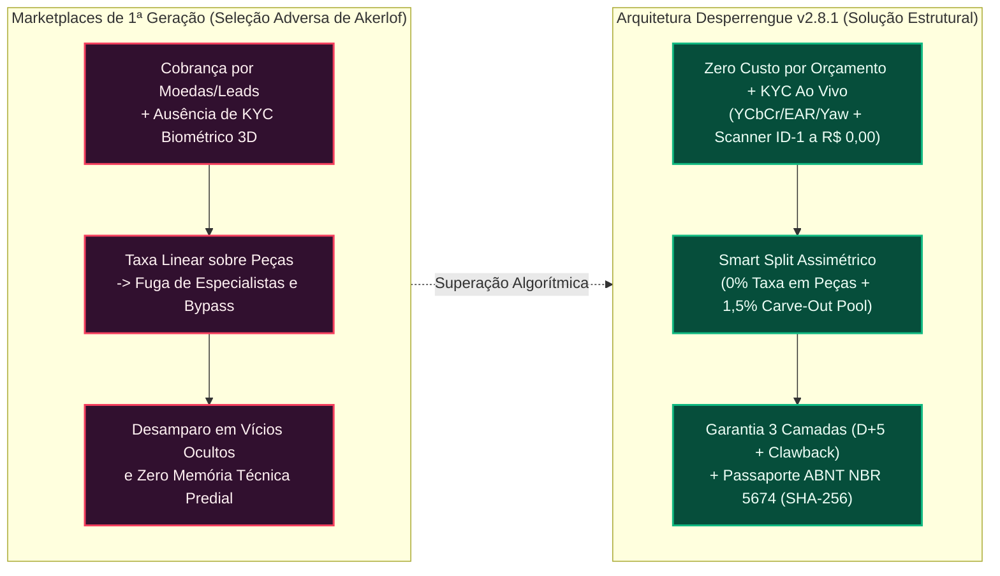

# Documento de Contexto, Fundamentação Econômica, Lean Canvas e Norteadores Estratégicos — Desperrengue (`v2.8.1`)

> **Classificação Epistemológica:** Tratado de Economia da Informação, Modelagem de Negócios (*Lean Canvas* — Ash Maurya), Teoria de Compatibilidade de Incentivos e Governança Institucional  
> **Referencial Teórico:** George Akerlof (*The Market for "Lemons"*, 1970) · Ash Maurya (*Running Lean*, 2012) · Lei do Inquilinato (Lei nº 8.245/1991) · Norma Técnica **ABNT NBR 5674**  
> **Implementação Auditada:** [`20261108110000_high_perf_warranty_antifraud_engine.sql`](../supabase/migrations/20261108110000_high_perf_warranty_antifraud_engine.sql) · [`20261108120000_client_kyc_biometrics_and_ocr.sql`](../supabase/migrations/20261108120000_client_kyc_biometrics_and_ocr.sql) · [`document_ocr_and_liveness_service.dart`](../app/lib/core/services/document_ocr_and_liveness_service.dart) · [`desperrengue_official_pdf_service.dart`](../app/lib/core/services/desperrengue_official_pdf_service.dart)

---

## 1. Introdução e Problema de Pesquisa (O Fenômeno de Seleção Adversa de Akerlof)

O setor brasileiro de manutenção predial e serviços residenciais caracteriza-se por elevada demanda inelástica, porém opera sob severa fricção informacional e informalidade. Em sua obra clássica *The Market for "Lemons": Quality Uncertainty and the Market Mechanism* (1970), George Akerlof demonstra que, em mercados marcados por **assimetria informacional pré-contratual**, a incapacidade de o contratante distinguir *ex ante* entre profissionais de alta qualificação técnica ($Q_{\text{alta}}$) e agentes oportunistas ou não qualificados ($Q_{\text{baixa}}$) força a convergência dos preços para uma média depreciada ($\bar{P}$), expulsando os melhores especialistas do mercado.

Nas plataformas de classificados e aplicativos de intermediação de primeira geração (baseados na venda de *leads* ou "moedas de orçamento"), verificam-se quatro falhas estruturais graves:

1. **Penalização Financeira do Trabalhador Autônomo (Venda de *Leads* sem Garantia):** Prestadores são obrigados a comprar pacotes de "moedas" antecipadamente apenas para desbloquear o contato de um cliente, sem qualquer garantia de fechamento do serviço, gerando prejuízo líquido recorrente para o trabalhador.
2. **Insegurança Física e Domiciliar do Cliente (*Ataques Sybil* e Falsidade Ideológica):** A ausência de prova de vida biométrica 3D e de validação criptográfica de documentos permite que indivíduos mal-intencionados ingressem em residências sem triagem civil confiável ou recriem perfis após execuções defeituosas.
3. **Desintermediação Induzida por Bitributação de Insumos (*Platform Leakage / Bypass*):** A cobrança de comissões lineares ($20\%$ a $30\%$) sobre o valor bruto total do serviço — incluindo peças e materiais comprados pelo técnico — confisca a margem da mão de obra e força as partes a transacionarem fora da plataforma.
4. **Desamparo Pós-Serviço (*Risco Moral*) e Perda de Memória Técnica do Imóvel:** Pagamentos diretos sem custódia (*Escrow*) deixam o morador desprotegido contra vícios ocultos que surgem horas após a saída do técnico, além de não gerarem lastro documental padronizado segundo a norma **ABNT NBR 5674** para vistorias imobiliárias e seguradoras.



---

## 2. A Solução Proposta e a Demonstração Matemática da Compatibilidade de Incentivos

O **Desperrengue** soluciona simultaneamente as falhas de seleção adversa, risco moral e evasão (*bypass*) por meio de uma arquitetura de **Oferta Direcionada em Cascata (*Tiered Waterfall*)**, **Custódia Condicional (*Smart Escrow*)** e **Particionamento Orçamentário Assimétrico (*Anti-Bypass Smart Split*)**:

Considere uma Ordem de Serviço cujo valor bruto total é $\text{GMV}_{\text{Total}} = V_{\text{MO}} + V_{\text{Mat}}$, onde $V_{\text{MO}}$ representa a mão de obra e $V_{\text{Mat}}$ representa os materiais/peças comprovados por nota. Em plataformas legadas com comissão linear $\tau_{\text{legado}} = 20\%$ sobre o total:

$$\text{Retenção}_{\text{legado}} = 0,20 \cdot (V_{\text{MO}} + V_{\text{Mat}})$$

Se um reparo elétrico envolve $V_{\text{MO}} = \text{R\$ } 200,00$ e $V_{\text{Mat}} = \text{R\$ } 300,00$ ($\text{GMV}_{\text{Total}} = \text{R\$ } 500,00$), a cobrança linear confisca $\text{R\$ } 100,00$ — o equivalente a **$50\%$ da remuneração pelo trabalho do técnico** ($\text{R\$ } 100,00 \div \text{R\$ } 200,00$).

No **Desperrengue**, a equação de retenção incide **exclusivamente sobre a mão de obra** ($\tau_{\text{App}} \in [12\%, 15\%]$, sendo $1,5\%$ segregado automaticamente via *Carve-Out* para o Fundo de Garantia) e aplica **alíquota estrita de $0,0\%$ sobre materiais**:

$$\text{Retenção}_{\text{Desperrengue}} = \tau_{\text{App}} \cdot V_{\text{MO}} + 0,00 \cdot V_{\text{Mat}}$$

No mesmo exemplo ($\tau_{\text{App}} = 15\%$), a retenção total é de apenas $\text{R\$ } 30,00$ ($6,0\%$ do GMV), enquanto permanecer dentro da plataforma entrega utilidade líquida estritamente superior ($U_{\text{InApp}} > U_{\text{Bypass}}$) para ambos os polos:
* **Para o Cliente:** Garantia de 3 Camadas (com retrabalho gratuito por segundo especialista em caso de falha) e emissão automática do **Passaporte Oficial de Manutenção do Imóvel (`ABNT NBR 5674`)** com assinatura criptográfica SHA-256 (`DSP-PASS-*`).
* **Para o Profissional:** Orçamentos 100% gratuitos (zero compra de moedas), proteção contra calote via *Smart Escrow*, isenção total sobre peças ($0\%$), evolução no *Relative Trust Score* ($RTS$) e liquidação via PIX instantâneo (`D+0`) nos Tiers de elite.

---

## 3. Lean Canvas — Modelagem Estratégica em 9 Blocos (Ash Maurya)

O modelo de negócios do **Desperrengue** estrutura-se nos **9 blocos canônicos do *Lean Canvas***, sintetizados abaixo tanto em diagrama geométrico matricial quanto em tabela analítica auditada:

### 3.1. Quadro Visual Estruturado do Lean Canvas (Blueprint Matricial)

```
┌─────────────────────────┬─────────────────────────┬──────────────────────────┬─────────────────────────┬─────────────────────────┐
│ 1. PROBLEMA             │ 4. SOLUÇÃO              │ 3. PROPOSTA DE VALOR     │ 9. VANTAGEM INJUSTA     │ 2. SEGMENTOS DE CLIENTES│
│                         │                         │    ÚNICA (UVP)           │    (FOSSO TECNOLÓGICO)  │                         │
│ • Prestadores pagando   │ • Despacho Geoespacial  │                          │                         │ • B2C (Demanda):        │
│   por "moedas/leads"    │   O(log N + K) < 60s    │ "Manutenção residencial  │ • Motor de KYC, Prova   │   Proprietários,        │
│   sem garantia de       │   em Cascata (1º,2º,3º).│  com identidade civil 3D │   de Vida 3D e OCR      │   inquilinos e famílias │
│   fechamento.           │ • KYC Bilateral 3D Ao   │  auditada, garantia real │   100% On-Device com    │   em centros urbanos.   │
│ • Clientes inseguros ao │   Vivo + Scanner ID-1.  │  em 3 camadas e prontuá- │   custo marginal R$ 0,00│ • B2C (Oferta):         │
│   receber desconhecidos │ • Custódia Smart Escrow │  rio certificado ABNT    │   por usuário validado. │   Profissionais técnicos│
│   em casa sem KYC real. │   com PIN de 4 dígitos  │  para o imóvel; para o   │ • Fundo de Garantia     │   autônomos e MEIs em   │
│ • Vícios ocultos pós-   │   e Garantia 3 Camadas. │  profissional: zero      │   autossustentado por   │   33 categorias.        │
│   serviço sem custódia  │ • Smart Split: 0% taxa  │  custo por orçamento,    │   Carve-Out de 1,5%     │ • B2B (Institucional):  │
│   ou fundo garantidor.  │   sobre peças/materiais.│  0% de taxa em peças e   │   (Break-Even: 67 jobs) │   Imobiliárias, síndicos│
│ • Falta de laudo ABNT   │ • Passaporte do Imóvel  │  pagamento garantido."   │   e Grafo Zero-Linkage. │   e seguradoras prediais│
│   NBR 5674 do imóvel.   │   em PDF SHA-256.       │                          │ • Lock-in pelo Passapor-│                         │
│                         ├─────────────────────────┤                          ├─────────────────────────┤                         │
│ Alternativas Atuais:    │ 8. MÉTRICAS-CHAVE       │ Conceito de Alto Nível:  │ 5. CANAIS DE TRAÇÃO     │ Early Adopters:         │
│ • Apps de venda de leads│                         │                          │                         │                         │
│   (GetNinjas / afins);  │ • GMV Total e V_MO;     │ "Fintech Escrow +        │ • Parcerias com         │ • Eletricistas NR-10 e  │
│   grupos informais de   │ • Índice Cobertura Pool │  Certificadora Predial   │   condomínios, síndicos │   encanadores frustrados│
│   WhatsApp e indicações │   (ICA >= 1,5x);        │  ABNT NBR 5674 para      │   e imobiliárias locais;│   com compra de moedas; │
│   sem garantia.         │ • SLA SOS (< 60s);      │  Serviços Residenciais." │ • Laudos PDF comparti-  │ • Moradores de condomí- │
│                         │ • Score RTS e LTV/CAC.  │                          │   lhados em vistorias;  │   nios com urgência SOS.│
├─────────────────────────┴─────────────────────────┴───┬──────────────────────┴─────────────────────────┴─────────────────────────┤
│ 7. ESTRUTURA DE CUSTOS                                │ 6. FONTES DE RECEITA (REVENUE STREAMS)                                   │
│                                                       │                                                                          │
│ • Custo Marginal de KYC/Biometria/OCR: R$ 0,00 (Edge) │ • Take Rate Assimétrico (12% a 15% apenas sobre Mão de Obra; 0% Peças), │
│ • Infraestrutura Cloud (Supabase PostgreSQL + Storage)│   sendo 13,5% receita líquida operacional e 1,5% Carve-Out de Garantia. │
│ • Taxas de Liquidação PIX / Gateway (1,5% GMV)        │ • Prêmio de Conveniência em Chamados de Emergência SOS (< 60 segundos).  │
│ • Aquisição Hiperlocal (Condomínios / Ads) e Suporte  │ • Licenciamento B2B (Passaporte ABNT NBR 5674) e Float Financeiro.      │
└───────────────────────────────────────────────────────┴──────────────────────────────────────────────────────────────────────────┘
```

### 3.2. Especificação Analítica dos 9 Blocos do Lean Canvas

| Bloco do Lean Canvas | Especificação Técnico-Científica e Estratégica no Desperrengue (`v2.8.1`) |
| :--- | :--- |
| **1. Problema** | **1.** Trabalhadores autônomos pagando antecipadamente por "moedas/créditos" para enviar orçamentos sem garantia de retorno.<br/>**2.** Clientes expostos ao risco de admitir desconhecidos em suas residências sem validação biométrica 3D e documental.<br/>**3.** Desamparo financeiro e técnico diante de vícios ocultos pós-serviço e evasão (*bypass*) causada pela cobrança de comissão sobre materiais.<br/>**4.** Ausência de histórico técnico auditável do imóvel segundo a norma **ABNT NBR 5674** para vistorias de locação (Lei nº 8.245/91) e seguros. |
| **2. Segmentos de Clientes** | **Ponta da Demanda (B2C):** Proprietários de imóveis, inquilinos e famílias que demandam reparos urgentes ou manutenção preventiva.<br/>**Ponta da Oferta (Profissionais):** Técnicos autônomos e MEIs distribuídos nas **33 categorias residenciais** (elétrica, hidráulica, climatização, chaveiro, etc.).<br/>**Parceiros Institucionais (B2B):** Imobiliárias, administradoras de condomínios e seguradoras residenciais que consomem o Passaporte do Imóvel. |
| **3. Proposta Única de Valor (UVP)** | **Para o Cliente:** *"Contrate especialistas verificados por biometria facial 3D em menos de 60 segundos, com pagamento protegido em custódia, Garantia Real em 3 Camadas e emissão automática do Passaporte Oficial de Manutenção do Imóvel (ABNT NBR 5674)."*<br/>**Para o Profissional:** *"Envie orçamentos 100% gratuitos (sem moedas), receba 100% do valor das peças (taxa zero em materiais) e tenha seu pagamento garantido via PIX sem risco de calote."* |
| **4. Solução** | **1.** Despacho geoespacial $O(\log N + K)$ em cascata de 5 níveis (*Tiered Waterfall* `1º, 2º, 3º`) com abertura por ditado de voz.<br/>**2.** KYC Bilateral Simétrico com câmera frontal ao vivo (3 desafios físicos $YCbCr/\text{EAR}/\text{Yaw}$), scanner guiado ISO ID-1 ($0^\circ..270^\circ$), Face Match 128-D e OCR visível.<br/>**3.** Custódia *Smart Escrow* liberada via PIN presencial de 4 dígitos, 4ª aba *"Em Mediação"* com guarda forense `dHash + MAD` (64 bits) e Garantia em 3 Camadas.<br/>**4.** Exportação em *Worker Isolate* do Prontuário da Casa em PDF vetorial com assinatura criptográfica SHA-256 (`DSP-PASS-*`). |
| **5. Canais** | **1.** Distribuição orgânica viral via exportação e compartilhamento do **Passaporte Oficial do Imóvel (PDF)** com imobiliárias, proprietários e seguradoras.<br/>**2.** Parcerias hiperlocais diretas com síndicos profissionais, portarias de condomínios e escolas técnicas (SENAI / CREA / CFT).<br/>**3.** Aquisição digital geolocalizada (Google Search / Meta Ads por raio de CEP) e distribuição via Google Play Store, Apple App Store e Web PWA. |
| **6. Fontes de Receita** | **1.** Comissão de intermediação (*Take Rate* de $12\%$ a $15\%$) incidente **exclusivamente sobre a Mão de Obra ($V_{\text{MO}}$)**, com isenção de $0\%$ sobre peças ($V_{\text{Mat}}$), retendo $13,5\%$ líquidos para a plataforma e destinando $1,5\%$ ao Fundo de Garantia.<br/>**2.** Taxa de urgência em chamados **SOS (`< 60s`)**.<br/>**3.** Receitas B2B de certificação predial (vistorias imobiliárias/seguradoras) e monetização financeira do *float* em custódia. |
| **7. Estrutura de Custos** | **1.** **Custo Marginal de KYC, Prova de Vida 3D e OCR = $\text{R\$ } 0,00$** (processamento 100% local na CPU/NPU do dispositivo via Google ML Kit + `Isolate.run`).<br/>**2.** Infraestrutura em nuvem de alta eficiência (Supabase PostgreSQL com RPCs PL/pgSQL e índices compostos + SMTP Resend).<br/>**3.** Custos transacionais de liquidação PIX/Gateway ($1,5\%$ GMV) e investimento hiperlocal de aquisição de clientes ($\text{CAC} = \text{R\$ } 42,00$). |
| **8. Métricas-Chave** | **1.** Volume Bruto Transacionado ($\text{GMV}_{\text{Total}}$) segregado em $V_{\text{MO}}$ e $V_{\text{Mat}}$.<br/>**2.** Índice de Cobertura Atuarial do Fundo de Garantia ($\text{ICA} \ge 1,50\times$, com *break-even* em $66,67$ serviços).<br/>**3.** Taxa de Conversão de Chamados (*Match Rate*), SLA de Despacho SOS (`< 60s`) e Taxa de Resolução na Camada 1 ($\ge 75\%$).<br/>**4.** Evolução do *Relative Trust Score* ($RTS$) da rede e relação $\text{LTV} / \text{CAC}$ ($9,65\times$, com *payback* em $1,2$ ordens). |
| **9. Vantagem Injusta (*Unfair Advantage*)** | **1.** Pipeline proprietário de visão computacional e biometria ativa *on-device* a custo marginal zero ($\text{R\$ } 0,00$), impossível de ser replicado sem engenharia profunda em *Worker Isolates*.<br/>**2.** Motor contábil e antifraude com 14 travas algorítmicas (`dHash + MAD` 64 bits $O(1)$, Grafo *Zero-Linkage*, *Clawback* e *Circuit Breaker*) que torna o valor esperado de fraudes estritamente negativo ($\mathbb{E}[\text{Payoff}] < 0$).<br/>**3.** Efeito de rede e *lock-in* patrimonial crescente gerado pelo histórico imutável do **Passaporte Oficial de Manutenção (`ABNT NBR 5674`)**. |

---

## 4. Norteadores Estratégicos: Missão, Visão e Valores Institucionais

A governança estratégica e as decisões de arquitetura de software do **Desperrengue** são regidas por três pilares institucionais permanentes:

* **Missão Institucional:** Democratizar e blindar a segurança na contratação de serviços residenciais no Brasil, protegendo o patrimônio das famílias por meio de custódia financeira, biometria ativa e certificação técnica (**ABNT NBR 5674**), ao mesmo tempo em que dignifica e valoriza o profissional autônomo através de relações econômicas justas, isentas de cobrança por *leads* ou taxação sobre insumos.
* **Visão de Futuro:** Consolidar-se como a infraestrutura tecnológica e financeira padrão (*de facto standard*) de manutenção predial e residencial na América Latina, reconhecida pela erradicação do modelo predatório de venda de orçamentos, pela solvência atuarial de sua Garantia de 3 Camadas e pela validade institucional do Passaporte Oficial do Imóvel perante o mercado imobiliário e securitário.
* **Valores Inegociáveis:**
  1. **Justiça Econômica e Compatibilidade de Incentivos:** O trabalhador autônomo jamais deve pagar para tentar trabalhar; a plataforma só é remunerada quando o serviço é efetivamente executado, sem jamais confiscar o reembolso de peças e materiais ($0\%$ de taxa).
  2. **Segurança Criptográfica e Forense em Primeiro Lugar:** Nenhum agente opera no ecossistema sem validação civil bilateral simétrica (Prova de Vida 3D ao vivo, Scanner ISO ID-1, Face Match 128-D e Módulo 11) e comprovação óptica imutável (`dHash` 64 bits e selo SHA-256).
  3. **Solvência e Transparência Contábil:** Todas as movimentações de custódia, *Carve-Out* ($1,5\%$), maturação (`D+0` a `D+7`) e *Clawback* obedecem a invariantes matemáticas auditáveis em livro-razão *append-only*.
  4. **Excelência de Performance e Simplicidade de Uso:** Complexidade algorítmica sofisticada no *backend* ($O(\log N + K)$ e $O(1)$) e em *Worker Isolates* traduzida em uma experiência fluida a $120\text{ FPS}$, acessível inclusive por ditado de voz.

---

## 5. Síntese das Inovações Tecnológicas e Alinhamento com os ODS (ONU)

| Falha Estrutural do Setor | Mecanismo Computacional Implementado no Desperrengue | Referência no Código-Fonte | Alinhamento ODS (Agenda 2030 ONU) |
| :--- | :--- | :--- | :--- |
| **Falsificação de Identidade e Ataques Sybil** | Prova de Vida Facial Ao Vivo ($YCbCr + \text{EAR} + \text{Yaw}$), Scanner ISO/IEC 7810 ID-1 com ROI central ($80\%$) e núcleo ($12\%$), Face Match 128-D multi-orientação e `cpf_hash` único. | [`document_ocr_and_liveness_service.dart`](../app/lib/core/services/document_ocr_and_liveness_service.dart), [`20261108120000_client_kyc_biometrics_and_ocr.sql`](../supabase/migrations/20261108120000_client_kyc_biometrics_and_ocr.sql) | **ODS 16** (Paz, Justiça e Instituições Eficazes — Identidade Legal e Prevenção à Fraude) |
| **Evasão por Taxação Indevida de Peças e Venda de Leads** | *Anti-Bypass Smart Split*: $13,5\%$ operacional + $1,5\%$ *Carve-out* sobre `labor_amount_cents` e $0,0\%$ sobre `materials_amount_cents`, com orçamentos 100% gratuitos. | [`fintech_warranty_models.dart`](../app/lib/core/models/fintech_warranty_models.dart), [`20261108110000_high_perf_warranty_antifraud_engine.sql`](../supabase/migrations/20261108110000_high_perf_warranty_antifraud_engine.sql) | **ODS 8** (Trabalho Decente e Crescimento Econômico — Valorização do Autônomo) |
| **Insolvência de Fundos de Garantia por Conluio** | Retenção escalonada (`D+7 / D+5 / D+2`), *Clawback* automático sobre o infrator, Grafo *Zero-Linkage* e deduplicação forense `dHash` 64-bit em $O(1)$. | [`perceptual_hash_guard.dart`](../app/lib/core/security/perceptual_hash_guard.dart), `public.trigger_layer3_rework` | **ODS 9** (Indústria, Inovação e Infraestrutura Resiliente) |
| **Perda de Histórico Técnico das Edificações** | Emissão automatizada em *Worker Isolate* do **Passaporte Oficial de Manutenção do Imóvel** em PDF vetorial segundo a **ABNT NBR 5674** e **Lei 8.245/91**. | [`desperrengue_official_pdf_service.dart`](../app/lib/core/services/desperrengue_official_pdf_service.dart) | **ODS 11** (Cidades e Comunidades Sustentáveis — Preservação do Patrimônio Edificado) |
