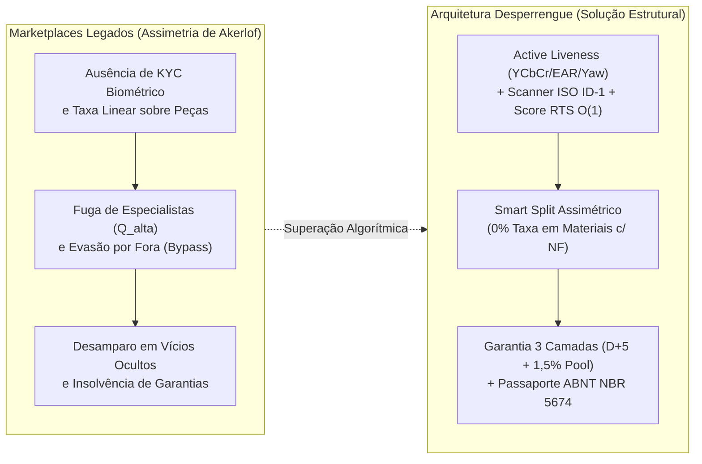

# Fundamentação Teórica, Falhas de Mercado e Tese Computacional do Produto (`Documento de Contexto.md`)

Análise científico-econômica sobre a estrutura do mercado de serviços domiciliares no Brasil, modelagem formal do fenômeno de **Seleção Adversa (Modelo de Akerlof)**, demonstração matemática do **Paradoxo da Desintermediação (*Platform Leakage / Bypass*)** e prova de como a engenharia distribuída do **Desperrengue** (`v2.8.1`) resolve estruturalmente essas falhas.

---

## 1. Economia de Serviços Domiciliares e o Fenômeno de Seleção Adversa (Modelo de Akerlof)

Em seu trabalho seminal *The Market for "Lemons": Quality Uncertainty and the Market Mechanism* (1970), George Akerlof demonstra que, em mercados caracterizados por forte **assimetria informacional pré-contratual**, a incapacidade do contratante de distinguir *ex ante* entre prestadores de alta qualificação técnica ($Q_{\text{alta}}$) e prestadores oportunistas ou não qualificados ($Q_{\text{baixa}}$) força a precificação pelo valor médio esperado $\bar{P}$.

Em diretórios classificados e aplicativos de intermediação de primeira geração, esse mecanismo desencadeia um ciclo degenerativo em três estágios:

1. **Inexistência de Barreira Biométrica e Documental Determinística**: Quando o cadastro aceita documentos sem verificação de autenticidade óptica ou selfies estáticas vulneráveis a ataques de apresentação (*Presentation Attacks*), indivíduos mal-intencionados recriam perfis a custo zero após cada execução defeituosa (*Ataque Sybil*).
2. **Compressão de Preços e Expulsão dos Especialistas ($Q_{\text{alta}}$)**: Profissionais certificados (**SENAI, CREA, CFT, NR-10, NR-35**) possuem custo de oportunidade elevado e não conseguem competir em leilões de menor preço contra perfis não verificados que não oferecem garantia real.
3. **Colapso de Confiança no Pós-Serviço (*Risco Moral*)**: Após o pagamento direto no ato, caso uma instalação elétrica ou reparo hidráulico apresente vício oculto em 48 horas, o cliente não dispõe de custódia financeira (*Escrow*) nem de fundo garantidor solvente para assegurar o retrabalho.

---

## 2. Demonstração Matemática do Paradoxo da Desintermediação (*Platform Leakage / Bypass*)

O principal vetor de falência econômica de plataformas de serviços residenciais é a **desintermediação (*Bypass*)**: após o primeiro contato, cliente e prestador combinam o pagamento fora do aplicativo para evitar a comissão da plataforma.

Considere uma Ordem de Serviço cujo valor bruto total é $\text{GMV} = V_{\text{MãoDeObra}} + V_{\text{Materiais}}$. Em plataformas tradicionais que cobram uma alíquota linear $\tau_{\text{legado}} = 20\%$ sobre o valor bruto total (incluindo peças e materiais comprados pelo técnico):

$$\text{Retenção}_{\text{legado}} = 0,20 \cdot (V_{\text{MãoDeObra}} + V_{\text{Materiais}})$$

Se um serviço envolve $V_{\text{MãoDeObra}} = \text{R\$ } 200,00$ e $V_{\text{Materiais}} = \text{R\$ } 300,00$ ($\text{GMV} = \text{R\$ } 500,00$), uma cobrança linear de $20\%$ confisca $\text{R\$ } 100,00$ — o que equivale a **$50\%$ da remuneração real pelo trabalho do profissional** ($\text{R\$ } 100,00 \div \text{R\$ } 200,00$). Essa distorção torna a evasão (*bypass*) uma necessidade de sobrevivência para o técnico honesto.

### 2.1. A Equação de Compatibilidade de Incentivos do Desperrengue

O **Desperrengue** erradica a penalização sobre insumos através do **Particionamento Orçamentário Assimétrico (*Anti-Bypass Smart Split*)**, tributando exclusivamente a mão de obra ($\tau_{\text{app}} = 15,0\%$, sendo $13,5\%$ operacional e $1,5\%$ fundo de garantia) e aplicando **alíquota estrita de $0,0\%$ sobre materiais**:

$$\text{Retenção}_{\text{Desperrengue}} = 0,15 \cdot V_{\text{MãoDeObra}} + 0,00 \cdot V_{\text{Materiais}}$$

No mesmo exemplo ($V_{\text{MãoDeObra}} = \text{R\$ } 200,00$ e $V_{\text{Materiais}} = \text{R\$ } 300,00$), a retenção total cai para $\text{R\$ } 30,00$ ($6,0\%$ do GMV total). Simultaneamente, permanecer dentro da plataforma entrega utilidade positiva estrita ($U_{\text{on-platform}} > U_{\text{off-platform}}$) para ambos os lados:

1. **Para o Cliente**: A transação dentro do aplicativo concede:
   - **Garantia Técnica de 90 Dias em 3 Camadas** (com despacho de segundo especialista custeado pela retenção/fundo em caso de falha); e
   - **Certificação Patrimonial ABNT NBR 5674** incorporada ao **Passaporte Oficial de Manutenção do Imóvel**, que valoriza o imóvel perante imobiliárias (Lei nº 8.245/91) e seguradoras em montante superior a $0,15 \cdot V_{\text{MãoDeObra}}$.
2. **Para o Profissional**: A execução dentro do aplicativo garante liquidação protegida contra inadimplência via *Smart Escrow*, reembolso integral de $100\%$ das peças, incremento de $+6,0\text{ pts}$ no *Relative Trust Score* ($RTS$) e ascensão aos degraus prioritários da cascata de despacho (`waterfall_tier_rank`).

---

## 3. Síntese das Inovações Científicas e Tecnológicas Codificadas

| Falha Estrutural do Setor | Mecanismo Computacional Implementado no Desperrengue | Referência no Código-Fonte |
| :--- | :--- | :--- |
| **Falsificação de Identidade e Ataques Sybil** | Prova de Vida Facial Ao Vivo ($YCbCr + \text{EAR} + \text{Yaw}$), Scanner ISO/IEC 7810 ID-1 com *Core Inset* de 12%, Face Match 128-D multi-orientação e `cpf_hash` único. | [`document_ocr_and_liveness_service.dart`](../app/lib/core/services/document_ocr_and_liveness_service.dart), [`20261108120000_client_kyc_biometrics_and_ocr.sql`](../supabase/migrations/20261108120000_client_kyc_biometrics_and_ocr.sql) |
| **Evasão por Taxação Indevida de Peças** | *Anti-Bypass Smart Split*: $13,5\%$ operacional + $1,5\%$ *Carve-out* sobre `labor_amount` e $0,0\%$ sobre `materials_amount`. | [`fintech_warranty_models.dart`](../app/lib/core/models/fintech_warranty_models.dart), [`20261108110000_high_perf_warranty_antifraud_engine.sql`](../supabase/migrations/20261108110000_high_perf_warranty_antifraud_engine.sql) |
| **Insolvência de Fundos de Garantia por Fraude** | Retenção escalonada ($D+7 / D+5 / D+2$), *Clawback First* sobre o saldo em maturação do infrator, Grafo Zero-Vínculo e deduplicação forense `dHash` 64-bit em $O(1)$. | [`perceptual_hash_guard.dart`](../app/lib/core/security/perceptual_hash_guard.dart), `public.trigger_layer3_rework` |
| **Perda de Histórico Técnico das Edificações** | Emissão automatizada em *Worker Isolate* do **Passaporte Oficial de Manutenção do Imóvel** em `%PDF-1.4` segundo a **ABNT NBR 5674** e **Lei 8.245/91**. | [`desperrengue_official_pdf_service.dart`](../app/lib/core/services/desperrengue_official_pdf_service.dart) |
