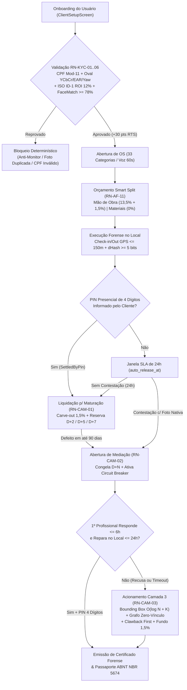
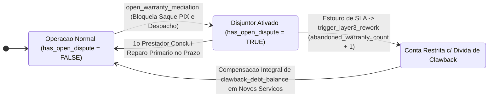

# Engenharia de Requisitos, Regras de Negócio Normativas e Matriz de Rastreabilidade (`Especificação do Projeto.md`)

Catálogo formal e exaustivo de Requisitos Funcionais (`RF`), Requisitos Não-Funcionais (`RNF`), Regras de Camada de Garantia (`RN-CAM-01` a `RN-CAM-03`), Travas Determinísticas Antifraude (`RN-AF-01` a `RN-AF-14`), Pilares do Marco Zero (`RN-MZ-01` a `RN-MZ-05`), Validadores Forenses de KYC Biométrico e OCR (`RN-KYC-01` a `RN-KYC-06`) e Matriz de Rastreabilidade Biunívoca Código $\times$ Teste do ecossistema **Desperrengue** (`v2.8.1`).

---

## 1. Árvore de Decisão Normativa do Ecossistema (`flowchart TD`)



---

## 2. Catálogo de Regras de Negócio Normativas

### 2.1. As 3 Camadas do Fundo de Garantia e Custódia (`RN-CAM-01` a `RN-CAM-03`)

| Código | Designação Formal | Especificação Algorítmica e Invariante |
| :---: | :--- | :--- |
| `RN-CAM-01` | **Custódia Financeira Condicional e Maturação Escalonada** | $100\%$ do valor pago permanece retido em `LOCKED_100` durante a execução; após aprovação por PIN de 4 dígitos ou decurso de 24h sem disputa (`auto_release_at`), o repasse líquido ingressa em `public.escrow_maturation_entries` por **D+7** (`TRAINEE`), **D+5** (`STANDARD`) ou **D+2** (`VERIFIED_ANCHOR`). |
| `RN-CAM-02` | **Retorno Técnico Prioritário e Segregação Atuarial de 1,5%** | De cada serviço liquidado, $1,5\%$ de `labor_amount` é segregado automaticamente em `public.warranty_pool_ledger` (`CARVEOUT_CONTRIBUTION_1_5_PCT`, ponto de equilíbrio $N = 66,67$). Em caso de falha em até 90 dias, o 1º prestador dispõe de **6 horas** para aceite e **24 horas** para reparo sem custo adicional. |
| `RN-CAM-03` | **Despacho Algorítmico Cego de 2º Especialista e *Clawback First*** | Se o 1º prestador violar o SLA da Camada 2, `trigger_layer3_rework` confisca prioritariamente sua retenção em maturação (`CLAWED_BACK`) ou debita o fundo de $1,5\%$ (limitado a $100\%$ de `labor_amount`), despachando um 2º especialista independente e inscrevendo o infrator em `clawback_debt_balance`. |

### 2.2. As 14 Travas Determinísticas contra os 6 Vetores de Golpe (`RN-AF-01` a `RN-AF-14`)

```text
┌──────────────────────────────────────────────────────────────────────────────────────────┐
│          MATRIZ DE DEFESA EM PROFUNDIDADE: 6 VETORES DE ATAQUE × 14 TRAVAS (RN-AF)       │
├───────────────────────────────┬──────────────────────┬───────────────────────────────────┤
│ Vetor de Ataque Modelado      │ Regras Normativas    │ Trava Criptográfica / Relacional  │
├───────────────────────────────┼──────────────────────┼───────────────────────────────────┤
│ V1. Conluio Triplo (Cash-Out) │ RN-AF-01, RN-AF-02,  │ • Proibição de estorno em espécie │
│                               │ RN-AF-03, RN-AF-04   │ • Sorteio Cego hashtextextended   │
│                               │                      │ • Disjunção Device/CPF/Face/Grafo │
│                               │                      │ • Clawback First + Penalidade -50 │
├───────────────────────────────┼──────────────────────┼───────────────────────────────────┤
│ V2. Sequestro de Escrow /     │ RN-AF-05, RN-AF-06,  │ • Check-in/Out GPS <= 150m        │
│     Sabotagem Pós-Serviço     │ RN-AF-07             │ • PIN Presencial de 4 Dígitos     │
│                               │                      │ • Auto-Release em 24h s/ disputa  │
├───────────────────────────────┼──────────────────────┼───────────────────────────────────┤
│ V3. Falso Defeito / Reciclagem│ RN-AF-08, RN-AF-09,  │ • Sensor Físico ImageSource.camera│
│     de Fotos da Galeria/Web   │ RN-AF-10             │ • Bloqueio Fake GPS (isMocked)    │
│                               │                      │ • Hamming 64-Bit >= 5 bits O(1)   │
├───────────────────────────────┼──────────────────────┼───────────────────────────────────┤
│ V4. Evasão por Inflação de    │ RN-AF-11, RN-AF-12   │ • Smart Split (0% em Peças c/ NF) │
│     Materiais / Retrabalho    │                      │ • Teto Camada 3 <= 100% Mão Obra  │
├───────────────────────────────┼──────────────────────┼───────────────────────────────────┤
│ V5. Quebra Atuarial Cold-Start│ RN-AF-13             │ • Reserva D+7 + Cooldown 24h entre│
│     e Monopólio de Resgate    │                      │   chamados de Camada 3            │
├───────────────────────────────┼──────────────────────┼───────────────────────────────────┤
│ V6. Ataque Sybil e Contas     │ RN-AF-14             │ • UNIQUE cpf_hash + face_hash     │
│     Laranja                   │                      │ • Trava PIX Same-Holder Lock      │
└───────────────────────────────┴──────────────────────┴───────────────────────────────────┘
```



### 2.3. Os 5 Pilares do Marco Zero (`RN-MZ-01` a `RN-MZ-05`)

- **`RN-MZ-01` (Maturação Escalonada $D+7 / D+5 / D+2$)**: Inverte a fonte pagadora nos primeiros serviços de contas iniciantes (`TRAINEE`), garantindo que sua própria retenção financie eventual retrabalho.
- **`RN-MZ-02` (Cálculo em $O(1)$ do *Relative Trust Score* — $RTS$)**: Combina sinais intrínsecos de credenciamento ($+30$ KYC/Biometria, $+20$ MEI $\ge 6$m, $+20$ Certificação Técnica) com histórico empírico ($+6\text{ pts}$ por serviço concluído até $30\text{ pts}$ e $-50\text{ pts}$ por abandono).
- **`RN-MZ-03` (Cascata Hierárquica de 5 Degraus — `waterfall_tier_rank` 1..5)**: Habilita o despacho imediato mesmo quando os Degraus 1 e 2 estão vazios em uma nova cidade, recorrendo com segurança aos Degraus 3 e 4.
- **`RN-MZ-04` (Reserva Semente de *Bootstrapping* e *Circuit Breaker*)**: Aporte inicial `COLD_START_SEED_RESERVE` acoplado ao congelamento preventivo `has_open_dispute = TRUE`.
- **`RN-MZ-05` (Profissionais Âncora e Quarentena de 24h)**: Flag `is_trusted_anchor = TRUE` combinada à restrição temporal de 24h entre acionamentos de Camada 3.

### 2.4. As 6 Regras Forenses de KYC Biométrico e OCR (`RN-KYC-01` a `RN-KYC-06`)

- **`RN-KYC-01` (Validação Aritmética Módulo 11 e Unicidade de CPF)**: Todo CPF digitado na Etapa 1 do `ClientSetupScreen` é validado pelo cálculo dos dois dígitos verificadores Módulo 11 (`public.is_valid_cpf`) e indexado via `SHA-256` salgado (`idx_profiles_cpf_hash_unique`).
- **`RN-KYC-02` (Prova de Vida Ao Vivo na Moldura Oval — $YCbCr$, $\text{EAR}$ e $\text{Yaw}$)**: Captura exclusiva na câmera frontal exigindo fração de pele $YCbCr \in [22\%, 82\%]$, rejeição de monitores (`blueMonitorRatio < 0,25`), piscada bilateral ($\text{EAR} < 0,18 \to > 0,25$) e rotação cefálica ($|\theta_y| \ge 18^\circ$).
- **`RN-KYC-03` (Scanner Documental Guiado ISO/IEC 7810 ID-1)**: Captura da Frente e do Verso de CNH, RG ou CIN sob moldura retangular de proporção `1,586 : 1`, exigindo nitidez Laplaciana $\sigma_{\text{Lap}}^2 \ge 110,0$ e reflexo especular $\le 8,5\%$.
- **`RN-KYC-04` (Recorte Estrito de ROI com *Core Inset* de 12% e Anti-Duplicidade `dHash + MAD`)**: Descarta $12\%$ das bordas externas antes de computar o `dHash` de 64 bits e a Diferença Absoluta Média ($\text{MAD}_{64\times 64}$), eliminando falsos positivos de superfícies de madeira e bloqueando fotos idênticas de Frente e Verso (`Hamming < 5`).
- **`RN-KYC-05` (Face Match 1:1 Multi-Orientação $0^\circ/90^\circ/180^\circ/270^\circ$ em 128-D Não-Negativo)**: Compara o descritor facial da selfie ao vivo contra as 4 rotações canônicas do recorte $3\times 4$ do documento ($A_k \ge 0, B_k \ge 0 \implies S_{\cos} \in [0\%, 100\%]$), exigindo $S_{\cos} \ge 78,0\%$.
- **`RN-KYC-06` (Transcrição Automática via OCR e Compatibilidade de Nome Civil)**: Exibe na Etapa 4 o card com os dados extraídos do documento e exige compatibilidade de tokens do Nome Civil $\ge 80\%$ em relação ao nome informado na Etapa 1.

---

## 3. Fluxograma Visual de Validação do PIN Presencial de 4 Dígitos vs. SLA de 24h

```text
┌──────────────────────────────────────────────────────────────────────────────────────────┐
│        FLUXO DETERMINÍSTICO DE CHECK-OUT FORENSE (PIN PRESENCIAL vs. SLA 24 HORAS)       │
│                                                                                          │
│  [Prestador conclui serviço e captura Foto "Depois" via ImageSource.camera (1280px)]     │
│                                            │                                             │
│                                            ▼                                             │
│     ┌──────────────────────────────────────────────────────────────────────────────┐     │
│     │ Guarda Forense Inicial: Geofence <= 150m E dHamming(Checkin, Checkout) >= 5  │     │
│     └──────────────────┬────────────────────────────────────────┬──────────────────┘     │
│                        │ (Cliente presente c/ PIN)              │ (Cliente ausente)      │
│                        ▼                                        ▼                        │
│     ╔═════════════════════════════════════╗  ╔════════════════════════════════════════╗  │
│     ║ CAMINHO A: PIN DE 4 DÍGITOS VÁLIDO  ║  ║ CAMINHO B: JANELA SLA DE 24 HORAS      ║  │
│     ║ • crypt(pin, checkout_pin_hash) OK  ║  ║ • status = 'awaiting_approval'         ║  │
│     ║ • status = 'completed'              ║  ║ • auto_release_at = NOW() + 24 hours   ║  │
│     ║ • Liquida p/ Maturação no ato       ║  ║ • Worker SKIP LOCKED libera após 24h   ║  │
│     ╚═════════════════════════════════════╝  ╚════════════════════════════════════════╝  │
└──────────────────────────────────────────────────────────────────────────────────────────┘
```

---

## 4. Matriz de Rastreabilidade Biunívoca Completa (Regra Normativa $\times$ SQL $\times$ Dart $\times$ Teste)

| Regra Normativa | Migração SQL e Função RPC | Arquivo Dart / Flutter | Suíte de Teste Automatizado |
| :--- | :--- | :--- | :--- |
| `RN-CAM-01` a `RN-CAM-03` | [`20261108110000_high_perf_warranty_antifraud_engine.sql`](../supabase/migrations/20261108110000_high_perf_warranty_antifraud_engine.sql) (`complete_job_and_schedule_escrow`, `settle_escrow_with_carveout_and_maturation`, `open_warranty_mediation`, `trigger_layer3_rework`) | [`fintech_warranty_models.dart`](../app/lib/core/models/fintech_warranty_models.dart), [`warranty_escrow_service.dart`](../app/lib/core/services/warranty_escrow_service.dart), [`fintech_warranty_widgets.dart`](../app/lib/features/shared/presentation/fintech_warranty_widgets.dart) | [`fintech_warranty_security_test.dart`](../app/test/fintech_warranty_security_test.dart), [`security_smoke.sql`](../supabase/tests/security_smoke.sql) |
| `RN-AF-01` a `RN-AF-14` | [`20261108110000_high_perf_warranty_antifraud_engine.sql`](../supabase/migrations/20261108110000_high_perf_warranty_antifraud_engine.sql) (`hamming_distance_64`, `chk_invariant_1_coverage_cap`, `chk_invariant_2_identity_disjunction`) | [`perceptual_hash_guard.dart`](../app/lib/core/security/perceptual_hash_guard.dart), [`anti_bypass_fintech_controller.dart`](../app/lib/core/state/anti_bypass_fintech_controller.dart) | [`red_team_warranty_and_kyc_forensics_test.dart`](../app/test/red_team_warranty_and_kyc_forensics_test.dart) |
| `RN-MZ-01` a `RN-MZ-05` | [`20261108110000_high_perf_warranty_antifraud_engine.sql`](../supabase/migrations/20261108110000_high_perf_warranty_antifraud_engine.sql) (`calculate_relative_trust_score`, `trg_sync_profile_trust_and_rank`) | [`fintech_warranty_models.dart`](../app/lib/core/models/fintech_warranty_models.dart) | [`fintech_warranty_security_test.dart`](../app/test/fintech_warranty_security_test.dart), [`red_team_warranty_and_kyc_forensics_test.dart`](../app/test/red_team_warranty_and_kyc_forensics_test.dart) |
| `RN-KYC-01` a `RN-KYC-06` | [`20261108120000_client_kyc_biometrics_and_ocr.sql`](../supabase/migrations/20261108120000_client_kyc_biometrics_and_ocr.sql) (`is_valid_cpf`, `submit_client_kyc`, `idx_profiles_cpf_hash_unique`) | [`client_setup_screen.dart`](../app/lib/features/client/presentation/client_setup_screen.dart), [`document_ocr_and_liveness_service.dart`](../app/lib/core/services/document_ocr_and_liveness_service.dart) | [`red_team_warranty_and_kyc_forensics_test.dart`](../app/test/red_team_warranty_and_kyc_forensics_test.dart), [`security_smoke.sql`](../supabase/tests/security_smoke.sql) |
| Passaporte ABNT NBR 5674 | [`20261106120000_category_match_orders_dossier.sql`](../supabase/migrations/20261106120000_category_match_orders_dossier.sql), `forensic_certificates` | [`desperrengue_official_pdf_service.dart`](../app/lib/core/services/desperrengue_official_pdf_service.dart) | [`dossier_test.dart`](../app/test/dossier_test.dart), `scripts/test-dossie.mjs` |
| Exclusão Escopada LGPD | [`20261107100000_scoped_account_deletion.sql`](../supabase/migrations/20261107100000_scoped_account_deletion.sql) (`delete_own_account_scoped`) | [`delete_account_screen.dart`](../app/lib/features/shared/presentation/delete_account_screen.dart) | [`account_screens_test.dart`](../app/test/account_screens_test.dart), [`scoped_deletion_smoke.sql`](../supabase/tests/scoped_deletion_smoke.sql) |
| Trava Temporal e Espacial de Privacidade Geográfica (`ADR-0022`) | `private.geo_privacy_secrets`, `_geo_fuzzy_center` (HMAC-SHA256), `_job_privacy_phase`, `get_job_location_for_viewer` | [`geo_privacy_policy_engine.dart`](../app/lib/core/security/geo_privacy_policy_engine.dart), [`accurate_geo_routing_service.dart`](../app/lib/core/services/accurate_geo_routing_service.dart), [`job_service.dart`](../app/lib/core/services/job_service.dart) | [`geo_privacy_policy_engine_test.dart`](../app/test/geo_privacy_policy_engine_test.dart), [`geo_privacy_and_portfolio_test.dart`](../app/test/geo_privacy_and_portfolio_test.dart) |

---

## 5. Modelagem Comportamental: Perfis de Usuários (Personas) e Histórias de Usuários (*User Stories*)

### 5.1. Perfis Arquetípicos de Usuários (Personas)

| Código | Persona Arquetípica | Perfil Socioeconômico e Operacional | Dores Estruturais Mitigadas pela Arquitetura |
| :--- | :--- | :--- | :--- |
| **P-01** | **Contratante Residencial (Cliente)** | Proprietário ou locatário urbano com rotina intensiva que demanda reparos emergenciais (`SOS < 60s`) ou manutenções preventivas. | Receio de admitir desconhecidos sem validação biométrica 3D na residência; insegurança quanto a vícios ocultos pós-pagamento; necessidade de comprovar manutenções perante imobiliárias e seguradoras (**ABNT NBR 5674**). |
| **P-02** | **Especialista Técnico (Profissional)** | Eletricista (NR-10), encanador, técnico de climatização ou chaveiro autônomo/MEI com qualificação comprovada nas 33 categorias. | Rejeição a plataformas que cobram "moedas" por orçamentos sem garantia de fechamento; compressão de margem quando a comissão incide sobre peças compradas; risco de inadimplência no pós-serviço. |
| **P-03** | **Motor Autônomo de Governança e Risco** | Subsistema automatizado de auditoria KYC, liquidação *Smart Escrow* e mediação assíncrona em *Worker Isolates* e RPCs PL/pgSQL. | Necessidade de validar identidades em tempo real a custo marginal $\text{BRL } 0,00$, bloquear reciclagem de fotos (`dHash` 64 bits) e conter ataques de conluio sem intervenção humana manual. |

### 5.2. Catálogo de Histórias de Usuários (*User Stories*)

| ID | Ator | Especificação da História de Usuário (Requisito Comportamental em 3ª Pessoa) | Regra Normativa Associada |
| :--- | :--- | :--- | :--- |
| **US-01** | **Cliente** | O contratante realiza o onboarding com validação de CPF (Módulo 11), prova de vida em câmera frontal ao vivo (3 desafios físicos) e leitura óptica (OCR) de CNH/RG no scanner ISO ID-1 para obter selo de identidade verificada. | `RN-KYC-01` a `RN-KYC-06` |
| **US-02** | **Cliente** | O contratante descreve uma emergência residencial utilizando ditado por voz (*Speech-to-Text*) e fotos nativas, visualizando no mapa os profissionais próximos ordenados por mérito (`1º, 2º, 3º`). | `RF-01`, `RN-MZ-02` |
| **US-03** | **Profissional** | O especialista recebe chamados qualificados em sua janela do *Tiered Waterfall* e envia propostas gratuitamente (sem compra de moedas), segregando o valor de mão de obra ($V_{\text{MO}}$) do reembolso de peças ($V_{\text{Mat}}$ — taxa $0\%$). | `RN-CAM-02`, *Smart Split* |
| **US-04** | **Profissional** | O especialista registra a conclusão técnica capturando fotos `Before/After` exclusivamente pela câmera traseira nativa, com validação imediata de `dHash` 64 bits ($D_H > 5$ e $\text{MAD} \ge 4,0$) e upload especulativo (`< 50 ms`). | `RN-AF-03`, `RN-AF-04` |
| **US-05** | **Cliente** | O contratante aprova o serviço presencialmente fornecendo o PIN de 4 dígitos (liberando a liquidação imediata) ou aciona a 4ª aba *"Em Mediação"* dentro de $24\text{h}$ caso identifique falha técnica, contando com a Garantia de 3 Camadas. | `RN-CAM-01` a `RN-CAM-03` |
| **US-06** | **Cliente** | O contratante acessa o **Prontuário da Casa (Passaporte Oficial de Manutenção do Imóvel)** sem dados fictícios e exporta o laudo PDF vetorial certificado segundo a **ABNT NBR 5674** com selo criptográfico SHA-256 (`DSP-PASS-*`). | `RF-07`, Passaporte ABNT |
