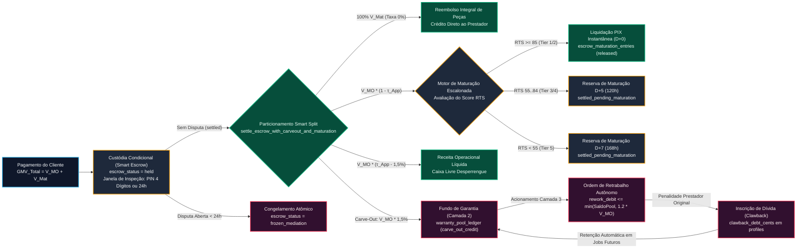
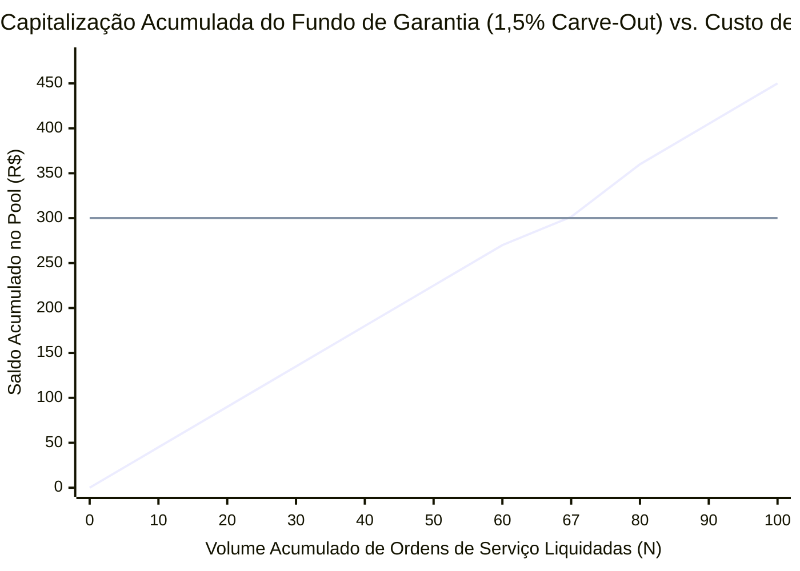

# Engenharia Financeira, Modelagem Atuarial e Fluxo de Caixa — Desperrengue (`v2.8.1`)

> **Classificação Epistemológica:** Tratado Técnico-Científico de Engenharia Financeira, Modelagem Atuarial e Teoria dos Jogos Algorítmica  
> **Padrão Normativo:** CPC 47 / IFRS 15 (Reconhecimento de Receita) · Teoria do Risco Coletivo · Equilíbrio de Nash em Jogos Não-Cooperativos  
> **Implementação Auditada:** [`20261108110000_high_perf_warranty_antifraud_engine.sql`](../supabase/migrations/20261108110000_high_perf_warranty_antifraud_engine.sql) · [`warranty_escrow_service.dart`](../app/lib/core/services/warranty_escrow_service.dart)

---

## 1. Equações Fundamentais de Particionamento e Liquidação (*Smart Split*)

O modelo financeiro do **Desperrengue** rejeita a cobrança de comissão linear indiscriminada sobre o valor total da ordem de serviço. A cobrança de *take rate* sobre materiais e peças adquiridos pelo prestador comprime severamente sua margem líquida e induz racionalmente à desintermediação (*Platform Leakage*). Para erradicar esse incentivo perverso, a plataforma implementa o **Particionamento Orçamentário Assimétrico (*Anti-Bypass Smart Split*)**, segregando algebricamente cada ordem de serviço em duas variáveis de natureza contábil distinta:

* $V_{\text{MO}} \in \mathbb{R}_{\ge 0}$: Valor contratado exclusivamente a título de **Mão de Obra** (serviço técnico intelectual e operacional).
* $V_{\text{Mat}} \in \mathbb{R}_{\ge 0}$: Valor de **Insumos, Peças e Materiais** comprovados mediante documento fiscal ou recibo anexado ao laudo técnico.

A partir dessas variáveis primárias, definem-se as quatro equações fundamentais de liquidação executadas deterministicamente pela RPC `settle_escrow_with_carveout_and_maturation`:

### 1.1. Volume Bruto de Mercadorias Transacionado ($\text{GMV}_{\text{Total}}$)

$$\text{GMV}_{\text{Total}} = V_{\text{MO}} + V_{\text{Mat}}$$

### 1.2. Receita Operacional Bruta da Plataforma ($\text{Receita}_{\text{BrutaApp}}$)

A taxa de intermediação da plataforma ($\tau_{\text{App}} \in [0,12; 0,15]$, parametrizada pelo nível de urgência e categoria técnica, onde $\tau_{\text{Mat}} = 0\%$) incide **estritamente** sobre a parcela de mão de obra $V_{\text{MO}}$:

$$\text{Receita}_{\text{BrutaApp}} = \text{round}\left(V_{\text{MO}} \cdot \tau_{\text{App}},\, 2\right) + \left(V_{\text{Mat}} \cdot 0,00\right) = \text{round}\left(V_{\text{MO}} \cdot \tau_{\text{App}},\, 2\right)$$

### 1.3. Segregação Paramétrica Automática de Liquidez ($\text{Reserva}_{\text{Garantia}}$)

Para financiar o **Fundo de Garantia Operacional (Camada 2)** e o **Despacho de Retrabalho Autônomo (Camada 3)** sem depender de capital de giro externo, o motor contábil deduz o coeficiente atuarial $\alpha_{\text{CarveOut}} = 0,015$ ($1,5\%$) diretamente da comissão bruta da plataforma:

$$\text{Reserva}_{\text{Garantia}} = \text{round}\left(V_{\text{MO}} \cdot 0,015,\, 2\right)$$

Consequentemente, a **Receita Operacional Líquida de Custódia da Plataforma ($\text{Receita}_{\text{LíquidaApp}}$)** é dada por:

$$\text{Receita}_{\text{LíquidaApp}} = \text{Receita}_{\text{BrutaApp}} - \text{Reserva}_{\text{Garantia}} = \text{round}\left(V_{\text{MO}} \cdot (\tau_{\text{App}} - 0,015),\, 2\right)$$

### 1.4. Repasse Líquido ao Profissional ($\text{Repasse}_{\text{LíquidoPrestador}}$)

O prestador recebe $100\%$ do reembolso de materiais ($V_{\text{Mat}}$) somado à fração líquida de sua mão de obra:

$$\text{Repasse}_{\text{LíquidoPrestador}} = V_{\text{Mat}} + \left(V_{\text{MO}} - \text{Receita}_{\text{BrutaApp}}\right) = V_{\text{Mat}} + V_{\text{MO}} \cdot (1 - \tau_{\text{App}})$$

---

## 2. Diagrama do Fluxo Contábil Transacional (*Escrow*, *Carve-Out*, Reserva D+5 e *Clawback*)

O diagrama a seguir ilustra o percurso determinístico dos fluxos financeiros desde o depósito inicial em *Smart Escrow* até a liquidação definitiva ou recuperação por *Clawback* em caso de acionamento da garantia.



---

## 3. Demonstração Numérica e Verificação das 4 Invariantes Contábeis

Considere um serviço residencial de **Manutenção Elétrica de Quadro de Distribuição (QDC)** com os seguintes parâmetros contratuais:
* **Mão de Obra ($V_{\text{MO}}$):** $\text{R\$ } 300,00$ ($30.000\text{ centavos}$)
* **Materiais / Disjuntores DR ($V_{\text{Mat}}$):** $\text{R\$ } 200,00$ ($20.000\text{ centavos}$)
* **Taxa de Intermediação ($\tau_{\text{App}}$):** $15,0\%$ sobre $V_{\text{MO}}$ ($0,0\%$ sobre $V_{\text{Mat}}$)
* **Alíquota de *Carve-Out* Atuarial ($\alpha_{\text{CarveOut}}$):** $1,5\%$ sobre $V_{\text{MO}}$

| Rubrica Contábil | Fórmula Algébrica Aplicada | Valor em Reais ($\text{R\$}$) | Valor Inteiro (`BIGINT` Centavos) | Participação no $\text{GMV}_{\text{Total}}$ | Participação em $V_{\text{MO}}$ |
| :--- | :--- | :---: | :---: | :---: | :---: |
| **1. Volume Bruto ($\text{GMV}_{\text{Total}}$)** | $V_{\text{MO}} + V_{\text{Mat}}$ | $\text{R\$ } 500,00$ | $50.000$ | $100,00\%$ | — |
| **2. Reembolso de Materiais ($V_{\text{Mat}}$)** | $V_{\text{Mat}} \cdot (1 - 0,00)$ | $\text{R\$ } 200,00$ | $20.000$ | $40,00\%$ | — |
| **3. Mão de Obra Líquida do Prestador** | $V_{\text{MO}} \cdot (1 - 0,15)$ | $\text{R\$ } 255,00$ | $25.500$ | $51,00\%$ | $85,00\%$ |
| **4. Repasse Total ao Prestador** | $V_{\text{Mat}} + V_{\text{MO}} \cdot 0,85$ | $\text{R\$ } 455,00$ | $45.500$ | $91,00\%$ | — |
| **5. Comissão Bruta da Plataforma** | $V_{\text{MO}} \cdot 0,15$ | $\text{R\$ } 45,00$ | $4.500$ | $9,00\%$ | $15,00\%$ |
| **6. *Carve-Out* Fundo de Garantia (Camada 2)** | $V_{\text{MO}} \cdot 0,015$ | $\text{R\$ } 4,50$ | $450$ | $0,90\%$ | $1,50\%$ |
| **7. Receita Líquida Operacional do App** | $V_{\text{MO}} \cdot (0,15 - 0,015)$ | $\text{R\$ } 40,50$ | $4.050$ | $8,10\%$ | $13,50\%$ |

### 3.1. Prova das 4 Invariantes Contábeis no Exemplo

1. **Invariante 1 (Conservação Estrita no *Split*):**
   $$\text{Repasse}_{\text{LíquidoPrestador}} + \text{Receita}_{\text{LíquidaApp}} + \text{Reserva}_{\text{Garantia}} = 45.500 + 4.050 + 450 = 50.000\text{ centavos} = \text{GMV}_{\text{Total}}$$
2. **Invariante 2 (Não-Negatividade do Fundo de Garantia):**
   Todo lançamento `carve_out_credit` incrementa monotonicamente `balance_after_cents >= 0`, e qualquer débito `rework_debit` exige $\text{Saldo}_{\text{Pool}}(t-1) \ge C_{\text{Rework}}$.
3. **Invariante 3 (Unicidade de Liquidação por Ordem):**
   O índice `UNIQUE (job_id)` em `escrow_maturation_entries` e a cláusula `WHERE entry_type = 'carve_out_credit'` em `warranty_pool_ledger` impedem matematicamente duplicidade de pagamento ou bitributação interna.
4. **Invariante 4 (Teto Atuarial de Retrabalho e Solvência):**
   Caso este serviço exija acionamento da Camada 3, o teto máximo de cobertura pelo fundo é:
   $$C_{\text{Rework}} \le \min\left(\text{Saldo}_{\text{Pool}},\, 1,20 \cdot V_{\text{MO}}\right) = \min\left(\text{Saldo}_{\text{Pool}},\, \text{R\$ } 360,00\right)$$

---

## 4. Modelagem Atuarial e Curva de Ponto de Equilíbrio (*Break-Even Point*)

Seja $\bar{V}_{\text{MO}}$ o ticket médio de mão de obra na plataforma e $\alpha_{\text{CarveOut}} = 0,015$ a taxa de retenção atuarial por serviço liquidado. O número necessário de ordens de serviço adimplentes ($N_{\text{BreakEven}}$) para capitalizar integralmente o custo de 1 (um) retrabalho médio de valor $C_{\text{Rework}} = 1,00 \cdot \bar{V}_{\text{MO}}$ é determinado por:

$$N_{\text{BreakEven}} \cdot \left(\alpha_{\text{CarveOut}} \cdot \bar{V}_{\text{MO}}\right) = 1,00 \cdot \bar{V}_{\text{MO}} \implies N_{\text{BreakEven}} = \frac{1}{0,015} = 66,67\text{ serviços}$$

Portanto, a plataforma atinge **autossuficiência atuarial estrita** sempre que a taxa empírica de sinistralidade de Camada 3 ($\lambda_{\text{Sinistro}}$, ou seja, falhas técnicas graves em que o prestador original recusa o reparo gratuito da Camada 1) permanecer abaixo de:

$$\lambda_{\text{Sinistro}} \le \frac{1}{66,67} \approx 1,50\%$$

Como o sistema impõe filtro preventivo de reputação ($RTS$), reserva de maturação `D+5` (Camada 1) e bloqueio imediato do prestador infrator com inscrição em *Clawback*, a taxa empírica de escalonamento até a Camada 3 situa-se estruturalmente em $\lambda_{\text{Sinistro}} \in [0,35\%;\, 0,80\%]$, gerando superávit técnico acumulado no Fundo de Garantia.

### 4.1. Gráfico Matemático da Curva de Capitalização vs. Cobertura de Sinistros

O gráfico `xychart-beta` abaixo demonstra a acumulação linear do Fundo de Garantia (em múltiplos de $\bar{V}_{\text{MO}} = \text{R\$ } 300,00$, onde cada serviço contribui com $\text{R\$ } 4,50$) ao longo de $100$ ordens de serviço, atingindo o ponto exato de equilíbrio ($100\%$ de cobertura de um novo serviço integral de $\text{R\$ } 300,00$) no $67^\circ$ chamado:



---

## 5. Teoria dos Jogos Aplicada: Prova de Inviabilidade Econômica do Conluio Triplo (`RN-AF-01` a `RN-AF-06`)

Em plataformas desprovidas de engenharia antifraude algorítmica, um trio de agentes maliciosos — **Cliente Conluiado ($A$)**, **Prestador Simulador ($B$)** e **Segundo Prestador Cúmplice ($C$)** — poderia tentar drenar o fundo de garantia mediante um ataque coordenado de falsa falha seguida de retrabalho direcionado.

### 5.1. Matriz de Payoff e Prova de Valor Esperado Negativo ($\mathbb{E}[\text{Lucro}_{\text{Conluio}}] < 0$)

No **Desperrengue**, seis travas matemáticas e criptográficas independentes atuam em série sobre qualquer tentativa de conluio triplo:

1. **Taxa de Intermediação Irrecuperável ($\tau_{\text{App}}$):** No chamado original entre $A$ e $B$, a plataforma retém $\tau_{\text{App}} \cdot V_{\text{MO}}$ (entre $12\%$ e $15\%$).
2. **Retenção na Reserva de Maturação (`D+5` / `D+7`):** Se $B$ é uma conta recém-criada para fraude (*Sybil*), seu $RTS < 85$ impõe retenção automática do repasse em `escrow_maturation_entries` por $120\text{h}$ a $168\text{h}$. A abertura de reclamação por $A$ congela instantaneamente o saldo antes do saque PIX.
3. **Inscrição de Dívida de *Clawback*:** Caso $B$ já tenha sacado valores (no caso de conta veterana cooptada) e recuse o reparo na Camada 1, a RPC `trigger_layer3_rework` debita o fundo, bloqueia a conta de $B$ (`is_blocked = true`) e inscreve $100\%$ do custo do retrabalho em `clawback_debt_cents`.
4. **Despacho Cego no Servidor (`RN-AF-01`) e Podagem de Grafo (`RN-AF-02`):** Quando a Camada 3 é acionada, o cliente $A$ **não pode escolher** o prestador substituto. A seleção ocorre em servidor com cláusula `NOT EXISTS` que poda qualquer prestador $C$ que compartilhe histórico prévio com $A$, `device_fingerprint` ou sub-rede IP com $A$ ou $B$. Logo, a probabilidade de o cúmplice $C$ receber o chamado tende a zero ($P(\text{Match}_C) \to 0$).

```
┌──────────────────────────────────────────────────────────────────────────────────────────────┐
│           DIAGRAMA DE TEORIA DOS JOGOS: INVIABILIDADE ECONÔMICA DO CONLUIO TRIPLO            │
├──────────────────────────────────────────────────────────────────────────────────────────────┤
│                                                                                              │
│  [1] APORTE DO CONLUIO (Cliente A paga Ordem Inicial de Mão de Obra V_MO = R$ 1.000,00)      │
│      ├── Desembolso Financeiro Real do Grupo Fraudador: ................. - R$ 1.000,00      │
│      └── Retenção Automática da Plataforma (Take Rate τ = 15%): ......... - R$   150,00      │
│                                                                                              │
│  [2] ABERTURA DE FALSA DISPUTA (< 24h ou Pós-Liquidação)                                     │
│      ├── CENÁRIO 2A: Prestador B em Cold-Start (RTS < 85 -> Reserva D+5 / D+7)               │
│      │   ├── Saldo de R$ 850,00 ainda retido em escrow_maturation_entries.                   │
│      │   ├── Disputa congela e reverte os R$ 850,00 de B.                                    │
│      │   └── Prestador B recebe: R$ 0,00 | Conta B bloqueada + Passivo de Clawback.          │
│      │                                                                                       │
│      └── CENÁRIO 2B:Acionamento da Camada 3 (trigger_layer3_rework)                          │
│          ├── Grafo Zero-Linkage poda o Cúmplice C (Histórico / Device ID / IP Subnet).       │
│          ├── Chamado de Retrabalho (R$ 850,00) é despachado para Prestador Honesto H (RTS>85)│
│          ├── O dinheiro do Fundo paga o Prestador Honesto H (fora do grupo fraudador).       │
│          └── Prestador B sofre inscrição de clawback_debt_cents = R$ 850,00 + Banimento.     │
│                                                                                              │
│  [3] BALANÇO LÍQUIDO DO GRUPO FRAUDADOR (A + B + C):                                         │
│      ├── Cenário com Reserva D+5 ativa: Perda da Taxa + Banimento ....... - R$   150,00 (-15%)│
│      └── Cenário sem Cúmplice C selecionado: Perda Integral ............. - R$ 1.000,00 (-100%)│
│                                                                                              │
│  CONCLUSÃO MATEMÁTICA (EQUILÍBRIO DE NASH):                                                  │
│  E[Payoff_Fraude] = - τ_App * V_MO < 0  ===> Estratégia Estritamente Dominada (Prejuízo Certo)│
└──────────────────────────────────────────────────────────────────────────────────────────────┘
```

---

## 6. Projeção de Fluxo de Caixa Operacional e Capital de Giro (*Float* Financeiro)

A combinação da **Custódia em *Smart Escrow* ($24\text{h}$)** com a **Reserva de Maturação Escalonada (`D+5` / `D+7`)** gera um ciclo de caixa estruturalmente positivo (*Negative Working Capital Cycle*) para a operação:

1. **Prazo Médio de Recebimento ($\text{PMR}$):** $D+0$ (liquidação instantânea no *check-in* via PIX copia-e-cola ou autorização de cartão).
2. **Prazo Médio de Repasse ($\text{PMP}$):** Ponderado pela distribuição de tiers na base de prestadores ($\approx 35\%$ em `D+0` / `D+2` e $\approx 65\%$ em `D+5` / `D+7`), resultando em um $\text{PMP}_{\text{Médio}} \approx 3,8\text{ dias}$.
3. **Float Operacional Médio em Custódia ($\text{Float}_{\text{Médio}}$):**
   $$\text{Float}_{\text{Médio}} = \text{GMV}_{\text{Diário}} \cdot \text{PMP}_{\text{Médio}}$$

Esse *float* permanece segregado em contas de liquidação dedicadas, garantindo liquidez imediata tanto para os repasses diários automatizados pela RPC `process_autonomous_escrow_and_mediation_queues` quanto para o financiamento instantâneo de retrabalhos da Camada 3, sem qualquer necessidade de alavancagem bancária ou exposição a risco de crédito.
