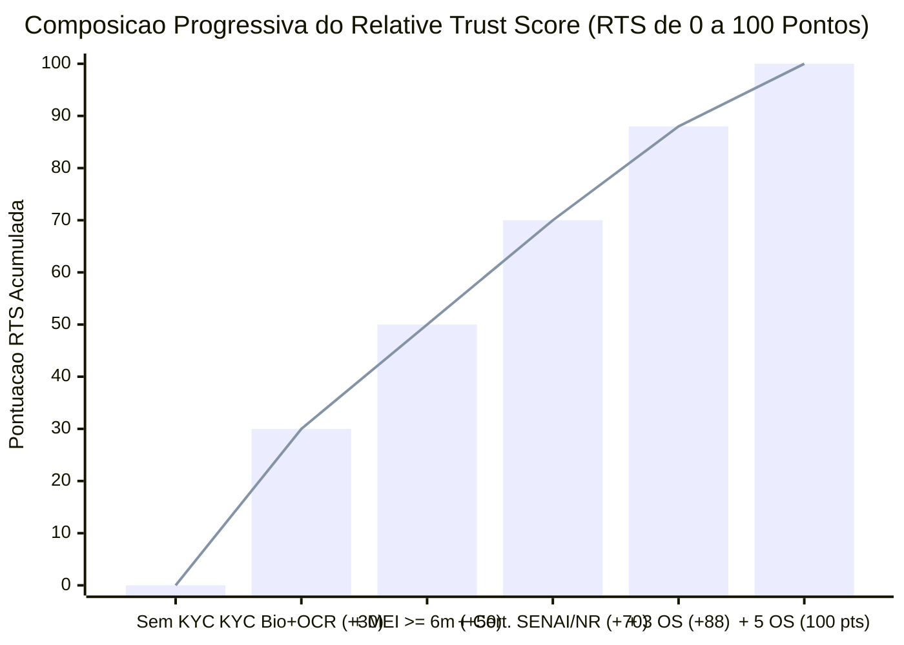
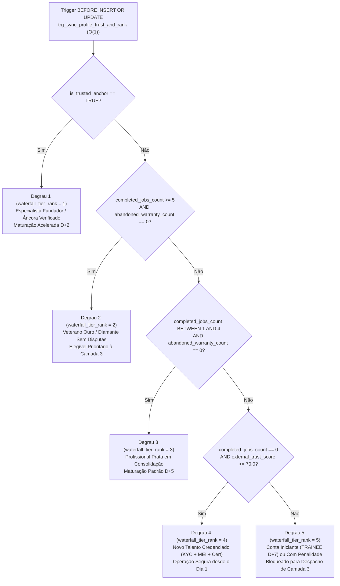
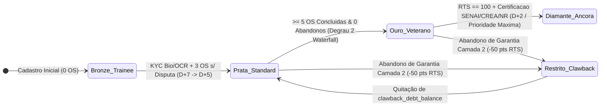

# Engenharia de Reputação Algorítmica, Teoria de Incentivos e Score RTS (`GAMIFICACAO.md`)

Especificação matemática do **Relative Trust Score ($RTS \in [0, 100]$)**, da progressão meritocrática de *tiers* (`Bronze` $\to$ `Prata` $\to$ `Ouro` $\to$ `Diamante` e `Profissional Âncora`), do acoplamento econômico entre reputação e velocidade de liquidação do *Smart Escrow* ($D+7 / D+5 / D+2$) e da prioridade algorítmica na **Cascata de 5 Degraus (`waterfall_tier_rank` 1 a 5)** do ecossistema **Desperrengue** (`v2.8.1`).

---

## 1. Modelagem Matemática do Relative Trust Score ($RTS$) em $O(1)$

Implementado na função PL/pgSQL imutável `public.calculate_relative_trust_score` e mantido incrementalmente em $O(1)$ pela trigger `public.trg_sync_profile_trust_and_rank` ([`20261108120000_client_kyc_biometrics_and_ocr.sql`](../supabase/migrations/20261108120000_client_kyc_biometrics_and_ocr.sql)), o índice de confiança do prestador é definido pela equação linear limitada:

$$RTS = \text{clamp}_{[0, 100]}\Big(30\cdot\mathbb{I}_{\text{KYC+Bio}} + 20\cdot\mathbb{I}_{\text{MEI}\ge 6\text{m}} + 20\cdot\mathbb{I}_{\text{Cert}} + \min(30,\; 6\cdot N_{\text{completed}}) - 50\cdot N_{\text{abandoned}}\Big)$$

Onde:
- $\mathbb{I}_{\text{KYC+Bio}} \in \{0, 1\}$: vale $1$ quando `kyc_biometric_verified = TRUE` ou `(liveness_verified AND ocr_verified)`, concedendo **$+30,0\text{ pts}$** (reaproveitados automaticamente do onboarding de Cliente);
- $\mathbb{I}_{\text{MEI}\ge 6\text{m}} \in \{0, 1\}$: vale $1$ quando `mei_cnpj_active_months >= 6`, concedendo **$+20,0\text{ pts}$**;
- $\mathbb{I}_{\text{Cert}} \in \{0, 1\}$: vale $1$ quando `technical_cert_verified = TRUE` (**SENAI, CREA, CFT, NR-10, NR-35**), concedendo **$+20,0\text{ pts}$**;
- $N_{\text{completed}}$: contador materializado `completed_jobs_count`, somando **$+6,0\text{ pts}$** por OS concluída sem disputa até o teto de **$+30,0\text{ pts}$** ($5$ serviços);
- $N_{\text{abandoned}}$: contador materializado `abandoned_warranty_count`, aplicando penalidade severa de **$-50,0\text{ pts}$** a cada garantia abandonada que exija acionamento da Camada 3.



---

## 2. Cascata Hierárquica de 5 Degraus do Marco Zero (`waterfall_tier_rank` 1 a 5)



---

## 3. Acoplamento Econômico: Reputação $\times$ Velocidade de Liquidação e Progressão de Tiers



```text
┌──────────────────────────────────────────────────────────────────────────────────────────┐
│     DIAGRAMA DE ACOPLAMENTO: REPUTAÇÃO (RTS / TIER) × PRIVILÉGIOS ECONÔMICOS REAIS       │
├───────────────────────────┬──────────────────┬─────────────────────┬─────────────────────┤
│ Tier / Classificação      │ Score RTS & OS   │ Velocidade do Escrow│ Acesso à Camada 3   │
├───────────────────────────┼──────────────────┼─────────────────────┼─────────────────────┤
│ 💎 Diamante / Âncora      │ RTS >= 90 | Ânc. │ Maturação D+2 (48h) │ 1º da Fila (Rank 1) │
│ 🥇 Ouro (Veterano)        │ RTS >= 80 | >=5OS│ Maturação D+5 / Ráp.│ 2º da Fila (Rank 2) │
│ 🥈 Prata (Em Ascensão)    │ RTS >= 60 | 1..4 │ Maturação D+5 (120h)│ 3º da Fila (Rank 3) │
│ 🥉 Bronze Qualificado     │ RTS >= 70 | 0 OS │ Maturação D+7 (168h)│ 4º da Fila (Rank 4) │
│ 🔒 Iniciante / Restrito   │ RTS <  70 | Disput│ Retenção D+7 + Claw.│ Inelegível (Rank 5) │
└───────────────────────────┴──────────────────┴─────────────────────┴─────────────────────┘
```

---

## 4. Árvore de Conquistas e Medalhas Sincronizada com Segurança e Patrimônio

Implementada em [`achievements.dart`](../app/lib/core/models/achievements.dart), [`client_achievements.dart`](../app/lib/core/models/client_achievements.dart) e [`achievement_widgets.dart`](../app/lib/features/shared/presentation/achievement_widgets.dart):

- **Conquistas do Profissional**: *Identidade Blindada* (conclusão do KYC Biométrico + OCR), *Mestre Certificado* (homologação de NR-10/NR-35/SENAI/CREA), *Guardião do Prazo* ($100\%$ de check-ins geolocalizados no horário) e *Socorrista de Elite* (execução impecável de chamados de retrabalho da Camada 3).
- **Conquistas Patrimoniais do Cliente**: *Titular Verificado* (aprovação na moldura oval ao vivo + scanner ISO ID-1), *Guardião do PIN* (encerramento presencial seguro com PIN de 4 dígitos) e *Imóvel Padrão ABNT* (emissão do **Passaporte Oficial de Manutenção do Imóvel — ABNT NBR 5674** com Score de Vistoria $\ge 90/100$).
