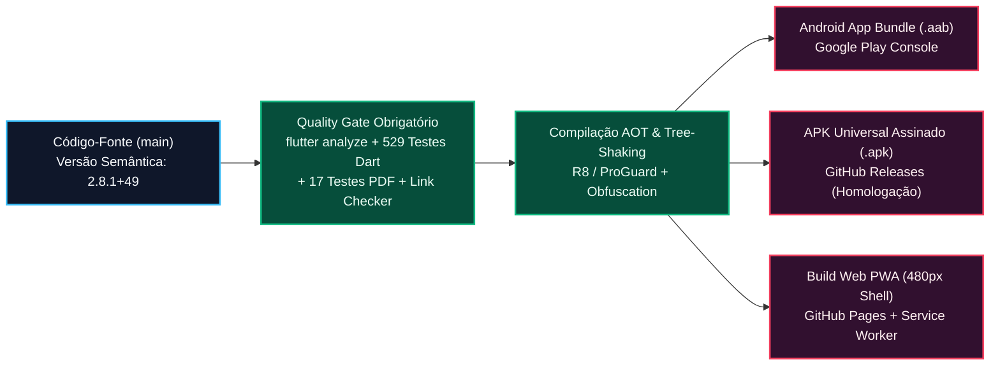

# Engenharia de Release, Empacotamento Android/iOS e Publicação na Google Play Store — Desperrengue (`v2.8.1`)

> **Classificação Epistemológica:** Tratado de Engenharia de *Release*, Geometria de Ícones Adaptativos, Otimização de Binários AOT e Conformidade Regulatória de Lojas de Aplicativos  
> **Padrões de Referência:** Google Play Console Policy · Android Adaptive Icons Specification (`API 26+`) · Apple Human Interface Guidelines · LGPD (Lei nº 13.709/2018, Art. 11)  
> **Implementação Auditada:** [`app/pubspec.yaml`](../app/pubspec.yaml) · [`app/web/manifest.json`](../app/web/manifest.json) · [`app/assets/icons/app_icon_raw.png`](../app/assets/icons/app_icon_raw.png)

---

## 1. Pipeline de Compilação AOT, Assinatura Criptográfica e Distribuição

O ciclo de geração de binários de produção do **Desperrengue** é totalmente automatizado via GitHub Actions (`.github/workflows/`) e reproduzível localmente, gerando tanto o pacote **Android App Bundle (`.aab`)** para a Google Play Store quanto o instalador universal **APK (`.apk`)** e o pacote **Web PWA** com *cache-busting* determinístico.



---

## 2. Engenharia Matemática do Ícone Adaptativo (*Safe-Zone* de $57\%\text{–}66\%$)

Em lançadores modernos do sistema Android (como Samsung *One UI Home*, Pixel Launcher e Motorola MyUX), os ícones de aplicativos são compostos por duas camadas de $108 \times 108\text{ dp}$ (`background` e `foreground`) sobre as quais o sistema operacional aplica uma máscara dinâmica (*squircle*, círculo, gota ou quadrado arredondado) que **recorta as bordas externas** até um diâmetro visível de $72 \times 72\text{ dp}$, reservando apenas o círculo central de **$66 \times 66\text{ dp}$ ($61,1\%$ a $66,0\%$ da tela total)** como **Zona de Segurança Absoluta (*Safe-Zone*)**.

Para erradicar qualquer distorção, borramento ou corte de bordas, o ícone mestre do **Desperrengue** ([`app/assets/icons/app_icon_raw.png`](../app/assets/icons/app_icon_raw.png)) é sintetizado matematicamente em alta resolução ($1024 \times 1024\text{ px}$ com *supersampling* $2\times$ a partir de $2048 \times 2048\text{ px}$):

1. **Geometria Simbólica:** Monograma **"D"** reverso em platina escovada tridimensional integrado a uma chave mecânica de precisão no espaço negativo e um selo de verificação (*checkmark*) em bronze/cobre metálico (`#F97316` $\to$ `#D97706`).
2. **Enquadramento Estrito na *Safe-Zone*:** Todo o brasão metálico está inscrito em uma caixa delimitadora central de **$57\%$ da dimensão total** ($584 \times 584\text{ px}$ dentro de $1024 \times 1024\text{ px}$), garantindo folga periférica uniforme de $21,5\%$ em cada extremidade sobre o fundo contínuo *Obsidian Slate* (`#0B0F19`).
3. **Preservação da Identidade Interna:** O ícone metálico "D" é exclusivo das interfaces de sistema operacional (*launcher*, *splash screen* nativa e ícones PWA `192px`/`512px`/`maskable`); dentro da interface do aplicativo, preserva-se a animação vetorial da casa residencial.

```
┌──────────────────────────────────────────────────────────────────────┐
│            MATRIZ DE ÍCONES DE PRODUÇÃO (ANDROID / iOS / PWA)        │
├──────────────────────────────────┬─────────────────┬─────────────────┤
│ Caminho do Artefato no Projeto   │ Resolução Exata │ Escopo de Uso   │
├──────────────────────────────────┼─────────────────┼─────────────────┤
│ assets/icons/app_icon_raw.png    │ 1024 x 1024 px  │ Master Source   │
│ mipmap-xxxhdpi/ic_launcher.png   │  192 x  192 px  │ Android Legacy  │
│ drawable-xxxhdpi/ic_launcher_fg  │  432 x  432 px  │ Adaptive Layer  │
│ ios/Runner/Assets.xcassets (1024)│ 1024 x 1024 px  │ Apple App Store │
│ web/icons/Icon-512.png           │  512 x  512 px  │ PWA Home Screen │
│ web/icons/Icon-maskable-512.png  │  512 x  512 px  │ Android PWA     │
└──────────────────────────────────┴─────────────────┴─────────────────┘
```

---

## 3. Conformidade com o Formulário de Segurança de Dados (*Google Play Data Safety*) e LGPD (Art. 11)

A publicação de aplicativos que operam custódia financeira e verificação de identidade civil exige transparência estrita no formulário **Data Safety** da Google Play Console e na **App Privacy** da Apple App Store:

| Categoria de Dado Sensível | Coletado / Processado | Compartilhado com Terceiros? | Finalidade Legal e Arquitetura de Proteção (LGPD) |
| :--- | :--- | :---: | :--- |
| **Biometria Facial (Prova de Vida e Face Match)** | **Processamento Efêmero *On-Device*** | **Não ($0\%$)** | A malha facial (EAR, Yaw, $YCbCr$) e o descritor 128-D são computados localmente na memória RAM do aparelho via `Isolate.run` para prevenção à fraude (LGPD, Art. 11, II, *g*). Nenhum dado biométrico é vendido ou enviado a *bureaus* externos. |
| **Documento Oficial (CNH / RG) e CPF** | **Sim (Criptografado)** | **Não ($0\%$)** | O CPF é anonimizado via hash criptográfico irreversível (`SHA-256` + `DSP-CPF-PEPPER-2026`). As imagens de auditoria são retidas em bucket privado `kyc-documents` sob RLS restritivo. |
| **Localização Geográfica Precisa (`GPS`)** | **Sim (Em Uso)** | **Não ($0\%$)** | Utilizada exclusivamente para despacho geoespacial $O(\log N + K)$ de prestadores próximos e validação de *check-in* no imóvel. |
| **Fotos de Evidência de Serviço (`Before/After`)** | **Sim** | **Não ($0\%$)** | Vinculadas ao laudo de conclusão, ao `dHash` de 64 bits de auditoria de garantia e ao Passaporte Oficial do Imóvel (`ABNT NBR 5674`). |
| **Exclusão de Conta e Dados pelo Titular** | **Autoatendimento *In-App*** | — | O usuário dispõe de botão dedicado em *Perfil -> Excluir Conta* que aciona a RPC `delete_own_account_scoped`, expurgando dados pessoais em conformidade com o Art. 18 da LGPD. |

---

## 4. Comandos de Compilação de Produção (*Release Build*)

### 4.1. Geração do Android App Bundle (`.aab`) para Google Play Store
```bash
cd app
flutter build appbundle --release \
  --obfuscate \
  --split-debug-info=build/app/outputs/symbols \
  --dart-define=SUPABASE_URL=https://seu-projeto.supabase.co \
  --dart-define=SUPABASE_ANON_KEY=sua-chave-anon-jwt
```

### 4.2. Geração do APK Universal (`.apk`) para Homologação Direta
```bash
cd app
flutter build apk --release \
  --dart-define=SUPABASE_URL=https://seu-projeto.supabase.co \
  --dart-define=SUPABASE_ANON_KEY=sua-chave-anon-jwt
```
