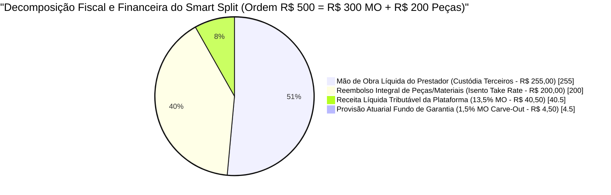
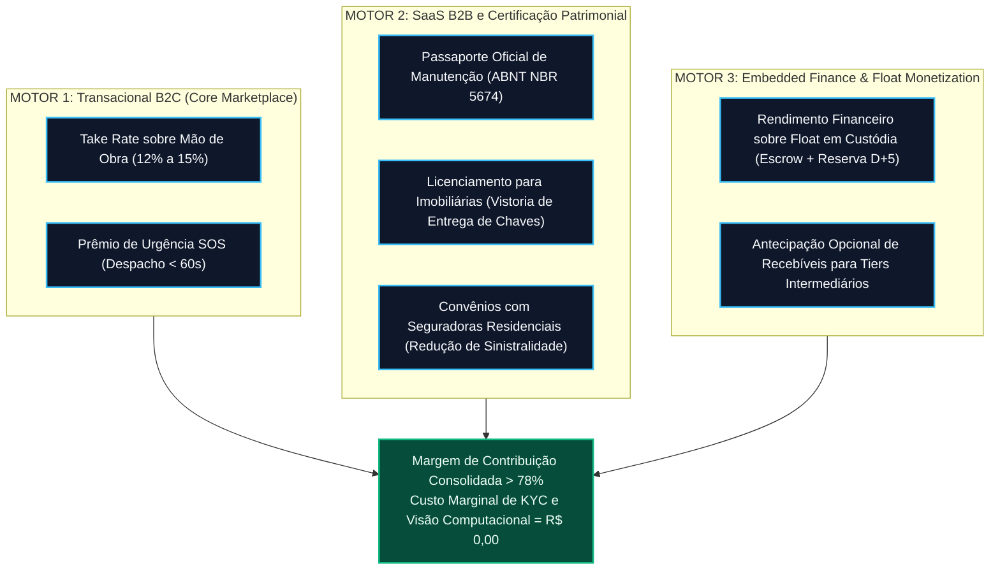

# Planos de Negócio, Estrutura de Receitas e Engenharia Tributária — Desperrengue (`v2.8.1`)

> **Classificação Epistemológica:** Tratado Técnico-Científico de Modelagem de Negócios, *Unit Economics* e Arquitetura Fiscal-Tributária  
> **Enquadramento Normativo:** Lei Complementar nº 116/2003 (ISSQN — Subitem 10.05) · Lei Complementar nº 123/2006 (Simples Nacional / Anexo III) · CPC 47 / IFRS 15 (Agente vs. Principal)  
> **Implementação Auditada:** [`20261108110000_high_perf_warranty_antifraud_engine.sql`](../supabase/migrations/20261108110000_high_perf_warranty_antifraud_engine.sql) · [`desperrengue_official_pdf_service.dart`](../app/lib/core/services/desperrengue_official_pdf_service.dart)

---

## 1. Decomposição Tributária e Contábil do *Smart Split* (Agente vs. Principal)

O maior risco fiscal de marketplaces de serviços no Brasil reside na **bitributação sobre o Volume Bruto de Mercadorias e Serviços ($\text{GMV}_{\text{Total}}$)**. Caso a plataforma receba a totalidade do pagamento ($\text{Mão de Obra} + \text{Peças}$) em conta própria sem segregação contratual e contábil de custódia, o fisco municipal e federal pode caracterizar a totalidade do ingresso financeiro como receita bruta da plataforma, tributando valores que pertencem ao prestador de serviço ou que representam mero reembolso de materiais já tributados pelo ICMS na cadeia varejista.

Para eliminar esse passivo, a arquitetura contábil do **Desperrengue** opera estritamente sob o regime de **Intermediação com Liquidação Particionada na Fonte (*Smart Split* — IFRS 15 / CPC 47)**:

1. **Parcela de Reembolso de Materiais ($V_{\text{Mat}}$ — Taxa $0\%$):** Segregada contabilmente como reembolso de insumos adquiridos em nome do tomador do serviço. Não transita como receita da plataforma, evitando bitributação de ISSQN/PIS/COFINS sobre mercadorias sujeitas ao ICMS.
2. **Parcela de Mão de Obra do Prestador ($V_{\text{MO}} \cdot (1 - \tau_{\text{App}})$):** Mantida em conta de custódia transitória (*Escrow* de terceiros) e liquidada diretamente ao titular da execução técnica. Constitui receita tributável exclusivamente na esfera jurídica do prestador (MEI / Autônomo / Simples Nacional).
3. **Taxa de Intermediação Digital ($\text{Receita}_{\text{BrutaApp}} = V_{\text{MO}} \cdot \tau_{\text{App}}$):** Única parcela que constitui fato gerador de receita de prestação de serviços de intermediação (Subitem 10.05 da Lista Anexa à LC nº 116/2003), sobre a qual emitem-se a NFS-e da plataforma e os tributos incidentes.

### 1.1. Gráfico Vetorial da Decomposição do *Smart Split* ($\text{GMV}_{\text{Total}} = \text{R\$ } 500,00$)

---

## 2. Comparativo de Eficiência Tributária: Abordagem Ingênua vs. *Smart Split* Desperrengue

Considere a ordem padrão de $\text{GMV}_{\text{Total}} = \text{R\$ } 500,00$ ($V_{\text{MO}} = \text{R\$ } 300,00$, $V_{\text{Mat}} = \text{R\$ } 200,00$, $\tau_{\text{App}} = 15\% \implies \text{Receita}_{\text{BrutaApp}} = \text{R\$ } 45,00$) sob uma alíquota efetiva consolidada de tributos sobre faturamento ($\tau_{\text{Trib}} = 11,33\%$ no Simples Nacional Anexo III intermediário ou $14,25\%$ no Lucro Presumido com ISS de $5\%$, PIS $0,65\%$, COFINS $3,00\%$, IRPJ $4,80\%$ e CSLL $2,88\%$):

| Métrica Fiscal e Financeira | Modelo Ingênuo (Tributação sobre $\text{GMV}_{\text{Total}}$) | Arquitetura *Smart Split* Desperrengue (Tributação sobre $\text{Receita}_{\text{BrutaApp}}$) | Ganho de Eficiência / Economia Fiscal |
| :--- | :---: | :---: | :---: |
| **Base de Cálculo Tributável da Plataforma** | $\text{R\$ } 500,00$ ($100\%$ do GMV) | $\text{R\$ } 45,00$ ($15\%$ de $V_{\text{MO}}$) | **Redução de $91,0\%$ na Base** |
| **Tributos Incidentes (Simples Anexo III — $11,33\%$)** | $\text{R\$ } 56,65$ | $\text{R\$ } 5,10$ | **Economia de $\text{R\$ } 51,55$ / Job** |
| **Tributos Incidentes (Lucro Presumido — $16,33\%$)** | $\text{R\$ } 81,65$ | $\text{R\$ } 7,35$ | **Economia de $\text{R\$ } 74,30$ / Job** |
| **Resultado Operacional Pós-Impostos e Pós-*Carve-Out*** | **Prejuízo de $-\text{R\$ } 16,15$** (Inviável) | **Lucro Líquido de $+\text{R\$ } 35,40$** ($78,6\%$ de margem líquida) | **Viabilização Estrutural da Operação** |

---

## 3. Arquitetura das 3 Fontes de Receita de Alta Margem (*Revenue Streams*)

O modelo de negócios do **Desperrengue** articula três motores de receita complementares que maximizam o *Lifetime Value* ($\text{LTV}$) tanto no eixo B2C quanto no eixo B2B institucional:

### 3.1. Motor 1 — Intermediação Transacional B2C e Prêmio de Urgência SOS
* **Take Rate Padrão ($12\%$ a $15\%$ sobre $V_{\text{MO}}$):** Aplicado sobre as 33 categorias técnicas residenciais.
* **Despacho de Emergência SOS (`< 60 segundos`):** Chamados críticos (ex.: rompimento hidráulico, curto-circuito em QDC, chaveiro de emergência) acionam priorização no *Tiered Waterfall* (`waterfall_tier_rank = 1`), com adicional de conveniência que eleva a margem bruta sem onerar o reembolso de peças.

### 3.2. Motor 2 — Monetização B2B via Passaporte Oficial de Manutenção ([`ABNT NBR 5674`](../app/lib/core/services/desperrengue_official_pdf_service.dart))
Diferentemente de plataformas que encerram o relacionamento após o pagamento, cada serviço concluído alimenta o **Prontuário da Casa (Passaporte Oficial de Manutenção do Imóvel)**. O dossiê vetorial gerado em PDF com assinatura criptográfica SHA-256 (`DSP-PASS-*`) e conformidade com a norma **ABNT NBR 5674** habilita receitas recorrentes B2B:
* **Imobiliárias e Administradoras de Locação:** Homologação técnica automatizada na entrega de chaves (comprovação de manutenções elétricas, hidráulicas e de climatização realizadas por profissionais auditados), eliminando conflitos de vistoria de saída.
* **Seguradoras Residenciais:** Auditoria preventiva de manutenção predial com *Score de Vistoria* ($0\text{–}100$), permitindo descontos atuariais em apólices residenciais mediante comprovação de revisões periódicas.

### 3.3. Motor 3 — *Embedded Finance* e Monetização de *Float*
O volume financeiro mantido em custódia transitória (*Smart Escrow* de $24\text{h}$ e Reserva de Maturação `D+5` / `D+7`) é alocado em títulos públicos federais de liquidez diária ($100\%$ CDI), gerando receita financeira adicional sem risco de crédito, além de permitir a oferta de antecipação opcional de recebíveis (`D+5 -> D+0`) mediante *spread* reduzido para prestadores de *Tier 3* sem histórico de disputas.

---

## 4. *Unit Economics*, Custo Zero de Onboarding ($\text{R\$ } 0,00$) e Relação $\text{LTV} / \text{CAC}$

Uma inovação estrutural decisiva para a rentabilidade unitária (*Unit Economics*) do **Desperrengue** é a execução integralmente local (*On-Device Edge Computing*) da cadeia de verificação de identidade (**KYC, Prova de Vida Biométrica Ativa 3D, Scanner ISO ID-1 com rotação $0^\circ..270^\circ$, Face Match 128-D e OCR de CNH/RG**):

* **Bureaus Comerciais Tradicionais (Serpro / Unico / Idwall):** Cobram entre $\text{R\$ } 2,50$ e $\text{R\$ } 6,80$ por validação biométrica + OCR. Em uma plataforma com alto volume de cadastros de clientes e prestadores, esse custo inviabiliza o *onboarding* universal na ponta do cliente.
* **Motor Nativo Desperrengue ([`document_ocr_and_liveness_service.dart`](../app/lib/core/services/document_ocr_and_liveness_service.dart)):** Executa Google ML Kit + `Isolate.run` diretamente na CPU/NPU do smartphone do usuário, reduzindo o **Custo Marginal de Verificação Biométrica ($\text{Custo}_{\text{KYC}}$) para exatos $\text{R\$ } 0,00$**.

| Indicador de *Unit Economics* | Parâmetro Projetado (Base Madura) | Fundamento Técnico e Operacional |
| :--- | :---: | :--- |
| **Ticket Médio Bruto ($\overline{\text{GMV}}$)** | $\text{R\$ } 380,00$ | Média ponderada entre serviços rápidos ($\text{R\$ } 180$) e manutenções técnicas ($\text{R\$ } 550$). |
| **Parcela Média de Mão de Obra ($\bar{V}_{\text{MO}}$)** | $\text{R\$ } 260,00$ | Representa $\approx 68,4\%$ do GMV médio; materiais ($\text{R\$ } 120$) isentos de taxa. |
| **Receita Líquida por Ordem ($\text{ARPU}_{\text{Job}}$)** | $\text{R\$ } 35,10$ | $13,5\%$ líquidos sobre $\bar{V}_{\text{MO}}$ (já deduzido o *Carve-Out* de $1,5\%$ do Fundo de Garantia). |
| **Custo Marginal de Onboarding KYC** | **$\text{R\$ } 0,00$** | Processamento $100\%$ *on-device* (ML Kit Face Detection + Text Recognition v2 em *Isolates*). |
| **Custo de Aquisição de Cliente ($\text{CAC}$)** | $\text{R\$ } 42,00$ | Aquisição orgânica alavancada pelo Passaporte do Imóvel e retenção por garantia real. |
| **Frequência Anual de Pedidos** | $4,2\text{ pedidos/ano}$ | Estimulada pela gamificação do *Score de Vistoria* do imóvel e manutenções preventivas. |
| **Tempo Médio de Retenção (*Lifespan*)** | $3,5\text{ anos}$ | *Lock-in* patrimonial gerado pelo histórico criptográfico acumulado no Prontuário da Casa. |
| **Valor Vitalício Líquido ($\text{LTV}$)** | $\text{R\$ } 405,40$ | $\text{ARPU}_{\text{Job}} \times 4,2 \times 3,5 \times \text{Margem Líquida Pós-Impostos } (78,6\%)$. |
| **Relação $\text{LTV} / \text{CAC}$** | **$9,65\times$** | Supera em mais de $3\times$ o *benchmark* de excelência de venture capital ($3,0\times$). |
| **Payback do $\text{CAC}$** | **$1,2\text{ ordens}$ ($\approx 3,4\text{ meses}$)** | Recuperação quase imediata já no segundo chamado residencial do cliente. |
