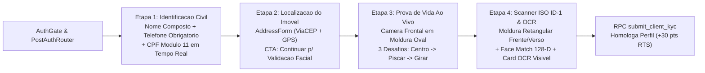
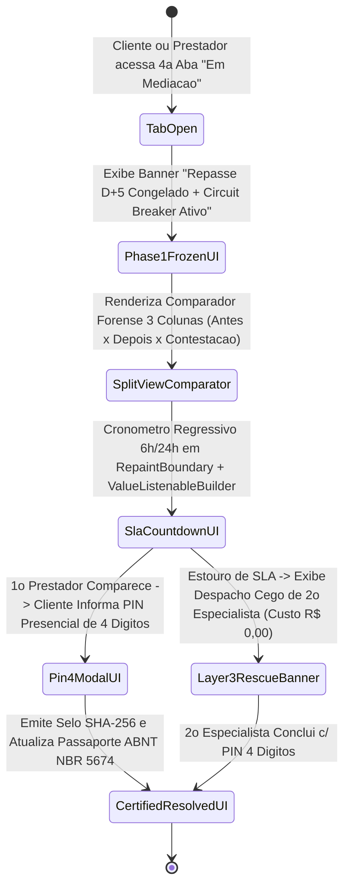

# Engenharia de Interação Humano-Computador (IHC), Design System e Wireframes (`Projeto de Interface.md`)

Especificação da arquitetura visual *Quiet Luxury Dark*, do container responsivo canônico de `480px`, da anatomia das 4 etapas do [`ClientSetupScreen`](../app/lib/features/client/presentation/client_setup_screen.dart), do mapa geoespacial com ordenação de especialistas (`1º, 2º, 3º`), da 4ª aba **"Em Mediação"** com comparador forense de 3 colunas (`ForensicSplitViewComparator`) e da **Carteira Digital Bipartida** do ecossistema **Desperrengue** (`v2.8.1`).

---

## 1. Arquitetura Visual *Quiet Luxury Dark* e Container Responsivo de `480px`

O sistema visual ([`app/lib/core/ui/app_theme.dart`](../app/lib/core/ui/app_theme.dart) e [`app/lib/core/ui/app_tokens.dart`](../app/lib/core/ui/app_tokens.dart)) adota a estética **Quiet Luxury Dark**, projetada para maximizar a legibilidade em ambientes externos e internos sob contraste mínimo **WCAG AA / AAA**:

| Token Semântico | Valor Hexadecimal | Função Cognitiva e Visual |
| :--- | :---: | :--- |
| `canvasPrimary` | `#0B0F19` | Superfície de fundo profunda que reduz fadiga ocular e destaca molduras de visão computacional. |
| `surfaceElevated` | `#151C2C` | Cartões de Ordem de Serviço, Carteira Bipartida e painéis do Passaporte ABNT NBR 5674. |
| `accentCopper` | `#FF6B00` | Ações primárias (CTAs), anéis de progresso biométrico e cantoneiras do scanner ISO ID-1. |
| `forensicEmerald` | `#10B981` | Selos de aprovação biométrica/OCR, garantias ativas e conformidade de `dHash` / GPS. |
| `warningAmber` | `#F59E0B` | Indicadores de saldo em maturação ($D+5$) e contagem regressiva de SLA de 6h/24h. |
| `alertCrimson` | `#EF4444` | Violação de SLA, ativação do *Circuit Breaker* (`has_open_dispute`) e bloqueio anti-monitor. |

Em [`app/lib/main.dart`](../app/lib/main.dart), o `MaterialApp.builder` aplica o envelope `ConstrainedBox(constraints: BoxConstraints(maxWidth: 480))`, garantindo que a densidade informacional e o posicionamento de alvos de toque permaneçam invariantes em Android, iOS e Desktop Web.

---

## 2. Jornada de Onboarding Civil e Biométrico em 4 Etapas (`ClientSetupScreen`)



### 2.1. Wireframe em Unicode Box-Drawing das 4 Etapas do `ClientSetupScreen`

```text
┌──────────────────────┐ ┌──────────────────────┐ ┌──────────────────────┐ ┌──────────────────────┐
│ ETAPA 1/4: DADOS     │ │ ETAPA 2/4: ENDEREÇO  │ │ ETAPA 3/4: BIOMETRIA │ │ ETAPA 4/4: DOCUMENTO │
├──────────────────────┤ ├──────────────────────┤ ├──────────────────────┤ ├──────────────────────┤
│ Como podemos chamar? │ │ Onde precisa do      │ │ Prova de Vida Facial │ │ Scanner ISO ID-1     │
│ [Wagner Oliveira   ] │ │ serviço?             │ │      ╭────────╮      │ │ ╔══════════════════╗ │
│                      │ │ CEP: [37540-000] [🔍]│ │    ╭─╯ (●) (●)╰─╮    │ │ ║ [FOTO] NOME OCR  ║ │
│ Telefone (c/ DDD)*   │ │ Rua: [Pe. José G...] │ │    │     ▼      │    │ │ ║  3x4   CPF MOD11 ║ │
│ [(35) 99999-9999   ] │ │ Nº: [203] Bairro:[..]│ │    ╰─╮ ◄─Yaw─►╭─╯    │ │ ╚══════════════════╝ │
│ (Sem sufixo opcional)│ │                      │ │      ╰────────╯      │ │ [✓ Frente] [✓ Verso] │
│                      │ │ 📍 Coordenadas GPS   │ │ [████████░░] 80%     │ │ ┌──────────────────┐ │
│ CPF do Titular*      │ │    Vinculadas ao     │ │ 1.✓ Centro 2.✓ Piscar│ │ │DADOS TRANSCRITOS │ │
│ [123.456.789-09  ✓ ] │ │    Passaporte ABNT   │ │ 3.▶ Vire o rosto 18° │ │ │Nome: WAGNER...   │ │
│ (Módulo 11 Validado) │ │                      │ │ YCbCr: OK | Lap: 132 │ │ │Match Facial: 91% │ │
│                      │ │ [Continuar p/ Facial │ │                      │ │ └──────────────────┘ │
│ [Continuar       ➔ ] │ │  e Documentos    ➔ ] │ │ [Capturar Ao Vivo  ] │ │ [Concluir e Entrar ] │
└──────────────────────┘ └──────────────────────┘ └──────────────────────┘ └──────────────────────┘
```

---

## 3. Abertura de Chamados, Ditado por Voz em 60s, Mapa em Tempo Real e Contador `1º, 2º, 3º`

1. **Abertura de Chamados, Ditado por Voz e Protocolo de Contenção em 60 Segundos ([`request_wizard.dart`](../app/lib/features/client/presentation/request_wizard.dart), [`voice_dictation.dart`](../app/lib/features/client/presentation/voice_dictation.dart))**:
   - O cliente seleciona uma das **33 categorias técnicas** ou relata o problema pelo microfone (`SpeechService`). O formatador inteligente ([`smart_transcript_formatter.dart`](../app/lib/core/utils/smart_transcript_formatter.dart)) estrutura o relato e exibe imediatamente instruções de contenção de danos em 60 segundos (ex.: desligamento de disjuntor DR ou fechamento de registro geral).
2. **Mapa em Tempo Real, Contador Ordenado (`1º, 2º, 3º`) e Overlay de Publicação ([`service_map_widgets.dart`](../app/lib/features/shared/presentation/service_map_widgets.dart), [`published_overlay.dart`](../app/lib/features/client/presentation/published_overlay.dart))**:
   - Permite o ajuste fino do pino geográfico do imóvel, exibe os especialistas elegíveis na região enumerados por prioridade algorítmica (`1º`, `2º`, `3º`) segundo o `waterfall_tier_rank` e o *Relative Trust Score* ($RTS$), e apresenta o *overlay* circular animado **"Pedido Publicado!"** com descarte imediato ao toque externo.

```text
┌──────────────────────────────────────────────────────────────────────────────────────────┐
│            WIREFRAME: MAPA EM TEMPO REAL + CONTADOR ORDENADO (1º, 2º, 3º)                │
├──────────────────────────────────────────────────────────────────────────────────────────┤
│  🗺️ Ajustar Pino exato do Imóvel (PreciseGeocoder)                    [Raio: 15,0 km]    │
│  ┌────────────────────────────────────────────────────────────────────────────────────┐  │
│  │        (1º 🛠️ RTS 96)                  📍 PINO DO IMÓVEL                           │  │
│  │                                        (lat_0, lng_0)          (2º 🛠️ RTS 88)     │  │
│  │                         (3º 🛠️ RTS 82)                                            │  │
│  └────────────────────────────────────────────────────────────────────────────────────┘  │
│  Especialistas Verificados na Caixa Delimitadora Axial:                                  │
│  [ 1º Roberto Almeida • Âncora NR-10 • 1,1 km ] [ 2º Marcos Vinicius • Ouro • 2,4 km ]   │
└──────────────────────────────────────────────────────────────────────────────────────────┘
```

---

## 4. Gestão de Pedidos em 4 Abas, 4ª Aba "Em Mediação" (`ForensicSplitViewComparator`) e Carteira Bipartida

### 4.1. Máquina de Estados de UI da 4ª Aba "Em Mediação"



### 4.2. Wireframe do Comparador Visual Forense de 3 Colunas (`ForensicSplitViewComparator`) e da Carteira Bipartida

Implementados em [`fintech_warranty_widgets.dart`](../app/lib/features/shared/presentation/fintech_warranty_widgets.dart) e [`wallet_tab.dart`](../app/lib/features/provider/presentation/wallet_tab.dart):

```text
┌──────────────────────────────────────────────────────────────────────────────────────────┐
│ 4ª ABA "EM MEDIAÇÃO" — COMPARADOR VISUAL FORENSE (ForensicSplitViewComparator)           │
├──────────────────────────────────────────────────────────────────────────────────────────┤
│ Fase Atual: [●1 Congelado]───[●2 Triagem]───[◉3 SLA 6h/24h]───[○4 Camada 3]───[○5 Cert.] │
│ ⏱️ SLA Restante (RepaintBoundary O(1)): [ 05 : 42 : 18 ]   🔒 Escrow D+5: CONGELADO       │
│ ┌─────────────────────────┬─────────────────────────┬──────────────────────────────────┐ │
│ │ 1. FOTO ANTES (Check-in)│ 2. FOTO DEPOIS (Saída)  │ 3. EVIDÊNCIA DE CONTESTAÇÃO      │ │
│ │ [Imagem Câmera Nativa]  │ [Imagem Câmera Nativa]  │ [Imagem Câmera Nativa do Defeito]│ │
│ │ pHash: 0x9F3A...12C4    │ pHash: 0x4B8E...77A1    │ pHash: 0xE12C...90F3             │ │
│ │ GPS: 12,4 m do imóvel   │ Hamming(1,2): 24 bits ✓ │ Hamming(2,3): 19 bits ✓ (Válida) │ │
│ └─────────────────────────┴─────────────────────────┴──────────────────────────────────┘ │
│ [🔑 Validar Reparo com PIN Presencial de 4 Dígitos]  [➕ Solicitar Split Adicional]       │
└──────────────────────────────────────────────────────────────────────────────────────────┘

┌──────────────────────────────────────────────────────────────────────────────────────────┐
│ CARTEIRA DIGITAL BIPARTIDA DO PROFISSIONAL (PIX IMEDIATO vs. RESERVA DE MATURAÇÃO D+N)   │
├───────────────────────────────────────────┬──────────────────────────────────────────────┤
│ 🟢 SALDO DISPONÍVEL PARA PIX IMEDIATO     │ 🕒 SALDO GARANTIDO EM MATURAÇÃO (D+5 / D+7)  │
│    R$ 1.240,00                            │    R$ 455,00                                 │
│    ✓ Titularidade PIX == CPF (Same-Holder)│    • Mão de Obra Líquida (85%): R$ 255,00    │
│    [ Sacar via PIX Agora ➔ ]              │    • Reembolso de Peças (100%): R$ 200,00    │
│                                           │    • Liberação automática em: 4d 11h         │
├───────────────────────────────────────────┴──────────────────────────────────────────────┤
│ 🛡️ Status do Disjuntor (Circuit Breaker): INATIVO (0 disputas abertas • RTS: 92,0/100)   │
└──────────────────────────────────────────────────────────────────────────────────────────┘
```
