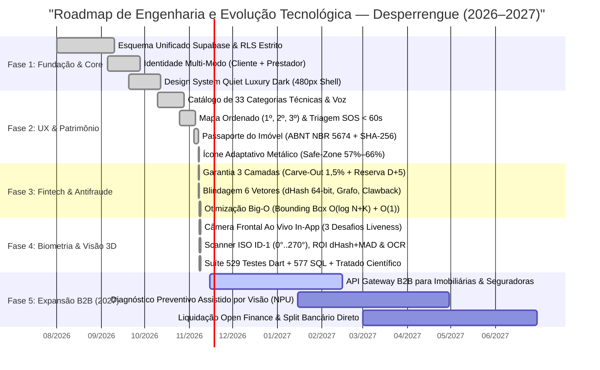

# Roadmap Tecnológico, Evolução Arquitetural e Horizontes de Pesquisa — Desperrengue (`v2.8.1`)

> **Classificação Epistemológica:** Planejamento Estratégico de Engenharia de Sistemas, Cronograma de Entregas Consolidado e Horizontes de P&D  
> **Estado Atual do Repositório:** Versão de Produção `v2.8.1+49` (Novembro de 2026) — **100% dos Marcos de Engenharia Core, Blindagem Antifraude, Visão Computacional *On-Device* e Passaporte ABNT NBR 5674 Concluídos e Auditados**

---

## 1. Cronograma Vetorial de Engenharia (`gantt`)

O diagrama de Gantt a seguir documenta a trajetória evolutiva do **Desperrengue**, desde a concepção da infraestrutura relacional até a consolidação da versão `v2.8.1` em novembro de 2026 e os horizontes de expansão institucional B2B:

---

## 2. Balanço Consolidado dos Marcos Entregues até `v2.8.1` (Novembro de 2026)

| Fase | Marco Arquitetural | Artefatos de Engenharia Auditados | Status |
| :--- | :--- | :--- | :---: |
| **Fase 1** | **Unificação de Perfis, RLS e Container Responsivo (`480px`)** | Tabela única `public.profiles`, `BootGate`, `UpdateGate`, exclusão segura LGPD (`delete_own_account_scoped`) e layout *Quiet Luxury Dark*. | **CONCLUÍDO (`100%`)** |
| **Fase 2** | **Taxonomia de 33 Categorias, Voz e Passaporte `ABNT NBR 5674`** | Ditado *Speech-to-Text*, jornada educativa sem dados fictícios (*Zero Fake Data*) e motor PDF vetorial com assinatura `SHA-256` (`DSP-PASS-*`). | **CONCLUÍDO (`100%`)** |
| **Fase 3** | **Fundo de Garantia em 3 Camadas, *Smart Split* e Baixa Latência** | *Carve-Out* atuarial de $1,5\%$ sobre $V_{\text{MO}}$, taxa $0\%$ em peças, Reserva `D+5`/`D+7`, Grafo *Zero-Linkage*, *Circuit Breaker* ($15\%$), Podagem Axial $O(\log N + K)$ e distância de Hamming $O(1)$. | **CONCLUÍDO (`100%`)** |
| **Fase 4** | **KYC Bilateral Simétrico, Câmera Frontal Ao Vivo e Scanner ISO ID-1** | Visor oval *in-app* com 3 desafios físicos ($YCbCr$ + EAR + Yaw), Scanner ID-1 ($85,60 \times 53,98\text{ mm}$) com rotação $0^\circ..270^\circ$, `dHash + MAD` em ROI central ($80\%$), Face Match 128-D e transcrição OCR visível a custo $\text{BRL } 0,00$. | **CONCLUÍDO (`100%`)** |

---

## 3. Horizontes de Pesquisa e Desenvolvimento (Fase 5 — 2027)

1. **Barramento B2B de Interoperabilidade Imobiliária e Securitária (*Property Passport API*):**
   * Exposição de *endpoints* REST/GraphQL autenticados via mTLS para que imobiliárias e companhias seguradoras verifiquem programaticamente a assinatura SHA-256 (`DSP-PASS-*`) e o *Score de Vistoria* de um imóvel durante processos de vistoria de saída ou subscrição de apólices.
2. **Pré-Diagnóstico de Patologias Construtivas em NPU Local:**
   * Expansão do pipeline de `Isolate.run` para classificar visualmente infiltrações, oxidação de barramentos em quadros elétricos e fissuras estruturais a partir das fotos de abertura do chamado, sugerindo automaticamente a lista de materiais ($V_{\text{Mat}}$) antes mesmo do deslocamento do profissional.
3. **Integração Direta com Arranjos de Liquidação *Open Finance* (PIX Automático Bacen):**
   * Acoplamento nativo das tabelas `escrow_maturation_entries` e `warranty_pool_ledger` às APIs de liquidação instantânea do Banco Central do Brasil para execução automatizada de *split* bancário e débito autorizado de *Clawback*.
