# Engenharia de Configuração, Provisionamento de Ambiente e Infraestrutura — Desperrengue (`v2.8.1`)

> **Classificação Epistemológica:** Manual Normativo de Engenharia de Ambiente, Provisionamento de Banco de Dados Relacional e Compilação Multiplataforma  
> **Plataformas Suportadas:** Windows 10/11 (`x86_64`) · Linux (Ubuntu/Debian/Fedora) · macOS (Apple Silicon / Intel) · Android (API 24+) · iOS (14.0+) · Web PWA  
> **Guias Operacionais Específicos:** [`setup/windows.md`](setup/windows.md) · [`setup/linux.md`](setup/linux.md) · [`setup/macos.md`](setup/macos.md)

---

## 1. Arquitetura do Ambiente de Desenvolvimento e Execução

O ecossistema de desenvolvimento do **Desperrengue** é composto por uma camada cliente em **Flutter 3.24+ / Dart 3.5+** acoplada a uma infraestrutura *backend* **Supabase (PostgreSQL 15+)** gerenciada por migrações declarativas e validada por ferramentas de integração contínua em Node.js.

```mermaid
flowchart LR
    classDef tool fill:#0F172A,stroke:#38BDF8,stroke-width:2px,color:#F8FAFC;
    classDef app fill:#064E3B,stroke:#10B981,stroke-width:2px,color:#ECFDF5;
    classDef db fill:#31102F,stroke:#F43F5E,stroke-width:2px,color:#FFF1F2;

    subgraph DEV["Estação de Trabalho (Windows / Linux / macOS)"]
        T1["Flutter SDK >= 3.24 & Dart >= 3.5"]:::tool
        T2["Android SDK (API 34+) / Xcode 15+"]:::tool
        T3["Supabase CLI & PostgreSQL Client"]:::tool
        T4["Node.js >= 20 LTS (Scripts de Auditoria)"]:::tool
    end

    subgraph TARGETS["Artefatos Compilados (app/)"]
        A1["Android Nativo (APK / AAB)<br/>Câmera Hardware + ML Kit On-Device"]:::app
        A2["iOS Nativo (IPA)<br/>AVFoundation + Vision/ML Kit"]:::app
        A3["Web PWA Responsivo (480px Shell)<br/>WebRTC getUserMedia + Cache-Busting"]:::app
    end

    subgraph BACKEND["Cluster Supabase (supabase/)"]
        B1["25 Migrações SQL Sequenciais<br/>(Esquema, Índices, Triggers O(1) e RPCs)"]:::db
        B2["Buckets Privados RLS<br/>(job-Attachments, avatars, kyc-documents)"]:::db
    end

    DEV --> TARGETS
    TARGETS <-->|"HTTPS / WSS + JWT RLS"| BACKEND
```



---

## 2. Pré-Requisitos de Software e Dependências Nativas

| Componente de Software | Versão Mínima Exigida | Finalidade Arquitetural no Projeto |
| :--- | :---: | :--- |
| **Flutter SDK** | `>= 3.24.0` (Canal `stable`) | Compilação AOT/JIT da interface multiplataforma e suporte a `Isolate.run`. |
| **Dart SDK** | `>= 3.5.0` | Execução dos motores matemáticos de visão computacional, hashing e PDF. |
| **Java Development Kit (JDK)** | `JDK 17` | Compilação Gradle para Android e assinatura criptográfica de pacotes APK/AAB. |
| **Android SDK / NDK** | `API Level 34` (Mínimo `API 24`) | Bindings nativos para `camera`, `google_mlkit_face_detection` e `google_mlkit_text_recognition`. |
| **Node.js** | `>= 20.0.0 LTS` | Execução dos validadores [`scripts/check-md-links.mjs`](../scripts/check-md-links.mjs) e [`scripts/test-dossie.mjs`](../scripts/test-dossie.mjs). |
| **Git** | `>= 2.40.0` | Controle de versão distribuído e isolamento de remotos (`origin`). |

Para instruções detalhadas de instalação de variáveis de ambiente (`PATH`, `JAVA_HOME`, `ANDROID_HOME`) por sistema operacional, consultam-se os guias dedicados:
* **Microsoft Windows:** [`docs/setup/windows.md`](setup/windows.md)
* **GNU/Linux:** [`docs/setup/linux.md`](setup/linux.md)
* **Apple macOS:** [`docs/setup/macos.md`](setup/macos.md)

---

## 3. Configuração de Variáveis de Ambiente (`--dart-define`)

O aplicativo cliente não armazena credenciais sensíveis em código-fonte estático. A injeção das chaves de conexão com o cluster Supabase ocorre em tempo de compilação por meio de flags `--dart-define`:

| Variável de Compilação | Descrição Técnica | Obrigatória |
| :--- | :--- | :---: |
| `SUPABASE_URL` | Endpoint HTTPS do projeto Supabase (`https://<project-ref>.supabase.co`). | **Sim** |
| `SUPABASE_ANON_KEY` | Chave pública anônima JWT (toda segurança real é imposta por políticas RLS no PostgreSQL). | **Sim** |

Exemplo de execução em dispositivo físico conectado via ADB com injeção explícita:

```bash
cd app
flutter pub get
flutter run --release \
  --dart-define=SUPABASE_URL=https://seu-projeto.supabase.co \
  --dart-define=SUPABASE_ANON_KEY=sua-chave-anon-jwt
```

---

## 4. Provisionamento do Banco de Dados e Ordem Canônica das Migrações SQL

O diretório [`supabase/migrations/`](../supabase/migrations/) contém a linha do tempo determinística do esquema relacional. Ao provisionar um novo ambiente (local via `supabase start` ou remoto via `supabase db push`), as migrações são aplicadas em ordem lexicográfica de *timestamp*, culminando nos motores de alta performance, antifraude e KYC:

1. **Fundação Relacional e Perfis Unificados:** Criação de `profiles`, `jobs`, `reviews`, `notifications`, buckets de *Storage* e políticas Row-Level Security (RLS).
2. **Rodada de Engenharia de Domínio (`20261106120000_ux_round_client_and_provider.sql`):** Taxonomia das 33 categorias técnicas residenciais, campos de triagem assistida e prontuário do imóvel.
3. **Motor de Garantia em 3 Camadas, Antifraude e Baixa Latência (`20261108110000_high_perf_warranty_antifraud_engine.sql`):**
   * Tabelas `warranty_pool_ledger`, `escrow_maturation_entries` e `job_mediations`;
   * Funções `hamming_distance_64` ($O(1)$ bitwise), `calculate_relative_trust_score` e gatilho incremental `trg_sync_profile_trust_and_rank`;
   * RPCs `complete_job_and_schedule_escrow`, `settle_escrow_with_carveout_and_maturation`, `open_warranty_mediation`, `trigger_layer3_rework` e `process_autonomous_escrow_and_mediation_queues`;
   * Criação dos **9 Índices Estratégicos** (compostos de *Bounding Box*, `GIN` e parciais).
4. **Motor de Identidade Civil Bilateral, Biometria 3D e OCR (`20261108120000_client_kyc_biometrics_and_ocr.sql`):**
   * Tabela `kyc_submissions`, bucket privado `kyc-documents`, validador algébrico `is_valid_cpf` (Módulo 11) e RPC atômica `submit_client_kyc`.

---

## 5. Permissões Nativas de Hardware e Conformidade de Sistema Operacional

Para que os módulos de **Prova de Vida Biométrica Ativa**, **Scanner Guiado ISO ID-1**, **Guarda Forense `dHash`** e **Ditado por Voz** operem sem bloqueios em Android (`AndroidManifest.xml`) e iOS (`Info.plist`), as seguintes permissões de hardware são declaradas e requisitadas sob demanda (*Just-in-Time Permission Request*):

| Permissão Android (`AndroidManifest.xml`) | Chave Equivalente iOS (`Info.plist`) | Módulo do Sistema que Consome o Sensor |
| :--- | :--- | :--- |
| `android.permission.CAMERA` | `NSCameraUsageDescription` | Visor de Prova de Vida Frontal Ao Vivo, Scanner ISO ID-1 de CNH/RG e captura de evidências `Before/After`. |
| `android.permission.ACCESS_FINE_LOCATION` | `NSLocationWhenInUseUsageDescription` | Geocodificação do endereço de atendimento e podagem geoespacial $O(\log N + K)$. |
| `android.permission.RECORD_AUDIO` | `NSMicrophoneUsageDescription` | Ditado assistido por voz (*Speech-to-Text*) na descrição de emergências residenciais. |
| `android.permission.INTERNET` | — | Comunicação segura TLS 1.3 com o banco de dados e *Storage* do Supabase. |

---

## 6. Verificação Pós-Instalação (Checklist de Sanidade)

Após clonar o repositório e instalar as dependências, executa-se a bateria completa de validação local:

```bash
# 1. Instalar pacotes Flutter
cd app && flutter pub get && cd ..

# 2. Executar análise estática (Zero warnings/errors)
cd app && flutter analyze && cd ..

# 3. Executar as 26 suítes de testes Dart/Flutter (529 testes)
cd app && flutter test && cd ..

# 4. Validar motor de geração de dossiê PDF (17 testes) e integridade de links Markdown
node scripts/test-dossie.mjs
node scripts/check-md-links.mjs
```
