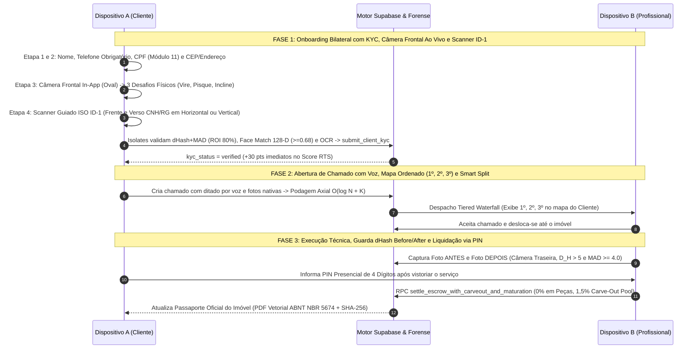

# Protocolo de Homologação Empírica em Campo (Android & iOS) — Desperrengue (`v2.8.1`)

> **Classificação Epistemológica:** Guia Normativo de Ensaios Empíricos em Hardware Físico, Validação Biométrica *In-App*, Auditoria de Sensores e Homologação Ponta a Ponta  
> **Público-Alvo:** Engenheiros de QA, Auditores de Segurança e Avaliadores de Campo  
> **Implementação Auditada:** [`client_setup_screen.dart`](../app/lib/features/client/presentation/client_setup_screen.dart) · [`document_ocr_and_liveness_service.dart`](../app/lib/core/services/document_ocr_and_liveness_service.dart) · [`fintech_warranty_widgets.dart`](../app/lib/features/shared/presentation/fintech_warranty_widgets.dart) · [`desperrengue_official_pdf_service.dart`](../app/lib/core/services/desperrengue_official_pdf_service.dart)

---

## 1. Objetivo e Escopo da Homologação Empírica

Enquanto as suítes automatizadas ([`TESTING.md`](TESTING.md)) verificam a corretude algébrica das funções em ambiente controlado, a **Homologação Empírica em Campo** valida o comportamento físico dos sensores nativos do smartphone (câmera frontal e traseira com foco óptico, microfone para ditado por voz, GPS para podagem axial e renderização a $60\text{–}120\text{ Hz}$) sob condições reais de iluminação e rede móvel (4G/5G/Wi-Fi).

---

## 2. Diagrama de Sequência da Jornada Completa de Homologação em Campo (`sequenceDiagram`)

---

## 3. Roteiro Determinístico de Ensaios em Aparelho Físico (Passo a Passo)

### Ensaio 01 — Instalação e Verificação do Ícone Adaptativo (*Safe-Zone* $66\%$)
1. Instalar o pacote APK/AAB de produção ou acessar a versão PWA instalada na tela inicial do Android (*One UI Home*) / iOS.
2. **Critério de Aprovação Visual:** Verificar na grade de aplicativos do sistema operacional se o ícone oficial do **Desperrengue** (monograma **"D"** reverso em platina escovada com chave mecânica integrada e selo de verificação em bronze sobre fundo `#0B0F19`) exibe geometria nítida, centralizada na zona de segurança de $66\%$ ($66 \times 66\text{ dp}$ dentro de $108 \times 108\text{ dp}$), sem qualquer corte pelas máscaras *squircle* ou circular do sistema.
3. Abrir o aplicativo e confirmar que a tela inicial preserva a animação vetorial da casa.

### Ensaio 02 — Cadastro do Cliente: Telefone Obrigatório e Validação Algébrica de CPF (Etapas 1 e 2)
1. Iniciar o fluxo de configuração de perfil do cliente ([`ClientSetupScreen`](../app/lib/features/client/presentation/client_setup_screen.dart)).
2. Na **Etapa 1 ("Como podemos lhe chamar?")**:
   * Tentar avançar sem preencher o **Telefone** (verificar que o campo não é mais opcional e exige DDD + 9 dígitos).
   * Inserir um CPF inválido (ex.: `111.111.111-11` ou dígito verificador incorreto) e confirmar o bloqueio imediato pelo algoritmo Módulo 11.
   * Inserir nome completo real, telefone válido e CPF válido, tocando em **Continuar**.
3. Na **Etapa 2 ("Onde você precisa do serviço?")**:
   * Informar o CEP residencial, verificar o autopreenchimento de logradouro/bairro/cidade, inserir o número do imóvel e tocar em **Concluir e iniciar verificação facial**.

### Ensaio 03 — Prova de Vida Biométrica em Câmera Frontal Ao Vivo (*In-App* — Etapa 3)
1. Observar na **Etapa 3** a abertura do visor circular/oval **ao vivo dentro da própria tela do aplicativo** utilizando obrigatoriamente a **câmera frontal** (`CameraLensDirection.front`).
2. **Teste Negativo (Auditoria Antifraude de Tela/Monitor):** Apontar a câmera para um monitor de computador exibindo código-fonte (VS Code) ou superfície sem rosto humano e tocar para capturar.
   * **Resultado Obrigatório:** O motor forense deve **rejeitar imediatamente** a captura, exibindo alerta de ausência de biometria facial humana ($\tau_{\text{Skin}} < 0,12$).
3. **Teste Positivo (3 Desafios Físicos Reais):** Posicionar o rosto dentro da moldura oval e executar os 3 desafios exibidos sequencialmente (ex.: *Olhe de frente*, *Vire levemente à direita*, *Pisque os olhos*), confirmando a aprovação dos 3 passos com selo verde.

### Ensaio 04 — Scanner Guiado ISO ID-1 (CNH/RG na Horizontal ou Vertical) e Transcrição OCR Visível (Etapa 4)
1. Na **Etapa 4**, tocar em **"Escanear FRENTE"** para abrir o visor retangular guiado na proporção oficial **ISO/IEC 7810 ID-1 ($85,60 \times 53,98\text{ mm}$)** com cantoneiras laranja e linha laser de varredura.
2. **Teste Negativo (Rejeição de Superfície Lisa / Cartão Sintético na ROI Central):** Apontar a câmera para uma folha lisa ou cartão sólido sobre uma mesa de madeira.
   * **Resultado Obrigatório:** O recorte de ROI central ($80\%$) e núcleo ($12\%$) deve calcular $\text{MAD} < 4,0$ e **bloquear** a imagem como superfície sintética/sem textura documental.
3. **Teste Positivo (Captura em Qualquer Orientação):** Posicionar uma CNH ou RG real dentro da moldura (tanto na **horizontal** quanto na **vertical**) e capturar a **Frente** e o **Verso** ($D_H(\text{Frente}, \text{Verso}) > 5$).
4. **Verificação da Transcrição OCR na Tela:** Confirmar a exibição imediata do card **"Dados Extraídos do Documento (OCR Automatico)"** apresentando:
   * Nome extraído do documento;
   * CPF extraído do documento;
   * Número de Registro/RG/CNH;
   * Percentual de similaridade biométrica **Face Match 128-D ($\ge 68\%$)** entre a selfie da Etapa 3 e a foto impressa no documento.
5. Concluir a submissão e verificar a transição para a tela inicial com status **Identidade Verificada**.

### Ensaio 05 — Abertura de Chamado com Ditado por Voz e Mapa Ordenado (`1º, 2º, 3º`)
1. Selecionar uma categoria técnica (ex.: *Elétrica* ou *Hidráulica*) e utilizar o botão de **Ditado por Voz** para descrever o problema sem digitar.
2. Na tela de busca geoespacial, observar o mapa interativo exibindo os prestadores próximos com a numeração sequencial explícita de prioridade (**`1º`**, **`2º`**, **`3º`**) governada pelo *Tiered Waterfall* ($RTS$).

### Ensaio 06 — Execução do Serviço, Guarda `dHash` *Before/After*, PIN de 4 Dígitos e Aba *"Em Mediação"*
1. No dispositivo do Profissional, realizar o *check-in* e capturar a foto **ANTES** pela câmera traseira.
2. No *check-out*, tentar enviar uma foto **DEPOIS** idêntica à foto ANTES: confirmar que o `PerceptualHashGuard` bloqueia o envio ($D_H \le 5$). Capturar uma foto real distinta do serviço concluído ($D_H > 5$).
3. Validar os dois caminhos de encerramento:
   * **Caminho A (Aprovação Presencial Imediata):** O cliente informa o **PIN de 4 dígitos** gerado em sua tela; o profissional digita o PIN e a liquidação *Smart Split* ocorre instantaneamente.
   * **Caminho B (Abertura de Mediação — 4ª Aba):** Na tela *"Meus Pedidos"* do cliente, acionar a contestação dentro da janela de $24\text{h}$ e verificar a ativação da 4ª aba **"Em Mediação"** com o comparador lado a lado (`ANTES | DEPOIS | RECLAMAÇÃO`) e cronômetro regressivo de SLA.

### Ensaio 07 — Passaporte Oficial de Manutenção do Imóvel (`ABNT NBR 5674`)
1. No menu **Perfil -> Prontuário da Casa (Passaporte)**:
   * Em conta recém-criada sem serviços concluídos, verificar que a tela exibe a **jornada educativa animada** explicando como o prontuário funciona e **zero dados fictícios (*zero fake data*)**.
   * Após concluir ou registrar uma manutenção auditada, verificar a atualização automática do *Score de Vistoria* e tocar em **"Exportar Prontuário da Casa em PDF (Vistoria/Seguradora)"**, validando o documento PDF vetorial com selo criptográfico SHA-256 (`DSP-PASS-*`).

---

## 4. Matriz de Homologação Empírica (Checklist de Campo)

| Código | Ensaio de Campo | Dispositivo Alvo | Critério Técnico de Aceite | Status |
| :--- | :--- | :---: | :--- | :---: |
| **HOM-01** | Ícone Adaptativo *Safe-Zone* $66\%$ | Android / iOS | Geometria nítida sem corte de bordas na *One UI Home*. | `[x]` |
| **HOM-02** | Validador CPF Módulo 11 + Telefone | Cliente | Rejeita CPFs inválidos e exige telefone com DDD. | `[x]` |
| **HOM-03** | Câmera Frontal Ao Vivo + 3 Desafios | Cliente / Prof. | Visor oval *in-app*, rejeita tela de PC e valida 3 movimentos. | `[x]` |
| **HOM-04** | Scanner ISO ID-1 + OCR Horizontal/Vertical | Cliente / Prof. | Rotação $0^\circ..270^\circ$, bloqueia cartão liso e exibe OCR na tela. | `[x]` |
| **HOM-05** | Mapa Geoespacial Ordenado (`1º, 2º, 3º`) | Cliente | Marcadores numerados em tempo real conforme *Tiered Waterfall*. | `[x]` |
| **HOM-06** | Guarda Forense `dHash` + PIN 4 Dígitos | Ambos | Bloqueia $D_H \le 5$ e liquida *Smart Split* via PIN ou 4ª Aba. | `[x]` |
| **HOM-07** | Passaporte do Imóvel (`ABNT NBR 5674`) | Cliente | Zero dados falsos no *empty state* e exportação PDF SHA-256. | `[x]` |
