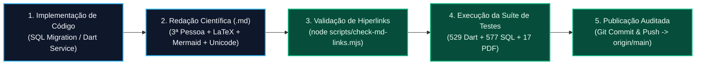

# Metadocumento Normativo e Padrão de Engenharia de Documentação Técnico-Científica — Desperrengue (`v2.8.1`)

> **Classificação Epistemológica:** Norma Interna de Engenharia de Software, Epistemologia da Ciência da Computação e Padronização Editorial (IEEE / ACM / ABNT)  
> **Escopo de Aplicação:** Todos os artefatos Markdown (`.md`), Architecture Decision Records (`docs/adr/`), Especificações de Interface (`docs/specs/`) e Guias de Configuração (`docs/setup/`) do repositório `00_Desperrengue`

---

## 1. Diretrizes Epistemológicas e Linguísticas Obrigatórias

Todo documento técnico-científico produzido ou atualizado no repositório **Desperrengue** submete-se rigorosamente aos **Cinco Pilares da Linguagem de Especialidade em Ciência da Computação**:

1. **Monossemia e Precisão Conceitual:** Emprego exclusivo de termos formais da Ciência da Computação, Engenharia de Sistemas Distribuídos, Criptografia, Visão Computacional e Engenharia Financeira, vedando o uso de coloquialismos ou expressões ambíguas.
2. **Impessoalidade e Objetividade Científica (3ª Pessoa Estrita):** Redação integralmente construída na **terceira pessoa do singular ou do plural**, com uso de voz passiva analítica (*"é processado pelo motor"*, *"foi verificada a invariante"*) ou sintética (*"define-se"*, *"calcula-se"*). É terminantemente proibido o uso de pronomes e verbos em 1ª ou 2ª pessoa (`eu`, `nós`, `você`, `fizemos`, `veja`).
3. **Formalismo Matemático e Algorítmico ($\LaTeX$ e Notação $\text{Big-}O$):** Toda regra de negócio, equação financeira, limiar forense ou operação de busca deve ser acompanhada de sua formulação algébrica em $\LaTeX$ e da respectiva demonstração de complexidade assintótica de tempo e espaço.
4. **Rastreabilidade Bijetiva com o Código-Fonte:** Cada conceito arquitetural documentado deve apontar por hiperlink clicável relativo para o arquivo SQL (`supabase/migrations/`), módulo Dart (`app/lib/`) e suíte de teste (`app/test/` ou `supabase/tests/`) que o implementa e verifica.
5. **Engenharia Visual Dupla (Mermaid.js + Blueprints Geométricos Unicode):** Documentos estruturais devem combinar diagramas vetoriais nativos do GitHub (`flowchart`, `sequenceDiagram`, `stateDiagram-v2`, `erDiagram`, `xychart-beta`, `pie`, `quadrantChart`, `mindmap`, `gantt`) com esquemas geométricos em caracteres Unicode Box-Drawing (`┌─┬─┐ │ └─┴─┘`) para representação de dimensões físicas, máscaras ópticas e topologias de memória.

---

## 2. Estrutura Canônica de um Documento Técnico no Repositório (*Template* Padrão)

Abaixo apresenta-se a estrutura canônica obrigatória para a autoria de novos tratados técnicos ou especificações de módulos no projeto:

```markdown
# [Título Formal e Monossêmico do Módulo ou Subsistema] — Desperrengue (`vX.Y.Z`)

> **Classificação Epistemológica:** [Natureza Científica do Documento]  
> **Padrão Normativo:** [Normas IEEE / ACM / ABNT / RFCs Aplicáveis]  
> **Implementação Auditada:** [`arquivo_sql.sql`](../supabase/migrations/...) · [`modulo_dart.dart`](../app/lib/...)

---

## 1. Fundamentação Teórica e Definição do Problema
Contextualização formal em 3ª pessoa, definindo as variáveis de estado, as premissas do domínio e as limitações das abordagens ingênuas.

## 2. Modelagem Matemática e Invariantes Formais
Apresentação das equações algébricas em blocos LaTeX ($$...$$) e enumeração numerada das invariantes de integridade (Invariante 1..N).

## 3. Arquitetura de Software e Diagrama de Fluxo / Estados
Inclusão de diagrama Mermaid.js (`flowchart`, `stateDiagram-v2` ou `sequenceDiagram`) e blueprint geométrico Unicode.

## 4. Análise de Complexidade Assintótica (Big-O)
Tabela comparativa entre a complexidade ingênua e a complexidade otimizada implementada (Tempo e Espaço), justificando estruturas de dados e índices.

## 5. Rastreabilidade de Código e Verificação Automatizada
Mapeamento exato das funções, tabelas, RPCs e suítes de testes automatizados (`app/test/` e `supabase/tests/`) que garantem regressão zero.
```

---

## 3. Fluxograma do Ciclo de Governança Documental e Verificação Contínua



---

## 4. Checklist Normativo de Homologação Documental

Antes de qualquer *commit* envolvendo arquivos `.md`, verifica-se o cumprimento integral dos seguintes critérios:

| # | Critério de Qualidade Científica e Editorial | Comando / Método de Verificação |
| :---: | :--- | :--- |
| **01** | Ausência absoluta de pronomes ou verbos em 1ª e 2ª pessoa (`eu`, `nós`, `você`). | Inspeção léxica e revisão gramatical em 3ª pessoa. |
| **02** | Preservação estrita dos nomes originais de todos os arquivos `.md` do repositório. | `git status` (zero deleções ou renomeações quebrando URLs). |
| **03** | Validade de $100\%$ dos hiperlinks relativos entre documentos, migrações e código Dart. | Execução de `node scripts/check-md-links.mjs` (`0` erros). |
| **04** | Fidelidade matemática entre as equações documentadas e as constantes do código-fonte. | Confronto direto com `supabase/migrations/` e `app/lib/`. |
| **05** | Renderização limpa de blocos Mermaid.js e alinhamento monoespaçado de blocos Unicode. | Validação sintática de grafos e matrizes Box-Drawing. |
