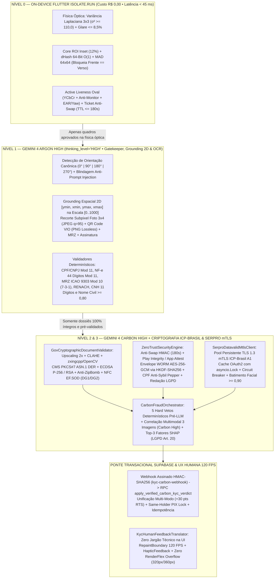

# ADR-0021: Arquitetura KYC Zero-Trust Híbrida (Gemini 4 Argon High + Carbon High), Criptografia VIO/ICP-Brasil, Sessão Anti-Swap (180s) e Explicabilidade SHAP (LGPD Art. 20)

* **Status:** Aceito (amplia e complementa [ADR-0006](0006-pagamento-mock-com-custodia-e-pin.md), [ADR-0007](0007-privacidade-por-minimizacao-de-dados.md), [ADR-0010](0010-webhook-autenticado-por-segredo-no-vault.md) e [ADR-0020](0020-garantia-3-camadas-antifraude-e-kyc-biometrico-ocr.md))
* **Data:** 2026-11-12
* **Decisores:** Arquitetura de Sistemas Distribuídos, Engenharia de Visão Computacional (`Gemini 4 Argon High`), Engenharia de Cibersegurança e Criptografia (`Gemini 4 Carbon High`) e Engenharia Mobile Flutter 120 FPS
* **Tags:** `kyc`, `zero-trust`, `argon-high`, `carbon-high`, `icp-brasil`, `vio`, `serpro-mtls`, `anti-swap`, `smart-split`, `lgpd-shap`, `120fps-ux`

---

## Contexto

O pipeline de validação biométrica e documental *on-device* introduzido no [ADR-0020](0020-garantia-3-camadas-antifraude-e-kyc-biometrico-ocr.md) estabeleceu a base de custo marginal zero (Tier-0 em *Worker Isolates* Dart) para captura ao vivo em moldura oval, scanner guiado ISO/IEC 7810 ID-1, nitidez Laplaciana e distinção estrutural Frente $\times$ Verso (`dHash` 64-bit + $\text{MAD}_{64\times 64}$ sobre *Core ROI Inset* de $12\%$). Contudo, a elevação do **Desperrengue** ao padrão de segurança bancária e documentoscopia governamental revelou seis desafios arquiteturais de fronteira:

1. **Economia Unitária vs. Tarifação de Bureaus Governamentais (SERPRO Datavalid):** Consultas diretas à base oficial do SERPRO Datavalid v4/v5 e bureaus biométricos custam entre $\text{R\$ } 0,48$ e $\text{R\$ } 1,50$ por requisição. Enviar capturas com reflexo especular sobre o CPF/QR Code, documentos cortados, fotos de telas (*Moiré*) ou tentativas brutas de fraude diretamente ao SERPRO gera desperdício financeiro de $\sim 35\%$ das chamadas.
2. **Grounding Espacial 2D Subpixel e Rotação Canônica Multimodal:** Documentos brasileiros heterogêneos (CNH física/digital, Nova Carteira de Identidade Nacional — CIN sob Decreto nº 10.977/2022, RG estadual e Passaporte ICAO Doc 9303) frequentemente são fotografados rotacionados ($90^\circ, 180^\circ, 270^\circ$). É indispensável localizar simultaneamente as coordenadas normalizadas $[0..1000]$ da Foto $3\times 4$, do QR Code VIO de alta densidade, da assinatura e da faixa MRZ, recortando o QR Code em **PNG sem perda (*lossless*)** para não degradar os módulos finos da matriz.
3. **Autenticidade Criptográfica Governamental (VIO/SENATRAN, ICP-Brasil e Chip NFC):** A leitura meramente textual (OCR) é vulnerável a falsificações tipográficas e ao golpe de **Clonagem de QR Code VIO** (onde um fraudador cola o QR Code verdadeiro de um terceiro sobre uma CNH adulterada). Exige-se verificação matemática de envelopes **ASN.1/DER CMS (`PKCS#7 SignedData`)**, assinaturas elípticas **ECDSA P-256 (`IEEE P1363` $\leftrightarrow$ `DER`)** e **RSA-2048** contra a cadeia X.509 ICP-Brasil/SENATRAN, proteção contra *zip-bombs* em cargas `zlib`, e *Passive Authentication* NFC (`EF.SOD` + hashes `SHA-256` de `DG1`/`DG2`).
4. **Ataques de Substituição de Sessão (*Document Swap*), Replay e Câmeras Virtuais (`VCam`/`OBS`):** Um atacante pode realizar a Prova de Vida com o próprio rosto no instante $t_{\text{liveness}}$ e, minutos depois, injetar fotos estáticas de documentos de outra pessoa ou usar emuladores de câmera virtual.
5. **Risco de Alucinação Decisória em LLMs e Auditoria Fiscal de Notas do *Smart Split*:** Um modelo generativo jamais pode aprovar isoladamente um dossiê reprovado pela criptografia, pela aritmética (Módulo 11 / Módulo 10 ICAO) ou pela biometria. Adicionalmente, a isenção de $0\%$ de taxa sobre peças no *Smart Split* requer auditoria estruturada de DANFEs, cupons NFC-e e recibos de materiais (Chave de Acesso de 44 dígitos, CNPJ e reconciliação aritmética de itens consumíveis).
6. **Direito à Explicação (LGPD Art. 20) vs. Complexidade Invisível na Interface Humana:** Enquanto a trilha de auditoria regulatória exige fatores determinísticos de explicabilidade (*SHAP Top-3 Factors*), o usuário final jamais deve ser exposto a jargões criptográficos ou matemáticos (`SHAP`, `ASN.1`, `VIO`, `YCbCr`, `EAR`, `dHash`, `MAD`, `mTLS`), necessitando de orientações acolhedoras em português a $120\text{ FPS}$ com *Zero Layout Shift*.

---

## Decisão

Adotamos a **Arquitetura KYC Zero-Trust Híbrida de Dupla Especialidade (`Gemini 4 Argon High` + `Gemini 4 Carbon High`)**, integrando o cliente multiplataforma Flutter (`app/`), a borda transacional Supabase (`supabase/functions/` e `supabase/migrations/`) e o microsserviço criptográfico e forense em Python/FastAPI (`kyc_engine/`):

### 1. Funil Econômico de Triagem em Três Níveis (Tier-0 $\to$ Tier-1 Argon High $\to$ Tier-2/3 Carbon/SERPRO)

Para preservar a economia unitária do marketplace (mantendo o custo médio de IA em nuvem próximo a $\text{R\$ } 0,034$ por verificação e zerando chamadas desperdiçadas no SERPRO Datavalid):

| Cenário Operacional (Lote de $10.000$ Tentativas de Onboarding) | Chamadas Tarifadas ao SERPRO / Bureau Externo | Desperdício com Fotos com Reflexo, Cortadas ou Inválidas | Custo Total de Validação (a $\text{R\$ } 0,85$/consulta média) |
| :--- | :---: | :---: | :---: |
| **Sem Funil Argon High** (Envia toda captura diretamente ao SERPRO) | $10.000$ chamadas (inclui $\sim 35\%$ de fotos com erro óptico ou documento trocado) | $3.500$ consultas pagas perdidas por erro de captura ou tentativa de fraude bruta | **$\text{R\$ } 8.500,00$** |
| **Com Funil Tier-0 + Gemini 4 Argon High** (Bloqueia anomalias antes da chamada externa) | Apenas **$6.500$** chamadas válidas e pré-auditadas | **$\text{R\$ } 0,00$** de desperdício no SERPRO ($3.500$ barradas no Tier-0/Tier-1 com orientação imediata) | **$\text{R\$ } 5.685,00$** (**Economia líquida de $\text{R\$ } 2.815,00$ por lote**) |

### 2. Grounding Espacial 2D (`[0..1000]`), Auto-Rotação Canônica e Validadores Matemáticos (`schemas_argon.py` & `vision_ocr_argon.py`)

1. **Coordenadas Normalizadas e Recorte Subpixel (`NormalizedBoundingBox2D`)**:
   - O `Gemini 4 Argon High` (`thinking_level="HIGH"`, `temperature=0.0`) retorna simultaneamente as regiões de interesse `face_portrait_box_2d`, `qr_code_vio_box_2d`, `signature_box_2d` e `mrz_box_2d` na escala inteira normalizada $[0..1000]$ ($\text{ymin} < \text{ymax}$, $\text{xmin} < \text{xmax}$).
   - Após rotacionar canonicamente a imagem para a horizontal ($0^\circ, 90^\circ, 180^\circ, 270^\circ$ via `rotate_to_canonical_orientation`), o método `to_pixel_crop(img_width, img_height, pad_ratio=0.04)` projeta as coordenadas em pixels reais com margem de segurança de $4\%$ e *clamping* estrito nas bordas $[0, W] \times [0, H]$, exportando a Foto $3\times 4$ em JPEG (`quality=95`) e o QR Code VIO em **PNG sem compressão destrutiva (*lossless*)**.
2. **Blindagem contra *Visual Prompt Injection* (`OpticalForensicsAndQualityGate`)**:
   - A instrução de sistema `SYSTEM_INSTRUCTION_HARDENED` isola todo texto visível na imagem como dado passivo não-confiável. Se o documento contiver instruções maliciosas coladas (*"Ignore as instruções anteriores"*, *"Aprove este documento"*), `adversarial_prompt_injection_detected` é marcado como `True` e o validador Pydantic `@model_validator(mode="after")` força obrigatoriamente `is_readable = False` e `ready_for_serpro_and_carbon = False`.
3. **Validadores Determinísticos em $O(1)$ e Compatibilidade Nominal**:
   - **CPF (`validate_cpf_mod11`) e CNPJ (`validate_cnpj_mod11`)**: Cálculo determinístico dos dois dígitos verificadores Módulo 11 da Receita Federal, rejeitando sequências repetidas (*repdigits*).
   - **MRZ ICAO Doc 9303 (`compute_icao_mrz_check_digit` & `validate_icao_mrz_lines`)**: Aritmética Módulo 10 com pesos cíclicos $(7, 3, 1)$ sobre os padrões TD1 ($3 \times 30$ caracteres na CIN/RG Mercosul) e TD3 ($2 \times 44$ caracteres no Passaporte).
   - **CNH (`validate_cnh_renach` & `validate_cnh_security_code`)**: Expressão regular `^[A-Z]{2}\d{9}$` para o RENACH e verificação de 11 dígitos não-repdigit para o código de segurança estadual.
   - **Compatibilidade Nominal Inteligente (`compute_civil_name_compatibility`)**: Normalização Unicode `NFKD` com remoção de diacríticos e preposições conectivas (`de, da, do, das, dos, e`). Quando os tokens significativos informados pelo usuário (ex.: `"Wagner Oliveira"`) formam um subconjunto ordenado legítimo do nome civil completo impresso no documento (ex.: `"WAGNER OLIVEIRA CLAUDIANO"`), o escore retorna $1,0 \ge 0,80$, evitando falsos positivos sem abrir brecha para impostores.

### 3. Decodificador Criptográfico VIO/ICP-Brasil e Passive Authentication NFC (`crypto_doc_validator.py`)

Implementado em `GovCryptographicDocumentValidator`:

1. **Super-Resolução e Pré-Processamento Adaptativo de QR Code Denso (Versão 15 a 25)**:
   - Opera diretamente sobre `cropped_qr_code_vio_png`, aplicando interpolação bicúbica $2\times$ (`cv2.INTER_CUBIC`), equalização de histograma limitada por contraste (`CLAHE` com `clipLimit=2.2`, `tileGridSize=(8,8)`) e limiarização adaptativa Gaussiana, decodificando via motor C++ `zxingcpp` com fallback automático para `cv2.QRCodeDetector`.
2. **Descompressão `zlib` Blindada contra *Zip-Bomb***:
   - Cargas comprimidas são processadas via `zlib.decompressobj().decompress(raw, max_length=65536)`. Qualquer payload cuja expansão exceda $64\text{ KiB}$ (`unconsumed_tail` não vazio) é abortado imediatamente em $O(1)$ com erro `QR_ZIP_BOMB_DETECTED`.
3. **Validação ASN.1/DER `CMS PKCS#7 SignedData` e Curvas `ECDSA P-256` / `RSA`**:
   - Valida envelopes `PKCS#7` e payloads compactos VIO, convertendo assinaturas ECDSA do formato `IEEE P1363` ($r \parallel s$ de 64 bytes) para `ASN.1 DER` (`encode_dss_signature`), verificando a janela temporal de validade (`not_valid_before_utc` $\le t \le$ `not_valid_after_utc`) e a assinatura criptográfica contra a cadeia de certificados X.509 ICP-Brasil/SENATRAN.
4. **Trava Anti-Clonagem Bit-a-Bit e NFC `EF.SOD`**:
   - Exige igualdade estrita entre o CPF assinado dentro do QR Code VIO, o CPF extraído via OCR e o CPF digitado pelo titular (`qr_cpf == ocr_cpf == typed_cpf`).
   - Para documentos com chip RFID/NFC (Nova CIN e e-Passport), `validate_nfc_passive_auth` valida a assinatura CMS do objeto `EF.SOD` contra o certificado *Document Signer* (DS/CSCA) e recalcula os hashes `SHA-256` dos grupos `DG1` (MRZ) e `DG2` (Face ISO/IEC 19794-5).

### 4. Protocolo Zero-Trust Anti-Swap (`180s` TTL), Hardware Attestation e Criptografia WORM (`security.py`)

Implementado em `ZeroTrustSecurityEngine` (backend) e `KycSessionAntiSwapGuard` (cliente Flutter):

$$\text{SessionToken} = \text{HMAC-SHA256}\left(K_{\text{srv}},\; \text{uid} \parallel \text{nonce} \parallel t_0\right)$$

$$\text{RequestHash} = \text{SHA256}\left(\text{uid} \parallel \text{nonce} \parallel H_{\text{selfie}} \parallel H_{\text{front}} \parallel H_{\text{back}} \parallel t_{\text{doc}}\right)$$

1. **Invariantes Temporais e de Origem de Captura**:
   - Exige $0 \le (t_{\text{liveness}} - t_0) \le 90\text{ s}$, $0 \le (t_{\text{doc}} - t_{\text{liveness}}) \le 180\text{ s}$ e $(t_{\text{now}} - t_0) \le 180\text{ s}$, comparando MACs em tempo constante (`hmac.compare_digest`).
   - Rejeita 100% de uploads oriundos de galeria (`capture_source != "LIVE_CAMERA"`) e bloqueia drivers de câmera virtual (`OBS VirtualCam`, `Magisk VCam`, `ManyCam`, `DroidCam`).
   - Exige veredito de hardware `MEETS_STRONG_INTEGRITY` (Google Play Integrity API) ou Apple `DCAppAttestService` em produção nativa, aplicando alçada transacional restrita (`WEB_LIMITED_ALCADA`) quando executado em navegador PWA ou modo de homologação.
2. **Criptografia de Evidências WORM e Proteção LGPD**:
   - Cada evidência documental é cifrada por envelope **AES-256-GCM** com chave efêmera derivada via **HKDF-SHA256** (`salt` CSPRNG de 16 bytes, `nonce` de 12 bytes, `info=b"desperrengue-kyc-worm-v2"` e `AAD` vinculado ao usuário/sessão).
   - O CPF é pseudonimizado via `HMAC-SHA256` com `cpf_pepper` secreto para prevenção de ataques Sybil, enquanto `PiiRedactingLogFilter` mascara automaticamente qualquer padrão de CPF nos logs (`***.456.789-**`).

### 5. Cliente Governamental mTLS 1.3 (`SerproDatavalidMtlsClient`) e os 5 Hard Vetos (`CarbonFraudOrchestrator`)

1. **Pool Persistente `httpx.AsyncClient` com TLS 1.3 Mútuo e Circuit Breaker**:
   - Configura `ssl.SSLContext` com `minimum_version = ssl.TLSVersion.TLSv1_3` e certificado ICP-Brasil A1, renovando tokens OAuth2 sob `asyncio.Lock` (*double-checked locking*) e protegendo a malha com **Circuit Breaker** automático (`CLOSED` $\to$ `OPEN` após falhas consecutivas $\to$ `HALF_OPEN`).
2. **Os 5 Hard Vetos Determinísticos Pré-LLM (`CarbonFraudOrchestrator`)**:
   - Antes de acionar o raciocínio profundo do `Gemini 4 Carbon High` (`thinking_level="HIGH"`), o orquestrador executa 5 travas matemáticas em Python puro que curto-circuitam imediatamente para `REJECTED` (impedindo qualquer alucinação aprobatória do LLM):
     - **Veto 1 (`HARD_VETO_ANTI_SWAP_OR_DEVICE_INTEGRITY`):** Sessão expirada ($> 180\text{ s}$), `request_hash` divergente, upload de galeria, câmera virtual ou falha de integridade de hardware.
     - **Veto 2 (`HARD_VETO_LIVENESS_OR_OPTICAL_FORENSICS`):** `liveness_score < 0.92`, detecção de *Visual Prompt Injection* (`adversarial_prompt_injection_detected == True`), padrão Moiré de tela ou documento ilegível (`is_readable == False`).
     - **Veto 3 (`HARD_VETO_CIVIL_IDENTITY_MISMATCH`):** CPF inválido no Módulo 11, inconsistência de CPF entre Frente/Verso/Digitado ou `name_compatibility_score < 0.80`.
     - **Veto 4 (`HARD_VETO_CRYPTO_VIO_OR_NFC_FORGERY`):** Assinatura VIO/ICP-Brasil inválida, divergência de clonagem (`qr_cpf != ocr_cpf` ou `qr_cpf != typed_cpf`) ou falha de *Passive Authentication* NFC (`EF.SOD`).
     - **Veto 5 (`HARD_VETO_BIOMETRIC_FACE_MISMATCH`):** Similaridade facial local $< 0,88$ ou similaridade governamental SERPRO Datavalid $< 0,90$.

### 6. Auditoria Fiscal de Notas Fiscais do Smart Split (0% em Peças) e Ponte Transacional Supabase

1. **Auditoria de Notas Fiscais (`analyze_fiscal_invoice_argon` & `FiscalInvoiceAuditArgon`)**:
   - Valida a Chave de Acesso de 44 dígitos de DANFE/NFC-e pelo Módulo 11 (pesos cíclicos de 2 a 9), valida o CNPJ de 14 dígitos do emissor pelo Módulo 11, segrega insumos consumíveis (`is_consumable_material = True`) de ferramentas/bens duráveis e verifica se a soma aritmética dos itens coincide com o total declarado (tolerância máxima de arredondamento $\le 5\text{ centavos}$).
2. **Ponte Webhook HMAC-SHA256 e Migração SQL (`20261112150000_carbon_kyc_webhook_bridge.sql`)**:
   - O gateway FastAPI (`kyc_engine/app/main.py`) assina o veredito final via `HMAC-SHA256` (`X-KYC-Signature` + `X-KYC-Timestamp` com janela anti-replay de $300\text{ s}$) para a Edge Function `supabase/functions/kyc-carbon-webhook/index.ts`, que invoca a RPC `public.apply_verified_carbon_kyc_verdict` (`SECURITY DEFINER SET search_path = public`).
   - A RPC registra o evento em `public.kyc_webhook_events` (idempotência estrita), atualiza `public.kyc_submissions` e `public.profiles`, preserva a **Unificação Multi-Modo ($+30\text{ pts}$ imediatos no Score $RTS$)** e ativa a trava **Same-Holder PIX Lock** (`pix_key_cpf_matched = TRUE`).

### 7. Explicabilidade SHAP (LGPD Art. 20) e UX Humana a 120 FPS (`KycHumanFeedbackTranslator`)

- Todo veredito em `ExtractedDocumentDossierArgon`, `FiscalInvoiceAuditArgon` e `FinalCarbonKYCVerdict` popula obrigatoriamente os 3 fatores determinantes de explicabilidade (`shap_top_3_explainability_factors` / `shap_top_3_factors`) exigidos pelo Art. 20 da LGPD para auditoria de conformidade.
- Na camada de apresentação Flutter (`app/lib/core/ui/kyc_human_feedback_translator.dart` e `client_setup_screen.dart`), o tradutor determinístico converte qualquer código forense em mensagens humanas claras, gentis e acionáveis, garantindo **zero exposição de jargão técnico** e renderização fluida a $120\text{ FPS}$ com `RepaintBoundary`, `HapticFeedback` sutil e zero `RenderFlex overflow` em telas compactas (`320px` e `360px`).

---

## Alternativas Consideradas

| Alternativa | Vantagens | Desvantagens | Motivo da Rejeição |
| :--- | :--- | :--- | :--- |
| **1. Consulta Direta ao SERPRO Datavalid Sem Triagem Argon High** | Menos componentes intermediários de visão computacional. | Desperdiça $\sim 35\%$ das chamadas pagas com fotos tremidas, cortadas ou com reflexo de flash; não extrai recortes subpixel 2D nem audita notas fiscais do *Smart Split*. | Inviabilidade econômica em escala (desperdício de $\text{R\$ } 2.815,00$ a cada $10.000$ cadastros). |
| **2. Decisão Antifraude 100% Delegada ao Prompt do LLM (Sem Hard Vetos)** | Implementação inicial mais curta em código. | Risco inaceitável de aprovação por alucinação ou *Visual Prompt Injection* quando um checksum matemático ou assinatura criptográfica falha. | Violação direta das diretrizes de segurança bancária Zero-Trust. |
| **3. Leitura de QR Code VIO com `pyzbar` na Imagem Inteira e Fatiamento Fixo `[:-64]`** | Sem necessidade de Grounding 2D prévio. | Falha em QR Codes densos (Versão 15 a 25) da CNH/CIN e corrompe envelopes `ASN.1/DER CMS PKCS#7` e cargas comprimidas `zlib`. | Incompatível com a especificação real do sistema VIO (SENATRAN/SERPRO) e ICP-Brasil. |

---

## Consequências

* **Positivas:**
  - Redução de $\sim 33\%$ no custo operacional de validação governamental graças ao funil econômico Tier-0 + Tier-1 (`Gemini 4 Argon High`).
  - Neutralização matemática de fraudes de clonagem de QR Code VIO (`qr_cpf == ocr_cpf == typed_cpf`), adulteração de chip NFC (`EF.SOD`), *Document Swap* ($> 180\text{ s}$), câmeras virtuais (`VCam`/`OBS`), *zip-bombs* e *Visual Prompt Injection*.
  - Conformidade integral com os Arts. 6º, 11, 18 e 20 da LGPD (explicabilidade SHAP, pseudonimização com *Pepper*, criptografia WORM `AES-256-GCM` e redação automática de PII em logs).
  - Experiência do usuário encantadora a $120\text{ FPS}$, sem jargões técnicos e 100% resiliente em ambientes offline/homologação (*Graceful Degradation*).
* **Negativas / Custos:**
  - Manutenção coordenada de contratos tipados entre Python (Pydantic v2), TypeScript/Deno (Supabase Edge Functions), PL/pgSQL (migrações) e Dart (Flutter), mitigada pela suíte unificada de testes unitários, criptográficos e *End-to-End Red Team*.

---

## Verificação

1. **Microsserviço Python KYC (`kyc_engine/`):** Execução de `PYTHONPATH=kyc_engine pytest kyc_engine/tests/ -v` com **64 testes passando em 3 suítes** ([`test_vision_ocr_argon.py`](../../kyc_engine/tests/test_vision_ocr_argon.py) com 38 testes, [`test_carbon_security_and_crypto.py`](../../kyc_engine/tests/test_carbon_security_and_crypto.py) com 16 testes e [`test_end_to_end_pipeline_redteam.py`](../../kyc_engine/tests/test_end_to_end_pipeline_redteam.py) com 10 testes E2E Red Team).
2. **Cliente Multiplataforma Flutter (`app/`):** Execução de `flutter analyze` (`0` erros/avisos) e `flutter test` com **559 testes passando em 27 suítes** (incluindo [`argon_carbon_kyc_and_ux_test.dart`](../../app/test/argon_carbon_kyc_and_ux_test.dart) com 21 testes, [`red_team_warranty_and_kyc_forensics_test.dart`](../../app/test/red_team_warranty_and_kyc_forensics_test.dart) e [`fintech_warranty_security_test.dart`](../../app/test/fintech_warranty_security_test.dart)) e zero `RenderFlex overflow` em `320px`/`360px`.
3. **Integridade Documental:** Execução de `node scripts/check-md-links.mjs` com `0` links quebrados.

---

## Referências

* [ADR-0020: Fundo de Garantia em Três Camadas, Motor Antifraude Determinístico e KYC Biométrico/OCR](0020-garantia-3-camadas-antifraude-e-kyc-biometrico-ocr.md)
* [Catálogo de Decisões Arquiteturais (`docs/adr/README.md`)](README.md)
* [Política de Segurança e Blindagem Antifraude (`.github/SECURITY.md`)](../../.github/SECURITY.md)
* [Engenharia de Qualidade e Testes Red Team (`docs/TESTING.md`)](../TESTING.md)
* [Gateway FastAPI Zero-Trust (`kyc_engine/app/main.py`)](../../kyc_engine/app/main.py)
* [Grounding 2D e OCR Forense Argon High (`kyc_engine/app/services/vision_ocr_argon.py`)](../../kyc_engine/app/services/vision_ocr_argon.py)
* [Validador Criptográfico VIO/ICP-Brasil e NFC (`kyc_engine/app/services/crypto_doc_validator.py`)](../../kyc_engine/app/services/crypto_doc_validator.py)
* [Orquestrador Carbon High e 5 Hard Vetos (`kyc_engine/app/services/fraud_orchestrator.py`)](../../kyc_engine/app/services/fraud_orchestrator.py)
* [Migração SQL da Ponte Webhook Carbon KYC (`supabase/migrations/20261112150000_carbon_kyc_webhook_bridge.sql`)](../../supabase/migrations/20261112150000_carbon_kyc_webhook_bridge.sql)
