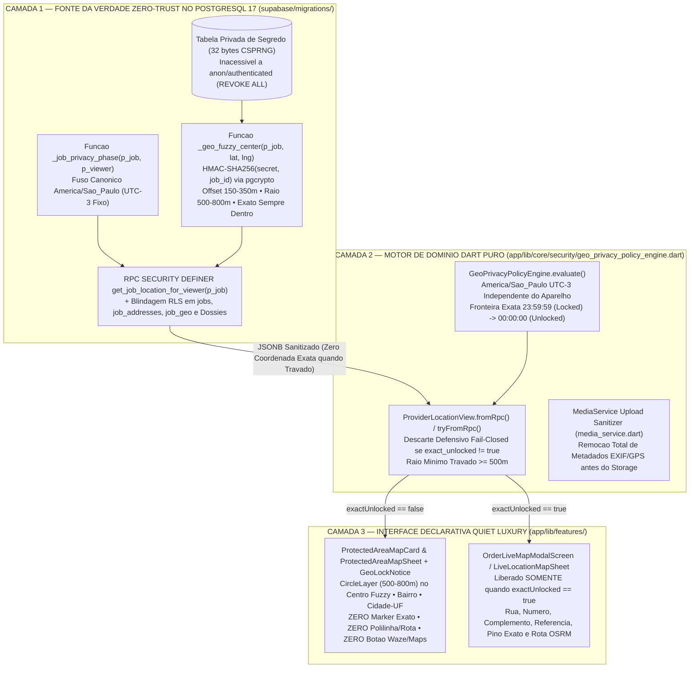
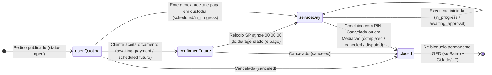

# ADR-0022: Trava Temporal e Espacial de Privacidade Geográfica (*Temporal & Spatial Geo-Privacy Lock*), Ofuscação Criptográfica Server-Side via HMAC-SHA256 e Sanitização Forense EXIF (LGPD Art. 6º, III)

* **Status:** Aceito (amplia e endurece [ADR-0003](0003-regras-de-negocio-no-banco-via-rpc.md), [ADR-0007](0007-privacidade-por-minimizacao-de-dados.md), [ADR-0019](0019-agendamento-geofence-chat-dossies.md) e [ADR-0021](0021-arquitetura-kyc-zero-trust-argon-carbon.md))
* **Data:** 2026-11-12
* **Decisores:** Arquitetura de Sistemas Distribuídos, Engenharia de Segurança Zero-Trust e Criptografia PostgreSQL (`@sec-db`), Arquitetura de Domínio Clean Architecture (`@geo-dom`), Engenharia Mobile/Core (`@eng`), Engenharia de UI/UX (`@prov-ui` & `@ux`) e Engenharia de QA e Documentação (`@qa-docs` & `@lead-qa`)
* **Tags:** `geo-privacy`, `zero-trust`, `hmac-sha256`, `pgcrypto`, `rls`, `lgpd`, `exif-stripping`, `america-sao-paulo`, `clean-architecture`, `stride`

---

## Contexto

Em um marketplace bilateral de serviços residenciais, a localização exata do imóvel do cliente (logradouro, número predial, complemento/apartamento, ponto de referência, CEP e par de coordenadas geodésicas $(\text{lat}_{\text{exact}}, \text{lng}_{\text{exact}})$) constitui um **dado pessoal crítico de segurança física e patrimonial**. A exposição prematura ou excessiva desse dado a prestadores de serviço introduz cinco riscos graves de segurança e privacidade:

1. **Vazamento em Pedidos Abertos (`open`) e Cotações Não Aceitas:** Quando um pedido é publicado no mural de oportunidades ou enviado por convite direto, múltiplos profissionais da categoria visualizam a demanda para formular orçamentos. Se a linha de `public.jobs`, `public.job_addresses` ou `public.job_geo` entregar a rua, o número ou a coordenada exata nessa fase, qualquer conta de prestador pode mapear residências de clientes sem jamais ter sido contratada.
2. **Exposição Antecipada em Agendamentos Futuros (`scheduled` / `awaiting_payment`) e Bypass Fora da Plataforma:** Mesmo após o aceite do orçamento, quando um atendimento é agendado para dias ou semanas no futuro, o profissional não necessita conhecer o número da casa ou apartamento antes do dia da execução — ele precisa apenas saber o **Bairro**, a **Cidade/UF** e uma **região aproximada (raio de $500\text{–}800\text{ m}$)** para planejar seu deslocamento logístico. Liberar o endereço completo dias antes amplia a superfície de risco residencial e facilita o contato presencial direto antes da confirmação financeira.
3. **Vulnerabilidade Matemática de Jitter Determinístico Público (`SHA-256(job_id)`):** Uma especificação ingênua que desloque o centro do círculo aplicando uma função determinística pública apenas sobre o identificador do chamado — tal como $\vec{\Delta} = f(\text{SHA-256}(\text{job\_id}))$ — é **trivialmente invertível em $O(1)$**. Como `job_id` é público para todos os candidatos, qualquer atacante calcula o mesmo vetor $\vec{\Delta}$ e subtrai do centro recebido ($\vec{P}_{\text{exact}} = \vec{P}_{\text{fuzzy}} - \vec{\Delta}$), recuperando a coordenada exata da casa com erro zero.
4. **Retenção Indevida Pós-Encerramento (`completed`, `canceled`, `disputed`) e Violação de Minimização (LGPD):** Após a conclusão, o cancelamento ou a abertura de disputa de uma Ordem de Serviço, manter o endereço completo e a rota exata acessíveis no histórico ou no dossiê do profissional viola o princípio da necessidade/minimização (Art. 6º, III da LGPD) e as regras de término de tratamento (Arts. 15 e 16 da LGPD).
5. **Canais Laterais de Vazamento (*Side-Channels*: EXIF/GPS de Fotos, Realtime, Dossiês, Chat e Fuso Horário do Aparelho):**
   - Fotos tiradas pelo cliente com a câmera do smartphone frequentemente carregam metadados **EXIF/TIFF GPS** (`GPSLatitude`, `GPSLongitude`) que revelam as coordenadas exatas do imóvel caso o binário original seja servido aos candidatos.
   - Manipulações do relógio ou do fuso horário local do aparelho (`DateTime.now().toLocal()`) permitiriam adiantar artificialmente o desbloqueio na interface caso a regra não operasse sobre o fuso canônico **`America/Sao_Paulo` (`UTC−3` fixo)** validado no servidor.

---

## Decisão

Instituímos a **Trava Temporal e Espacial de Privacidade Geográfica (*Temporal & Spatial Geo-Privacy Lock*)** em **três camadas concêntricas de Defesa em Profundidade** (PostgreSQL 17 RLS/RPC + Motor de Domínio Dart Puro + Componentes Visuais Flutter), governada por uma máquina de estados determinística de **4 fases para o profissional** (além da visão integral do proprietário `ownerFull` e do bloqueio `denied`), ofuscação criptográfica **HMAC-SHA256 com segredo exclusivo do servidor** e sanitização binária de metadados **EXIF/GPS** antes do upload.

---

### 1. Máquina de Fases da Trava Temporal e Espacial (Tabela Normativa das 4 Fases + Papéis)

O acesso aos atributos de localização de uma Ordem de Serviço é determinado pelo par $(\text{papel do visualizador}, \text{estado temporal/contratual da OS})$ avaliado no fuso **`America/Sao_Paulo` (`UTC−3` fixo)**:

| Fase (`GeoPrivacyPhase` / RPC `phase`) | Papel e Condição de Ativação (`America/Sao_Paulo`) | `exact_unlocked` | Dados Textuais Liberados | Coordenadas e Representação Cartográfica |
| :--- | :--- | :---: | :--- | :--- |
| **`ownerFull`** (`owner_full`) | **Cliente dono do pedido** (`client_id = auth.uid()`) ou **`admin`**, em **qualquer** etapa ou status do chamado. | `true` | Logradouro (`street`), Número (`number`), Complemento (`complement`), Referência (`reference`), CEP, Bairro e Cidade/UF. | Coordenadas **exatas** $(\text{lat}_{\text{exact}}, \text{lng}_{\text{exact}})$, `radius_m = 100`, mapa interativo em tela cheia (`OrderLiveMapModalScreen`) e rota em tempo real. |
| **1. `openQuoting`** (`open_quoting`) | **Profissional** (candidato no feed ou convidado direto) enquanto o pedido está **`open`** (ou quando o profissional autenticado não é o prestador contratado). | `false` | **Apenas Bairro + Cidade/UF** (`areaTitle`, ex.: `"Country Club • Poços de Caldas - MG"`). `street`, `number`, `complement`, `reference` e `cep` são `NULL`. | Centro **FUZZY** $(\text{lat}_{\text{fuzzy}}, \text{lng}_{\text{fuzzy}})$ derivado por HMAC-SHA256 no servidor + círculo aproximado (`radius_m` $\in [500, 800]$). **Sem pino exato e sem rota.** |
| **2. `confirmedFuture`** (`confirmed_future`) | **Profissional contratado** (`provider_id = auth.uid()`) com orçamento aceito: (a) status `awaiting_payment` (qualquer data), ou (b) status `scheduled` quando $\text{HOJE}_{\text{SP}} < \text{DIA\_AGENDADO}_{\text{SP}}$ (ou sem data e não-emergencial). | `false` | **Apenas Bairro + Cidade/UF** + Data Agendada (`DD/MM/AAAA`) + Aviso de Segurança Residencial informando liberação automática às `00h00` do dia agendado. | Centro **FUZZY** $(\text{lat}_{\text{fuzzy}}, \text{lng}_{\text{fuzzy}})$ derivado por HMAC-SHA256 + `CircleLayer` ($500\text{–}800\text{ m}$) em `ProtectedAreaMapCard` / `ProtectedAreaMapSheet`. **Sem pino exato e sem rota.** |
| **3. `serviceDay`** (`service_day`) | **Profissional contratado** (`provider_id = auth.uid()`) em: (a) status `scheduled` com $\text{HOJE}_{\text{SP}} \ge \text{DIA\_AGENDADO}_{\text{SP}}$ (ou `emergency` pago), ou (b) serviço iniciado em campo (`in_progress` ou `awaiting_approval`). | `true` | **Endereço Completo Liberado:** Rua, Número, Complemento, Ponto de Referência, CEP, Bairro e Cidade/UF (`fullStreetLine`). | Coordenadas **exatas** $(\text{lat}_{\text{exact}}, \text{lng}_{\text{exact}})$, `radius_m = 100`, mapa exato em tela cheia, pino do imóvel, rota viária OSRM, trânsito, distância ($\text{km}$) e ETA ($\text{min}$). |
| **4. `closed`** (`closed` / `denied`) | **Re-bloqueio Permanente Pós-Serviço (LGPD):** qualquer chamado com status `completed`, `canceled` ou `disputed` (ou acesso negado `denied`/`none`). | `false` | **Apenas Bairro + Cidade/UF** (ou vazio se `denied`). `street`, `number`, `complement`, `reference` e `cep` retornam permanentemente a `NULL`. | `lat = NULL`, `lng = NULL` (sem pino exato, sem rota e sem exposição retroativa da residência no histórico/dossiê do profissional). |

---

### 2. Correção Criptográfica: Por Que o Jitter por `SHA-256(job_id)` É Invertível e Como o `HMAC-SHA256` Server-Side o Neutraliza

#### 2.1. Prova Matemática da Invertibilidade do Jitter Determinístico Público

Suponha um esquema de ofuscação espacial em que o deslocamento planar $(\Delta\text{lat}, \Delta\text{lng})$ aplicado às coordenadas reais $(\text{lat}_{\text{exact}}, \text{lng}_{\text{exact}})$ seja calculado exclusivamente a partir de uma função pública determinística $g$ sobre o identificador do pedido $\text{job\_id}$:

$$\vec{P}_{\text{fuzzy}} = \vec{P}_{\text{exact}} + g\big(\text{SHA-256}(\text{job\_id})\big)$$

Como a função $g$ (código-fonte do aplicativo/repositório) é conhecida segundo o **Princípio de Kerckhoffs** e o identificador $\text{job\_id}$ é obrigatoria e publicamente transmitido ao cliente móvel do profissional para renderizar o card da oportunidade, o atacante conhece tanto $\vec{P}_{\text{fuzzy}}$ quanto $\text{job\_id}$. Portanto, a transformação é uma bijeção sem segredo e admite inversa exata em tempo constante $O(1)$:

$$\vec{P}_{\text{exact}} = \vec{P}_{\text{fuzzy}} - g\big(\text{SHA-256}(\text{job\_id})\big)$$

Logo, um jitter derivado apenas de `SHA-256(job_id)` fornece **zero bits de entropia secreta** ($H(\vec{P}_{\text{exact}} \mid \vec{P}_{\text{fuzzy}}, \text{job\_id}) = 0$), permitindo a reconstrução exata do endereço residencial antes do aceite do orçamento.

#### 2.2. Construção Criptográfica Server-Side com `HMAC-SHA256(secret, job_id)` e Garantia Geométrica de Contenção

Para erradicar a invertibilidade mantendo estabilidade espacial por chamado, o cálculo do centro aproximado é executado **exclusivamente dentro do PostgreSQL** pela função `_geo_fuzzy_center(p_job uuid, p_lat double precision, p_lng double precision)` utilizando a extensão `pgcrypto`:

1. **Segredo Criptográfico Isolado (`256 bits` CSPRNG):** Na migração SQL, um segredo mestre $K_{\text{srv}} \in \{0,1\}^{256}$ é gerado uma única vez via `extensions.gen_random_bytes(32)` e armazenado em tabela privada protegida por `REVOKE ALL ON TABLE ... FROM PUBLIC, anon, authenticated`. Nenhum cliente web ou mobile jamais lê $K_{\text{srv}}$.
2. **Derivação via Função Pseudoaleatória (`PRF`):** Calcula-se o código de autenticação de mensagem de 32 bytes:
   $$M = \text{HMAC-SHA256}\left(K_{\text{srv}},\; \text{p\_job}::\text{text}\right)$$
3. **Amostragem Determinística Sob Segredo de Módulo, Azimute e Raio:** Extraem-se inteiros sem sinal a partir de fatias disjuntas de bytes de $M$:
   - **Distância de deslocamento ($d$):** mapeada uniformemente no intervalo $[150\text{ m},\; 350\text{ m}]$;
   - **Ângulo azimutal ($\theta$):** mapeado uniformemente em $[0,\; 2\pi)$ radianos;
   - **Raio do círculo de privacidade ($R$):** mapeado no intervalo $[500\text{ m},\; 800\text{ m}]$.
4. **Projeção Geodésica Esférica Local:**
   $$\delta\text{lat} = \frac{d \cdot \cos(\theta)}{111\,320,0}, \qquad \delta\text{lng} = \frac{d \cdot \sin(\theta)}{111\,320,0 \cdot \max\big(0,1,\; \cos(\text{rad}(\text{lat}_{\text{exact}}))\big)}$$
   $$\text{lat}_{\text{fuzzy}} = \text{lat}_{\text{exact}} + \delta\text{lat}, \qquad \text{lng}_{\text{fuzzy}} = \text{lng}_{\text{exact}} + \delta\text{lng}$$
5. **Teorema de Contenção Estrita e Margem de Segurança de $150\text{ m}$:**
   Como a distância euclidiana/geodésica entre o centro deslocado e a residência satisfaz estritamente:
   $$\text{dist}\left(\vec{P}_{\text{fuzzy}}, \vec{P}_{\text{exact}}\right) = d \le 350\text{ m} < 500\text{ m} \le R$$
   o imóvel real $\vec{P}_{\text{exact}}$ está **sempre contido no interior do círculo $\mathcal{B}(\vec{P}_{\text{fuzzy}}, R)$**, a pelo menos $R_{\min} - d_{\max} = 500\text{ m} - 350\text{ m} = 150\text{ m}$ de distância da circunferência externa. Assim, o círculo nunca "entrega" a casa pela borda e nunca exclui o endereço real.

---

### 3. Arquitetura das 3 Camadas de Defesa em Profundidade

1. **Camada 1 — Banco de Dados PostgreSQL 17 (`RLS` + Triggers Sanitizadores + `RPC SECURITY DEFINER`):**
   - **Segredo Isolado (`private.geo_privacy_secrets`):** Schema dedicado `private` (`REVOKE ALL FROM PUBLIC, anon, authenticated`) armazenando chave de 32 bytes (`extensions.gen_random_bytes(32)`) sob RLS ativo sem policy pública, lido exclusivamente pela função interna `public._geo_fuzzy_center(p_job, p_lat, p_lng)` (`SECURITY DEFINER`, `REVOKE ALL FROM PUBLIC, anon, authenticated`) via `extensions.hmac(p_job::text::bytea, secret_key, 'sha256')`.
   - **Segregação Física em `public.jobs`, `public.job_geo` e `public.job_addresses` (Zero Vazamento em `SELECT *` e `supabase_realtime`):**
     - `public.jobs` recebe as colunas públicas aproximadas `public_lat double precision`, `public_lng double precision` e `fuzzy_radius_m integer`, enquanto `public.job_addresses` recebe `cep text`.
     - Triggers `BEFORE/AFTER INSERT OR UPDATE` em `public.jobs` (e sincronização em `public.job_geo`) migram automaticamente qualquer `(latitude, longitude)` enviado na abertura do chamado para `public.job_geo` (respeitando a precedência `client_pin > client > client_geocode/nominatim`), migram `address_cep` para `job_addresses.cep`, anulam `jobs.latitude = NULL`, `jobs.longitude = NULL` e `jobs.address_cep = NULL`, sanitizam `jobs.address_summary` para conter estritamente `Bairro, Cidade - UF` (sem rua/número/apto), e gravam em `public_lat`/`public_lng`/`fuzzy_radius_m` o centro deslocado HMAC (ou `NULL` quando `status IN ('completed', 'canceled', 'disputed')`).
     - Dessa forma, leituras `.from('jobs').select()` ou assinaturas `supabase_realtime` **jamais** transmitem coordenadas exatas e tampouco induzem o mapa do cliente a exibir um ponto deslocado como se fosse exato.
   - **Contrato Canônico (`public.get_job_location_for_viewer(p_job uuid) returns jsonb`):** Função `SECURITY DEFINER SET search_path = public` com permissão `EXECUTE` restrita a `authenticated`. Avalia o papel do chamador (`auth.uid()`) e a fase temporal via `public._job_privacy_phase(p_job, auth.uid())`, retornando o payload JSONB padronizado (`viewer_role`, `phase`, `exact_unlocked`, `city`, `uf`, `neighborhood`, `street`, `number`, `complement`, `reference`, `cep`, `lat`, `lng`, `radius_m`, `scheduled_date`, `unlock_at`).
   - **Blindagem de RLS e RPCs Auxiliares:** As políticas RLS de `public.job_addresses` e `public.job_geo` exigem `public._can_see_exact_location(job_id, auth.uid())` (`owner` e `admin` sempre; `provider` atribuído **somente** em `service_day`). As RPCs `public.job_destination`, `public.provider_job_dossier`, `public.client_job_dossier`, `public.provider_full_service_history` e `public.notify_service_day_address_unlocked` (`00:00` SP idempotente, sem endereço no texto da notificação) operam sob o mesmo gate temporal.
2. **Camada 2 — Motor de Domínio Dart Puro ([`geo_privacy_policy_engine.dart`](../../app/lib/core/security/geo_privacy_policy_engine.dart), [`marketplace_models.dart`](../../app/lib/core/models/marketplace_models.dart) & [`job_service.dart`](../../app/lib/core/services/job_service.dart)):**
   - Implementa `GeoViewerRole`, `GeoPrivacyPhase`, `GeoPrivacyDecision`, `GeoPrivacyPolicyEngine` e `ProviderLocationView` sem dependência de Flutter, Supabase ou `dart:io`.
   - `ProviderLocationView.fromRpc` e `tryFromRpc` aplicam **sanitização defensiva *fail-closed***: se `exact_unlocked != true` ou se a fase for incompatível, os campos `street`, `number`, `complement`, `reference` e `cep` são forçados a `null` no cliente mesmo que um mock ou payload malformado os envie, e qualquer `radius_m < 500` em estado travado é elevado para `800`. Em `closed`/`denied`, `lat` e `lng` são forçados a `null`.
   - O modelo `Job` (`marketplace_models.dart`) expõe os campos opcionais `publicLat`, `publicLng` e `fuzzyRadiusM` para ordenação aproximada por distância no feed do profissional, enquanto `JobService.fetchLocationForViewer(jobId)` e `JobService.fetchOwnerExactLocation(jobId)` resolvem a localização autorizada (exata para o cliente dono em qualquer fase; condicionada à fase para o profissional).
   - Os métodos legados `isServiceDayUnlocked` e `AccurateGeoRoutingService.resolveProviderAddressView` ([`accurate_geo_routing_service.dart`](../../app/lib/core/services/accurate_geo_routing_service.dart)) delegam integralmente ao `GeoPrivacyPolicyEngine`.
3. **Camada 3 — Componentes Visuais Flutter ([`geo_privacy_widgets.dart`](../../app/lib/features/shared/presentation/geo_privacy_widgets.dart) & Telas do Profissional):**
   - `ProtectedAreaMapCard`, `GeoLockNotice` e `ProtectedAreaMapSheet` exibem o mapa `flutter_map` com `CircleLayer` do raio aproximado ($500\text{–}800\text{ m}$) centrado na coordenada fuzzy, cabeçalho com selo `"🔒 Segurança Residencial"`, `Bairro • Cidade - UF` e aviso explicativo com a data de liberação (`DD/MM/AAAA`), **sem `Marker` de pino exato, sem polilinha de rota e sem botões de navegação externa (Google Maps/Waze) ou cópia de endereço**.
   - As 5 superfícies do modo profissional (`provider_shell.dart`, `provider_job_screen.dart`, `provider_execution_screens.dart`, `dossie_servico_profissional_screen.dart` e `scheduled_service_screen.dart`) abrem `OrderLiveMapModalScreen` / `LiveLocationMapSheet` **exclusivamente** quando `view.exactUnlocked == true`.

---

### 4. Fuso Horário Canônico `America/Sao_Paulo` (`UTC−3` Fixo) e Fronteira `00:00:00`

Desde a promulgação do Decreto Federal nº 9.772/2019, o Brasil não adota horário de verão, mantendo o fuso **`America/Sao_Paulo` permanentemente em `UTC−3` (`-03:00`)**.

- **No PostgreSQL:** A comparação de datas utiliza `(now() AT TIME ZONE 'America/Sao_Paulo')::date` contra `(scheduled_for AT TIME ZONE 'America/Sao_Paulo')::date`.
- **No Motor Dart (`GeoPrivacyPolicyEngine`):** O método `toSaoPaulo(DateTime instant)` converte qualquer instante para UTC e aplica o deslocamento constante `saoPauloOffset = Duration(hours: -3)`, extraindo `saoPauloDay(instant) = DateTime.utc(sp.year, sp.month, sp.day)` sem jamais consultar `DateTime.now().toLocal()` ou `timeZoneName` do sistema operacional hospedeiro.
- **Invariante de Fronteira:** Para um serviço agendado no dia $D$ em São Paulo:
  - Em $D - 1$ às `23:59:59` (`02:59:59Z` do dia $D$ em UTC): $\text{today}_{\text{SP}} < D \implies$ **`confirmedFuture` (travado)**;
  - Em $D$ às `00:00:00` (`03:00:00Z` do dia $D$ em UTC): $\text{today}_{\text{SP}} == D \implies$ **`serviceDay` (liberado)**.

---

### 5. Conformidade Legal com a LGPD (Lei Federal nº 13.709/2018) e Remoção de EXIF/GPS

| Dimensão Regulatória / Forense | Dispositivo Legal (LGPD) | Implementação Técnica no Ecossistema Desperrengue |
| :--- | :---: | :--- |
| **Base Legal do Tratamento** | Art. 7º, V e IX | **Execução de contrato** (viabilizar o deslocamento físico do prestador contratado no dia do atendimento) e **legítimo interesse** na proteção da incolumidade física e patrimonial do cliente residencial. |
| **Princípio da Minimização / Necessidade** | Art. 6º, III | Durante a cotação (`openQuoting`) e a espera pré-serviço (`confirmedFuture`), o tratamento limita-se ao mínimo estritamente necessário para precificação e logística: **Bairro, Cidade/UF e círculo aproximado de $500\text{–}800\text{ m}$**. |
| **Segurança e Prevenção *By Design*** | Art. 6º, VII e VIII; Art. 46 | A coordenada exata e o endereço predial nunca trafegam pela rede até o dispositivo do profissional antes do desbloqueio; o segredo do HMAC reside exclusivamente no banco de dados. |
| **Término do Tratamento e Retenção Mínima** | Arts. 15 e 16 | Ao transicionar para `completed`, `canceled` ou `disputed` (**fase `closed`**), o acesso do profissional aos dados prediais e coordenadas exatas é **permanentemente revogado** no banco e na UI, restando apenas Bairro e Cidade/UF para fins de histórico contábil e portfólio. O canal administrativo (`admin`) mantém trilha própria para cumprimento de obrigação legal/regulatória e mediação. |
| **Sanitização Forense de Imagens (*EXIF Stripping*)** | Art. 6º, III e VII | No upload de fotos de pedidos e evidências ([`media_service.dart`](../../app/lib/core/services/media_service.dart) e [`image_metadata_stripper.dart`](../../app/lib/core/utils/image_metadata_stripper.dart)), o sanitizador binário lossless remove integralmente todos os segmentos de metadados EXIF/TIFF/GPS/XMP/IPTC (`APP1`–`APP15`, `COM`, `eXIf`, `tEXt`, `iTXt`, `zTXt` em JPEG, PNG e WebP), preservando a tag visual `Orientation` (1..8) e operando em modo *fail-closed* (`ImageMetadataException`) para formatos desconhecidos antes da gravação no Supabase Storage. Complementarmente, [`address_privacy.dart`](../../app/lib/core/utils/address_privacy.dart) (`AddressPrivacy.coarseArea`) aplica sanitização de segunda camada no portfólio e no ledger. |

---

### 6. Modelagem de Ameaças Consideradas (Matriz STRIDE Resumida)

| Categoria STRIDE | Vetor de Ameaça Específico | Mitigação Arquitetural Implementada |
| :--- | :--- | :--- |
| **I — Information Disclosure** (*Inversão de Offset por Enumeração de `job_id`*) | Atacante obtém `job_id` e tenta inverter matematicamente o deslocamento do centro do círculo. | Neutralizado pelo uso de **`HMAC-SHA256(secret, job_id)`** com chave de 256 bits gerada por CSPRNG e isolada no servidor (`private`/RLS sem policy). Sem $K_{\text{srv}}$, a saída do HMAC é indistinguível de um oráculo aleatório. |
| **I — Information Disclosure** (*Ataque de Média de Amostras / Monte Carlo*) | Atacante consulta a RPC `get_job_location_for_viewer` $N$ vezes para o mesmo pedido na esperança de que jitters aleatórios independentes tenham média igual a $\vec{P}_{\text{exact}}$. | Como o HMAC é determinístico para o par $(K_{\text{srv}}, \text{job\_id})$, todas as $N$ chamadas retornam **exatamente o mesmo centro fuzzy e o mesmo raio**, fornecendo variância amostral nula ($\sigma^2 = 0$) e zero ganho de informação adicional. |
| **I — Information Disclosure** (*Bypass via PostgREST / Supabase Realtime*) | Profissional autenticado assina `.from('jobs').stream()` ou executa `SELECT * FROM job_addresses / job_geo` diretamente via cliente Supabase. | Políticas RLS endurecidas em `job_addresses` e `job_geo` condicionadas a `_can_see_exact_location(job_id, auth.uid())`, e mascaramento das coordenadas em `jobs` para que o profissional receba coordenadas exatas somente na fase `service_day`. |
| **I — Information Disclosure** (*Vazamento em Dossiês, Notificações, Chat ou EXIF*) | Profissional lê `provider_job_dossier` após conclusão, recebe push notification com endereço ou extrai tags GPS das fotos do chamado. | RPCs de dossiê e agenda passam pelo gate de fase; notificações automáticas ("Endereço liberado hoje") e cabeçalhos de chat não incluem rua/número antes do desbloqueio; `media_service.dart` remove EXIF/GPS antes do upload. |
| **T / E — Tampering & Elevation of Privilege** (*Adulteração do Relógio ou Fuso do Celular*) | Profissional adianta o relógio do smartphone para o dia seguinte ou muda o fuso para `UTC+14` tentando forçar `serviceDay`. | A decisão real de entrega dos dados ocorre no servidor PostgreSQL usando `now() AT TIME ZONE 'America/Sao_Paulo'`. Mesmo que o relógio local do aparelho esteja adulterado, a RPC `get_job_location_for_viewer` continua devolvendo `exact_unlocked = false` e `street = null`. |

---

## Alternativas Consideradas

| Alternativa | Vantagens | Desvantagens | Motivo da Rejeição |
| :--- | :--- | :--- | :--- |
| **1. Ocultação Apenas na Camada de UI Flutter (Mantendo `SELECT *` Aberto no Banco)** | Alteração restrita ao código Dart. | Qualquer inspeção de tráfego HTTPS/WSS ou chamada PostgREST com o token JWT do profissional expõe rua, número e coordenadas exatas. | Viola frontalmente a arquitetura Zero-Trust ([ADR-0003](0003-regras-de-negocio-no-banco-via-rpc.md) e [ADR-0007](0007-privacidade-por-minimizacao-de-dados.md)). |
| **2. Jitter Determinístico Calculado por `SHA-256(job_id)` Sem Segredo Server-Side** | Não requer tabela de segredo no PostgreSQL. | Totalmente invertível em $O(1)$ por qualquer detentor do `job_id` ($\vec{P}_{\text{exact}} = \vec{P}_{\text{fuzzy}} - \text{offset}(\text{job\_id})$). | Falha criptográfica crítica (exposição exata da residência). |
| **3. Jitter Aleatório Puro (`random()`) a Cada Chamada da RPC** | Não requer armazenamento de chave secreta. | Permite **Ataque de Média de Amostras (*Center Averaging*)**: com $N \approx 50$ requisições sucessivas, a média amostral converge para a coordenada exata ($\sigma / \sqrt{N} \to 0$). | Vulnerável a reconstrução estatística por repetição de consultas. |
| **4. Centróide Fixo do Bairro ou CEP Sem Offset Individual** | Implementação simples por tabela de bairros. | Em bairros pequenos ou condomínios, o centróide pode coincidir com o imóvel ou colocar a casa fora do círculo quando o imóvel fica na divisa do bairro. | Não garante matematicamente que o ponto exato esteja sempre dentro do círculo com margem $\ge 150\text{ m}$. |

---

## Consequências e Plano de Rollback

* **Consequências Positivas:**
  - **Vazamento Zero (*Zero-Leakage Guarantee*)**: Nenhum profissional obtém logradouro, número, complemento, referência, CEP ou coordenada exata antes das `00h00` (`America/Sao_Paulo`) do dia agendado (e com orçamento aceito e pago), nem após o encerramento do serviço (`completed`/`canceled`/`disputed`).
  - **Preservação Integral da Experiência do Cliente**: O cliente dono (`ownerFull`) continua visualizando em 100% do tempo seu endereço completo e o mapa interativo exato em tela cheia.
  - **Transparência e Confiança na UX do Profissional**: Os componentes `ProtectedAreaMapCard`, `GeoLockNotice` e `ProtectedAreaMapSheet` comunicam claramente a região de atendimento (`Bairro • Cidade - UF` e raio aproximado) e o instante exato de liberação automática.
* **Consequências Negativas / Custos Operacionais:**
  - Adição de uma chamada RPC leve (`get_job_location_for_viewer`, latência $< 5\text{ ms}$ em índice PK) nas telas de detalhe do serviço do profissional, mitigada por cache de visualização e fallback seguro via `GeoPrivacyPolicyEngine.evaluate`.
* **Plano de Rollback Seguro:**
  1. **Banco de Dados (`supabase/migrations/`):** As novas migrações são idempotentes (`CREATE OR REPLACE FUNCTION`, `DROP POLICY IF EXISTS ... CREATE POLICY`). Em caso de necessidade de reversão emergencial de política sem perda de dados, uma migração corretiva pode ajustar `_job_privacy_phase` para retornar `service_day` aos prestadores atribuídos (`provider_id = auth.uid()`), mantendo intactos a tabela de segredo HMAC, o contrato JSONB da RPC `get_job_location_for_viewer` e as colunas existentes de `jobs`, `job_addresses` e `job_geo`.
  2. **Aplicativo Flutter (`app/`):** Como `AccurateGeoRoutingService.resolveProviderAddressView` e `isServiceDayUnlocked` mantiveram assinatura retrocompatível e `ProviderLocationView.fromRpc` opera guiado pelo campo `exact_unlocked` retornado pelo servidor, uma alteração de política na RPC propaga-se instantaneamente para os clientes móveis sem exigir recompilação binária, ou pode ser revertida via OTA (`beta-latest`).

---

## Verificação

* **SHAs Auditados por Subsistema:** `@geo-dom` (`7b61c4d`, `6aa248e`, `38ffed4`), `@eng` (`b78c074`, `0658fcd`, `214eec8`, `74e6352`, `2aae697`), `@prov-ui` (`d814455`, `f69353e`, `60f34b5`), `@ux` (`b3d2622`, `569f8e4`) e `@sec-db` (`d3822d6`, `e404338`, `3c690f1`).
1. **Testes Unitários do Motor de Domínio Dart e Segurança Core:** [`app/test/geo_privacy_policy_engine_test.dart`](../../app/test/geo_privacy_policy_engine_test.dart), [`app/test/eng_image_metadata_stripper_test.dart`](../../app/test/eng_image_metadata_stripper_test.dart) e [`app/test/eng_media_upload_sanitize_test.dart`](../../app/test/eng_media_upload_sanitize_test.dart) validando todas as fases (`ownerFull`, `openQuoting`, `confirmedFuture`, `serviceDay`, `closed`), fronteiras exatas `23:59:59` vs. `00:00:00` no fuso `America/Sao_Paulo` (`UTC−3`), conversão de timestamps UTC que cruzam a meia-noite em SP (ex.: `02:30Z`), descarte defensivo em `ProviderLocationView.fromRpc`, remoção lossless de EXIF/GPS e URLs assinadas no bucket privado `forensic-evidence`.
2. **Testes Adversariais de Widgets e Multi-Viewport:** [`app/test/temporal_geo_privacy_lock_widgets_test.dart`](../../app/test/temporal_geo_privacy_lock_widgets_test.dart), [`app/test/provider_geo_privacy_ui_test.dart`](../../app/test/provider_geo_privacy_ui_test.dart), [`app/test/ux_client_and_shared_polish_test.dart`](../../app/test/ux_client_and_shared_polish_test.dart) e [`app/test/geo_privacy_and_portfolio_test.dart`](../../app/test/geo_privacy_and_portfolio_test.dart) provando em múltiplos tamanhos de viewport (`320×640`, `360×780`, `412×915`, `480×960`) que: (a) o cliente vê sempre endereço completo e mapa exato (`fetchOwnerExactLocation`); (b) o profissional em `openQuoting` e `confirmedFuture` vê apenas Bairro, Cidade/UF e `CircleLayer` ($500\text{–}800\text{ m}$) sem `DestinationMapPin` e sem vazamento textual de rua/número/apto; (c) no `serviceDay` vê endereço completo e rota; e (d) em `closed` (`completed`/`canceled`) o endereço volta a ficar oculto.
3. **Verificação SQL em Motor PostgreSQL Real (`PGlite` + `pgcrypto` + `uuid-ossp`) e Validador de Links:**
   - Suíte SQL [`supabase/tests/geo_privacy_lock.sql`](../../supabase/tests/geo_privacy_lock.sql) (**45/45 asserções aprovadas** em execução PostgreSQL real via `@pg-verifier`, cobrindo `owner`, `admin`, `provider` em `open_quoting`, `confirmed_future`, fronteira `02:59:59Z` vs `03:00:00Z` SP, `service_day`, `closed`, wrapper 1-arg `_can_see_exact_location(uuid)` anti-oráculo com erro `42501` na sobrecarga de 2 argumentos, IDOR, cofres `private.*` e bucket privado `forensic-evidence`), suíte [`supabase/tests/security_smoke.sql`](../../supabase/tests/security_smoke.sql) (`65/65 ok`), verificador matemático e léxico [`scripts/test-geo-privacy-sql.mjs`](../../scripts/test-geo-privacy-sql.mjs) (`12/12 PASS`, Monte Carlo 10.000 amostras com `dist=[150.97m .. 348.98m]` e `radius=[500m .. 800m]`) e `node scripts/check-md-links.mjs` com `0` links quebrados.
   - **Nota de Saneamento Retroativo de Migrações (`db reset` / `db push` em Banco Limpo):** Durante a verificação em motor PostgreSQL real da cadeia completa de 27 migrações, foram identificadas e corrigidas *in-place* (com preservação semântica integral para bancos já provisionados) quatro inconsistências sintáticas/relacionais em migrações precedentes: (a) [`20261108120000_client_kyc_biometrics_and_ocr.sql`](../../supabase/migrations/20261108120000_client_kyc_biometrics_and_ocr.sql) (substituição de `.concat(...)` por operador SQL `||` no mascaramento de CPF); (b) [`20261110140000_real_portfolio_5_curated_and_notes.sql`](../../supabase/migrations/20261110140000_real_portfolio_5_curated_and_notes.sql) (alinhamento de `m.phase` para `m.current_phase <> 'PHASE_5_SETTLED_AND_CERTIFIED'`); (c) escape de literal `100%%` em `RAISE EXCEPTION` na função `pin_case` da mesma migração; e (d) [`20261110234000_zero_trust_bilateral_antifraud_v285.sql`](../../supabase/migrations/20261110234000_zero_trust_bilateral_antifraud_v285.sql) (referência canônica a `public.profiles` em vez de `public.users`).

---

## Referências

* [ADR-0003: Regras de negócio no banco via RLS, *triggers* e RPCs `SECURITY DEFINER`](0003-regras-de-negocio-no-banco-via-rpc.md)
* [ADR-0007: Privacidade por minimização: tabelas segregadas, trava temporal e *views*](0007-privacidade-por-minimizacao-de-dados.md)
* [ADR-0019: Serviço agendado vs. em execução, dupla trava (relógio + Haversine) e dossiês](0019-agendamento-geofence-chat-dossies.md)
* [ADR-0021: Arquitetura KYC Zero-Trust Híbrida (Argon High + Carbon High), VIO/ICP-Brasil e SHAP LGPD](0021-arquitetura-kyc-zero-trust-argon-carbon.md)
* [Catálogo de Decisões Arquiteturais (`docs/adr/README.md`)](README.md)
* [Migração da Trava Geográfica (`supabase/migrations/20261113100000_temporal_geo_privacy_lock.sql`)](../../supabase/migrations/20261113100000_temporal_geo_privacy_lock.sql)
* [Migração de Hardening Zero-Trust (`supabase/migrations/20261113110000_security_hardening_audit.sql`)](../../supabase/migrations/20261113110000_security_hardening_audit.sql)
* [Motor de Domínio da Trava Geográfica (`app/lib/core/security/geo_privacy_policy_engine.dart`)](../../app/lib/core/security/geo_privacy_policy_engine.dart)
* [Componentes Visuais da Trava Geográfica (`app/lib/features/shared/presentation/geo_privacy_widgets.dart`)](../../app/lib/features/shared/presentation/geo_privacy_widgets.dart)
* [Serviço de Roteamento e Compatibilidade (`app/lib/core/services/accurate_geo_routing_service.dart`)](../../app/lib/core/services/accurate_geo_routing_service.dart)
* [Serviço de Ordens e Ponte RPC (`app/lib/core/services/job_service.dart`)](../../app/lib/core/services/job_service.dart)
* [Serviço de Mídia e Sanitização EXIF (`app/lib/core/services/media_service.dart`)](../../app/lib/core/services/media_service.dart)
* [Especificação de Arquitetura (`docs/ARCHITECTURE.md`)](../ARCHITECTURE.md)
* [Engenharia de Qualidade e Testes (`docs/TESTING.md`)](../TESTING.md)
