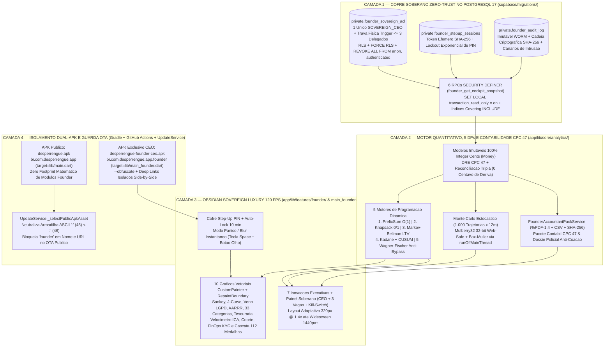

# ADR-0023: Cockpit Soberano do Fundador (*Founder Sovereign Cockpit & War Room*), Isolamento Físico Dual-APK Zero-Footprint, Trava Física de 3 Delegados no PostgreSQL 17, Contabilidade CPC 47 em Centavos Inteiros (`BIGINT`) e Motores de Programação Dinâmica

* **Status:** Aceito (amplia e endurece [ADR-0003](0003-regras-de-negocio-no-banco-via-rpc.md), [ADR-0014](0014-design-tokens-e-modo-escuro.md), [ADR-0017](0017-distribuicao-beta-e-atualizacao-no-app.md), [ADR-0018](0018-carteira-ledger-e-pix-sandbox.md), [ADR-0020](0020-garantia-3-camadas-antifraude-e-kyc-biometrico-ocr.md) e [ADR-0022](ADR-0022-temporal-geo-privacy-lock.md))
* **Data:** 2026-11-14
* **Decisores:** Arquitetura de Sistemas Distribuídos, Engenharia de Banco de Dados Zero-Trust (`@fnd-db`, SHA `2e91794`), Engenharia Quantitativa, Programação Dinâmica e Contabilidade CPC 47 (`@fnd-dp`, SHA `f48fd04`), Sistemas de Design Executivo 120 FPS (`@fnd-ui`, SHAs `9af18ca`, `c212935` e `6aec511`), Engenharia de Build/Release Dual-APK (`@fnd-ops`, SHA `7446fd3`) e Auditoria Red-Team & Integração (`@fnd-qa`)
* **Tags:** `founder-cockpit`, `dual-apk`, `zero-trust`, `sovereign-acl`, `cpc-47`, `ifrs-15`, `dynamic-programming`, `monte-carlo`, `pdf-1-4`, `ota-security`, `stride`

---

## Contexto

À medida que o ecossistema **Desperrengue** evolui para operação real com custódia financeira em três camadas, retenção escalonada (`D+2`/`D+5`/`D+7`), fiscalização de documentos fiscais eletrônicos (`NF-e`/`NFC-e` 44 dígitos) e protocolo silencioso anti-coação (`FROZEN_UNDER_DURESS`), a governança executiva passa a exigir um **Centro de Comando e Sala de Guerra (*Founder Sovereign Cockpit & War Room*)** com visibilidade contábil, atuarial, demográfica e forense em tempo real. Contudo, embutir essa superfície administrativa dentro do aplicativo público distribuído a clientes e prestadores introduziria cinco riscos estruturais inaceitáveis:

1. **Superfície de Engenharia Reversa e Pegada Binária no APK Público:** Qualquer rota, modelo ou tela do painel executivo compilada dentro de `desperrengue.apk` (`lib/main.dart`) exporia metadados estratégicos de precificação, heurísticas de detecção de *bypass* e fluxos da Sala de Guerra a descompiladores AOT/DEX.
2. **Armadilha Lexicográfica ASCII no Canal OTA Público (`'-'` ASCII 45 vs. `'.'` ASCII 46):** Na publicação conjunta de dois artefatos no mesmo *release* rolante do GitHub (`beta-latest`), o nome `desperrengue-founder-ceo.apk` ordena lexicograficamente **antes** de `desperrengue.apk` porque o caractere hífen (`'-'`, código ASCII `45`) precede o ponto (`'.'`, código ASCII `46`). Um seletor ingênuo baseado em `.firstWhere((a) => a.endsWith('.apk'))` entregaria o binário exclusivo do CEO aos testadores públicos via atualização automática in-app.
3. **Escalada de Privilégio e Proliferação Descontrolada de Acessos Executivos:** Um simples atributo booleano ou papel genérico `role = 'admin'` não impede delegações excessivas, compartilhamento silencioso de sessão ou persistência de tokens após o desligamento de um auditor externo (contador ou diretor de operações).
4. **Deriva de Ponto Flutuante (`IEEE 754 double`) e Risco de Bitributação sobre Repasses de Terceiros:** Agregar GMV, repasse líquido de mão de obra ($85\%$), reembolso isento de peças ($100\%$ com taxa $0\%$), *carve-out* atuarial ($1,5\%$) e receita tributável da plataforma ($13,5\%$ + taxas SOS) em ponto flutuante gera divergências de centavos entre banco, UI e dossiê contábil, além de exigir segregação formal **Principal vs. Agente (CPC 47 / IFRS 15)** para evitar tributação indevida no Simples Nacional Anexo III ($6\%$) sobre o GMV bruto.
5. **Jank de Interface em Simulações Estocásticas e Otimização Combinatória:** Executar milhares de trajetórias de Monte Carlo, algoritmos de Programação Dinâmica sobre matrizes de transição ou geração vetorial `%PDF-1.4` diretamente na *UI Isolate* violaria o orçamento de quadro de $8,33\text{ ms}$ ($120\text{ FPS}$) ou quebraria a portabilidade Web caso utilizasse `dart:io` ou `Isolate.run` sem abstração multiplataforma.

---

## Decisão

Instituímos a arquitetura **Founder Sovereign Cockpit & Dual-APK Zero-Trust (`v2.12.0`)** estruturada em **quatro camadas ortogonais de isolamento físico, criptográfico, matemático e visual**:

---

### 1. Isolamento Físico Dual-APK, Coexistência Side-by-Side e Blindagem OTA contra Colisão ASCII

1. **Detecção Determinística no Gradle ([`app/android/app/build.gradle.kts`](../../app/android/app/build.gradle.kts) e [`AndroidManifest.xml`](../../app/android/app/src/main/AndroidManifest.xml)):**
   - A flag `isFounderBuild` é derivada deterministicamente tanto da propriedade Gradle `-PfounderApp=true` quanto da decodificação Base64/Base64URL de `dart-defines` (`--dart-define=FOUNDER_APP=true`).
   - Quando `isFounderBuild == false` (build público padrão): `applicationId = "br.com.desperrengue.app"`, rótulo `"Desperrengue"` e esquemas de *deep-link* `br.com.desperrengue.app://login-callback` e `desperrengue://onboarding`.
   - Quando `isFounderBuild == true` (build soberano CEO): aplica `applicationIdSuffix = ".founder"` (`br.com.desperrengue.app.founder`), rótulo `"Desperrengue CEO"`, esquemas isolados `br.com.desperrengue.app.founder://login-callback` e `desperrengue-founder://onboarding`, e — a partir da **`v2.12.1`** — ativa o overlay determinístico de recursos `sourceSets.matching { it.name in setOf("debug", "profile", "release") }` acrescentando `src/founder/res` sobre `src/main/res`. Dessa forma, `desperrengue-founder-ceo.apk` recebe exclusivamente o **Ícone Adaptativo Soberano Obsidian & Ouro Imperial 24k com Keystone Diamante de 4 Facetas** (`ic_launcher`, `ic_launcher_foreground`, `ic_launcher_background`, `ic_launcher_monochrome` distinguível inclusive em *Themed Icons* Android 13–16; ver [`desperrengue_public_vs_ceo_showcase.png`](../brand/desperrengue_public_vs_ceo_showcase.png)) e a Splash Nativa `#07090D`, enquanto `desperrengue.apk` conserva **`0` bytes extras** e $100\%$ da iconografia azul-noite `#0F172A` original, permitindo coexistência *side-by-side* instantaneamente distinguível (`< 50 ms`) na tela inicial do smartphone do fundador.
2. **Pipeline Contínuo Dual-APK com Ofuscação AOT ([`.github/workflows/beta-release.yml`](../../.github/workflows/beta-release.yml)):**
   - Compila sequencialmente `desperrengue.apk` (`--target=lib/main.dart`) e `desperrengue-founder-ceo.apk` (`--target=lib/main_founder.dart --obfuscate --split-debug-info=build/founder-symbols -PfounderApp=true --dart-define=FOUNDER_APP=true`), publica ambos os binários em `beta-latest` e registra os respectivos selos criptográficos `SHA-256` nas notas do *release* e no sumário da execução.
3. **Neutralização da Armadilha ASCII no Atualizador Público ([`update_service.dart`](../../app/lib/core/services/update_service.dart)):**
   - O seletor `_selectPublicApkAsset` aplica precedência estrita em três níveis: (1º) correspondência exata `desperrengue.apk`; (2º) fallback para `.apk` cujo nome não contenha `founder`; (3º) rejeição *fail-closed* caso o nome ou `browser_download_url` contenha `founder`.
4. **Guarda Estática de Zero-Footprint ([`eng_static_guards_test.dart`](../../app/test/eng_static_guards_test.dart)):**
   - Varre automaticamente toda a árvore pública de `app/lib/` assegurando que nenhum arquivo fora de `main_founder.dart`, `features/founder/**` e `core/analytics/founder_*` importe, exporte ou referencie símbolos do Cockpit Soberano, garantindo *tree-shaking* total de $100\%$ no APK público.

---

### 2. Cofre Relacional Zero-Trust, Exclusividade Soberana e Teto Físico de 3 Delegados no PostgreSQL 17

Na migração idempotente [`20261114100000_founder_sovereign_cockpit_zero_trust.sql`](../../supabase/migrations/20261114100000_founder_sovereign_cockpit_zero_trust.sql), toda a governança de acesso reside no schema isolado `private` (`ENABLE ROW LEVEL SECURITY`, `FORCE ROW LEVEL SECURITY` e `REVOKE ALL FROM PUBLIC, anon, authenticated`):

| Invariante de Segurança | Mecanismo Físico no PostgreSQL 17 | Código de Erro / Comportamento |
| :--- | :--- | :--- |
| **Unicidade Vitalícia do CEO** | Índice parcial único `uq_single_sovereign_ceo` sobre `private.founder_sovereign_acl (seat_role) WHERE seat_role = 'SOVEREIGN_CEO' AND is_active = TRUE`. | Impede matematicamente a existência de dois assentos `SOVEREIGN_CEO` ativos. |
| **Trava Física de no Máximo 3 Delegados** | Trigger `private.trg_enforce_max_3_founder_delegates()` (`BEFORE INSERT OR UPDATE`) com `LOCK TABLE private.founder_sovereign_acl IN EXCLUSIVE MODE`. | Bloqueia qualquer 4º delegado ativo com `ERR_MAX_3_AUTHORIZED_DELEGATES_EXCEEDED` (`SQLSTATE P0001`) e proíbe delegados de receberem escopo `FULL_SOVEREIGN`. |
| **Sessão Step-Up por PIN Mestre + Lockout** | `public.founder_unlock_stepup_session(p_master_pin)` valida hash `bcrypt` (`pgcrypto`), armazena apenas `SHA-256(stepup_token)` em `private.founder_stepup_sessions` e aplica *backoff* exponencial em tentativas inválidas. | Chamadores fora da ACL geram canário forense (`is_intrusion_canary = TRUE`) e recebem negação `42501` (repropagada *fail-closed* em [`founder_cockpit_repository.dart`](../../app/lib/features/founder/data/founder_cockpit_repository.dart)). |
| **Kill-Switch Imediato de Delegado** | `public.founder_revoke_delegate(p_stepup_token, p_target_user_id)` desativa o assento (`is_active = FALSE`) e executa `DELETE FROM private.founder_stepup_sessions WHERE user_id = p_target_user_id` na mesma transação. | Qualquer token ativo do delegado revogado é invalidado no exato milissegundo do clique. |
| **Livro de Auditoria Imutável Encadeado** | `private.founder_audit_log` protegido por trigger `BEFORE UPDATE OR DELETE` (`42501`) e cadeia `row_hash = SHA256(prev_hash \|\| payload)`. | Qualquer tentativa de adulteração retroativa rompe a cadeia verificada em `audit_chain_intact`. |
| **Snapshot Read-Only `< 15 ms`** | `public.founder_get_cockpit_snapshot` opera sob `SET LOCAL transaction_read_only = on` apoiado por índices *covering* `INCLUDE` sobre `jobs`, `escrow_maturation_entries`, `warranty_pool_ledger` e `job_fiscal_documents`. | Zero contenção de escrita sobre o fluxo transacional de clientes e prestadores. |

---

### 3. Contabilidade CPC 47 / IFRS 15 em Centavos Inteiros (`BIGINT`), Reconciliação Tripla e 5 Motores de Programação Dinâmica

1. **Segregação Contábil Principal vs. Agente (`CPC 47 / IFRS 15`) e Reconciliação Tripla:**
   - Todos os valores monetários em [`founder_dashboard_models.dart`](../../app/lib/core/analytics/founder_dashboard_models.dart) operam estritamente em centavos inteiros (`int` + `Money`), eliminando deriva binária.
   - A DRE segrega o **GMV Bruto** em repasses de terceiros não-tributáveis na plataforma ($85\%$ de mão de obra do prestador + $100\%$ de materiais isentos lastreados por chave `NF-e` de 44 dígitos), provisão atuarial vinculada ($1,5\%$ `warranty_pool_ledger`) e **Receita Bruta Tributável Exclusiva da Plataforma** ($13,5\%$ de intermediação + taxas SOS), tributada a $6\%$ no Simples Nacional Anexo III (redução legal superior a $91\%$ face à tributação equivocada sobre o GMV total).
   - O verificador `FounderThreeWayReconciliation` confronta continuamente entradas PIX confirmadas (`pix_topups`), soma líquida do razão de partidas dobradas (`ledger_lines`) e saldos custodiados (`wallets` + `escrow_maturation_entries`), acusando alerta imediato (`threeWayReconciliationOk = false`) diante de **1 único centavo** de discrepância.
2. **Os 5 Motores Determinísticos de Programação Dinâmica ([`founder_dp_optimization_engine.dart`](../../app/lib/core/analytics/founder_dp_optimization_engine.dart)):**
   - **DP 1 — `PrefixSumFinancialTimeline`:** pré-computação em $O(T)$ e consultas de janelas móveis (`7d`, `30d`, `90d`, `365d` ou intervalo arbitrário $[i, j]$) em tempo estrito **$O(1)$**.
   - **DP 2 — `KnapsackGrowthAndBoosterOptimizer`:** Programação Dinâmica da Mochila Inteira 0/1 com reconstrução por ponteiros de *backtracking* para alocação ótima de orçamento entre canais de aquisição e *Smart Supply Boosters* por bairro.
   - **DP 3 — `MarkovBellmanCohortLtvEngine`:** Iteração de Valor de Bellman $V^{(k+1)} = R + \gamma P V^{(k)}$ sobre cadeias de Markov absorventes para as três coortes estruturais (`Exclusivamente Clientes`, `Exclusivamente Profissionais` e `Interseção Dual-Mode`), demonstrando algebricamente a superioridade de `LTV/CAC` dos usuários híbridos.
   - **DP 4 — `KadaneAndCusumAnomalyDetector`:** algoritmo de Kadane em $O(T)$ com rastreamento de índices para máxima aceleração contígua de lucro líquido acoplado ao detector sequencial tabular de Page (`CUSUM` bilateral $S_t^+, S_t^-$) para deriva de sinistralidade.
   - **DP 5 — `AntiBypassAndLeakageDetector`:** tabela de distância de edição ponderada de Wagner-Fischer em $O(m \cdot n)$ com normalização anti-ofuscação (*leetspeak*, dígitos espaçados, `p.i.x`, `z4p`, `f0ra do app`) fundida a sinais comportamentais de cancelamento pós-chat e distorção de materiais sem NF-e verificada.
3. **Simulação de Monte Carlo Off-Thread e Exportador Vetorial `%PDF-1.4` ([`founder_accountant_pack_service.dart`](../../app/lib/core/analytics/founder_accountant_pack_service.dart)):**
   - `runMonteCarloSimulationOffThread` executa $1.000$ trajetórias estocásticas de 12 meses via `runOffMainThread` com PRNG determinístico `Mulberry32` (32 bits Web-safe sem truncamento em JS/Wasm) + transformação de Box-Muller, calculando bandas `P10 / P50 / P90`, probabilidade de *break-even* (`40 OS/mês`) e solvência atuarial (`ICA >= 1,50x`).
   - `FounderAccountantPackService` sintetiza em Dart puro (`runOffMainThread`, Web-safe) tanto o **Pacote Contábil-Fiscal Mensal CPC 47** (`%PDF-1.4` vetorial + CSV RFC-4180 + selo `SHA-256`) quanto o **Dossiê Policial Forense Anti-Coação (`FROZEN_UNDER_DURESS`)** com manifesto JSON de cadeia de custódia.

---

### 4. Design System *Obsidian Sovereign Luxury*, 10 Gráficos Vetoriais, 7 Inovações e Ergonomia Multi-Viewport

Implementada em [`app/lib/main_founder.dart`](../../app/lib/main_founder.dart) e nos módulos de [`app/lib/features/founder/`](../../app/lib/features/founder/presentation/founder_cockpit_screen.dart):

- **Contraste WCAG AAA e Privacidade Instantânea:** Paleta `#0E1218` / `#141A22` / `#1A212B` com tinta primária `#EAEFF6` ($15,6:1$), algarismos tabulares (`FontFeature.tabularFigures()`) sem tremor horizontal no `AnimatedMoneyOdometer`, auto-bloqueio por inatividade em 10 minutos e **Modo Pânico / Privacidade (`ImageFilter.blur`)** acionável pelo botão de olho no topo ou pela tecla `Space` (com guarda inteligente que ignora `Space` quando o foco está em campos editáveis `EditableText`).
- **10 Gráficos Executivos `CustomPainter` Isolados em `RepaintBoundary`** ([`founder_charts_painters.dart`](../../app/lib/features/founder/presentation/founder_charts_painters.dart)): (1) Diagrama de Sankey do *Smart Split*; (2) Curva-J Mensal com linha de *break-even* em `40 OS/mês`; (3) Diagrama de Venn Demográfico dos 4 grupos + funil LGPD escopado; (4) Funil Pirata `AARRR` (`LTV/CAC 9,65x`); (5) Dispersão em Quadrantes das 33 Categorias; (6) Histograma de Maturação de Tesouraria/Escrow + Float CDI; (7) Velocímetro Atuarial do Fundo Garantidor (`ICA >= 1,50x`); (8) Mapa de Calor de Retenção por Coorte; (9) Termômetro FinOps do Funil KYC (`Tier-0` local vs. `Argon` vs. `Carbon/SERPRO`); e (10) Cascata de 5 Degraus + 112 Medalhas de Gamificação (`90` Profissional + `22` Cliente).
- **Layout Responsivo Sem *Clamp* de `480px`:** Em telas $\ge 1180\text{ px}$ (`1440×900` Desktop/Web), expande-se em Centro de Comando Panorâmico de 3 colunas; abaixo de $1180\text{ px}$ (`480×900` Mobile e teste de tortura de acessibilidade `320×700 @ 1.4x`), adapta-se em **Modo Pocket de 6 Abas** com zero `RenderFlex overflow`.

---

### 5. Modelagem de Ameaças (Matriz STRIDE)

| Categoria STRIDE | Vetor de Ameaça Específico | Mitigação Arquitetural Implementada |
| :--- | :--- | :--- |
| **S — Spoofing** (*Roubo de Sessão JWT Comum para Acessar o Cockpit*) | Atacante obtém um JWT autenticado comum ou tenta invocar RPCs `founder_*` sem assento soberano. | Dupla barreira: `auth.uid()` deve constar ativo em `private.founder_sovereign_acl` **e** apresentar `p_stepup_token` efêmero desbloqueado via PIN Mestre (`bcrypt`) em `private.founder_stepup_sessions`. |
| **T — Tampering** (*Apagamento de Rastros de Auditoria Executiva*) | Agente interno tenta executar `UPDATE` ou `DELETE` em `private.founder_audit_log`. | Bloqueado por `REVOKE ALL` + trigger imutável `BEFORE UPDATE OR DELETE` (`SQLSTATE 42501`) + cadeia de hashes `SHA-256` (`prev_hash -> row_hash`). |
| **R — Repudiation** (*Ações Estratégicas ou Revogações sem Autoria*) | Dúvida sobre quem autorizou um delegado, disparou um *Supply Booster* ou exportou dossiê de coação. | Toda mutação grava `actor_user_id`, `action_code`, `payload` e hash criptográfico encadeado em `private.founder_audit_log`. |
| **I — Information Disclosure** (*Vazamento Binário via OTA ou Decompilação*) | Usuário público recebe APK do CEO via atualização automática ou extrai rotas administrativas do APK público. | `_selectPublicApkAsset` bloqueia `founder` em nome e URL no OTA; `eng_static_guards_test.dart` prova matematicamente zero referências a módulos Founder no grafo de compilação de `lib/main.dart`. |
| **D — Denial of Service** (*Consultas Analíticas Pesadas Travando Checkout*) | Dashboard executivo varre tabelas transacionais bloqueando `jobs` ou `wallets`. | `founder_get_cockpit_snapshot` executa sob `SET LOCAL transaction_read_only = on` com índices *covering* `INCLUDE`; simulações de Monte Carlo rodam 100% no cliente em `runOffMainThread`. |
| **E — Elevation of Privilege** (*Criação de 4º Delegado ou Auto-Outorga Soberana*) | Tentativa de cadastrar mais de 3 convidados ou conceder `FULL_SOVEREIGN` a um delegado. | Trigger física `trg_enforce_max_3_founder_delegates()` com `LOCK TABLE ... IN EXCLUSIVE MODE` aborta imediatamente com `ERR_MAX_3_AUTHORIZED_DELEGATES_EXCEEDED` (`P0001`). |

---

## Alternativas Consideradas

| Alternativa | Vantagens | Desvantagens | Motivo da Rejeição |
| :--- | :--- | :--- | :--- |
| **1. Tela Oculta Dentro do Mesmo `desperrengue.apk` (`lib/main.dart`)** | Único passo de compilação no CI. | Aumenta o tamanho do APK público, expõe código/rotas executivas à engenharia reversa e cria risco permanente de exposição acidental na UI. | Viola o requisito inegociável de *Zero Footprint* no aplicativo público. |
| **2. Controle de Limite de 3 Delegados Apenas no Código Dart/UI** | Não requer triggers em PL/pgSQL. | Chamadas concorrentes (`race condition`) ou invocação direta via PostgREST poderiam inserir 4 ou mais delegados. | Viola a arquitetura Zero-Trust no SGBD ([ADR-0003](0003-regras-de-negocio-no-banco-via-rpc.md)). |
| **3. Cálculos de DRE e Simulações em `double` na Thread Principal** | Implementação trivial. | Gera erros de arredondamento de centavos (`0.1 + 0.2 != 0.3`) e trava animações a $120\text{ FPS}$ durante 1.000 corridas de Monte Carlo. | Incompatível com auditoria contábil CPC 47 e fluidez executiva. |

---

## Consequências e Plano de Rollback

* **Consequências Positivas:**
  - **Isolamento Físico Absoluto:** O aplicativo público (`br.com.desperrengue.app`) permanece 100% livre de qualquer byte, rota ou importação do Cockpit Executivo, enquanto o CEO opera o `Desperrengue CEO` (`br.com.desperrengue.app.founder`) lado a lado no mesmo aparelho.
  - **Governança Auditável e Instantânea:** Exclusividade vitalícia do CEO com até 3 vagas delegadas revogáveis em tempo real (*Kill-Switch*), DRE CPC 47 exata ao centavo, reconciliação tripla contínua e pacote contábil/forense `%PDF-1.4` assinado em `SHA-256`.
* **Consequências Negativas / Custos Operacionais:**
  - O job `beta-release.yml` passa a compilar dois APKs Android por *push* em `main`, acrescentando o tempo de compilação AOT do alvo `lib/main_founder.dart` ao pipeline de release.
* **Plano de Rollback Seguro:**
  1. **Banco de Dados:** As tabelas `private.founder_*` e RPCs `public.founder_*` são estritamente aditivas e desacopladas das tabelas transacionais do marketplace; em emergência, basta `REVOKE EXECUTE ON FUNCTION public.founder_unlock_stepup_session(text) FROM authenticated` para congelar todos os acessos sem afetar clientes ou prestadores.
  2. **Distribuição Mobile:** A remoção do segundo passo de build em `beta-release.yml` interrompe a emissão de novos binários `desperrengue-founder-ceo.apk` sem qualquer impacto sobre `desperrengue.apk`.

---

## Verificação

1. **Verificação em PostgreSQL 17 Real (`PGlite` + `pgcrypto` + `uuid-ossp`):** Cadeia completa de **31 migrações** + reexecução de idempotência de 2ª passagem + **4 suítes SQL transacionais** ([`founder_zero_trust_cockpit_smoke.sql`](../../supabase/tests/founder_zero_trust_cockpit_smoke.sql), [`forensic_photo_and_fiscal.sql`](../../supabase/tests/forensic_photo_and_fiscal.sql), [`geo_privacy_lock.sql`](../../supabase/tests/geo_privacy_lock.sql) e [`security_smoke.sql`](../../supabase/tests/security_smoke.sql)) com 100% de aprovação (`158` asserções SQL OK).
2. **Suíte Executiva, Quantitativa e Tortura Multi-Viewport ([`founder_executive_cockpit_test.dart`](../../app/test/founder_executive_cockpit_test.dart), [`update_service_test.dart`](../../app/test/update_service_test.dart) e [`eng_static_guards_test.dart`](../../app/test/eng_static_guards_test.dart)):** Validação exaustiva da exclusividade CEO + teto de 3 delegados + *Kill-Switch*, demografia de 4 grupos + LGPD, DRE `BIGINT` CPC 47 + detecção de 1 centavo de discrepância na reconciliação tripla, 5 motores de Programação Dinâmica + 1.000 trajetórias Monte Carlo + PDF `%PDF-1.4` / CSV / `SHA-256`, isolamento OTA ASCII e renderização completa sem `RenderFlex overflow` em `320×700 @ 1.4x`, `480×900` e `1440×900`.
3. **Compilação Multi-Target Web e Integridade Documental:** `flutter analyze` (`0` issues), `flutter build web --target=lib/main.dart` e `flutter build web --target=lib/main_founder.dart` concluídos com êxito, e `node scripts/check-md-links.mjs` com `0` links quebrados.

---

## Referências

* [ADR-0003: Regras de negócio no banco via RLS, *triggers* e RPCs `SECURITY DEFINER`](0003-regras-de-negocio-no-banco-via-rpc.md)
* [ADR-0013: Exclusão de conta escopada (LGPD) com trava financeira e Dossiê em PDF](0013-exclusao-de-conta-lgpd-e-dossie.md)
* [ADR-0017: Distribuição contínua (APK Beta / PWA) e verificação de atualização in-app](0017-distribuicao-beta-e-atualizacao-no-app.md)
* [ADR-0018: Carteira do cliente, livro-razão de partida dobrada e Pix sandbox](0018-carteira-ledger-e-pix-sandbox.md)
* [ADR-0020: Fundo de Garantia em 3 Camadas, Motor Antifraude $O(1)/O(\log N)$ e KYC Biométrico/OCR](0020-garantia-3-camadas-antifraude-e-kyc-biometrico-ocr.md)
* [ADR-0022: Trava Temporal e Espacial de Privacidade Geográfica (*Temporal & Spatial Geo-Privacy Lock*)](ADR-0022-temporal-geo-privacy-lock.md)
* [Catálogo de Decisões Arquiteturais (`docs/adr/README.md`)](README.md)
* [Migração Zero-Trust do Cockpit Soberano (`supabase/migrations/20261114100000_founder_sovereign_cockpit_zero_trust.sql`)](../../supabase/migrations/20261114100000_founder_sovereign_cockpit_zero_trust.sql)
* [Suíte SQL do Cockpit Soberano (`supabase/tests/founder_zero_trust_cockpit_smoke.sql`)](../../supabase/tests/founder_zero_trust_cockpit_smoke.sql)
* [Modelos Contábeis CPC 47 (`app/lib/core/analytics/founder_dashboard_models.dart`)](../../app/lib/core/analytics/founder_dashboard_models.dart)
* [Motores de Programação Dinâmica e Monte Carlo (`app/lib/core/analytics/founder_dp_optimization_engine.dart`)](../../app/lib/core/analytics/founder_dp_optimization_engine.dart)
* [Exportador Contábil e Forense `%PDF-1.4` (`app/lib/core/analytics/founder_accountant_pack_service.dart`)](../../app/lib/core/analytics/founder_accountant_pack_service.dart)
* [Tela Principal do Cockpit Soberano (`app/lib/features/founder/presentation/founder_cockpit_screen.dart`)](../../app/lib/features/founder/presentation/founder_cockpit_screen.dart)
* [Entrypoint Exclusivo do Fundador (`app/lib/main_founder.dart`)](../../app/lib/main_founder.dart)
* [Serviço de Atualização OTA Blindado (`app/lib/core/services/update_service.dart`)](../../app/lib/core/services/update_service.dart)
* [Guardas Estáticas de Isolamento (`app/test/eng_static_guards_test.dart`)](../../app/test/eng_static_guards_test.dart)
* [Suíte Executiva e Red-Team (`app/test/founder_executive_cockpit_test.dart`)](../../app/test/founder_executive_cockpit_test.dart)
* [Registro Histórico de Versões (`docs/CHANGELOG.md`)](../CHANGELOG.md)
