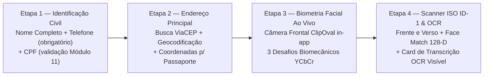

# Especificação do Onboarding Biométrico, Scanner Documental ISO ID-1 e Credenciamento KYC (Cliente e Profissional)

Este documento especifica a arquitetura de verificação de identidade civil, **Prova de Vida Facial Ativa (*Active Liveness Detection*)**, **Scanner Documental Guiado ISO/IEC 7810 ID-1**, **Face Match Multi-Ângulo 128-D** e **Credenciamento Profissional em 5 Etapas** do ecossistema **Desperrengue** (`v2.8.1`).

---

## 1. Arquitetura Unificada de Identidade Civil e Biometria (`public.profiles`)

No modelo relacional do **Desperrengue**, cada conta autenticada (`auth.users.id`) mapeia-se para uma única tupla em `public.profiles`. Essa decisão arquitetural garante que os atributos criptográficos e biométricos coletados no onboarding do **Usuário Cliente** sejam imediatamente compartilhados quando o mesmo titular ativa o **Modo Profissional**:

| Coluna em `public.profiles` | Tipo SQL | Restrição / Índice | Função Arquitetural e Antifraude |
| :--- | :--- | :--- | :--- |
| `cpf_hash` | `TEXT` | `UNIQUE` B-Tree parcial | Hash SHA-256 com *salt* de domínio do CPF validado por Módulo 11. Impede recriação de contas (*Ataque Sybil* — `RN-AF-14`) em $O(1)$. |
| `cpf_masked` | `TEXT` | `CHECK` formato `***.XXX.XXX-**` | Representação mascarada segura para exibição em tela e recibos auditados. |
| `face_liveness_hash` | `TEXT` | `UNIQUE` B-Tree parcial | Assinatura criptográfica do descritor facial L2-normalizado de 128 dimensões extraído durante a prova de vida ao vivo. |
| `client_kyc_verified` | `BOOLEAN` | `NOT NULL DEFAULT false` | Indica conclusão bem-sucedida da Prova de Vida Ao Vivo + Scanner Frente/Verso + Face Match $\ge 78\%$ + OCR. |
| `client_liveness_score` | `NUMERIC(5,2)` | `CHECK (0..100)` | Pontuação composta da prova de vida facial ativa ($\ge 80.0\%$). |
| `client_ocr_confidence` | `NUMERIC(5,2)` | `CHECK (0..100)` | Índice de confiança da transcrição OCR e compatibilidade nominal ($\ge 80.0\%$). |
| `relative_trust_score` | `NUMERIC(5,2)` | Materializado via Trigger | Recebe imediatamente $+30\text{ pontos}$ (`RN-MZ-02`) quando `client_kyc_verified = true` ou `verification_status = 'verified'`. |

---

## 2. Onboarding do Usuário Cliente em 4 Etapas (`ClientSetupScreen`)

Implementado em [`app/lib/features/client/presentation/client_setup_screen.dart`](../app/lib/features/client/presentation/client_setup_screen.dart) e [`app/lib/core/services/document_ocr_and_liveness_service.dart`](../app/lib/core/services/document_ocr_and_liveness_service.dart):

### 2.1. Etapa 1 e Etapa 2 — Identidade Civil e Localização Patrimonial
- **Etapa 1**: Coleta o nome civil completo ($\ge 2$ tokens), telefone celular obrigatório ($10$ ou $11$ dígitos) e CPF ($11$ dígitos validados pelo algoritmo oficial de dígitos verificadores Módulo 11, rejeitando sequências monotônicas).
- **Etapa 2**: Coleta o endereço completo com preenchimento automático por CEP (ViaCEP) e geolocalização reversa, vinculando o imóvel ao **Passaporte Oficial de Manutenção do Imóvel**.

### 2.2. Etapa 3 — Câmera Frontal Ao Vivo em Moldura Oval (`_LiveFrontOvalLivenessCameraModal`)
- **Bloqueio de Câmera Traseira e Galeria**: Inicializa exclusivamente o fluxo nativo da lente frontal (`CameraLensDirection.front` / WebRTC `facingMode: "user"`), renderizado no interior de um `ClipOval` com anel de progresso animado.
- **Execução Sequencial de 3 Desafios Biomecânicos Reais**:
  1. *Centralização Facial*: Posicionamento da face no centro geométrico da elipse com cobertura de pele $YCbCr \in [14\%, 82\%]$ e simetria bilateral $\ge 0.42$.
  2. *Rotação Cefálica Lateral*: Variação de luminância inter-frame $\Delta\text{Luma} \in [2.2, 48.0]$ que comprova tridimensionalidade e descarta fotografias estáticas.
  3. *Piscada Ativa e Nitidez Final*: Variância do operador Laplaciano $\sigma_{\text{Lap}}^2 \ge 95.0$ e filtro anti-monitor (`blueMonitorRatio < 0.25`), bloqueando capturas apontadas para monitores LCD/OLED (como telas de computador ou terceiros dispositivos).

### 2.3. Etapa 4 — Scanner Documental ISO/IEC 7810 ID-1, Face Match Multi-Ângulo e OCR Visível
- **Moldura Guiada (`DocumentGuidedScannerModal`)**: Apresenta janela retangular na proporção canônica `1.586 : 1` (padrão ISO/IEC 7810 ID-1 de RG, CNH e CIN) com cantoneiras néon e checklist pré-disparo.
- **Recorte Central de 12% (*Core ROI Inset*) e Diferenciação Frente/Verso**:
  - Remove $12\%$ das margens periféricas da imagem antes da extração de descritores, impedindo que a superfície de apoio (mesa/bancada) contamine o hash perceptual.
  - Exige divergência estrutural simultânea em três métricas entre Frente e Verso:
    $$\text{Hamming}(\text{dHash}_{\text{frente}}, \text{dHash}_{\text{verso}}) \ge 10\text{ bits}, \quad \text{MAD}_{64\times 64} \ge 0.055, \quad \Delta\sigma_{\text{quadrantes}}^2 \ge 0.040$$
- **Face Match Multi-Ângulo ($0^\circ, 90^\circ, 180^\circ, 270^\circ$) em Espaço 128-D Não-Negativo**:
  - Rotaciona o recorte da fotografia 3x4 do documento nos quatro ângulos ortogonais para compensar documentos fotografados na vertical ou invertidos, exigindo similaridade de cosseno:
    $$S_{\cos}(\mathbf{v}_{\text{selfie}}, \mathbf{v}_{\text{doc}}) = \max_{\theta \in \{0^\circ, 90^\circ, 180^\circ, 270^\circ\}} \left(\frac{\mathbf{v}_{\text{selfie}} \cdot \mathbf{v}_{\text{doc}}(\theta)}{\|\mathbf{v}_{\text{selfie}}\|_2 \, \|\mathbf{v}_{\text{doc}}(\theta)\|_2}\right) \ge 78.0\%$$
- **Card Visível de Transcrição Automática OCR (`_OcrTranscribedSummaryCard`)**:
  - Exibe na tela o **Nome Civil Transcrito**, **CPF Extraído**, **Número de Registro (RG/CNH)**, **Data de Nascimento** e os *badges* de **Similaridade Facial (%)** e **Compatibilidade Nominal ($\ge 80\%$)** antes de liberar o botão **"Concluir e Continuar"** (que invoca a RPC `submit_client_kyc_biometrics_and_ocr`).

---

## 3. Credenciamento Profissional em 5 Etapas (`verificacao_step1..5`)

Quando o usuário atua no **Modo Profissional**, o fluxo complementar de credenciamento técnico e bancário desenvolve-se nas telas [`app/lib/features/auth/presentation/`](../app/lib/features/auth/presentation/):

| Etapa | Arquivo de Implementação | Escopo Técnico e Regras de Negócio |
| :--- | :--- | :--- |
| **Passo 1 — Documento Frente** | [`verificacao_step1_frente.dart`](../app/lib/features/auth/presentation/verificacao_step1_frente.dart) | Captura guiada da frente do documento oficial com custódia no bucket privado `pro-verifications`. |
| **Passo 2 — Documento Verso** | [`verificacao_step2_verso.dart`](../app/lib/features/auth/presentation/verificacao_step2_verso.dart) | Captura guiada do verso do documento oficial e validação de certificações técnicas (**SENAI, CREA, CFT, NR-10, NR-35** — `RN-MZ-05`, concedendo $+15\text{ pts}$ imediatos no $RTS$). |
| **Passo 3 — Verificação Biométrica (Selfie)** | [`verificacao_step3_selfie.dart`](../app/lib/features/auth/presentation/verificacao_step3_selfie.dart) | Captura de selfie de segurança e validação de presença facial, aproveitando a assinatura `face_liveness_hash` caso o titular já tenha concluído o KYC no Modo Cliente. |
| **Passo 4 — Registro Profissional e PIX Same-Holder** | [`verificacao_step4_registro.dart`](../app/lib/features/auth/presentation/verificacao_step4_registro.dart) | Seleção das **33 categorias de serviço**, raio de atendimento geoespacial e chave PIX submetida à trava **Same-Holder Lock** (`pix_holder_cpf_hash = cpf_hash` — `RN-AF-14`). |
| **Passo 5 — Submissão Atômica e Status** | [`verificacao_step5_finalizacao.dart`](../app/lib/features/auth/presentation/verificacao_step5_finalizacao.dart) | Disparo da RPC `submit_professional_verification`, transição para `pending` / `verified` e recálculo imediato do $RTS$ e do `waterfall_tier_rank`. |

---

## 4. Segurança de Armazenamento (`pro-verifications` e `forensic-evidence`)

Os buckets `pro-verifications` e `forensic-evidence` operam com `public = false` no Supabase Storage. O acesso de escrita e leitura é governado por políticas RLS que exigem correspondência estrita entre o primeiro segmento do caminho do objeto e o identificador criptográfico da sessão (`(storage.foldername(name))[1] = auth.uid()::text`), garantindo isolamento completo entre usuários.
