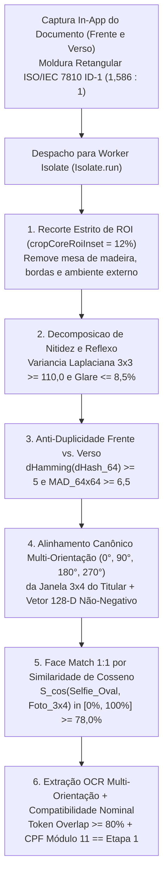

# Tratado de Onboarding Unificado (Cliente & Profissional), Biometria Facial Ao Vivo e OCR (`onboarding_profissional.md`)

Especificação técnico-científica da **Arquitetura de Identidade Civil Unificada Multi-Modo** (`public.profiles` + `public.kyc_submissions`) e formulação matemática completa dos **6 validadores forenses de Visão Computacional** executados em *Worker Isolates* no ecossistema **Desperrengue** (`v2.8.1+202611082`).

---

## 1. Arquitetura de Identidade Civil Unificada Multi-Modo (`+30 pts` imediatos no Score RTS)

Diferentemente de sistemas fragmentados que duplicam tabelas de usuários para clientes e prestadores, o **Desperrengue** unifica a identidade civil e biométrica na entidade [`public.profiles`](../supabase/migrations/20261108120000_client_kyc_biometrics_and_ocr.sql) (`id = auth.uid()`).

Quando um usuário conclui o onboarding como **Cliente** ([`client_setup_screen.dart`](../app/lib/features/client/presentation/client_setup_screen.dart)) e invoca a RPC `public.submit_client_kyc`, o banco de dados grava atomicamente:
- `cpf_hash` (`SHA-256` com *pepper* `DSP-CPF-PEPPER-2026`, índice único `idx_profiles_cpf_hash_unique`);
- `face_liveness_hash` (assinatura do descritor facial 128-D extraído ao vivo, índice `idx_profiles_face_liveness_hash`);
- `liveness_verified = TRUE`, `ocr_verified = TRUE`, `kyc_biometric_verified = TRUE` e `pix_key_cpf_matched = TRUE`.

Consequentemente, quando esse mesmo titular ativa o **Modo Profissional** ([`verificacao_step1_frente.dart`](../app/lib/features/auth/presentation/verificacao_step1_frente.dart) a [`verificacao_step5_finalizacao.dart`](../app/lib/features/auth/presentation/verificacao_step5_finalizacao.dart)), a trigger `BEFORE INSERT OR UPDATE` `trg_sync_profile_trust_and_rank` reutiliza instantaneamente sua validação civil e biométrica, concedendo-lhe **na hora os $+30,0\text{ pontos}$ de $P_{\text{KYC}}$ no *Relative Trust Score* ($RTS$)** e exigindo apenas a complementação de suas especialidades técnicas (dentre as 33 categorias), raio de atendimento e credenciais profissionais (**MEI/CNPJ** e certificações **SENAI, CREA, CFT, NR-10, NR-35**).

---

## 2. Máquina de Estados dos 3 Desafios Físicos da Prova de Vida Ao Vivo (`ActiveLivenessStep`)

```mermaid
stateDiagram-v2
    direction LR
    [*] --> centerFaceInOval : Inicializa Camera Frontal (facingMode: user)
    centerFaceInOval --> blinkBothEyesSlowly : Pele YCbCr in [22%, 82%] & blueMonitorRatio < 0,25 & Centro <= 0,17
    blinkBothEyesSlowly --> turnHeadRight : Queda Ocular EAR < 0,18 seguida de Retorno EAR > 0,25
    turnHeadRight --> returnHeadToCenterAndCapture : Rotacao 3D |Yaw| >= 18,0 graus
    returnHeadToCenterAndCapture --> completed : Retorno |Yaw| <= 6,0 graus & Disparo Automatico SHA-256
    completed --> [*]
```



### 2.1. Blueprint Antropométrico da Câmera Frontal Ao Vivo na Moldura Oval

```text
┌──────────────────────────────────────────────────────────────────────────────────────────┐
│ VIEWFINDER DE CÂMERA FRONTAL AO VIVO (WEB WEBRTC FACINGMODE: USER / MOBILE FRONT LENS)   │
│                                                                                          │
│                        ╭──────────────────────────────╮                                  │
│                    ╭───╯   ZONA DE TOPOLOGIA FACIAL   ╰───╮                              │
│                  ╭─╯   Crominância Pele YCbCr: 22%–82%    ╰─╮                            │
│                  │                                          │                            │
│                  │       p2  p3                p2  p3       │                            │
│                  │    p1 ( ● ) p4   │Ponte│ p1 ( ● ) p4     │ ◄── Razão Ocular (EAR)     │
│                  │       p6  p5     │Nasal│    p6  p5       │     Piscada: EAR < 0,18    │
│                  │                     ▼                    │     Retorno: EAR > 0,25    │
│                  │            ◄─── Eixo Yaw (θ_y) ───►      │                            │
│                  │             Desafio: θ_y ≥ +18,0°        │ ◄── Rotação 3D (Yaw)       │
│                  ╰─╮           Retorno: |θ_y| ≤ 6,0°      ╭─╯                            │
│                    ╰───╮     Luminância: 42 ≤ L ≤ 230 ╭───╯                              │
│                        ╰──────────────────────────────╯                                  │
│                                                                                          │
│ ▶ Bloqueio Anti-Monitor/Parede: Sem crominância epidérmica YCbCr + simetria = 0% avanço  │
│ ▶ Captura Automática no Retorno ao Centro ⇒ Assinatura Criptográfica DSP-LIVE-SHA256     │
└──────────────────────────────────────────────────────────────────────────────────────────┘
```

---

## 3. Pipeline Forense em `Isolate.run` e Blueprint do Scanner ISO/IEC 7810 ID-1



### 3.1. Blueprint Geométrico do Scanner Documental ISO/IEC 7810 ID-1 com *Core Inset* de 12%

```text
┌──────────────────────────────────────────────────────────────────────────────────────────┐
│ CÂMERA TRASEIRA IN-APP (AMBIENTE EXTERNO DESCARTADO: MESA DE MADEIRA / MONITOR / BORDAS) │
│  ╔════════════════════════════════════════════════════════════════════════════════════╗  │
│  ║ MOLDURA RETANGULAR VAZADA ISO/IEC 7810 ID-1 (STRICT ROI CROP - PROPORÇÃO 1,58)     ║  │
│  ║  ┌ ─ ─ ─ ─ ─ ─ ─ ─ ─ ─ ─ ─ ─ ─ ─ ─ ─ ─ ─ ─ ─ ─ ─ ─ ─ ─ ─ ─ ─ ─ ─ ─ ─ ─ ─ ─ ─ ─ ─ ┐ ║  │
│  ║  │ CORE INSET DE SEGURANÇA (12% DE MARGEM INTERNA PARA CÁLCULO DHASH + MAD)      │ ║  │
│  ║  │  ┌──────────────┐   REPÚBLICA FEDERATIVA DO BRASIL - SENATRAN / DETRAN / SSP  │ ║  │
│  ║  │  │   FOTO 3×4   │   NOME CIVIL: [EXTRAÍDO VIA OCR MULTI-ORIENTAÇÃO]           │ ║  │
│  ║  │  │  DO TITULAR  │   DOC IDENTIDADE / ÓRGÃO EMISSOR / UF                       │ ║  │
│  ║  │  │  (64×64 LBP  │   CPF: ###.###.###-## (VALIDADO MÓDULO 11 == ETAPA 1)       │ ║  │
│  ║  │  │   + CLAHE)   │   DATA NASCIMENTO: DD/MM/AAAA      Nº REGISTRO CNH          │ ║  │
│  ║  │  └──────────────┘                                                             │ ║  │
│  ║  │  [DETECÇÃO E ROTAÇÃO CANÔNICA AUTOMÁTICA: 0° | 90° | 180° | 270°]             │ ║  │
│  ║  └ ─ ─ ─ ─ ─ ─ ─ ─ ─ ─ ─ ─ ─ ─ ─ ─ ─ ─ ─ ─ ─ ─ ─ ─ ─ ─ ─ ─ ─ ─ ─ ─ ─ ─ ─ ─ ─ ─ ─ ┘ ║  │
│  ╚════════════════════════════════════════════════════════════════════════════════════╝  │
│ ▶ Regra Anti-Falso-Positivo: Duplicidade Frente×Verso exige dHamming(dHash) ≤ 2 E MAD<6,5│
│ ▶ Regra Face Match 1:1: Vetor 128-D Não-Negativo (A_k ≥ 0, B_k ≥ 0) ⇒ S_cos ∈ [0%, 100%] │
└──────────────────────────────────────────────────────────────────────────────────────────┘
```

---

## 4. Formulação Matemática dos 6 Validadores Forenses ([`document_ocr_and_liveness_service.dart`](../app/lib/core/services/document_ocr_and_liveness_service.dart))

### 4.1. Validador 1 — Algoritmo Aritmético Módulo 11 de CPF (`validateCpfMod11` / `public.is_valid_cpf`)
Dado um vetor de 11 dígitos decimais $d_1 d_2 \dots d_{11}$ (não-monotônico, isto é, $\exists i, j : d_i \neq d_j$), os dígitos verificadores $d_{10}$ e $d_{11}$ são validados em $O(1)$ por:

$$d_{10} = \left[\left(10 \sum_{i=1}^{9} d_i \cdot (11 - i)\right) \bmod 11\right] \bmod 10, \qquad d_{11} = \left[\left(10 \sum_{i=1}^{10} d_i \cdot (12 - i)\right) \bmod 11\right] \bmod 10$$

### 4.2. Validador 2 — Segmentação Epidérmica no Espaço $YCbCr$ e Filtro Anti-Monitor
Para cada pixel $(R, G, B)$ no interior da elipse de prova de vida $(x - c_x)^2/a^2 + (y - c_y)^2/b^2 \le 1$, projeta-se o vetor no espaço de luminância-crominância:

$$Y = 0,299 R + 0,587 G + 0,114 B, \quad Cb = 128 - 0,168736 R - 0,331264 G + 0,5 B, \quad Cr = 128 + 0,5 R - 0,418688 G - 0,081312 B$$

Um pixel pertence à máscara epidérmica humana se, e somente se, $77 \le Cb \le 127$ e $133 \le Cr \le 173$, exigindo-se razão de preenchimento $\text{skinFillRatio} \in [0,22,\; 0,82]$ e ausência de emissão espectral de painel LCD/OLED ($\text{blueMonitorRatio} < 0,25$).

### 4.3. Validador 3 — Razão de Aspecto Ocular ($\text{EAR}$) e Ângulo de Euler $\text{Yaw}$ ($\theta_y$)
A dinâmica de piscada bilateral aferida sobre os 6 marcos perioculares $(p_1, \dots, p_6)$ e a rotação horizontal $\theta_y$ sobre o deslocamento do centroide facial em relação à ponte nasal obedecem a:

$$\text{EAR} = \frac{\|p_2 - p_6\|_2 + \|p_3 - p_5\|_2}{2 \cdot \|p_1 - p_4\|_2}, \qquad \theta_y = \arcsin\left(\text{clamp}_{[-1, 1]}\left(\frac{\Delta x_{\text{nariz-centro}}}{R_{\text{elipse}}}\right)\right) \cdot \frac{180^\circ}{\pi}$$

### 4.4. Validador 4 — Variância do Operador Laplaciano Discreto $3 \times 3$ ($\sigma_{\text{Lap}}^2$)
A nitidez óptica da captura documental é calculada pela variância espacial da convolução $L(x, y) = (I * K_{\text{Lap}})(x, y)$:

$$L(x, y) = I(x-1, y) + I(x+1, y) + I(x, y-1) + I(x, y+1) - 4\,I(x, y), \qquad \sigma_{\text{Lap}}^2 = \frac{1}{|\Omega|} \sum_{(x,y)\in\Omega} \big(L(x, y) - \mu_L\big)^2 \ge 110,0$$

### 4.5. Validador 5 — `dHash` de 64 Bits e Diferença Absoluta Média ($\text{MAD}_{64\times 64}$) sobre ROI 12%
Após aplicar `PerceptualHashGuard.cropCoreRoiInset(source, insetRatio: 0.12)`, computam-se o hash de gradiente horizontal $9 \times 8$ (`dHash`) e a Diferença Absoluta Média sobre grade normalizada $64 \times 64$:

$$\text{dHash}_{64} = \sum_{y=0}^{7}\sum_{x=0}^{7} \mathbb{I}\big(I_{9\times 8}(x, y) > I_{9\times 8}(x+1, y)\big) \cdot 2^{8y + x}, \qquad \text{MAD}_{64\times 64}(A, B) = \frac{1}{4096}\sum_{u=0}^{63}\sum_{v=0}^{63} \big|I_A(u,v) - I_B(u,v)\big|$$

### 4.6. Validador 6 — Face Match 1:1 Multi-Orientação no 1º Ortante ($\mathbb{R}_{\ge 0}^{128}$) e Compatibilidade Nominal
Para garantir invariância rotacional quando o usuário fotografa a CNH na vertical ou na horizontal, o recorte da foto $3\times 4$ é avaliado nas quatro rotações canônicas $\theta \in \{0^\circ, 90^\circ, 180^\circ, 270^\circ\}$. Como todas as componentes dos vetores de características $\mathbf{A}, \mathbf{B}(\theta) \in \mathbb{R}_{\ge 0}^{128}$ são estritamente não-negativas ($A_k \ge 0, B_k \ge 0$), o produto interno é sempre não-negativo e a similaridade de cosseno pertence matematicamente ao intervalo fechado $[0\%, 100\%]$:

$$S_{\cos}(\mathbf{A}, \mathbf{B}) = \max_{\theta \in \{0^\circ, 90^\circ, 180^\circ, 270^\circ\}} \left( \frac{\sum_{k=1}^{128} A_k \cdot B_k(\theta)}{\sqrt{\sum_{k=1}^{128} A_k^2} \cdot \sqrt{\sum_{k=1}^{128} B_k(\theta)^2}} \right) \times 100\% \ge 78,0\%$$
