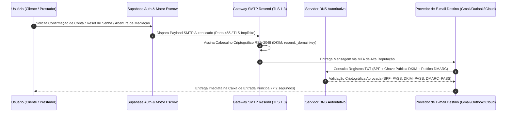

# Arquitetura de Mensageria Transacional, Criptografia DNS (DKIM/SPF/DMARC) e Integração SMTP — Desperrengue (`v2.8.1`)

> **Classificação Epistemológica:** Especificação de Infraestrutura de Rede, Autenticação Criptográfica de Correio Eletrônico e Entrega Determinística de Notificações Críticas  
> **Protocolos Normativos:** RFC 5321 (SMTP) · RFC 6376 (DKIM) · RFC 7208 (SPF) · RFC 7489 (DMARC)  
> **Escopo no Ecossistema:** Autenticação Supabase GoTrue (OTP / Magic Links / Recuperação de Credenciais) e Alertas Transacionais de Custódia e Mediação (`SLA 24h`)

---

## 1. Papel Arquitetural da Mensageria Autenticada em Operações Fintech

Em um ecossistema transacional com custódia financeira condicional (*Smart Escrow*) e janelas temporais estritas de contestação ($24\text{h}$), a entrega confiável e à prova de falsificação (*anti-spoofing*) de mensagens eletrônicas constitui um requisito crítico de segurança. O provedor SMTP nativo compartilhado de ambientes de desenvolvimento possui severas limitações de *rate limit* ($\le 3\text{ e-mails/hora}$) e reputação de IP, sendo inadequado para operação real.

Para garantir entregabilidade superior a $99,5\%$ diretamente na caixa de entrada principal (*Primary Inbox*) e impedir ataques de *phishing* em nome da plataforma, o **Desperrengue** integra o motor transacional do **Supabase Auth (GoTrue)** a uma infraestrutura dedicada **Resend SMTP** sob domínio próprio autenticado criptograficamente via **DKIM**, **SPF** e **DMARC**.



---

## 2. Especificação Criptográfica dos Registros DNS (Zona Autoritativa)

A blindagem do domínio institucional contra falsificação de remetente (*Email Spoofing*) fundamenta-se em três protocolos complementares configurados na zona DNS autoritativa (Cloudflare / Registro.br):

| Protocolo | Tipo de Registro | Nome (Host) | Valor / Especificação Técnica | Função Criptográfica e de Segurança |
| :--- | :---: | :--- | :--- | :--- |
| **DKIM** (*DomainKeys Identified Mail*) | `TXT` | `resend._domainkey` | `p=MIGfMA0GCSqGSIb3DQEBAQUAA4...` (Chave Pública RSA 2048-bit) | Garante a **integridade do conteúdo** e a **autenticidade da origem**: o servidor destinatário verifica a assinatura digital do cabeçalho usando a chave pública publicada no DNS. |
| **SPF** (*Sender Policy Framework*) | `TXT` | `send` (ou `@`) | `v=spf1 include:amazonses.com ~all` | Define a **lista branca de endereços IP e *gateways* autorizados** a disparar pacotes SMTP em nome do subdomínio de envio. |
| **MX** (*Bounce Handling*) | `MX` | `send` | `feedback-smtp.sa-east-1.amazonses.com` (Prioridade `10`) | Canal de retorno para telemetria automática de *hard bounces* (endereços inexistentes) e proteção da reputação do domínio. |
| **DMARC** (*Domain-based Message Authentication*) | `TXT` | `_dmarc` | `v=DMARC1; p=quarantine; pct=100; adkim=s; aspf=s` | Impõe política estrita de alinhamento (`adkim=s`, `aspf=s`), determinando que qualquer mensagem que falhe na verificação DKIM ou SPF seja neutralizada. |

---

## 3. Parâmetros de Acoplamento SMTP no Cluster Supabase

A integração entre o módulo `auth` do Supabase e o *gateway* Resend é parametrizada sob criptografia explícita:

```
┌──────────────────────────────────────────────────────────────────────────────┐
│            PARÂMETROS DE ACOPLAMENTO SMTP DEDICADO (SUPABASE AUTH)           │
├───────────────────────────────────┬──────────────────────────────────────────┤
│ Parâmetro de Configuração         │ Valor Normativo de Produção              │
├───────────────────────────────────┼──────────────────────────────────────────┤
│ Host do Servidor SMTP             │ smtp.resend.com                          │
│ Porta de Transporte Seguro        │ 465 (TLS Implícito) ou 587 (STARTTLS)    │
│ Usuário de Autenticação SMTP      │ resend                                   │
│ Credencial (Password / Token)     │ re_******************************** (API)│
│ Endereço de Remetente (Sender)    │ nao-responda@<dominio-autenticado>       │
│ Nome Institucional de Exibição    │ Desperrengue Segurança & Custódia        │
│ Intervalo Mínimo por Usuário      │ 60 segundos (Proteção Anti-Flood OTP)    │
└───────────────────────────────────┴──────────────────────────────────────────┘
```

---

## 4. Eventos Críticos Governados pela Infraestrutura de Mensageria

1. **Verificação de Identidade e Credenciais (GoTrue Auth):** Emissão de links de confirmação de cadastro, códigos OTP de 6 dígitos e recuperação segura de senha.
2. **Notificações de Custódia e Janela de Garantia ($24\text{h}$):** Aviso imediato ao cliente quando o prestador registra a conclusão do serviço com fotos `Before/After` validadas por `dHash`, iniciando a contagem do prazo de $24\text{h}$ ou aprovação via PIN de 4 dígitos.
3. **Alertas de SLA de Mediação (`RN-CAM-01` a `RN-CAM-03`):** Notificação prioritária ao prestador original sobre abertura de contestação na 4ª aba **"Em Mediação"**, informando o prazo fatal para reparo amigável antes do acionamento da Camada 3 e inscrição em *Clawback*.
