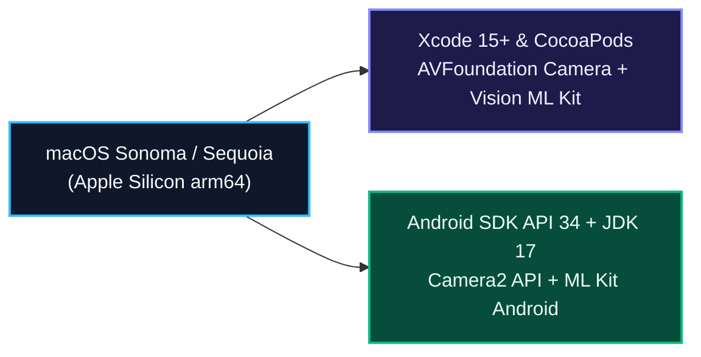

# Guia Normativo de Provisionamento em Ambiente Apple macOS — Desperrengue (`v2.8.1`)

> **Classificação Epistemológica:** Procedimento Técnico de Configuração de *Toolchain* em Apple macOS (Apple Silicon `M1/M2/M3/M4` e Intel `x86_64`) para Compilação iOS e Android  
> **Documento Pai:** [`docs/SETUP.md`](../SETUP.md)

---

## 1. Arquitetura de Compilação Cruzada (iOS + Android) no macOS

Estações de trabalho baseadas em **Apple macOS** constituem o ambiente homologado para compilação simultânea de binários **iOS (`.ipa` via Xcode / CocoaPods)** e **Android (`.aab` / `.apk` via Gradle)**, além do empacotamento **Web PWA**.



---

## 2. Provisionamento de Dependências via Homebrew e Xcode

```bash
# 1. Instalar ferramentas de linha de comando do Xcode e aceitar licença
xcode-select --install
sudo xcodebuild -license accept
sudo xcode-select --switch /Applications/Xcode.app/Contents/Developer
sudo xcodebuild -runFirstLaunch

# 2. Instalar CocoaPods, OpenJDK 17 e Node.js LTS via Homebrew
brew install cocoapods openjdk@17 node
```

---

## 3. Configuração de Permissões Nativas iOS (`Info.plist`)

Para execução dos módulos de **Prova de Vida Biométrica em Câmera Frontal Ao Vivo**, **Scanner Guiado ISO ID-1**, **Podagem Geoespacial** e **Ditado por Voz** em dispositivos iPhone, o arquivo `ios/Runner/Info.plist` declara as chaves obrigatórias da Apple:

* `NSCameraUsageDescription`: Necessária para renderização ao vivo da câmera frontal no visor oval de Liveness e captura de documentos CNH/RG e fotos `Before/After`.
* `NSLocationWhenInUseUsageDescription`: Necessária para localização do imóvel e despacho geoespacial de prestadores próximos.
* `NSMicrophoneUsageDescription` e `NSSpeechRecognitionUsageDescription`: Necessárias para transcrição de voz na abertura de chamados de emergência.

---

## 4. Instalação de Pods e Execução da Suíte de Verificação

```bash
# 1. Resolver pacotes Dart e dependências nativas iOS (CocoaPods)
cd app
flutter pub get
cd ios && pod install --repo-update && cd ..

# 2. Executar análise estática e os 529 testes automatizados
flutter analyze
flutter test

# 3. Validar suíte Node.js de PDF (17 testes) e integridade de links Markdown
cd ..
node scripts/test-dossie.mjs
node scripts/check-md-links.mjs
```
