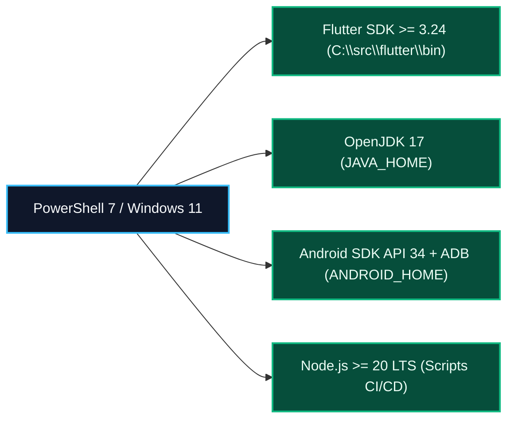

# Guia Normativo de Provisionamento em Ambiente Microsoft Windows — Desperrengue (`v2.8.1`)

> **Classificação Epistemológica:** Procedimento Técnico de Configuração de *Toolchain* de Compilação em Windows 10/11 (`x86_64`)  
> **Documento Pai:** [`docs/SETUP.md`](../SETUP.md)

---

## 1. Arquitetura da Toolchain no Sistema Operacional Windows

A compilação local do aplicativo **Desperrengue** em estações Microsoft Windows 10/11 requer a integração entre o **Flutter SDK**, o **Android SDK / NDK** (via Android Studio ou *Command-Line Tools*), o **Java Development Kit 17 (JDK 17)** e o runtime **Node.js 20 LTS** para execução das suítes de auditoria documental e PDF.



---

## 2. Configuração de Variáveis de Ambiente do Sistema

No painel de Variáveis de Ambiente do Windows (ou via PowerShell administrativo), definem-se os seguintes caminhos canônicos:

| Variável de Sistema | Caminho Padrão Recomendado | Finalidade Técnica |
| :--- | :--- | :--- |
| `JAVA_HOME` | `C:\Program Files\Android\Android Studio\jbr` (ou JDK 17 isolado) | Execução do daemon Gradle e assinatura `apksigner`. |
| `ANDROID_HOME` | `C:\Users\<Usuario>\AppData\Local\Android\Sdk` | Localização de `platform-tools` (`adb`), `build-tools` e imagens Android. |
| `Path` (Adições) | `%FLUTTER_ROOT%\bin`, `%ANDROID_HOME%\platform-tools`, `%JAVA_HOME%\bin` | Acesso global aos binários `flutter`, `dart`, `adb` e `java`. |

---

## 3. Sequência Determinística de Inicialização e Verificação (PowerShell)

```powershell
# 1. Aceitar licenças do Android SDK e verificar integridade do ambiente
flutter doctor --android-licenses
flutter doctor -v

# 2. Instalar dependências do pacote Flutter
Set-Location -Path "C:\00_Desperrengue\app"
flutter pub get

# 3. Executar análise estática e suíte completa de 529 testes
flutter analyze
flutter test

# 4. Retornar à raiz e validar motor de PDF (17 testes) e hiperlinks Markdown
Set-Location -Path "C:\00_Desperrengue"
node scripts/test-dossie.mjs
node scripts/check-md-links.mjs
```

---

## 4. Depuração em Aparelho Android Físico via USB / Wi-Fi (ADB)

Para homologar os módulos de **Prova de Vida em Câmera Frontal Ao Vivo** e **Scanner Guiado ISO ID-1** em hardware real (ex.: dispositivos Samsung Galaxy com *One UI*):

1. Habilitar as **Opções do Desenvolvedor** e a **Depuração USB** no dispositivo Android.
2. Conectar o aparelho à estação Windows e verificar o reconhecimento via `adb devices`.
3. Executar a compilação com injeção explícita das variáveis do projeto Supabase:

```powershell
Set-Location -Path "C:\00_Desperrengue\app"
flutter run --release `
  --dart-define=SUPABASE_URL=https://seu-projeto.supabase.co `
  --dart-define=SUPABASE_ANON_KEY=sua-chave-anon-jwt
```
