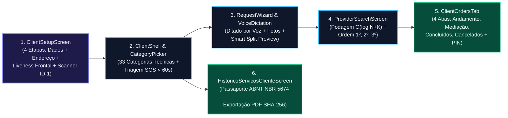

# Especificação Analítica das Interfaces do Módulo Cliente — Desperrengue (`v2.8.1`)

> **Classificação Epistemológica:** Especificação Formal de Engenharia de Interface Humano-Computador (IHC), Máquinas de Estado de Tela e Contratos de Dados do Módulo Cliente  
> **Documento Pai:** [`docs/Projeto de Interface.md`](../Projeto%20de%20Interface.md)  
> **Implementação Auditada:** [`client_setup_screen.dart`](../../app/lib/features/client/presentation/client_setup_screen.dart) · [`historico_servicos_cliente_screen.dart`](../../app/lib/features/client/presentation/historico_servicos_cliente_screen.dart) · [`fintech_warranty_widgets.dart`](../../app/lib/features/shared/presentation/fintech_warranty_widgets.dart)

---

## 1. Fluxograma de Navegação e Estados do Módulo Cliente

---

## 2. Catálogo Técnico das Telas do Módulo Cliente

### 2.1. Tela de Onboarding e Verificação Biométrica (`ClientSetupScreen`)
* **Arquivo de Implementação:** [`app/lib/features/client/presentation/client_setup_screen.dart`](../../app/lib/features/client/presentation/client_setup_screen.dart)
* **Arquitetura Funcional em 4 Etapas Sequenciais:**
  1. **Etapa 1 — Identificação Civil (`_currentStep == 0`):** Campos obrigatórios de Nome Completo, Telefone Móvel com máscara `(DD) 9XXXX-XXXX` (não opcional) e CPF validado em tempo real pelo algoritmo algébrico Módulo 11.
  2. **Etapa 2 — Endereço de Atendimento (`_currentStep == 1`):** Consulta automática de CEP com autopreenchimento de logradouro/bairro/cidade e persistência no histórico de endereços.
  3. **Etapa 3 — Prova de Vida Biométrica em Câmera Frontal Ao Vivo (`_currentStep == 2`):** Visor nativo *in-app* (`CameraLensDirection.front`) com máscara oval antropométrica que exige a execução sequencial de **3 desafios físicos reais** (*Olhe de frente*, *Vire à direita/esquerda*, *Pisque os olhos*), rejeitando fotos de telas de computador ou ambientes sem rosto humano ($YCbCr \ge 0,12$ e Laplaciano $\ge 18,0$).
  4. **Etapa 4 — Scanner Guiado ISO/IEC 7810 ID-1 e Transcrição OCR (`_currentStep == 3`):** Visor retangular dedicado na proporção oficial $85,60 \times 53,98\text{ mm}$ para captura de **Frente** e **Verso** de CNH ou RG (na horizontal ou vertical via rotação automática $0^\circ..270^\circ$), cálculo de `dHash + MAD` sobre ROI central ($80\%$), **Face Match 128-D ($\ge 68\%$)** e exibição em tela do card **"Dados Extraídos do Documento (OCR Automatico)"**.

### 2.2. Tela Inicial e Catálogo de 33 Categorias (`ClientShell` e `CategoryPicker`)
* **Arquivos de Implementação:** [`app/lib/features/client/presentation/client_shell.dart`](../../app/lib/features/client/presentation/client_shell.dart) e [`app/lib/features/client/presentation/category_picker.dart`](../../app/lib/features/client/presentation/category_picker.dart)
* **Especificação Técnica:** Apresenta barra de busca semântica com palavras-chave de triagem, seletor rápido de endereço auditado, botão de emergência **SOS (`< 60s`)** e grade responsiva das **33 categorias técnicas residenciais**.

### 2.3. Abertura Assistida por Voz (`RequestWizard` / `VoiceDictation`) e Busca Geoespacial Ordenada (`1º, 2º, 3º`)
* **Arquivos de Implementação:** [`app/lib/features/client/presentation/request_wizard.dart`](../../app/lib/features/client/presentation/request_wizard.dart), [`app/lib/features/client/presentation/voice_dictation.dart`](../../app/lib/features/client/presentation/voice_dictation.dart) e [`app/lib/features/client/presentation/provider_search_screen.dart`](../../app/lib/features/client/presentation/provider_search_screen.dart)
* **Especificação Técnica:** Permite descrever o problema via microfone nativo (*Speech-to-Text*), anexar evidências iniciais e acompanhar em tempo real no mapa os profissionais filtrados pela podagem axial $O(\log N + K)$, identificados por marcadores numerados em ordem estrita de prioridade (**`1º`**, **`2º`**, **`3º`**) segundo o *Tiered Waterfall* (`waterfall_tier_rank`).

### 2.4. Gestão de Pedidos, Modal de PIN de 4 Dígitos e 4ª Aba *"Em Mediação"* (`ClientOrdersTab`)
* **Arquivos de Implementação:** [`app/lib/features/client/presentation/client_orders_tab.dart`](../../app/lib/features/client/presentation/client_orders_tab.dart) e [`app/lib/features/shared/presentation/fintech_warranty_widgets.dart`](../../app/lib/features/shared/presentation/fintech_warranty_widgets.dart)
* **Especificação Técnica:**
  * Exibe o **PIN Presencial de 4 Dígitos** para liberação imediata do *Smart Escrow* mediante vistoria física aprovada, garante ao cliente titular (`ownerFull`) visualização integral do endereço completo e do mapa exato em tela cheia (`OrderLiveMapModalScreen` a $100\%$ da viewport) em qualquer fase do pedido, e aplica decremento otimista em $O(1)$ ($0\text{ ms}$) nos badges de pedidos não lidos via [`unread_orders_badge_controller.dart`](../../app/lib/core/state/unread_orders_badge_controller.dart);
  * Integra a **4ª Aba "Em Mediação"**, equipada com o widget `ForensicSplitViewComparator` (comparação tripla lado a lado: `ANTES | DEPOIS | EVIDÊNCIA DA RECLAMAÇÃO`), cronômetro regressivo de SLA ($24\text{h}$) e acionamento autônomo da **Camada 3 (Retrabalho Gratuito por Novo Profissional)**.

### 2.5. Passaporte Oficial de Manutenção do Imóvel (`HistoricoServicosClienteScreen`)
* **Arquivos de Implementação:** [`app/lib/features/client/presentation/historico_servicos_cliente_screen.dart`](../../app/lib/features/client/presentation/historico_servicos_cliente_screen.dart) e [`app/lib/core/services/desperrengue_official_pdf_service.dart`](../../app/lib/core/services/desperrengue_official_pdf_service.dart)
* **Especificação Técnica:**
  * **Política Estrita de Zero Dados Fictícios (*Zero Fake Data*):** Quando o cliente ainda não possui manutenções registradas, exibe uma jornada educativa animada detalhando os benefícios patrimoniais do prontuário;
  * Consolida apenas serviços reais concluídos ou auditados pelo titular, calcula o *Score de Vistoria* ($0\text{–}100$), segrega o investimento em **Mão de Obra** vs. **Peças com Nota ($0\%$ taxa)** e exporta o laudo PDF vetorial em conformidade com a norma **ABNT NBR 5674** com selo criptográfico SHA-256 (`DSP-PASS-*`).
