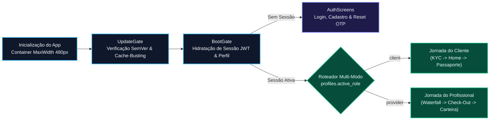

# Especificação Analítica das Interfaces Compartilhadas e Guardas de Sessão — Desperrengue (`v2.8.1`)

> **Classificação Epistemológica:** Especificação Formal de Componentes Transversais, Guardas de Inicialização (`BootGate` / `UpdateGate`), Autenticação e Alternância de Papel Multi-Modo  
> **Documento Pai:** [`docs/Projeto de Interface.md`](../Projeto%20de%20Interface.md)  
> **Implementação Auditada:** [`main.dart`](../../app/lib/main.dart) · [`fintech_warranty_widgets.dart`](../../app/lib/features/shared/presentation/fintech_warranty_widgets.dart)

---

## 1. Arquitetura do Container Responsivo (`480px`) e Guardas de Inicialização

Todas as telas do **Desperrengue** são encapsuladas pela árvore raiz definida em [`app/lib/main.dart`](../../app/lib/main.dart), que impõe o **Container Responsivo de `480px`** (garantindo geometria mobile idêntica em navegadores Desktop/PWA e aparelhos Android/iOS) e executa duas guardas determinísticas antes de renderizar a jornada de negócio:

---

## 2. Catálogo Técnico das Interfaces Compartilhadas

### 2.1. Guarda de Atualização Obrigatória (`UpdateGate`)
* **Arquivo de Teste Associado:** [`app/test/update_test.dart`](../../app/test/update_test.dart)
* **Especificação Técnica:** Compara a versão semântica compilada no binário local (`2.8.1+49`) com a política mínima publicada pelo servidor. Caso detecte versão obsoleta ou *service worker* desatualizado no PWA, exibe tela bloqueante orientando a atualização imediata, prevenindo incompatibilidades de contrato com as RPCs de *Smart Escrow*.

### 2.2. Guarda de Inicialização e Roteamento (`BootGate`)
* **Arquivo de Teste Associado:** [`app/test/offboarding_boot_theme_test.dart`](../../app/test/offboarding_boot_theme_test.dart)
* **Especificação Técnica:** Gerencia a transição suave da *splash screen* (com a animação vetorial da casa residencial), restaura o token JWT do Supabase Auth e inspeciona o estado de completude do perfil (`kyc_status` e `active_role`), encaminhando o usuário sem piscadas de tela (*zero layout shift*).

### 2.3. Telas de Autenticação e Recuperação Criptográfica (`AuthScreens`)
* **Arquivo de Teste Associado:** [`app/test/account_screens_test.dart`](../../app/test/account_screens_test.dart)
* **Especificação Técnica:** Implementam login por e-mail/senha, criação de conta com validação de entropia de credencial, confirmação via código OTP/link autenticado via gateway SMTP Resend (`DKIM`/`SPF`/`DMARC`) e tradução determinística de erros de rede ou credenciais.

### 2.4. Central de Perfil Unificada, Alternância Multi-Modo e Exclusão Segura LGPD
* **Arquivos de Teste Associados:** [`app/test/user_profile_test.dart`](../../app/test/user_profile_test.dart) e [`app/test/account_screens_test.dart`](../../app/test/account_screens_test.dart)
* **Especificação Técnica:**
  * **Sincronização de Avatar e Identidade:** A foto de perfil, o selo de **Identidade Verificada (`kyc_status = 'verified'`)** e os $+30\text{ pontos}$ de reputação base são compartilhados instantaneamente entre os modos;
  * **Chaveamento Atômico Cliente $\leftrightarrow$ Profissional:** Permite alternar o papel ativo (`active_role`) em um único toque, preservando a mesma sessão `auth.uid()`;
  * **Autoatendimento de Exclusão de Conta (LGPD, Art. 18):** Inclui modal de confirmação com trava de segurança que invoca a RPC `delete_own_account_scoped`, expurgando dados pessoais e arquivos privados do titular.
