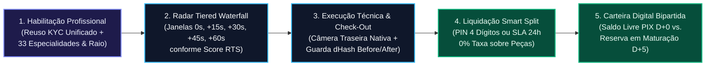

# Especificação Analítica das Interfaces do Módulo Profissional — Desperrengue (`v2.8.1`)

> **Classificação Epistemológica:** Especificação Formal de Engenharia de Interface Humano-Computador (IHC), Fluxos de Execução Técnica e Carteira Digital Bipartida do Módulo Profissional  
> **Documento Pai:** [`docs/Projeto de Interface.md`](../Projeto%20de%20Interface.md)  
> **Implementação Auditada:** [`provider_shell.dart`](../../app/lib/features/provider/presentation/provider_shell.dart) · [`provider_execution_screens.dart`](../../app/lib/features/provider/presentation/provider_execution_screens.dart) · [`perceptual_hash_guard.dart`](../../app/lib/core/security/perceptual_hash_guard.dart) · [`fintech_warranty_widgets.dart`](../../app/lib/features/shared/presentation/fintech_warranty_widgets.dart)

---

## 1. Fluxograma Operacional do Módulo Profissional

---

## 2. Catálogo Técnico das Telas do Módulo Profissional

### 2.1. Credenciamento Unificado e Seleção das 33 Especialidades (`provider_setup_screens.dart`)
* **Arquivo de Implementação:** [`app/lib/features/provider/presentation/provider_setup_screens.dart`](../../app/lib/features/provider/presentation/provider_setup_screens.dart)
* **Arquitetura de Identidade Civil Unificada:** Caso o usuário já tenha concluído a **Prova de Vida Biométrica Ativa** e o **Scanner ISO ID-1 com OCR** no modo Cliente (`kyc_status = 'verified'`), o sistema reutiliza automaticamente sua certificação civil e os $+30\text{ pontos}$ do $RTS$, solicitando apenas a seleção das especialidades técnicas dentre as **33 categorias** e o raio de atuação geoespacial. Caso inicie diretamente como profissional, executa o mesmo pipeline forense *on-device*.

### 2.2. Painel de Operações, Radar *Tiered Waterfall* e Trava Temporal de Privacidade Geográfica (`ProviderShell` / `ProviderJobScreen`)
* **Arquivos de Implementação:** [`app/lib/features/provider/presentation/provider_shell.dart`](../../app/lib/features/provider/presentation/provider_shell.dart), [`app/lib/features/provider/presentation/provider_job_screen.dart`](../../app/lib/features/provider/presentation/provider_job_screen.dart) e [`app/lib/core/security/geo_privacy_policy_engine.dart`](../../app/lib/core/security/geo_privacy_policy_engine.dart)
* **Especificação Técnica:**
  * Exibe em destaque o **Relative Trust Score ($RTS \in [0, 100]$)**, o degrau atual na cascata (`Tier 1 — Elite` a `Tier 5 — Cold-Start`) e o regime de liquidação ativo (`PIX D+0`, `D+2`, `D+5` ou `D+7`);
  * Recebe ofertas em tempo real governadas pelo atraso determinístico de cascata ($\Delta t \in \{0\text{s}, 15\text{s}, 30\text{s}, 45\text{s}, 60\text{s}\}$), detalhando separadamente o valor de **Mão de Obra ($V_{\text{MO}}$)** e o reembolso de **Peças/Materiais ($V_{\text{Mat}}$ — isento de comissão)**;
  * **Trava Temporal e Espacial de Privacidade Geográfica ([`ADR-0022`](../adr/ADR-0022-temporal-geo-privacy-lock.md)):** Consome exclusivamente `ProviderLocationView` via RPC `get_job_location_for_viewer` (e `job.publicLat`/`job.publicLng` para distância aproximada no feed). Nas fases `openQuoting` e `confirmedFuture` ($\text{HOJE}_{\text{SP}} < \text{DIA\_AGENDADO}_{\text{SP}}$), renderiza apenas `Bairro • Cidade - UF` e o círculo aproximado de $500\text{–}800\text{ m}$ centrado no ponto deslocado por `HMAC-SHA256`, sem rua/número/complemento e sem pino exato. A partir de `00:00:00` (`America/Sao_Paulo`) do dia do serviço (`serviceDay`), libera endereço completo e mapa full-screen com rota (`OrderLiveMapModalScreen`), voltando a ocultar rua/número/rota após `completed`/`canceled`/`disputed` (`closed`).

### 2.3. Tela de Execução em Campo, Guarda Forense `dHash` e Pipeline Especulativo (`provider_execution_screens.dart`)
* **Arquivos de Implementação:** [`app/lib/features/provider/presentation/provider_execution_screens.dart`](../../app/lib/features/provider/presentation/provider_execution_screens.dart), [`app/lib/core/security/perceptual_hash_guard.dart`](../../app/lib/core/security/perceptual_hash_guard.dart) e [`app/lib/core/services/warranty_escrow_service.dart`](../../app/lib/core/services/warranty_escrow_service.dart)
* **Especificação Técnica:**
  * **Bloqueio de Galeria (`RN-AF-03`):** Impõe captura exclusiva via sensor óptico traseiro (`ImagePicker(source: ImageSource.camera, preferredCameraDevice: CameraDevice.rear)`);
  * **Validação `dHash` 64 Bits + `MAD` em *Worker Isolate* (`RN-AF-04`):** Ao capturar a foto **DEPOIS**, computa o hash perceptual sobre a ROI central ($80\%$) e rejeita instantaneamente fotos duplicadas ($D_H(H_{\text{Before}}, H_{\text{After}}) \le 5$) ou lisas/sintéticas ($\text{MAD} < 4,0$);
  * **Upload Especulativo Assíncrono:** Inicia a compressão e o envio ao *Storage* em segundo plano assim que a foto é aprovada, reduzindo a latência percebida no botão *"Finalizar Serviço"* de $\approx 3.500\text{ ms}$ para **`< 50 ms`**.

### 2.4. Modal de Validação por PIN de 4 Dígitos e Aba *"Em Mediação"*
* Permite ao profissional inserir o **PIN de 4 dígitos** fornecido presencialmente pelo cliente para destravar a liquidação *Smart Split* no ato, sem aguardar a janela de $24\text{h}$.
* Caso o cliente abra uma contestação dentro de $24\text{h}$, a 4ª aba **"Em Mediação"** notifica o profissional com cronômetro regressivo de SLA, permitindo **aceitar o reparo gratuito da Camada 1** (preservando sua reputação e destravando o pagamento após o conserto) antes que o sistema acione a Camada 3 e inscreva passivo de *Clawback*.

### 2.5. Carteira Digital Bipartida (`wallet_tab.dart` / `pix_withdraw_screen.dart`)
* **Arquivos de Implementação:** [`app/lib/features/provider/presentation/wallet_tab.dart`](../../app/lib/features/provider/presentation/wallet_tab.dart) e [`app/lib/features/provider/presentation/pix_withdraw_screen.dart`](../../app/lib/features/provider/presentation/pix_withdraw_screen.dart)
* **Especificação Técnica:** Segrega de forma transparente os ativos financeiros do profissional em três blocos contábeis:
  1. **Saldo Livre para Saque PIX Imediato (`D+0`):** Valores já maturados ou liquidados instantaneamente para *Tiers 1 e 2* ($RTS \ge 85$), acrescidos de $100\%$ dos reembolsos de materiais ($V_{\text{Mat}}$);
  2. **Saldo em Maturação Programada (`D+2` / `D+5` / `D+7`):** Entradas registradas em `escrow_maturation_entries` com data e hora exatas de liberação automática (`release_at`);
  3. **Passivo de *Clawback* (`clawback_debt_cents`):** Exibido apenas caso o prestador tenha recusado reparo legítimo na Camada 1, demonstrando a compensação automática sobre serviços futuros.
