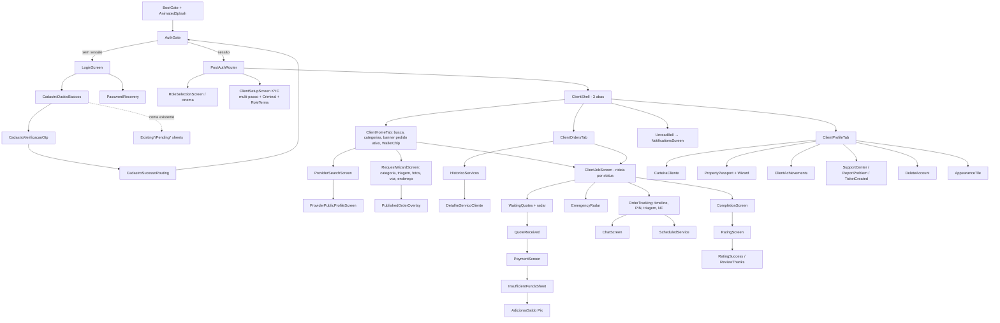
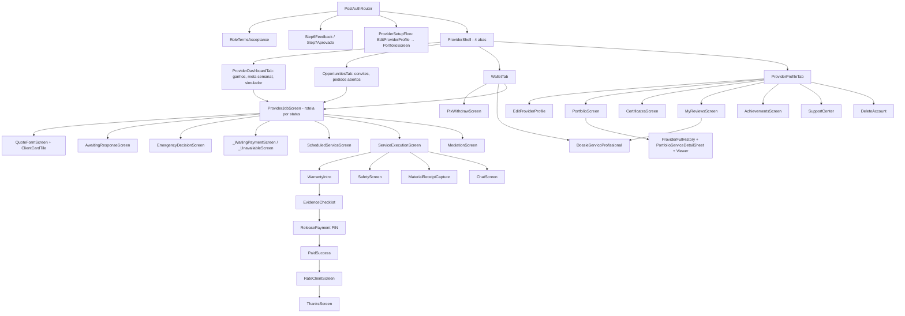

# Desperrengue v2.28.0 — Relatório de Auditoria (Fase 1 do prompt mestre)

> **Escopo:** `features/client|provider|shared|auth|boot|home`, `core/ui/**`, `main.dart`. **Fora:** `features/founder/**`, `main_founder.dart`.
> **Base:** `main` = `35b432a` (v2.27.0). **Autor:** `qagal` (QA Galeria). **Reprodução:** todos os números abaixo saem dos comandos da §8.
> Os anexos A–D (inventário por tela) foram levantados por 4 inventariantes read-only e conferidos por amostragem; `arquivo:linha` refere-se a `main@35b432a`.

## 0. Resumo executivo

1. **Contagens da §1.1 do spec reconfirmadas** — com 3 ressalvas: várias linhas do spec (`TextOverflow.ellipsis` 188, `FittedBox` 38, `CircularProgressIndicator` 62, `showModalBottomSheet` 39) foram medidas **com** `features/founder/**`; **sem** founder são **102 / 29 / 50 / 29**. `fontSize` (606 / 93 < 12 sp / 772 total) e `MaterialPageRoute` (83) batem exatamente. O ratchet do `foundation` deve partir **destes** números (§1).
2. **O app é instanciável em teste, exceto 20 telas/roteadores** (§5.1): 5 de entrada/raiz (`DesperrengueApp`, `BootGate`, `AuthGate`, `PostAuthRouter`, `VerificacaoStep4`), 2 do profissional (`ServiceExecutionScreen`, `ProviderJobScreen`), 7 do cliente e 6 compartilhadas. Para cada uma: o que falta e a **menor refatoração** (um parâmetro opcional `loader`/`stream`/`service`, sem mudar comportamento).
3. **A chave do harness:** `Supabase.initialize(url fake, EmptyLocalStorage)` + `SharedPreferences.setMockInitialValues({})` (padrão de `ui_polish_test.dart:58-66`). Com isso ~20 telas com `JobService()/ProviderService()/SocialService()` em *field initializer* passam a renderizar (estados **erro/vazio**; sucesso só com `loader`). `GalleryEnv.init()` já faz isso.
4. **Glifos/pesos (medido):** 13.787 literais de string; as fontes embarcadas cobrem **todas as letras e pontuação** (acentos pt-BR, `→ • · …`) — **nenhum Latin-Ext-A é necessário hoje**. Faltam **23 codepoints**, todos símbolos/emojis (`★ ✓ ✔ ➔ ⚡ ⏱ ⌫ ● ⚠` e emojis `🔒 📍 📷 👋 🚨 🎙 🎉 💬 ⭐ 📅 🧪`) → trocar por `Icon`/SVG/Lottie (spec §2.1). **Pesos usados:** `w900` ×261, `w800` ×207, `w700` ×154, `w600` ×62, `bold` ×52, `w500` ×11, `w400` ×1. Inter embarcado só tem 400/500/600/700; Jakarta 700/800 ⇒ **468 usos de `w800/w900` (424 em client/provider/shared/home)** hoje sintetizam negrito ou caem para 700.
5. **Contraste da cor de marca:** `clientAccent #F26B0F` sobre `#FFFFFF` = **3,05:1** (calculado) ⇒ falha AA para texto < 24 px; `providerAccent #1B3A78` passa com folga. Falta `accentInk`.
6. **Já existe base reaproveitável:** `core/ui/widgets.dart` já tem `AppCard`, `StatusChip`, `InfoBanner`, `SectionTitle`, `StepperBar`, `RatingStars`, `LoadingView/ErrorView/EmptyView`, `UserAvatar` (o spec afirma "sem componente base": na verdade há, porém com padding/raio/sombra próprios e `fontSize` literais — viram fachada).
7. **Harness e testes entregues** (Etapas 2–3): ver `docs` desta branch e a §7.

## 1. Contagens reconfirmadas (comandos reproduzíveis)

Script: `app/test/support/screen_gallery/tool/audit_counts.ps1` (a partir de `app/`). Regex sobre o texto de cada `.dart` de `lib/`, **sem** `features/founder/**` e `main_founder.dart`.

| Indicador (regex) | Spec §1.1 | **Medido s/ founder** | fora de `core/` | cli+prov+shared+home | Observação |
|---|--:|--:|--:|--:|---|
| Arquivos Dart / linhas | 202 / ~112 mil | **185 / 92.940** | | | 202 incluía os 16 do founder + `main_founder` |
| `fontSize:\s*\d` (literal numérico) | 606 · ~770 | **772** | 713 | **606** ✔ | 794 se contar `fontSize:` não numérico |
| `fontSize` literal < 12 sp | 93 | **107** | 100 | **93** ✔ | |
| `Color(0x` | 591 | **670** | 342 | 121 | spec usa outra regex; 328 estão em `core/ui` (emblemas, ícones) |
| `context.tk` | 560 | **603** | 536 | 531 | |
| `MaterialPageRoute` | 83 | **83** ✔ | 83 | 73 | só 22 rotas customizadas (`SereneAuthPageRoute`) |
| `showModalBottomSheet` / `showDialog` | 39 / 9 | **29 / 8** | 25 / 6 | 21 / 6 | spec contava founder |
| `CircularProgressIndicator` | 62 | **50** | 46 | 35 | idem |
| `FittedBox` | 38 | **29** | 28 | 27 | idem |
| `TextOverflow.ellipsis` | 188 | **102** | 95 | 80 | idem |
| `isCompact` | 15 | **18** | 18 | 2 | 16 vivem na apresentação (cinema) |
| `AnimatedSwitcher/Container/Opacity` | 33 | **15** | 13 | 7 | |
| `LayoutBuilder` | 32 | **21** | 19 | 11 | |
| `Colors.<x>` (≠ transparent/white/black) | — | **172** | 151 | 3 | quase só em `core/` e auth |
| `FontWeight.w800/w900` | — | **468** | 439 | 424 | Inter só embarca ≤ 700 |
| `fontFamily:` literal | — | **21** | 6 | 4 | |
| `.repeat(` (animação em loop) | — | **8** | | | `core/ui/widgets.dart:461` (PulseRadar), `adicionar_saldo_screen.dart:321`, `client_job_screen.dart:417`, `client_shell.dart:356` (`_PulseDot`), `published_overlay.dart:76`, `voice_dictation.dart:294`, `order_live_map_modal_screen.dart:1019`, `review_thanks_view.dart:108` |
| Testes `*_test.dart` / goldens | 62 / 0 | **62 / 0** ✔ | | | |

## 2. Diagnósticos qualitativos (§1.2) — confirmados

| # | Diagnóstico | Evidência |
|---|---|---|
| 1 | **Sem `fontFamily`/`textTheme` no tema**; AppBar 18/w700, botões 16/w700 e 15/w700, labels da `NavigationBar` 12 sp (< 12,5) | `core/ui/app_theme.dart:99-220` (L114 AppBar, L131 NavBar, L169/L178 botões); `main.dart:33-45` não define fonte |
| 2 | **Glifos/pesos** (ver §0.4) | `tool/glyph_audit.dart` (`dart run test/support/screen_gallery/tool/glyph_audit.dart`) |
| 3 | **Contraste da marca** 3,05:1 (laranja sobre branco) | `app_theme.dart:20`; usado como texto/ícone/link em vários cartões |
| 4 | **Sem escala responsiva:** 21 `LayoutBuilder`; `isCompact` quase só no cinema; `main.dart` simula celular de 480 px na Web com `MediaQuery.copyWith(size:)` e fundo `#0F172A` literal | `main.dart:47-67` |
| 5 | **Sem política de `TextScaler`** no `builder`; 29 `FittedBox` e 102 `…` mascaram estouro | `main.dart:47`; contagens §1 |
| 6 | **Containers** com padding/raio/sombra por tela; `AppCard` existe mas é pouco usado | `core/ui/widgets.dart` (`AppCard`, `StatusChip`…) |
| 7 | **Transições:** 83 `MaterialPageRoute` sem `pageTransitionsTheme`; sem *cross-fade* nas abas dos shells (`IndexedStack` em `client_shell.dart`/`provider_shell.dart`) | `app_theme.dart` não define `pageTransitionsTheme` |
| 8 | **Micro-interações:** 8 `.repeat(` (todos pulsos/radares de carregamento — legítimos, mas `_PulseDot` em `client_shell.dart:356` roda **para sempre** na Início) | §1 |
| 9 | **Web:** layout "celular 480" sem composição desktop; sem foco visível nem hover padronizados | `main.dart:47-67` |
| + | **Telas órfãs / legado:** `VerificacaoStep1FrenteScreen` sem chamador em `lib/` (cadeia Step1→2→3→4→5 só alcançável a partir dela); `CriminalBackgroundStatusScreen` sem chamador | Anexo A (#10–14), Anexo D (#3) |

## 3. Inventário consolidado por arquivo (onda · dono sugerido)

Gerado por `audit_counts.ps1 -Markdown` (colunas: linhas, `fontSize` literal, `< 12 sp`, `Color(0x`, `Colors.*`, `FittedBox`, `…`, spinner, `MaterialPageRoute`, sheets+diálogos, `w800/w900`). Onda = §5 do spec; dono = grupos do §7 do spec (`boot/**` → `auth_ui`). Fichas completas por tela (rota, construtor, estados, dependências, veredito): **Anexos A–D**.

| arquivo | linhas | fontSize | <12 | Color(0x | Colors.* | FittedBox | ellipsis | spinner | MaterialPageRoute | sheet/dialog | w800/900 | onda | dono |
|---|--:|--:|--:|--:|--:|--:|--:|--:|--:|--:|--:|:-:|---|
| `features/auth/presentation/desperrengue_welcome_cinema_screen.dart` | 2071 | 0 | 0 | 56 | 5 | 0 | 0 | 0 | 0 | 0 | 0 | 0 | (pronto v2.27.0) |
| `features/auth/presentation/widgets/cinema_card_parts.dart` | 162 | 0 | 0 | 2 | 5 | 0 | 0 | 0 | 0 | 0 | 0 | 0 | (pronto v2.27.0) |
| `features/auth/presentation/widgets/cinema_motion.dart` | 315 | 0 | 0 | 0 | 0 | 0 | 0 | 0 | 0 | 0 | 0 | 0 | (pronto v2.27.0) |
| `features/auth/presentation/widgets/cinema_story_cards_a.dart` | 940 | 0 | 0 | 47 | 20 | 0 | 0 | 0 | 0 | 0 | 0 | 0 | (pronto v2.27.0) |
| `features/auth/presentation/widgets/cinema_story_cards_b.dart` | 834 | 0 | 0 | 28 | 9 | 0 | 0 | 0 | 0 | 0 | 0 | 0 | (pronto v2.27.0) |
| `features/auth/presentation/widgets/story_nav_circle_button.dart` | 184 | 0 | 0 | 4 | 1 | 0 | 0 | 0 | 0 | 0 | 0 | 0 | (pronto v2.27.0) |
| `main.dart` | 74 | 0 | 0 | 1 | 0 | 0 | 0 | 0 | 0 | 0 | 0 | 0 | foundation |
| `features/auth/presentation/auth_gate.dart` | 107 | 0 | 0 | 0 | 0 | 0 | 0 | 0 | 0 | 0 | 0 | 1 | auth_ui |
| `features/auth/presentation/cadastro_dados_basicos.dart` | 670 | 6 | 0 | 1 | 16 | 0 | 0 | 1 | 0 | 0 | 0 | 1 | auth_ui |
| `features/auth/presentation/cadastro_sucesso_routing.dart` | 282 | 2 | 0 | 12 | 0 | 0 | 1 | 0 | 0 | 0 | 1 | 1 | auth_ui |
| `features/auth/presentation/cadastro_verificacao_otp.dart` | 328 | 4 | 0 | 1 | 10 | 0 | 0 | 2 | 1 | 0 | 0 | 1 | auth_ui |
| `features/auth/presentation/deep_link_policy.dart` | 63 | 0 | 0 | 0 | 0 | 0 | 0 | 0 | 0 | 0 | 0 | 1 | auth_ui |
| `features/auth/presentation/existing_account_sheets.dart` | 691 | 15 | 0 | 12 | 0 | 0 | 1 | 0 | 0 | 3 | 3 | 1 | auth_ui |
| `features/auth/presentation/login_screen.dart` | 466 | 6 | 0 | 1 | 22 | 0 | 0 | 1 | 0 | 0 | 0 | 1 | auth_ui |
| `features/auth/presentation/password_recovery_screen.dart` | 579 | 7 | 0 | 1 | 18 | 0 | 0 | 2 | 0 | 0 | 1 | 1 | auth_ui |
| `features/auth/presentation/post_auth_router.dart` | 359 | 0 | 0 | 3 | 0 | 0 | 0 | 1 | 0 | 0 | 0 | 1 | auth_ui |
| `features/auth/presentation/role_selection_screen.dart` | 816 | 1 | 1 | 1 | 0 | 0 | 7 | 0 | 0 | 1 | 4 | 1 | auth_ui |
| `features/auth/presentation/verificacao_step1_frente.dart` | 326 | 5 | 0 | 3 | 11 | 0 | 0 | 0 | 1 | 0 | 0 | 1 | auth_ui |
| `features/auth/presentation/verificacao_step2_verso.dart` | 323 | 5 | 0 | 3 | 10 | 0 | 0 | 0 | 1 | 0 | 0 | 1 | auth_ui |
| `features/auth/presentation/verificacao_step3_selfie.dart` | 305 | 6 | 0 | 2 | 10 | 0 | 0 | 0 | 1 | 0 | 0 | 1 | auth_ui |
| `features/auth/presentation/verificacao_step4_registro.dart` | 331 | 4 | 0 | 1 | 5 | 0 | 0 | 0 | 1 | 0 | 0 | 1 | auth_ui |
| `features/auth/presentation/verificacao_step5_finalizacao.dart` | 284 | 5 | 0 | 1 | 3 | 0 | 0 | 1 | 1 | 0 | 0 | 1 | auth_ui |
| `features/auth/presentation/verificacao_step6_feedback.dart` | 287 | 7 | 0 | 4 | 1 | 0 | 1 | 1 | 3 | 0 | 0 | 1 | auth_ui |
| `features/auth/presentation/verificacao_step6a_como_funciona.dart` | 355 | 5 | 0 | 7 | 0 | 0 | 0 | 0 | 0 | 0 | 0 | 1 | auth_ui |
| `features/auth/presentation/verificacao_step6b_dicas.dart` | 261 | 6 | 0 | 7 | 0 | 0 | 0 | 0 | 0 | 0 | 1 | 1 | auth_ui |
| `features/auth/presentation/verificacao_step6c_termos.dart` | 285 | 11 | 4 | 7 | 1 | 0 | 0 | 0 | 0 | 0 | 2 | 1 | auth_ui |
| `features/auth/presentation/verificacao_step7_aprovado.dart` | 328 | 4 | 0 | 10 | 1 | 0 | 0 | 1 | 1 | 0 | 1 | 1 | auth_ui |
| `features/boot/animated_splash_screen.dart` | 287 | 2 | 0 | 6 | 0 | 1 | 0 | 0 | 0 | 0 | 1 | 1 | auth_ui |
| `features/boot/boot_gate.dart` | 116 | 1 | 0 | 0 | 0 | 0 | 0 | 0 | 0 | 0 | 0 | 1 | auth_ui |
| `features/boot/update_gate.dart` | 746 | 5 | 2 | 0 | 0 | 0 | 5 | 1 | 0 | 0 | 1 | 1 | auth_ui |
| `features/shared/presentation/criminal_background_check_step.dart` | 836 | 14 | 1 | 0 | 0 | 0 | 0 | 1 | 0 | 0 | 8 | 1 | auth_ui |
| `features/shared/presentation/role_terms_acceptance_screen.dart` | 351 | 10 | 1 | 0 | 0 | 0 | 1 | 0 | 0 | 0 | 6 | 1 | auth_ui |
| `features/client/presentation/address_form.dart` | 553 | 1 | 0 | 0 | 0 | 0 | 0 | 4 | 0 | 0 | 0 | 2 | client_core_ui |
| `features/client/presentation/category_picker.dart` | 413 | 4 | 0 | 3 | 0 | 3 | 0 | 0 | 0 | 1 | 2 | 2 | client_core_ui |
| `features/client/presentation/client_shell.dart` | 419 | 4 | 0 | 0 | 0 | 0 | 0 | 0 | 4 | 0 | 5 | 2 | client_core_ui |
| `features/client/presentation/provider_search_screen.dart` | 432 | 7 | 2 | 0 | 0 | 0 | 1 | 0 | 2 | 0 | 5 | 2 | client_core_ui |
| `features/client/presentation/published_overlay.dart` | 290 | 3 | 0 | 2 | 0 | 2 | 2 | 0 | 0 | 0 | 3 | 2 | client_core_ui |
| `features/client/presentation/request_wizard.dart` | 1229 | 21 | 1 | 0 | 0 | 0 | 0 | 0 | 2 | 0 | 18 | 2 | client_core_ui |
| `features/client/presentation/voice_dictation.dart` | 473 | 2 | 0 | 0 | 0 | 0 | 0 | 1 | 0 | 0 | 5 | 2 | client_core_ui |
| `features/shared/presentation/smart_triage_widgets.dart` | 1157 | 39 | 6 | 0 | 0 | 0 | 0 | 1 | 0 | 0 | 25 | 2 | client_core_ui |
| `features/client/presentation/adicionar_saldo_screen.dart` | 408 | 8 | 0 | 0 | 0 | 1 | 0 | 1 | 0 | 0 | 5 | 3 | client_core_ui |
| `features/client/presentation/carteira_cliente_screen.dart` | 215 | 6 | 1 | 3 | 0 | 1 | 1 | 1 | 1 | 1 | 3 | 3 | client_core_ui |
| `features/client/presentation/client_job_screen.dart` | 1684 | 25 | 6 | 0 | 0 | 6 | 9 | 0 | 3 | 1 | 18 | 3 | client_orders_ui |
| `features/client/presentation/client_orders_tab.dart` | 639 | 9 | 1 | 0 | 0 | 1 | 6 | 0 | 8 | 0 | 8 | 3 | client_orders_ui |
| `features/client/presentation/client_setup_screen.dart` | 2868 | 26 | 4 | 7 | 0 | 1 | 1 | 4 | 3 | 0 | 19 | 3 | client_core_ui |
| `features/client/presentation/completion_screens.dart` | 468 | 17 | 0 | 0 | 0 | 0 | 0 | 0 | 5 | 1 | 12 | 3 | client_orders_ui |
| `features/client/presentation/detalhe_servico_cliente_screen.dart` | 1265 | 15 | 1 | 0 | 0 | 1 | 3 | 2 | 5 | 0 | 8 | 3 | client_orders_ui |
| `features/client/presentation/historico_servicos_cliente_screen.dart` | 209 | 3 | 1 | 0 | 0 | 0 | 1 | 0 | 0 | 0 | 2 | 3 | client_orders_ui |
| `features/client/presentation/insufficient_funds_sheet.dart` | 122 | 3 | 0 | 0 | 0 | 1 | 0 | 0 | 1 | 1 | 3 | 3 | client_core_ui |
| `features/client/presentation/order_tracking_screen.dart` | 578 | 9 | 0 | 3 | 0 | 1 | 0 | 0 | 2 | 0 | 7 | 3 | client_orders_ui |
| `features/client/presentation/payment_widgets.dart` | 87 | 2 | 0 | 0 | 0 | 0 | 0 | 0 | 0 | 0 | 2 | 3 | client_core_ui |
| `features/client/presentation/provider_public_profile_screen.dart` | 351 | 8 | 1 | 2 | 0 | 0 | 0 | 0 | 1 | 0 | 6 | 3 | client_orders_ui |
| `features/client/presentation/wallet_chip.dart` | 44 | 1 | 0 | 0 | 0 | 0 | 0 | 0 | 1 | 0 | 1 | 3 | client_core_ui |
| `features/provider/presentation/dossie_servico_profissional_screen.dart` | 683 | 11 | 2 | 0 | 0 | 0 | 1 | 1 | 2 | 0 | 5 | 4 | provider_ui |
| `features/provider/presentation/material_receipt_capture_screen.dart` | 290 | 1 | 0 | 0 | 0 | 0 | 0 | 2 | 0 | 0 | 0 | 4 | provider_ui |
| `features/provider/presentation/pix_withdraw_screen.dart` | 241 | 2 | 0 | 0 | 0 | 0 | 0 | 0 | 0 | 0 | 2 | 4 | provider_ui |
| `features/provider/presentation/provider_execution_screens.dart` | 1155 | 17 | 0 | 3 | 1 | 1 | 0 | 3 | 10 | 1 | 21 | 4 | provider_ui |
| `features/provider/presentation/provider_job_screen.dart` | 718 | 9 | 0 | 0 | 1 | 0 | 1 | 2 | 0 | 1 | 8 | 4 | provider_ui |
| `features/provider/presentation/provider_portfolio_widgets.dart` | 2423 | 65 | 16 | 1 | 1 | 0 | 8 | 0 | 2 | 2 | 31 | 4 | provider_ui |
| `features/provider/presentation/provider_profile_screens.dart` | 852 | 19 | 0 | 1 | 0 | 0 | 1 | 1 | 1 | 2 | 16 | 4 | provider_ui |
| `features/provider/presentation/provider_setup_screens.dart` | 82 | 1 | 0 | 0 | 0 | 0 | 0 | 0 | 0 | 0 | 1 | 4 | provider_ui |
| `features/provider/presentation/provider_shell.dart` | 1085 | 25 | 2 | 0 | 0 | 2 | 11 | 0 | 3 | 2 | 20 | 4 | provider_ui |
| `features/provider/presentation/wallet_tab.dart` | 512 | 7 | 2 | 2 | 0 | 0 | 2 | 0 | 4 | 0 | 7 | 4 | provider_ui |
| `core/ui/app_scaffold.dart` | 59 | 0 | 0 | 0 | 0 | 0 | 0 | 0 | 0 | 0 | 0 | 5 | foundation |
| `core/ui/app_theme.dart` | 221 | 4 | 0 | 26 | 6 | 0 | 0 | 0 | 0 | 0 | 2 | 5 | foundation |
| `core/ui/app_tokens.dart` | 245 | 0 | 0 | 54 | 0 | 0 | 0 | 0 | 0 | 0 | 0 | 5 | foundation |
| `core/ui/category_brand_emblem.dart` | 1257 | 0 | 0 | 90 | 0 | 0 | 0 | 0 | 0 | 0 | 0 | 5 | foundation |
| `core/ui/currency_input_formatter.dart` | 18 | 0 | 0 | 0 | 0 | 0 | 0 | 0 | 0 | 0 | 0 | 5 | foundation |
| `core/ui/desperrengue_brand_logo.dart` | 289 | 0 | 0 | 8 | 0 | 0 | 0 | 0 | 0 | 0 | 0 | 5 | foundation |
| `core/ui/duotone_service_icons.dart` | 677 | 3 | 0 | 2 | 0 | 0 | 1 | 0 | 0 | 1 | 3 | 5 | foundation |
| `core/ui/image_picking.dart` | 747 | 9 | 4 | 0 | 1 | 0 | 2 | 0 | 0 | 2 | 3 | 5 | foundation |
| `core/ui/job_labels.dart` | 47 | 0 | 0 | 0 | 0 | 0 | 0 | 0 | 0 | 0 | 0 | 5 | foundation |
| `core/ui/kyc_human_feedback_translator.dart` | 311 | 0 | 0 | 0 | 0 | 0 | 0 | 0 | 0 | 0 | 0 | 5 | foundation |
| `core/ui/light_island.dart` | 19 | 0 | 0 | 0 | 0 | 0 | 0 | 0 | 0 | 0 | 0 | 5 | foundation |
| `core/ui/media_widgets.dart` | 688 | 0 | 0 | 0 | 1 | 0 | 0 | 0 | 0 | 0 | 1 | 5 | foundation |
| `core/ui/profile_and_achievement_emblems.dart` | 1379 | 0 | 0 | 117 | 0 | 0 | 0 | 0 | 0 | 0 | 0 | 5 | foundation |
| `core/ui/serene_route_transitions.dart` | 163 | 0 | 0 | 0 | 0 | 0 | 0 | 0 | 0 | 0 | 0 | 5 | foundation |
| `core/ui/typography/cinema_type_scale.dart` | 223 | 14 | 0 | 15 | 12 | 0 | 0 | 0 | 0 | 0 | 4 | 5 | foundation |
| `core/ui/typography/font_licenses.dart` | 31 | 0 | 0 | 0 | 0 | 0 | 0 | 0 | 0 | 0 | 0 | 5 | foundation |
| `core/ui/widgets.dart` | 732 | 7 | 1 | 0 | 1 | 1 | 0 | 2 | 0 | 1 | 7 | 5 | foundation |
| `features/home/presentation/home_screens.dart` | 45 | 1 | 0 | 0 | 0 | 0 | 0 | 0 | 0 | 0 | 0 | 5 | shared_ui |
| `features/shared/presentation/achievement_widgets.dart` | 1018 | 19 | 3 | 40 | 0 | 0 | 1 | 1 | 1 | 2 | 20 | 5 | shared_ui |
| `features/shared/presentation/chat_screen.dart` | 591 | 7 | 2 | 0 | 0 | 0 | 3 | 0 | 0 | 0 | 0 | 5 | shared_ui |
| `features/shared/presentation/delete_account_screen.dart` | 412 | 3 | 0 | 0 | 0 | 0 | 0 | 2 | 2 | 3 | 3 | 5 | shared_ui |
| `features/shared/presentation/fintech_warranty_widgets.dart` | 3202 | 93 | 25 | 0 | 0 | 0 | 7 | 0 | 2 | 1 | 55 | 5 | shared_ui |
| `features/shared/presentation/geo_privacy_widgets.dart` | 752 | 15 | 0 | 12 | 0 | 0 | 5 | 0 | 0 | 1 | 6 | 5 | shared_ui |
| `features/shared/presentation/live_location_map.dart` | 720 | 6 | 0 | 1 | 0 | 0 | 1 | 1 | 0 | 1 | 3 | 5 | shared_ui |
| `features/shared/presentation/notifications_screen.dart` | 313 | 2 | 2 | 0 | 0 | 0 | 0 | 0 | 1 | 0 | 2 | 5 | shared_ui |
| `features/shared/presentation/order_live_map_modal_screen.dart` | 2082 | 9 | 4 | 39 | 0 | 6 | 6 | 0 | 1 | 0 | 5 | 5 | shared_ui |
| `features/shared/presentation/profile_photo_viewer.dart` | 836 | 6 | 0 | 0 | 0 | 0 | 1 | 3 | 0 | 0 | 6 | 5 | shared_ui |
| `features/shared/presentation/review_thanks_view.dart` | 273 | 3 | 0 | 0 | 0 | 0 | 0 | 0 | 0 | 0 | 2 | 5 | shared_ui |
| `features/shared/presentation/review_widgets.dart` | 764 | 15 | 2 | 0 | 0 | 0 | 0 | 0 | 0 | 1 | 13 | 5 | shared_ui |
| `features/shared/presentation/scheduled_service_screen.dart` | 781 | 8 | 0 | 0 | 0 | 0 | 0 | 0 | 1 | 1 | 6 | 5 | shared_ui |
| `features/shared/presentation/service_map_widgets.dart` | 628 | 6 | 2 | 1 | 0 | 0 | 2 | 2 | 0 | 2 | 3 | 5 | shared_ui |
| `features/shared/presentation/showcase_widgets.dart` | 627 | 10 | 5 | 1 | 0 | 0 | 4 | 2 | 2 | 1 | 8 | 5 | shared_ui |
| `features/shared/presentation/support_screens.dart` | 366 | 7 | 0 | 0 | 0 | 0 | 1 | 0 | 3 | 0 | 8 | 5 | shared_ui |
| `features/shared/presentation/theme_picker.dart` | 84 | 2 | 0 | 0 | 0 | 0 | 0 | 0 | 0 | 1 | 2 | 5 | shared_ui |

## 4. Mapa de fluxos

### 4.1 Cliente



### 4.2 Profissional



Telas **compartilhadas** (ambos): `ChatScreen`, `NotificationsScreen`, `ScheduledServiceScreen`, `SupportCenter/ReportProblem/TicketCreated`, `DeleteAccountScreen`, `AppearanceTile`, `ProfilePhotoViewer/EditableAvatar`, `Review*`, `Achievement*`, `Geo*`/mapas, `fintech_warranty_widgets` (cartões e Passaporte do Imóvel).

## 5. Instanciabilidade em teste

**Legenda:** `SIM` = monta direto; `SIM c/ fakes` = há injeção (`custom*`, `loader`, `stream`, `@visibleForTesting`); `SIM c/ Supabase fake` = só monta com o *shim* `GalleryEnv.init()` (mostra erro/vazio); `NÃO` = **precisa de refatoração mínima** (nenhuma toca regra de negócio: é só um parâmetro opcional com o padrão atual).

### 5.1 NÃO instanciáveis sem refatoração (o que falta)

| Tela | Arquivo:linha | Por quê | Refatoração mínima (dono) |
|---|---|---|---|
| `DesperrengueApp` | `main.dart:22` | raiz: `BootGate` → Supabase real | **não registrar**; a galeria usa a própria casca (`pump.dart`) |
| `BootGate` | `boot/boot_gate.dart:56` | `AppInitializationService` com defaults reais (Supabase+SecureStorage) | `@visibleForTesting AppInitializationService? service` (shared_ui/auth_ui). Cobertura via `AnimatedSplashScreen` |
| `AuthGate` | `auth/presentation/auth_gate.dart:32,50,74` | `Supabase.instance`, `onAuthStateChange`, `AppLinks()` sem injeção | só roteia; **excluir** (instanciar destinos) |
| `PostAuthRouter` | `post_auth_router.dart:66,76` | `_load()` → `ProfileService().fetchCurrent()`; `_EnrollRunner` privado | `@visibleForTesting ProfileService? service` (auth_ui); `destinationFor(...)` já é pura/testável |
| `VerificacaoStep4RegistroScreen` | `verificacao_step4_registro.dart:46-61` + `core/services/draft_store.dart:28` | `DraftStore.keyFor` usa `Supabase.instance` **sem try/catch** | `Supabase` fake resolve; ideal: `keyFor` tolerante (foundation/core) |
| `ServiceExecutionScreen` | `provider_execution_screens.dart:135` | `currentUser!.id` no `build` (NPE sem sessão) + `JobService()` L53 | param `myId`/`jobService` (provider_ui) |
| `ProviderJobScreen` | `provider_job_screen.dart:30-33` | `JobService().streamJob` + `currentUser?.id` | param `stream`/`jobService` (provider_ui). Filhas públicas já instanciam direto; `_UnavailableScreen`/`_WaitingPaymentScreen`/`_OpenJobRouter` são privadas → tornar `@visibleForTesting` |
| `ClientJobScreen` | `client_job_screen.dart:45-46` | `JobService()` field-init + `streamJob` realtime | `jobStream`/`jobService` (client_orders_ui) |
| `EmergencyRadarScreen` | `client_job_screen.dart:1503,1510,1526` | `JobService()`, `Timer.periodic`, `ProviderService().byId` | `jobService`/provider loader (client_orders_ui) |
| `CompletionScreen` | `completion_screens.dart:36-52` | `initState._load` chama 3 serviços sem loader | `loader` (client_orders_ui) |
| `ProviderPublicProfileScreen` | `provider_public_profile_screen.dart:35,40` | `ProviderService()` field-init + `portfolio()` | `portfolioLoader` (client_orders_ui) |
| `ClientHomeTab` / `ClientShell` | `client_shell.dart:111-112,67-70` | `JobService().streamMyJobs()` + abas sem injeção; `_PulseDot` infinito | `jobsStream` repassado à Home/Orders (client_core_ui) |
| `DocumentGuidedScannerModal` | `client_setup_screen.dart:1918,2168` | `camera` em `initState` | factory de câmera injetável (client_core_ui); só o painter é testável |
| `AchievementsScreen`, `AchievementsSection` | `achievement_widgets.dart:379,322` | `ProviderService()` inline | `loader` (provider_ui / client_orders_ui) |
| `ShowcaseStrip`, `CaseDetailScreen`, `CaseCurationScreen` | `showcase_widgets.dart:36,212,548` | `ProviderService()` + `FutureBuilder` | `loader` por tela (provider_ui) |
| `MapaRotaServicoModal` | `service_map_widgets.dart:206` | `buildTileLayer` (OSM por rede) sem override | param `tileLayer` (trocar por `buildSafeMapTileLayer`) (shared_ui) |
| Estado "foto escolhida" de `VerificacaoStep1/2/3` | `_imagemSelecionada` privado; `ImagePicker()` campo | picker não injetável | param `picker`/`initialImage` (auth_ui) |

**Parciais:** `OrderLiveMapModalScreen`/`InteractiveLocationPreviewCard` (`RealTimeRouteAndTrafficService.instance` tenta rede; renderiza com `tileLayerOverride`+lat/long) — recomendado `routeService`; `WarrantyThreeLayerResolutionSheet`/`PropertyPassport*` (`FintechLedgerStore.instance`: o harness reseta). `QuoteReceivedScreen`/`PaymentScreen`/`EvidenceChecklist`/`ReleasePayment`/`RateClient`/`Mediation`/`ClientCardTile`/`QuoteForm`/`AwaitingResponse`/`EmergencyDecision` → **SIM c/ Supabase fake** (estado inicial/erro).

> **Conclusão para o plano da galeria:** ≈ 100 telas/sheets/cartões registráveis **hoje**, sem tocar `lib/`; as linhas da §5.1 são o **backlog de testabilidade** (todas são parâmetros opcionais; nenhuma muda comportamento). Pedirei cada uma ao dono da tela (board), na onda dele.

### 5.2 Dependências compartilhadas que o harness fornece

| Dependência | Onde | Como a galeria resolve |
|---|---|---|
| `Supabase.instance.client` (`JobService/ProviderService/SocialService/MediaService/WalletService`, `DraftStore.keyFor`) | ~40 telas | `GalleryEnv.init()` → `Supabase.initialize(url fake, EmptyLocalStorage, autoRefreshToken:false)`; `currentUser == null`; rede falha → estados erro/vazio |
| `SharedPreferences` (`LocalPrefs`, `PrivacyMode`, `UnreadOrdersBadgeController`, `DraftStore`, `UpdateGate`) | muitas | `SharedPreferences.setMockInitialValues({})` em `resetSingletons()` |
| Riverpod (`walletProvider`, `statementProvider`, `walletServiceProvider`, `themeModeProvider`) | carteira, `WalletChip`, `AppearanceTile` | `ProviderScope(overrides:)` com `FakeWalletService` (`fakes.dart`) |
| Singletons em memória (`AppSession`, `PrivacyMode`, `JobTriageStore`, `FintechLedgerStore`, `ProviderPortfolioStore`) | execução, passaporte, portfólio | reset por cenário (`resetSingletons`); semear no `GalleryScreen.interact`/builder |
| Mapas (`flutter_map`) | pedidos, geo, localização | `tileLayerOverride`/`tileLayer` (SizedBox) ou `isMapFlutterTestEnvironment` |
| Plugins nativos (`camera`, `geolocator`, `image_picker`, `speech_to_text`, `video_player`, `url_launcher`, `app_links`) | só em toque/`initState` de 4 telas | injeções existentes (`SpeechEngine`, `customCameraCapture`, `positionStream`, `photoPicker`…); evitar `video` nas evidências |
| Timers periódicos (1 s/8 s/10 s/15 s/20 s) e animações infinitas (`PulseRadar`, `_PulseDot`, `SoundWaveBars`) | várias | `animatesForever:true` ⇒ `pump(Duration)` em passos (sem `pumpAndSettle`); a galeria desmonta a árvore e avança 5 s no fim (sem timers pendentes) |
| Fonte do sistema (Ahem no `flutter test`) | todo texto sem `fontFamily` | `loadGalleryFonts()` registra Jakarta/Inter **e Inter como "Roboto"** ⇒ medição de largura realista nas telas ainda sem tema global |

## 6. Plano de ondas × galeria

| Onda | Telas registradas na galeria (id) | Estado |
|---|---|---|
| 0 Fundação | `core/ui/*` átomos (`widgets.dart`, `AppScaffold`), `HomeAdmin` | registrado |
| 1 Entrada | login, cadastro, OTP, recovery, role selection, sheets de conta, KYC 6a/6b/6c/7, splash, update gate, role terms, criminal | registrado (parte); Step4/BootGate/AuthGate/PostAuth ⇒ §5.1 |
| 2 Cliente núcleo | categorias, wizard, busca, voz, endereço, overlay, triagem | registrado (c/ fakes existentes) |
| 3 Cliente pedidos/dinheiro | carteira, adicionar saldo, orders tab, detalhe, tracking, histórico, rating | registrado (`ClientJobScreen`/`Completion`/`PublicProfile` ⇒ §5.1) |
| 4 Profissional | wallet tab, dossiê, pix, receipt, portfólio, perfil, execução (Warranty/Safety/Thanks/Paid), quote form | registrado (execução/job ⇒ §5.1) |
| 5 Compartilhadas | fintech cards/passaporte, chat, notificações, mapas, geo, review, achievements, support, delete, theme | registrado |
| 6 Polimento/Web | teclado/foco/hover, `ResponsiveShell`, goldens | testes prontos; ligam após `web_a11y` |

## 7. QA entregue nesta fase (Etapas 2–3)

- **Harness** `app/test/support/screen_gallery/**`: viewports (7), escalas (1.0/1.35/1.5), claro/escuro, modos cliente/profissional/marca; `FontLoader` real; `withGalleryRun` (captura **todos** os erros do framework, não só o 1º); coletores (`Text`/`Icon` com estilo efetivo, retângulo, `arquivo:linha` do widget criador), contraste WCAG real sobre o fundo efetivo (gradientes = pior parada), alvos de toque via árvore de semântica, escala de toque, duração de transição de página, leitor de `cmap` TTF + extrator de literais Dart.
- **Registro** `app/test/ui_gallery/gallery_registry.dart` (único ponto de entrada dos donos de tela) e **ratchet** `app/test/ui_design_audit/known_violations.json` (só diminui; o teste imprime a contagem e exige que nada **suba**).
- **Testes** em `app/test/ui_gallery/` (layout, escala) e `app/test/ui_design_audit/` (tipografia, alvos, contraste, glifos, movimento, Web/teclado), todos **não-bloqueantes** até a onda do dono (lista de exceção versionada).
- Goldens: `@Tags(['golden'])`, desligados por padrão em `app/dart_test.yaml`; rodar só no CI Linux (`flutter test --tags golden`).

## 8. Como reproduzir

```powershell
cd app
# Contagens e tabela por arquivo
powershell -NoProfile -File test/support/screen_gallery/tool/audit_counts.ps1 -Markdown
# Glifos/pesos
dart run test/support/screen_gallery/tool/glyph_audit.dart
# Galeria
flutter test --no-pub test/ui_gallery test/ui_design_audit
# Atualizar o ratchet depois de CORRIGIR telas (só diminui)
$env:GALLERY_UPDATE_BASELINE='1'; flutter test --no-pub test/ui_gallery test/ui_design_audit
```

---

# Anexos — inventário por tela (levantado por inventariantes read-only)


## Anexo A — auth · boot · home · main (`features/auth`, `features/boot`, `features/home`, `main.dart`)


Caminhos relativos a `app/lib/`. `auth/` = `features/auth/presentation/`. Testes em `app/test/`.
Contagens: fs=`fontSize:`, C0x=`Color(0x`, FB=FittedBox, ell=TextOverflow.ellipsis, CPI=CircularProgressIndicator, MPR=MaterialPageRoute, sh=showModalBottomSheet|showDialog, Col=`Colors.`.
Dono padrão: auth_ui (tudo do grupo A; boot/home/UpdateGate podem ir p/ shared_ui). Onda = sugestão minha (spec §5 não consultada).
Padrão de teste existente (reutilizável): `_buildTestApp({textScale, disableAnimations, home})` em duplicate_registration_ux_and_recovery_test.dart:20 (ProviderScope + MaterialApp + MediaQuery.textScaler; viewports via `tester.binding.setSurfaceSize`: 320×640@1.35/1.40, 360×780, 390×844, 412×915@1.30).

#### Resumo
| # | Tela | Linhas | Veredito | Teste existente |
|---|---|---|---|---|
| 1 | LoginScreen | 466 | SIM | duplicate_registration_ux_and_recovery_test:951,1001 |
| 2 | CadastroDadosBasicosScreen | 670 | SIM c/ fakes | idem:194,269,325,374,455,560 |
| 3 | CadastroVerificacaoOtpScreen | 328 | SIM | nenhum (só `findsNothing`) |
| 4 | CadastroSucessoRoutingScreen | 282 | SIM (desmontar <480 ms) | welcome_cinema_onboarding_test:414 |
| 5 | PasswordRecoveryScreen | 579 | SIM c/ fakes | duplicate_registration_…:476 |
| 6 | ExistingAccountDetectedSheet | 691 (arq.) | SIM | duplicate_registration_…:229,809 |
| 7 | PendingVerificationDetectedSheet | (idem) | SIM | idem |
| 8 | ExistingCpfAccountSheet | (idem) | SIM | idem:908 |
| 9 | RoleSelectionScreen | 816 | SIM (c/ `profile`) | offboarding_boot_theme_test:493; welcome_cinema_onboarding_test:2017,2102 |
| 10 | VerificacaoStep1FrenteScreen | 326 | SIM (estado inicial) | nenhum |
| 11 | VerificacaoStep2VersoScreen | 323 | SIM c/ XFile fake | nenhum |
| 12 | VerificacaoStep3SelfieScreen | 305 | SIM c/ XFile fake | nenhum |
| 13 | VerificacaoStep4RegistroScreen | 331 | **NÃO** | nenhum |
| 14 | VerificacaoStep5FinalizacaoScreen | 284 | SIM c/ XFile fake | nenhum |
| 15 | VerificacaoStep6aComoFuncionaScreen | 356 | SIM | nenhum |
| 16 | VerificacaoStep6bDicasScreen | 262 | SIM | nenhum |
| 17 | VerificacaoStep6cTermosScreen | 285 | SIM | criminal_check_terms_and_cross_role_ux_test:459; red_team_bivalent_treasury_12x_test:350; profile_photo_save_and_change_ux_test |
| 18 | VerificacaoStep6FeedbackScreen | 288 | SIM c/ cuidado (Timer 8 s) | nenhum |
| 19 | VerificacaoStep7AprovadoScreen | 329 | SIM | nenhum |
| 20 | AuthGate | 107 | **NÃO** | nenhum |
| 21 | PostAuthRouter | 359 | **NÃO** | nenhum (harness próprio em welcome_cinema_onboarding_test:2053) |
| 22 | AnimatedSplashScreen | 287 | SIM c/ fakes | offboarding_boot_theme_test:456,473 |
| 23 | BootGate | 116 | **NÃO** | nenhum |
| 24 | UpdateGate (card flutuante) | 746 | SIM c/ fakes | eng_update_security_test:47; update_test:99,197,318,433 |
| 25 | HomeAdminScreen | 45 | SIM | ux_client_and_shared_polish_test:440 |
| 26 | DesperrengueApp (main.dart) | 74 | **NÃO** (root) | nenhum |

Não-telas: `deep_link_policy.dart` (63 L, `DeepLinkPolicy`, lógica pura; teste eng_resilience_and_policy_test), `widgets/story_nav_circle_button.dart` (StoryNavCircleButton; só o cinema usa, L1516/1558 do welcome screen; teste welcome_cinema_typography_test), `widgets/cinema_*` e `desperrengue_welcome_cinema_screen.dart` (fora da fatia).

**26 telas/sheets/gates, 5 NÃO instanciáveis diretos** (Step4Registro, AuthGate, PostAuthRouter, BootGate, DesperrengueApp) + 1 condicional (Step6Feedback, Timer).

#### Fichas

##### 1. login_screen.dart (466 L) — `LoginScreen({initialEmail=''})` (ConsumerStatefulWidget; não usa `ref.` — grep 0; teste envolve em ProviderScope por segurança)
- Chegada: auth_gate.dart:104 (sem sessão); cadastro_dados_basicos.dart:122; password_recovery_screen.dart:182; client_setup_screen.dart:381.
- Injeções: nenhuma (só `initialEmail`). initState L41-46 só preenche controller. Supabase só no tap: `signInWithPassword` L76, OAuth/`auth` L131.
- Estados: vazio, initialEmail preenchido, `_isLoading` (CPI), erro por SnackBar (L87,114,146,155 via `RegistrationGuardService.translateAuthErrorPtBr`, estático puro).
- Deps render: nenhuma. `Navigator.push` L98 (OTP), L307 (recovery, key `btn-login-forgot-password` L300), L421 (cadastro) só no tap.
- Veredito: **SIM**.
- Testes: duplicate_registration_ux_and_recovery_test.dart:951,1001 (+ transições SereneAuthPageRoute).
- Contagens: fs=6 C0x=1 FB=0 ell=0 CPI=1 MPR=0 sh=0 Col=32.
- Onda 1 · auth_ui. Estados sugeridos: vazio, initialEmail, 320×640@1.4.

##### 2. cadastro_dados_basicos.dart (670 L) — `CadastroDadosBasicosScreen({customPrecheckEmail, customSignUp, customResendSignupOtp})` (@visibleForTesting)
- Chegada: login_screen.dart:425. Abre: ExistingAccountDetectedSheet L112, PendingVerificationDetectedSheet L146, OTP L191/L308, Termos(6c) L545, Login L122, Recovery L130.
- Injeções: `customPrecheckEmail(email)→SignupEmailEligibility`, `customSignUp({email,password,fullName})→AuthResponse`, `customResendSignupOtp(email)`. Sem elas: `RegistrationGuardService()` + `Supabase.instance.client.auth.signUp` L280 / `.resend` L162. `Env.abstractApiKey` L65 (vazio em teste → sem http, L80). Sem initState.
- Estados: form vazio, validação (SnackBars L181-297), `_isLoading` (CPI), termos aceitos/não, senha visível, sucesso→OTP, conta existente→sheet, pendente→sheet.
- Veredito: **SIM c/ fakes** (os 3 customs; render inicial não precisa de nenhum).
- Testes: duplicate_registration_ux_and_recovery_test.dart:194,269,325,374,455,560 (helper `_fillValidSignupForm`).
- Contagens: fs=6 C0x=1 FB=0 ell=0 CPI=1 MPR=0 sh=0 Col=22.
- Onda 1 · auth_ui.

##### 3. cadastro_verificacao_otp.dart (328 L) — `CadastroVerificacaoOtpScreen({required email})`
- Chegada: cadastro_dados_basicos.dart:191,308; login_screen.dart:101. Depois `pushReplacement` → CadastroSucessoRouting L153.
- Injeções: nenhuma. Supabase só em ações: `auth.resend` L81, `verifyOTP` L129, `currentUser` L136; `LegalMandateService.recordAcceptanceIfAuthenticated` L140.
- Estados: inicial, `_isLoading` (CPI×2), reenvio com `Timer.periodic(1 s)` L65 (só após tap "Reenviar"; cancelado no dispose L38), `_isResending`.
- Deps render: nenhuma (sem initState).
- Veredito: **SIM**.
- Testes: nenhum instancia.
- Contagens: fs=4 C0x=1 FB=0 ell=0 CPI=2 MPR=1 sh=0 Col=15.
- Onda 1 · auth_ui.

##### 4. cadastro_sucesso_routing.dart (282 L) — `CadastroSucessoRoutingScreen()`
- Chegada: cadastro_verificacao_otp.dart:153-156.
- initState L40 → `_processarTransicaoSessao`: `WelcomeCinemaTracker.armForFreshRegistration(uid)` (uid via Supabase em try/catch L49-55), `ProfileService().fetchCurrent()` em try L63, `Future.delayed(480ms)` → `Navigator.pushAndRemoveUntil(AuthGate)` L71 (Supabase real).
- Estados: único (ponte cinematográfica; AnimationController 480 ms; `disableAnimationsOf`).
- Veredito: **SIM** com pump único e **desmontar a árvore antes de 480 ms** (como o teste); não há injeção para o destino.
- Testes: welcome_cinema_onboarding_test.dart:414 (MaterialApp + `AppTheme.resolve(null, light)`, desmonta antes do timer ~L430).
- Contagens: fs=2 C0x=12 FB=0 ell=1 CPI=0 MPR=0 sh=0 Col=0 (CustomPainter `_CinematicBridgeHaloPainter` L241).
- Onda 2 · auth_ui.

##### 5. password_recovery_screen.dart (579 L) — `PasswordRecoveryScreen({initialEmail, onSendRecoveryOtp, onVerifyAndUpdatePassword})` (2 callbacks @visibleForTesting)
- Chegada: cadastro_dados_basicos.dart:130; login_screen.dart:307-310.
- Injeções: `onSendRecoveryOtp(email)`, `onVerifyAndUpdatePassword({email,...})`. Defaults: `Supabase.instance.client.auth.resetPasswordForEmail` L106, `verifyOTP` L157, `updateUser` L162. `_isSupabaseInitialized()` L81-88 faz try/catch (tolerante). initState L62.
- Estados: etapa 1 (e-mail), etapa 2 (OTP + nova senha), `_isLoading` (CPI×2), erro SnackBar, sucesso → AuthGate/Login L181-184.
- Veredito: **SIM c/ fakes** (2 callbacks).
- Testes: duplicate_registration_ux_and_recovery_test.dart:476 (callbacks fake).
- Contagens: fs=7 C0x=1 FB=0 ell=0 CPI=2 MPR=0 sh=0 Col=25.
- Onda 1 · auth_ui.

##### 6-8. existing_account_sheets.dart (691 L)
- `ExistingAccountDetectedSheet({required email, onGoToLogin, onRecoverPassword, onUseOtherEmail})` L204 (key `existing-account-detected-sheet`); `static show(context,{email})` L218 → showModalBottomSheet L225.
- `PendingVerificationDetectedSheet({required email, onResendAndVerify, onBack})` L408; `show` L420/426.
- `ExistingCpfAccountSheet({cpfMasked, onSignOutAndGoLogin, onReviewDigits})` L552 (key `existing-cpf-account-sheet`); `show` L564/570. Enums de ação L8/15/21.
- Chegada: cadastro_dados_basicos.dart:112 (Existing), :146 (Pending); client_setup_screen.dart:368 (Cpf).
- Deps: nenhuma (StatelessWidget). Sem callback → `Navigator.of(...).pop(action)`.
- Estados: ação única; variações: e-mail longo, cpfMasked null/preenchido (overflow).
- Veredito: **SIM** (pumpar direto em Scaffold/Material, ou `show()` em MaterialApp).
- Testes: duplicate_registration_ux_and_recovery_test.dart:229,809,908.
- Contagens (arquivo): fs=15 C0x=12 FB=0 ell=1 CPI=0 MPR=0 sh=3 Col=5.
- Onda 1 · auth_ui.

##### 9. role_selection_screen.dart (816 L) — `RoleSelectionScreen({UserProfile? profile})`
- Chegada: post_auth_router.dart:224 (dest modeSelection; dentro de AnimatedSwitcher/cinema).
- Injeção: `profile` (UserProfile fake). Sem profile: `Supabase.instance...currentUser` L64 em try/catch ("Ambiente de teste", L69-71).
- Estados: primeiro acesso (pílulas "Criar Perfil"), cliente ativo, profissional ativo, ambos, cadastro pela metade / "Em análise" (`_StagePill`), claro/escuro, modal sair (showModalBottomSheet L100), replay cinema (btn-replay-welcome-cinema → push DesperrengueWelcomeCinemaScreen L76).
- Deps render: AnimationController 420 ms (L45). No tap: `AppSession.instance.choose` L95 (singleton puro), `ProfileService().setLastMode` L96, `.signOut` L142 (Supabase).
- Veredito: **SIM** (com `profile`).
- Testes: offboarding_boot_theme_test.dart:493 (MaterialApp + AppTheme.resolve light/dark; view 1080×2400 dpr 2.75); welcome_cinema_onboarding_test.dart:2017,2102 (`_makeProfile`).
- Contagens: fs=12 C0x=1 FB=0 ell=7 CPI=0 MPR=0 sh=1 Col=7.
- Onda 1 · auth_ui.

##### 10-12,14. verificacao_step1_frente (326) / step2_verso (323) / step3_selfie (305) / step5_finalizacao (284)
- Params: Step1 `()`; Step2 `required XFile frenteDocumento`; Step3 `required XFile frenteDocumento, versoDocumento`; Step5 `required XFile frenteDocumento, versoDocumento, selfie; required String tipoRegistro, numeroRegistro`.
- Cadeia: Step1 → Step2 (step1:68-72) → Step3 (step2:69-72) → Step4 (step3:73-76) → Step5 (step4:92-95) → AuthGate pushAndRemoveUntil (step5:106-108). **Step1 não tem chamador em `lib/`** (grep `VerificacaoStep1FrenteScreen(` = 0): ponto de entrada órfão/legado; Step2–5 só alcançáveis a partir dele.
- Injeções: nenhuma. `final ImagePicker _picker = ImagePicker();` campo (step1:24, step2:26, step3:30) — `pickImage` só no tap (step1:29, step3:36 `ImageSource.camera`/`CameraDevice.front`). Step5: `ProfileService().submitKyc` L88, `LegalMandateService.recordAcceptanceIfAuthenticated` L99 só no submit.
- Estados: Step1/2/3 sem imagem / com `_imagemSelecionada`+`_previewBytes` (privados, só após pick); Step5 resumo + `_isUploading` (CPI) + erro SnackBar (L51-55).
- Veredito: **SIM** para estado inicial (XFile fake: `XFile('x.jpg')`/`XFile.fromData`); estado "foto escolhida" **NÃO** — picker não injetável (falta parâmetro `picker`/`initialImage`).
- Testes: nenhum.
- Contagens: Step1 fs=5 C0x=2 MPR=1 Col=23 · Step2 fs=5 C0x=3 MPR=1 Col=22 · Step3 fs=6 C0x=2 MPR=1 Col=20 · Step5 fs=5 C0x=1 CPI=1 MPR=1 Col=14 (FB/ell/sh = 0 em todos).
- Onda 2 · auth_ui.

##### 13. verificacao_step4_registro.dart (331 L) — `VerificacaoStep4RegistroScreen({required XFile frenteDocumento, versoDocumento, selfie})`
- Chegada: verificacao_step3_selfie.dart:76.
- initState L46-50: `_restoreDraft()` L61 → `DraftStore.keyFor('kyc_registro')` L59 → `Supabase.instance.client.auth.currentUser?.id` (core/services/draft_store.dart:28) **sem try/catch** → erro assíncrono não tratado sem Supabase; depois `DraftStore.read` → SharedPreferences (draft_store.dart:34). `_saveDraft` L71 (listener do campo) idem.
- Estados: form vazio, tipo selecionado (CREA/CFT/CNPJ/CRM/OAB/Outro), número digitado, erro de validação.
- Veredito: **NÃO** — falta (a) Supabase inicializado/fake, ou (b) `DraftStore.keyFor` tolerante (try/catch → 'anon'; arquivo core), ou parâmetro `draftKey`/`userId` na tela; (c) `SharedPreferences.setMockInitialValues({})`.
- Testes: nenhum.
- Contagens: fs=4 C0x=1 FB=0 ell=0 CPI=0 MPR=1 sh=0 Col=14.
- Onda 2 · auth_ui (depende de ajuste no DraftStore).

##### 15-17. verificacao_step6a_como_funciona (356) / 6b_dicas (262) / 6c_termos (285)
- Params: 6a `()` Stateless; 6b `()` Stateless; 6c `({UserMode? initialMode})` (default provider; segmented Cliente|Profissional).
- Chegada: 6a/6b: verificacao_step6_feedback.dart:178,186 (push MaterialPageRoute L253-255); 6c: verificacao_step6_feedback.dart:194, cadastro_dados_basicos.dart:545, client_orders_tab.dart:558.
- Deps: nenhuma. 6c usa `LegalMandateService` estático puro (`currentDocumentSha256Hex`, `sha256ForMode`, `versionForMode`, `clausesForMode`, L34-37).
- Estados: 6a/6b estáticos; 6c modo cliente / profissional.
- Veredito: **SIM**.
- Testes: só 6c — criminal_check_terms_and_cross_role_ux_test.dart:459, red_team_bivalent_treasury_12x_test.dart:350 (`MaterialApp(home: const VerificacaoStep6cTermosScreen())`), profile_photo_save_and_change_ux_test.dart.
- Contagens: 6a fs=5 C0x=7 Col=8 · 6b fs=6 C0x=7 Col=4 · 6c fs=11 C0x=7 Col=7 (FB/ell/CPI/MPR/sh = 0).
- Onda 0 (6a/6b) / 1 (6c) · auth_ui.

##### 18. verificacao_step6_feedback.dart (288 L) — `VerificacaoStep6FeedbackScreen()`
- Chegada: post_auth_router.dart:287 (KYC pendente).
- initState L44-46: `Timer.periodic(8 s)` (const privado `_pollInterval` L32) → `_checkStatus` → `ProfileService().fetchCurrent()` L60 (Supabase). Dispose cancela L50.
- Estados: "em análise"; `_checking` (CPI); SnackBar info/erro L81; rejeitado/aprovado → AuthGate L65-69.
- Veredito: **SIM c/ cuidado** — render ok; pump <8 s e desmontar (Timer.periodic pendente reprova testWidgets se árvore não for desmontada). Para testar poll falta injeção de `ProfileService`/intervalo.
- Testes: nenhum.
- Contagens: fs=7 C0x=4 FB=0 ell=1 CPI=1 MPR=3 sh=0 Col=7.
- Onda 2 · auth_ui.

##### 19. verificacao_step7_aprovado.dart (329 L) — `VerificacaoStep7AprovadoScreen({nomeProfissional='Profissional'})`
- Chegada: post_auth_router.dart:289.
- Deps: `ProfileService().activateProvider()` L39 só no tap (erro → SnackBar L45-49). `_isActivating` (CPI). Sem initState.
- Veredito: **SIM**. Estados: normal, nome longo, ativando.
- Testes: nenhum.
- Contagens: fs=4 C0x=10 FB=0 ell=0 CPI=1 MPR=1 sh=0 Col=8.
- Onda 1 · auth_ui.

##### 20. auth_gate.dart (107 L) — `AuthGate()`
- Chegada: boot_gate.dart:67; cadastro_sucesso_routing:73; login_screen:65; post_auth_router:101; role_selection:144; step5:108; step6_feedback:67; step7:41; password_recovery:181.
- initState: `Supabase.instance.client` campo L32, `onAuthStateChange.listen` L50, `AppLinks()` + `getInitialLink()` + `uriLinkStream` L74-83 (plugin app_links), `InstantImageCacheEngine.instance.purgeAllUserImages` L69 (logout), `DraftStore.clearAllForUser`.
- Veredito: **NÃO** — sem parâmetros de injeção (client/auth stream/AppLinks). É só roteador (LoginScreen ou PostAuthRouter); instanciar destinos diretamente.
- Testes: nenhum. Contagens: tudo 0. Onda 6 / excluir.

##### 21. post_auth_router.dart (359 L) — `PostAuthRouter()`
- Chegada: auth_gate.dart:105. Destinos (L190-300): modeSelection→RoleSelectionScreen L224 (ou cinema), ClientSetupScreen, RoleTermsAcceptanceScreen, ProviderSetup, kycStart, Step6Feedback L287, Step7 L289, HomeAdmin L297, ClientShell, ProviderShell; `_EnrollRunner` privado L308 (CPI + botão `switchMode` L349).
- initState L44-48: `_load()` L66 → `LocalPrefs.lastProfile` (SharedPreferences), `ProfileService().fetchCurrent()` L76 / `cachedProfile()` L78 (Supabase.instance), `WelcomeCinemaTracker.shouldShowBeforeRoleSelection`; `AppSession.instance` (L36, listener `profileTick` L47).
- Estados: loading (`LoadingView`; ponte escura key `post-auth-cinema-dark-bridge` L119 com CPI), erro (`ErrorView` + "Sair da conta"), destino por `destinationFor(profile, mode, forceSelection, preferred)` (função pública, testável sem widget).
- Veredito: **NÃO** — falta injeção de `ProfileService`/loader; destinos instanciáveis separadamente (outros donos). `_EnrollRunner` privado.
- Testes: harness próprio `_PostSignupCinemaHarness` (welcome_cinema_onboarding_test:2053) reproduz o AnimatedSwitcher.
- Contagens: fs=0 C0x=3 FB=0 ell=0 CPI=1 MPR=0 sh=0 Col=0. Onda 6 / excluir.

##### 22. boot/animated_splash_screen.dart (287 L) — `AnimatedSplashScreen({required Future<BootResult> init, required onFinished, duration=1800ms})`
- Chegada: boot_gate.dart:103.
- Injeção: `init` (`BootResult(theme: AppThemeMode.x, backendReady: true)`), `onFinished`, `duration`.
- initState: `_run()` L51 (AnimationController + `disableAnimations` L59) + `Timer(3200 ms)` `_slowTimer` L53 (cancelado no dispose).
- Estados: animação (`SplashSymbolPainter`, `ConfettiPainter`), `_slow` (>3,2 s com init pendente), reduce-motion.
- Veredito: **SIM c/ fakes** (`init: Future.value/Completer.future`). Fim: pump ≥1,9 s; `_slow`: pump 3,3 s com Completer pendente e desmontar.
- Testes: offboarding_boot_theme_test.dart:456 (Future.value), :473 (Completer).
- Contagens: fs=2 C0x=6 FB=1 ell=0 CPI=0 MPR=0 sh=0 Col=1.
- Onda 1 · shared_ui.

##### 23. boot/boot_gate.dart (116 L) — `BootGate()` (ConsumerStatefulWidget; precisa ProviderScope)
- Chegada: main.dart:70.
- didChangeDependencies L56-58 → `AppInitializationService(warmUp: _warmUp).run()` com defaults reais: `Supabase.initialize` + `SecureSessionStorage` (core/boot/app_initialization_service.dart:53-57), `FlutterSecureStorage().deleteAll()` (L61), leitura de tema; `_warmUp` L33: `InstantImageCacheEngine.instance`, `precacheImage(AssetImage('assets/splash/logo.png'))` L36, `UnreadOrdersBadgeController.instance.ensureLoaded()` L44. Sucesso → `pushReplacement(fadeRoute(AuthGate()))` L67.
- Estados: splash; falha `_failed` (cloud_off + "Tentar novamente") L72-101 (inalcançável sem injetar service).
- Veredito: **NÃO** — `AppInitializationService` aceita `initBackend/wipeSecureStorage/readTheme` mas o BootGate não os expõe; falta `@visibleForTesting AppInitializationService? service` (ou factory) no widget. Alternativa: galeria cobre `AnimatedSplashScreen` (ficha 22).
- Testes: nenhum.
- Contagens: fs=1 C0x=0 FB=0 ell=0 CPI=0 MPR=0 sh=0 Col=4. Onda 6 / exige mudança de produção.

##### 24. boot/update_gate.dart (746 L) — `UpdateGate({required child, check, openUrl, service, installer, interval=60s, initialDelay=3s})`
- Chegada: main.dart:48 (MaterialApp.builder). Card `_DiscreetFloatingUpdateCard` (privado L347), botões `_DiscreetCapsuleActionButton` L698; `UpdateGate.maybeOf(context)`.
- Injeções (L39 "injetáveis para testes"): `check: Future<UpdateInfo?> Function()`, `openUrl`, `service: UpdateService`, `installer: PublicNativeOtaInstaller`, `interval`, `initialDelay`.
- initState L107-116: observer, `_installer.progressNotifier`, `Timer(initialDelay)` L114, `Timer.periodic(interval)` L115; se `check==null` → `SharedPreferences.getInstance()` L148; dispensar L183 também usa prefs; `UpdateService(enabled:true)` L238 só no manual.
- Estados: sem update (só child), update disponível (card), dismiss persistido, manual override, `_legacyDownloading`, OTA progress (`PublicOtaProgress` fases), erro.
- Veredito: **SIM c/ fakes** (`check`→`UpdateInfo`, `installer` fake, `initialDelay` ~50 ms, `interval` longo, `SharedPreferences.setMockInitialValues`). Desmontar para cancelar timers.
- Testes: eng_update_security_test.dart:47; update_test.dart:99,197,318,433 (`MaterialApp(builder: (c, child) => UpdateGate(check: check, openUrl: open, initialDelay: 50ms, interval: 5min, child: child!))`).
- Contagens: fs=5 C0x=0 FB=0 ell=5 CPI=1 MPR=0 sh=0 Col=1.
- Onda 3 · shared_ui.

##### 25. home/presentation/home_screens.dart (45 L) — `HomeAdminScreen()` (Stateless)
- Chegada: post_auth_router.dart:297.
- Deps: `ProfileService().signOut()` só no tap L22; `context.tk.brand` (exige `AppTheme.resolve` no MaterialApp).
- Veredito: **SIM** (com theme). Estado único.
- Testes: ux_client_and_shared_polish_test.dart:438-440 (`_wrapForUxTest(const HomeAdminScreen())`).
- Contagens: fs=1 C0x=0 FB=0 ell=0 CPI=0 MPR=0 sh=0 Col=0.
- Onda 0 · shared_ui.

##### 26. main.dart (74 L) — `DesperrengueApp()` (ConsumerWidget)
- Root: `ref.watch(themeModeProvider)`, `AppSession.instance.theme` (ValueNotifier singleton) L32, `UpdateGate` no builder L48, trava 480 px em telas largas L52-66, locale pt_BR + delegates L36-44, `home: BootGate()` L70.
- Veredito: **NÃO** como tela (BootGate → Supabase real). Útil só como molde do harness (MaterialApp com `AppTheme.resolve(mode, brightness)` + locale/delegates + moldura 480 px).
- Testes: nenhum. Contagens: C0x=1, resto 0. Onda 6 / excluir.

#### NÃO instanciáveis
- VerificacaoStep4RegistroScreen → initState→`_restoreDraft`→`DraftStore.keyFor` usa `Supabase.instance.client` sem try/catch (draft_store.dart:28) + SharedPreferences; precisa guard no DraftStore ou Supabase fake.
- AuthGate → `Supabase.instance.client` (L32) + `onAuthStateChange` + `AppLinks()` (L74); sem injeção. Só roteia.
- PostAuthRouter → `_load()` L66 chama `ProfileService().fetchCurrent()` (Supabase.instance), `LocalPrefs`, `WelcomeCinemaTracker`; sem parâmetro de loader/ProfileService.
- BootGate → cria `AppInitializationService` com defaults reais (Supabase.initialize + FlutterSecureStorage + precacheImage) em didChangeDependencies L56; sem parâmetro de injeção.
- DesperrengueApp → root; BootGate + Supabase real.
- (condicional) VerificacaoStep6FeedbackScreen → Timer.periodic 8 s (L45) + `ProfileService()` (L60): pump curto + desmontar.
- (estado, não tela) Step1/2/3 com foto selecionada → `_imagemSelecionada` privado, ImagePicker não injetável.

#### Dependências compartilhadas
- `Supabase.instance.client`: AuthGate L32; Login L76/131; Otp L81/129/136; PasswordRecovery L106/157/162 (guard `_isSupabaseInitialized` L81); DadosBasicos L162/280; PostAuthRouter L58, RoleSelection L64, CadastroSucesso L51 (todos em try/catch); **`DraftStore.keyFor` (core/services/draft_store.dart:28) SEM catch**; `ProfileService` default (profile_service.dart:21,26); AppSession L33.
- `ProfileService()` (ctor aceita `[SupabaseClient? client]`, profile_service.dart:17, mas todas as telas instanciam `ProfileService()` inline → harness não consegue trocar sem refatorar): PostAuthRouter L76/78/99, RoleSelection L96/142, CadastroSucesso L63, Step5 L88, Step6Feedback L60/104, Step7 L39, HomeAdmin L22.
- `AppSession.instance` (app_session.dart:13): PostAuthRouter, RoleSelection L95, main — singleton ValueNotifiers (`mode`, `theme`, `forceSelection`, `profileTick`); inofensivo mas global (resetar entre casos).
- `SharedPreferences`: UpdateGate L148/183, DraftStore (L34/56/64), LocalPrefs, WelcomeCinemaTracker → `SharedPreferences.setMockInitialValues({})`.
- `InstantImageCacheEngine.instance` (AuthGate L69, BootGate L34/39), `UnreadOrdersBadgeController.instance` (BootGate L44), `MediaService.clearSignedCache`/`EagerImagePrefetcher`.
- `RegistrationGuardService` (const ctor `[SupabaseClient?]`; `translateAuthErrorPtBr` estático puro); `LegalMandateService` (estático puro p/ 6c; `recordAcceptanceIfAuthenticated` usa Supabase no submit Otp L140 / Step5 L99).
- Plugins: `app_links` (AuthGate), `image_picker` (Step1/2/3 campo `ImagePicker()`, só no tap), `flutter_secure_storage` (BootGate via AppInitializationService:61), `http` (DadosBasicos L89, só se `Env.abstractApiKey` não vazio).
- Timers: UpdateGate (Timer + periodic), AnimatedSplash (Timer 3200 ms), Step6Feedback (periodic 8 s), Otp (periodic 1 s pós-tap), CadastroSucesso (Future.delayed 480 ms → AuthGate real!).
- Harness de tema: `AppTheme.resolve(UserMode?, Brightness)` + `context.tk` (RoleSelection, HomeAdmin, …); `LightIsland`/`AppScaffold`/`DesperrengueBrandLogo` sem singletons (grep).
- Não usados nesta fatia: geolocator, permission_handler, camera (pacote), speech_to_text, video_player, flutter_map, url_launcher, Lottie, Image.network.

---

## Anexo B — client (`features/client/presentation`)


Legenda contagens: fs=`fontSize:` | c0=`Color(0x` | fb=FittedBox | el=TextOverflow.ellipsis | cp=CircularProgressIndicator | mpr=MaterialPageRoute | sh=showModalBottomSheet/showDialog | col=`Colors.`
Paths relativos a `app/lib/features/client/presentation/` (tests em `app/test/`).
Ondas (assumidas; ajuste ao spec §5): 0=widgets puros, 1=telas com injeção pronta, 2=Riverpod/wallet fake, 3=precisam Supabase dummy/fakes de serviço, 4=precisam refactor p/ injeção (NÃO), 5=câmera/mapa/vídeo, 6=compostos (shell).

#### Contagens por arquivo
| arquivo | linhas | fs | c0 | fb | el | cp | mpr | sh | col |
|---|---|---|---|---|---|---|---|---|---|
| address_form.dart | 553 | 1 | 0 | 0 | 0 | 4 | 0 | 0 | 0 |
| adicionar_saldo_screen.dart | 408 | 8 | 0 | 1 | 0 | 1 | 0 | 0 | 1 |
| carteira_cliente_screen.dart | 215 | 6 | 3 | 1 | 1 | 1 | 1 | 1 | 9 |
| category_picker.dart | 413 | 4 | 3 | 3 | 0 | 0 | 0 | 1 | 0 |
| client_job_screen.dart | 1684 | 25 | 0 | 6 | 9 | 0 | 3 | 1 | 1 |
| client_orders_tab.dart | 639 | 9 | 0 | 1 | 6 | 0 | 8 | 0 | 1 |
| client_setup_screen.dart | 2868 | 26 | 7 | 1 | 1 | 4 | 3 | 0 | 26 |
| client_shell.dart | 419 | 4 | 0 | 0 | 0 | 0 | 4 | 0 | 1 |
| completion_screens.dart | 468 | 17 | 0 | 0 | 0 | 0 | 5 | 1 | 0 |
| detalhe_servico_cliente_screen.dart | 1265 | 15 | 0 | 1 | 3 | 2 | 5 | 0 | 7 |
| historico_servicos_cliente_screen.dart | 209 | 3 | 0 | 0 | 1 | 0 | 0 | 0 | 0 |
| insufficient_funds_sheet.dart | 122 | 4 | 0 | 1 | 0 | 0 | 1 | 1 | 0 |
| order_tracking_screen.dart | 578 | 9 | 3 | 1 | 0 | 0 | 2 | 0 | 0 |
| payment_widgets.dart | 87 | 3 | 0 | 0 | 0 | 0 | 0 | 0 | 0 |
| provider_public_profile_screen.dart | 351 | 8 | 2 | 0 | 0 | 0 | 1 | 0 | 3 |
| provider_search_screen.dart | 432 | 7 | 0 | 0 | 1 | 0 | 2 | 0 | 1 |
| published_overlay.dart | 290 | 3 | 2 | 2 | 2 | 0 | 0 | 0 | 5 |
| request_wizard.dart | 1229 | 21 | 0 | 0 | 0 | 0 | 2 | 0 | 1 |
| voice_dictation.dart | 473 | 2 | 0 | 0 | 0 | 1 | 0 | 0 | 0 |
| wallet_chip.dart | 44 | 1 | 0 | 0 | 0 | 0 | 1 | 0 | 0 |

#### Fichas
Colunas: Tela(arquivo:linha) | Chegada | Construtor/injeções | Estados | Deps que impedem render | Veredito | Testes existentes | Onda/dono

| Tela | Chegada | Construtor / injeções | Estados | Deps que impedem render | Veredito | Testes existentes | Onda / dono |
|---|---|---|---|---|---|---|---|
| **AddressForm** (address_form.dart:25, widget de form) | client_setup_screen.dart:124,1431 | req `onChanged`; opt `initial`; `@visibleForTesting lookup, geocoder, pinPicker` | vazio/preenchido, buscando CEP (cp×4), `_StatusLine` L532 | `Geolocator.*` L226-236 só em tap; lookup/geocoder padrão = rede (só ao digitar CEP/tap) | **SIM c/ fakes** (lookup/geocoder/pinPicker) | location_pin_test.dart (MaterialApp + `_FakeRouting` L40) | 1 / client_core_ui |
| **AdicionarSaldoScreen** (adicionar_saldo_screen.dart:27) | carteira_cliente_screen.dart:74; insufficient_funds_sheet.dart:78 | opt `suggestedCents`; ConsumerStatefulWidget | valor (_AmountView), PIX (_PixView), aguardando (_Waiting anim), sucesso (_SuccessView anim) | `ref.read(walletServiceProvider)` L88/107 (WalletService() → `Supabase.instance.client`); `topupStream.listen` L91; `Timer(2200ms)` L120 | **SIM c/ fakes** (ProviderScope + `walletServiceProvider.overrideWithValue(FakeWalletService)`) | wallet_test.dart L196 (FakeWalletService L23 + `SharedPreferences.setMockInitialValues`) | 2 / client_core_ui |
| **CarteiraClienteScreen** (carteira_cliente_screen.dart:14) + `EntryTile` L164 (req `entry`,`hidden`) | wallet_chip.dart:27; client_orders_tab.dart:521 | sem params; ConsumerStatefulWidget | loading/erro/vazio/dados via `walletProvider`/`statementProvider` | `PrivacyMode.instance.ensureLoaded()` L25; showModalBottomSheet L53 (escrow) | **SIM c/ fakes** (override walletProvider/statementProvider ou walletServiceProvider) | wallet_test.dart L283/302/315 (light+dark); EntryTile sem teste direto | 2 / client_core_ui |
| **CategoryGrid / CategoryTile** (category_picker.dart:60/85; `_AllCategories` sheet L288) | client_shell.dart:276 | req `onPick`; opt `count`; Tile req `category`,`onTap` | só sucesso (kCategories const) + sheet "ver todas" | nenhuma | **SIM** | ui_polish_test.dart L137/147; ux_client_and_shared_polish_test.dart | 0 / client_core_ui |
| **ClientJobScreen** (client_job_screen.dart:35) | client_shell.dart:22; detalhe_servico_cliente_screen.dart:767,866; request_wizard.dart:494 | req `jobId`; **sem injeção** | StreamBuilder<Job?> L67: loading/null/delegação por status → WaitingQuotes/EmergencyRadar/OrderTracking/Completion/Canceled (L82-92) | `final _jobs = JobService()` L45 → `Supabase.instance.client`; `streamJob` L46 (realtime); `ProviderService().byId` L55 | **NÃO** — falta `jobStream`/`jobService` injetável | nenhum | 4 / client_orders_ui |
| **WaitingQuotesScreen** (client_job_screen.dart:103) + `LiveSearchRadarHeader` L368 (req job,live,invites,cards,quotes,onOpenMap), `OrderPublishStepper` L746 (req `quotes`) | client_job_screen.dart:82 | req `job`; `@visibleForTesting quotesStream, invitesStream` | loading/vazio/orçamentos (slots L993)/convites/radar animado | `Timer.periodic(1s)` L132; `UnreadOrdersBadgeController.instance.markViewed` L130 (SharedPreferences); `late final JobService()/ProviderService()` L117-118 (lazy); `FlutterMap` L523 + `buildSafeMapTileLayer` L531 (tiles rede, só mapa aberto); `ProfileService()` L183, `fetchOwnerExactLocation` L428 | **SIM c/ fakes** (2 streams + SharedPreferences mock; dispose p/ cancelar Timer) | ui_polish_test.dart L386 (Supabase.initialize dummy L62); orders_map_ux_and_instant_media_test.dart L564/603; ux_client_and_shared_polish_test.dart L404. Stepper/RadarHeader sem teste direto | 3 / client_orders_ui |
| **QuoteReceivedScreen** (client_job_screen.dart:1252) | client_job_screen.dart:1231 | req `job`,`quote`,`provider` (ProviderCard?) | normal / `_busy` | `final _jobs = JobService()` L1264 field-init → Supabase.instance; `ProfileService().fetchCurrent` L1211 só em tap | **NÃO** s/ Supabase.initialize dummy; **SIM c/ Supabase dummy** (nenhuma rede no build) | nenhum | 3 / client_orders_ui |
| **PaymentScreen** (client_job_screen.dart:1378) | client_job_screen.dart:84 | req `job` | normal / `_busy` / saldo insuficiente (InsufficientFundsBottomSheet) | `JobService()` L1388 field-init; `WalletPayCard` L1472 (ref.watch walletProvider → ProviderScope) | **NÃO** direto; **SIM c/ fakes**: Supabase dummy + override walletProvider | nenhum | 3 / client_orders_ui |
| **EmergencyRadarScreen** (client_job_screen.dart:1493) | client_job_screen.dart:82 | req `job` | procurando (radar), match (`_MatchDialog` L1617), cancelado (`_CanceledView` L1662) | `JobService()` L1503 field-init; `Timer.periodic(1s)` L1510; `ProviderService().byId` L1526; `JobTriageStore.instance` L1582/1589 | **NÃO** — falta injeção de JobService/provider loader | nenhum | 4 / client_orders_ui |
| **ClientOrdersTab** (client_orders_tab.dart:32) + `OrdersTabs` L108 (req `buckets`,`onOpen`) | client_shell.dart:69 | `@visibleForTesting jobsStream, onOpen`; `includeMediationTab` | loading/vazio/lista por aba, badge não-lido, mediação | `UnreadOrdersBadgeController.instance` L56,90,122,153,165,253 (SharedPreferences; Supabase auth com try/catch L86-89); `JobService().streamMyJobs()` L51 só se jobsStream null | **SIM c/ fakes** (`jobsStream: Stream.value(...)` + `onOpen` + SharedPreferences mock) | client_flow_widgets_test.dart L622,973; ux_client_and_shared_polish_test.dart L387; OrdersTabs: orders_map_ux...test L161, red_team_warranty_and_kyc_forensics_test L595 | 1 / client_orders_ui |
| **ClientProfileTab** (client_orders_tab.dart:345) | client_shell.dart:70 | req `profile`; `@visibleForTesting customPhotoPicker, customAvatarUploader` | avatar/sem avatar, enviando foto, tiles (Endereço/Carteira/Histórico/Trocar p/ prestador/Sair) | `AppSession.instance.choose` L589 (tap); `ProfileService().signOut` L602 (tap); image_picker só em tap | **SIM c/ fakes** (pickers injetados) | profile_photo_save_and_change_ux_test.dart L75,189,217,264 (ProviderScope host) | 1 / client_core_ui |
| **EditAddressScreen** (client_setup_screen.dart:81) | client_orders_tab.dart:512; client_shell.dart:128; request_wizard.dart:522 | opt `currentLine` | form vazio/inválido (snack)/salvando | AddressForm; `_save` → `ProfileService().updateProfile` L59 + `AppSession.instance.refreshProfile()` L65 (só tap) | **SIM** (render) | nenhum direto | 1 / client_core_ui |
| **ClientSetupScreen** (client_setup_screen.dart:150, 2868 linhas, KYC multi-step) | post_auth_router.dart:261,270,280 | req `profile`; opt `initialStep, targetMode, isSixMonthRenewal, initialTermsAccepted`; `@visibleForTesting customSubmitter, customCameraCapture, rawOcrFront/BackTextOverride, customCriminalResultOverride, customCpfConflictChecker` | passos: dados, termos, liveness/selfie, docs (OCR), criminal, CPF duplicado, enviando, erro | `camera` (`CameraController` L222; liveness step 2 L317-350 — bypass com `customCameraCapture`); `Timer _saveTimer` L211/324, `_frameSamplingTimer` L623, `_sharpnessTimer` L2047; `_isSupabaseInitialized()` guard L351-359; `AppSession.instance` L1072,1127,1139 (taps); `ProfileService()` L376,416,1051 | **SIM c/ fakes** (customCameraCapture + customSubmitter + OCR overrides; SharedPreferences mock p/ draft) | argon_carbon_kyc_and_ux_test.dart L594; criminal_check_terms_and_cross_role_ux_test.dart L425,534; duplicate_registration_ux_and_recovery_test.dart L628,716; red_team_warranty_and_kyc_forensics_test.dart L487,880 | 3 / client_core_ui |
| **DocumentGuidedScannerModal** (client_setup_screen.dart:1918) | client_setup_screen.dart:889 | req `isFront`,`documentType` | câmera inicializando/preview/capturando/erro | `CameraController`/`availableCameras()`/`CameraPreview` L2168 em initState; `_sharpnessTimer` L2047 | **NÃO** — falta factory de câmera injetável (só `DocumentScannerOverlayPainter` L2405 é testável) | nenhum | 5 / client_core_ui |
| **ClientShell** (client_shell.dart:26) | post_auth_router.dart:276 | req `profile` | IndexedStack 3 abas, PopScope | `ClientHomeTab` + `ClientOrdersTab()` sem injeção (L67-70); `EagerImagePrefetcher.prefetchUrls` L40 (rede p/ avatar); `JobService.notifyJobsChanged` | **NÃO** — falta injeção de `jobsStream` nas abas | nenhum | 6 / client_core_ui |
| **ClientHomeTab** (client_shell.dart:99) + `_ActiveJobCard`, `_OpenJobBanner`, `_PulseDot` | client_shell.dart:68 | req `profile`,`onSeeOrders` | busca, categorias, banner pedido aberto, card ativo (StreamBuilder L242) | `final _jobs = JobService()` L111 + `streamMyJobs()` L112 (realtime); `WalletChip` L156 (ProviderScope+walletProvider); `_PulseDot` anim infinita (pumpAndSettle trava) | **NÃO** — falta `jobsStream` | nenhum | 6 / client_core_ui |
| **CompletionScreen** (completion_screens.dart:22) | client_job_screen.dart:92 | req `job` | `_loaded` false→true; avaliação none/pendente/revelada; dossiê (FintechLedgerStore L141) | initState `_load()` L36-52: `ProviderService().byId`, `JobService().fetchPayment`, `SocialService().reviewStatus` (Supabase; try/catch → estado de falha) | **NÃO** — falta `loader`/services injetáveis | nenhum | 4 / client_orders_ui |
| **RatingScreen** (completion_screens.dart:204) | completion_screens.dart:173 | req `job`,`provider` | nota 0..5, tags, comentário, fotos (PickedImage), gorjeta, `_busy` | nada em build/initState; `MediaService()` L301, `SocialService().submitReview` L306, `ProviderPortfolioStore.instance` L316 só no submit | **SIM** (render) | nenhum | 1 / client_orders_ui |
| **RatingSuccessScreen** (completion_screens.dart:452) | completion_screens.dart:324 | opt `revealed` | revelada/não | `ReviewThanksView` (shared) | **SIM** | nenhum | 0 / client_orders_ui |
| **DetalheServicoClienteScreen** (detalhe_servico_cliente_screen.dart:64, 1265 linhas) | detalhe_servico_cliente_screen.dart:54; support_screens.dart:253 | req `jobId`; `@visibleForTesting dossierLoader, jobLoader, imageBuilder, quotesLoader, onOpenProvider, onSavePin, avatarHttpClient` | loading, dossiê null, erro, andamento/concluído, orçamentos, mediação timeline, reviews, evidências | `UnreadOrdersBadgeController.instance` L111; `InstantImageCacheEngine.instance` L126-130 (já pula em teste); `_ServiceVideo` VideoPlayerController.networkUrl L1210 + `MediaService().signedUrl` (só com vídeo); `JobService()/ProviderService()/ProfileService()` L166-171,466,661 só fallback | **SIM c/ fakes** (7 loaders + `imageBuilder`; SharedPreferences mock) | client_flow_widgets_test.dart L146; client_history_test.dart L108,157; geo_privacy_and_portfolio_test.dart; orders_map_ux_and_instant_media_test.dart L239,290,334; ux_client_and_shared_polish_test.dart L334 | 1 / client_orders_ui |
| **HistoricoServicosClienteScreen** (historico_servicos_cliente_screen.dart:18) | client_orders_tab.dart:530 | `@visibleForTesting loader` | loading/erro/vazio/lista + filtro | default `JobService().fetchMyFinishedJobs()` L31 | **SIM c/ fakes** (`loader`) | client_history_test.dart L172 | 1 / client_orders_ui |
| **InsufficientFundsBottomSheet** (insufficient_funds_sheet.dart:21; helper L14) | PaymentScreen/WalletPayCard fluxo | req `requiredCents`,`availableCents` | único | CTA → AdicionarSaldoScreen L78 (só tap) | **SIM** | wallet_test.dart L165 | 0 / client_core_ui |
| **OrderTrackingScreen** (order_tracking_screen.dart:25) | client_job_screen.dart:90 | req `job`; `@visibleForTesting fiscalDocsLoader` | timeline, PIN (`_PinCard`), triagem, evidências, notas fiscais | `Timer.periodic(10s)` L57; `JobTriageStore.instance` L50-88; `FintechLedgerStore.instance` L303; `late final JobService()` L42 → `jobAddress/jobPin/evidence` L139-141 e `ProviderService().byId` L138 (initState, try/catch); `Supabase.instance.client` L99 só se fiscalDocsLoader null | **SIM c/ fakes** (`fiscalDocsLoader`; demais cargas caem em catch) — usar `pump(Duration)`, não pumpAndSettle | smart_triage_test.dart L348; ux_client_and_shared_polish_test.dart L519,548 | 3 / client_orders_ui |
| **WalletPayCard** (payment_widgets.dart:12) | client_job_screen.dart:1472; request_wizard.dart:1090 | req `priceCents` | suficiente / insuficiente / carregando | `walletProvider` | **SIM c/ fakes** | wallet_test.dart | 2 / client_core_ui |
| **ProviderPublicProfileScreen** (provider_public_profile_screen.dart:20) | client_job_screen.dart:1214; detalhe_servico_cliente_screen.dart:669; provider_search_screen.dart:232 | req `provider`,`profile`; opt `category`,`hideCta` | portfólio (loading/vazio/lista), tabs, CTA | `final _service = ProviderService()` L35 field-init; `_service.portfolio` initState L40; `EagerImagePrefetcher` L40-46; `ProviderPortfolioStore.instance` L184-187 | **NÃO** — falta `portfolioLoader`/service injetável | nenhum | 4 / client_orders_ui |
| **ProviderSearchScreen** (provider_search_screen.dart:22) + `RadiusSlider` L251, `AreaPublishButton` L306 | client_shell.dart:122; client_job_screen.dart:187 | req `profile`; opt `category,query,onPick,pickTitle,excludeIds`; `@visibleForTesting loader` | loading/vazio/lista/erro; modo escolher | `late final ProviderService()` L49 (lazy, só se loader null) | **SIM c/ fakes** (`loader`) | client_flow_widgets_test.dart L174; RadiusSlider/AreaPublishButton sem teste direto | 1 / client_orders_ui |
| **PublishedOrderOverlay** (published_overlay.dart:47; `showPublishedOrderOverlay` L38) | request_wizard (após publicar) | req `categoryName`; opt `direct`, `providerName` | animação ondas/check | AnimationController; sem rede | **SIM** (pump com duração) | client_flow_widgets_test.dart L545,602; ux_client_and_shared_polish_test.dart L424 | 1 / client_orders_ui |
| **RequestWizardScreen** (request_wizard.dart:40, 1229 linhas) | client_shell.dart:269; provider_public_profile_screen.dart:340; provider_search_screen.dart:106 | req `profile`; opt `provider`,`category`; `@visibleForTesting speechEngine, textRefiner, openRequestsCounter, mapOpener, debugStep, debugImages, debugDescription` | passos (categoria/descrição/fotos/endereço/revisão/publicar), triagem, erro, enviando | `late final JobService()` L197 (lazy, ao publicar); `ProviderService().busySlots` L236 (initState se provider != null); `pickImage` L305 (tap); `SmartTriageService/JobTriageStore.instance` L352,479-484; `MediaService()` L420; PlatformSpeechEngine default só se engine null | **SIM c/ fakes** (speechEngine, openRequestsCounter, debugStep/images/description; evitar `provider:`) | client_flow_widgets_test.dart L408,938 (FakeSpeech L43); smart_triage_test.dart L307 | 3 / client_orders_ui |
| **VoiceDictationPanel** (voice_dictation.dart:245) + `VoiceDictationController` L23, `SoundWaveBars` L440 | request_wizard.dart:717 | req `textController`; opt `maxLength, engine, refiner, onChanged, onSpeechCompleted` | ocioso/ouvindo (waves)/refinando (cp)/erro permissão | `PlatformSpeechEngine()` default L277 (speech_to_text) → injetar fake; animação infinita ao ouvir | **SIM c/ fakes** (`engine`) | client_flow_widgets_test.dart (FakeSpeech L43; `open()` L252); Controller/SoundWaveBars sem teste direto | 1 / shared_ui |
| **WalletChip** (wallet_chip.dart:12) | client_shell.dart:156 | sem params | saldo / oculto (PrivacyMode) / carregando | `walletProvider`; `PrivacyMode.instance` L19-21; Navigator.push → CarteiraClienteScreen | **SIM c/ fakes** (override walletProvider) | sem teste direto | 2 / client_core_ui |

#### NÃO instanciáveis
- **ClientJobScreen** → `JobService()` L45 field-init lança sem Supabase; falta `jobStream`/`jobService` (streamJob L46).
- **EmergencyRadarScreen** → `JobService()` L1503 + `Timer.periodic` L1510 + `ProviderService().byId` L1526; falta injeção.
- **QuoteReceivedScreen** → `JobService()` L1264 field-init (OK só c/ Supabase.initialize dummy).
- **PaymentScreen** → `JobService()` L1388 + WalletPayCard (ProviderScope/walletProvider fake); OK c/ Supabase dummy + override.
- **CompletionScreen** → initState `_load` L36-52 chama ProviderService/JobService/SocialService; sem loader; só renderiza fallback de erro.
- **ProviderPublicProfileScreen** → `ProviderService()` L35 field-init + `portfolio()` em initState; falta `portfolioLoader`.
- **ClientHomeTab** → `JobService()` L111 + `streamMyJobs()` L112 (realtime); falta `jobsStream`; + WalletChip (ProviderScope), `_PulseDot` anim infinita.
- **ClientShell** → compõe HomeTab + `ClientOrdersTab()` sem injeção (L67-70) + `EagerImagePrefetcher` (avatar); falta repasse de `jobsStream`.
- **DocumentGuidedScannerModal** → `camera` em initState; falta factory injetável (só `DocumentScannerOverlayPainter` L2405 testável).

Obs.: "NÃO" = sem injeção. Padrão de teste existente `SharedPreferences.setMockInitialValues` + `Supabase.initialize(url:'https://teste.supabase.co', publishableKey:'chave-de-teste', authOptions: FlutterAuthClientOptions(localStorage: EmptyLocalStorage(), autoRefreshToken:false))` (ui_polish_test.dart L60-66) faz `JobService()` não lançar, mas streams realtime ainda tentam rede.

#### Dependências compartilhadas (harness precisa fakear)
1. **`Supabase.instance.client`** via `JobService([client])`, `ProviderService([client])`, `WalletService([client])` (core/services/job_service.dart:18, provider_service.dart:14, wallet_service.dart) — param opcional existe, mas as telas chamam `JobService()` sem args (~11 sítios). Também `ProfileService()`, `SocialService()`, `MediaService()`. Padrão atual: `Supabase.initialize` dummy (ui_polish_test.dart L62, dossier_test, account_screens_test, provider_geo_privacy_ui_test, temporal_geo_privacy_lock_widgets_test).
2. **Riverpod `walletProvider`/`statementProvider`/`walletServiceProvider`** (wallet_providers.dart:8-14) — WalletChip, WalletPayCard, CarteiraCliente, AdicionarSaldo; fake = `FakeWalletService implements WalletService` (wallet_test.dart L23) + `ProviderScope(overrides:)`.
3. **`UnreadOrdersBadgeController.instance`** (core/state/unread_orders_badge_controller.dart:16; SharedPreferences + try/catch Supabase não-init L86-89) — ClientOrdersTab, OrdersTabs, WaitingQuotes, DetalheServico → `SharedPreferences.setMockInitialValues`.
4. **`PrivacyMode.instance`** (core/state/privacy_mode.dart:8) — WalletChip, CarteiraCliente.
5. **`JobTriageStore`, `FintechLedgerStore`, `ProviderPortfolioStore`, `SmartTriageService` `.instance`** — OrderTracking, Completion, EmergencyRadar, RequestWizard, ProviderPublicProfile (in-memory).
6. **`AppSession.instance`** — ClientProfileTab, ClientSetupScreen, EditAddressScreen (só taps).
7. **`EagerImagePrefetcher` / `InstantImageCacheEngine.instance`** (core/services/instant_image_cache_engine.dart:33,447) — avatar/portfólio (rede); DetalheServico já pula em teste (L126-128).
8. **Timers/animações infinitas** (evitar `pumpAndSettle`): WaitingQuotes L132, EmergencyRadar L1510, OrderTracking L57 (10s), ClientSetup `_saveTimer`/`_frameSamplingTimer`/`_sharpnessTimer`, AdicionarSaldo L120, `_PulseDot` (client_shell L338), LiveSearchRadarHeader/PublishedOverlay/VoiceDictation.
9. **Plugins nativos**: `camera` (ClientSetup, DocumentGuidedScannerModal), `geolocator` (AddressForm, só tap), `speech_to_text` via `SpeechEngine` (injetável), `video_player` (DetalheServico L1210), `flutter_map` tiles (WaitingQuotes L523), `image_picker` (RequestWizard L305; ClientProfileTab `customPhotoPicker`).
10. **RoutingService/geocoder/CEP lookup** (AddressForm) — injetáveis; `_FakeRouting` em location_pin_test.dart L40.

---

## Anexo C — provider + dependências de `core/ui` (`features/provider/presentation`)


Paths relativos a `app/lib/`. Contagens: `fs`=`fontSize:`, `c0x`=`Color(0x`, `FB`=FittedBox, `ell`=TextOverflow.ellipsis, `CPI`=CircularProgressIndicator, `MPR`=MaterialPageRoute, `sh`=showModalBottomSheet|showDialog, `Col`=`Colors.`.

#### Fato-chave do harness (vale p/ quase tudo)
- `ProviderService([client])` e `JobService([client])` fazem `client ?? Supabase.instance.client` (core/services/provider_service.dart:14, job_service.dart:18). **Sem `Supabase.initialize` qualquer `ProviderService()`/`JobService()` lança** (AssertionError). Os testes existentes resolvem com o padrão:
  `SharedPreferences.setMockInitialValues({}); await Supabase.initialize(url:'https://teste.supabase.co', publishableKey:'chave-de-teste', authOptions: FlutterAuthClientOptions(localStorage: const EmptyLocalStorage(), autoRefreshToken:false));` (test/dossier_test.dart:51-60, test/ui_polish_test.dart:58-66, account_screens_test.dart:19). Com isso as chamadas de rede falham (→ estado de erro / `catch(_){}`), nada carrega; `auth.currentUser` é **null** (qualquer `currentUser!` estoura).
- `Supabase.initialize(..., httpClient: fake)` existe no SDK (tests só usam `SupabaseClient(..., httpClient:)` em duplicate_signup_security_and_guard_test.dart:355 e eng_*_test) → possível harness p/ estados carregado/vazio de telas sem injeção, mas nenhum teste de tela faz isso hoje.
- Nenhuma tela do grupo tem Lottie / flutter_map / geolocator / permission_handler / speech_to_text / url_launcher / secure_storage direto. Câmera/galeria: só via `ImagePicker()` (material_receipt L21, execution L449, core/ui/image_picking L82) — só no toque, não no render. `video_player` só no dossiê (`_EvidenceVideo`, L584-660, init no initState do widget filho).
- `InstantCachedImage` evita rede em teste: `_isFlutterTestEnvironment()` (core/ui/media_widgets.dart:16, usado L389 e L558 para pular `Image.network`), mas ainda chama `MediaService().publicUrl/signedUrl` (L187/L271 → exige Supabase init) e `InstantImageCacheEngine.instance`.

#### Tabela-resumo (arquivo, linhas, contagens)
| arquivo | linhas | fs | c0x | FB | ell | CPI | MPR | sh | Col |
|---|---|---|---|---|---|---|---|---|---|
| provider/presentation/dossie_servico_profissional_screen.dart | 683 | 11 | 0 | 0 | 1 | 1 | 2 | 0 | 10 |
| provider/presentation/material_receipt_capture_screen.dart | 290 | 1 | 0 | 0 | 0 | 2 | 0 | 0 | 0 |
| provider/presentation/pix_withdraw_screen.dart | 241 | 2 | 0 | 0 | 0 | 0 | 0 | 0 | 0 |
| provider/presentation/provider_execution_screens.dart | 1155 | 19 | 3 | 1 | 0 | 3 | 10 | 1 | 6 |
| provider/presentation/provider_job_screen.dart | 718 | 9 | 0 | 0 | 1 | 2 | 0 | 1 | 2 |
| provider/presentation/provider_portfolio_widgets.dart | 2423 | 65 | 1 | 0 | 8 | 0 | 2 | 2 | 16 |
| provider/presentation/provider_profile_screens.dart | 852 | 19 | 1 | 0 | 1 | 1 | 1 | 2 | 1 |
| provider/presentation/provider_setup_screens.dart | 82 | 1 | 0 | 0 | 0 | 0 | 0 | 0 | 0 |
| provider/presentation/provider_shell.dart | 1085 | 25 | 0 | 2 | 11 | 0 | 3 | 2 | 0 |
| provider/presentation/wallet_tab.dart | 512 | 7 | 2 | 0 | 2 | 0 | 4 | 0 | 7 |
| core/ui/widgets.dart | 732 | 9 | 0 | 1 | 0 | 2 | 0 | 1 | 3 |
| core/ui/media_widgets.dart | 688 | 1 | 0 | 0 | 0 | 0 | 0 | 0 | 1 |
| core/ui/image_picking.dart | 747 | 9 | 0 | 0 | 2 | 0 | 0 | 2 | 12 |
| core/ui/app_scaffold.dart | 59 | 0 | 0 | 0 | 0 | 0 | 0 | 0 | 0 |
| core/ui/serene_route_transitions.dart | 163 | 0 | 0 | 0 | 0 | 0 | 0 | 0 | 1 |

(Hot spots: provider_portfolio_widgets fs=65 / ell=8 / Col=16; provider_shell ell=11 / fs=25; execution fs=19, MPR=10.)

---
### FICHAS — provider/presentation

#### 1. dossie_servico_profissional_screen.dart (683 l)
- **Tela**: `DossieServicoProfissionalScreen` (L45). Privados: `_TimelineRow, _MoneyRow, _LabeledText, _ZoomGallery, _EvidenceVideo` (video_player, L584+).
- **Chega por**: `provider_profile_screens.dart:719` (MyReviews → dossiê), `wallet_tab.dart:99` (MPR).
- **Ctor**: `required jobId`; injeções: `loader` (DossierLoader), `openChat`, `imageBuilder`, `locationLoader` (todos testáveis; comentário L33 `@visibleForTesting`).
- **Estados**: loading (CPI), erro, sucesso (concluído/cancelado/etc via `DossierStatus`), modo privacidade (PrivacyMode.hidden), vídeo de evidência.
- **Impedimentos**: `PrivacyMode.instance` (L73/95/96/101/150 — singleton; precisa `SharedPreferences.setMockInitialValues`); sem `loader` → `ProviderService()` L78 e `JobService().fetchJob` L111; `_EvidenceVideo`: `MediaService().signedUrl` L610 + `VideoPlayerController.networkUrl` L612 (só se houver vídeo; **não** pumpar evidência de vídeo).
- **Veredito**: **SIM c/ fakes** (`loader`, `locationLoader`, `imageBuilder: (..)=>SizedBox()`, `openChat`) + Supabase.initialize fake (JobService/ProviderService em L111/121 só em ações/chat) + SharedPreferences mock.
- **Testes**: dossier_test.dart:221,356,374 (loader/host padrão), provider_geo_privacy_ui_test.dart (loader+locationLoader+imageBuilder; Supabase.initialize L187), temporal_geo_privacy_lock_widgets_test.dart:209.
- **Onda**: 3 · **Dono**: provider_ui.

#### 2. material_receipt_capture_screen.dart (290 l)
- **Tela**: `MaterialReceiptCaptureScreen` (L38); `MaterialReceiptResult` (modelo L29); privados `_PhotoTile`, `_OutcomeBanner`.
- **Chega por**: `provider_execution_screens.dart:77` (MPR, `_addMaterialReceipt`).
- **Ctor**: `required jobId`; `providerId`, `service` (FiscalReceiptService), `photoPicker`, `clipboardReader` — todos injeção.
- **Estados**: ocioso, foto capturada, busy (CPI×2), resultado/outcome banners (aceito/recusado/duplicado etc.).
- **Impedimentos**: default `pickReceiptPhotoFromCamera` = `ImagePicker()` L21 (só no toque; injetável); `Supabase.instance.client.auth.currentUser?.id` L115 só se `providerId==null` (passar `providerId`); `FiscalReceiptService()` default L65.
- **Veredito**: **SIM c/ fakes** (`providerId`, `service: FiscalReceiptService(backend:, storage:)`, `photoPicker`, `clipboardReader`).
- **Testes**: material_receipt_capture_screen_test.dart:51,137 (fake `_Backend`/`_Storage`, MaterialApp + botão "abrir" + MPR).
- **Onda**: 2 · **Dono**: provider_ui.

#### 3. pix_withdraw_screen.dart (241 l)
- **Tela**: `PixWithdrawScreen` (L13).
- **Chega por**: `wallet_tab.dart:75`, `shared/presentation/delete_account_screen.dart:209`.
- **Ctor**: `required available`; `verifiedCpfHash`, `verifiedHolderName`, `hasOpenDispute=false`. Sem injeção de service (L39-40 `_providersOrNull ??= ProviderService()` — só em `_submit` L99).
- **Estados**: formulário (validação), circuit-breaker de disputa, same-holder lock, sucesso/erro no submit (precisa service).
- **Impedimentos**: nenhum no render (initState só formata texto L49-55). Submit exige ProviderService → Supabase init.
- **Veredito**: **SIM** (render/validação). Submit real: SIM c/ Supabase.initialize fake (falha de rede = estado de erro).
- **Testes**: account_screens_test.dart:36,88 (light/dark, Supabase.initialize L19); red_team_warranty_and_kyc_forensics_test.dart:656.
- **Onda**: 2 · **Dono**: provider_ui.

#### 4. provider_execution_screens.dart (1155 l) — 10 telas
Todas `required job: Job` (modelo `Job` em core/models/marketplace_models.dart; ver `fakeJob()` em test/completion_redesign_test.dart:36 — Job(id, clientId, title, description, category, status, paymentStatus, urgency, visibility, createdAt)). **Nenhuma tem injeção de serviço.** Fluxo: `ServiceExecutionScreen` → Warranty/Evidence/Release/Safety, → Paid → Rate → Thanks.
| tela | linha | chega por | impede render? | veredito | testes |
|---|---|---|---|---|---|
| `ServiceExecutionScreen` | 43 | provider_job_screen.dart:58 (roteador por status `inProgress/awaitingApproval`) | `final _jobs = JobService()` L53 e `ForensicPhotoService()` L70 (field init → exige Supabase init); **`Supabase.instance.client.auth.currentUser!.id` L135 no build → NPE com user null**; `JobTriageStore.instance` L212-214 e `FintechLedgerStore.instance` L221-225 (singletons ValueListenable); `_ElapsedClock` Timer.periodic 1s (L280-285) | **NÃO** — falta usuário logado (`currentUser`) e/ou parâmetro `myId`; ForensicPhotoService provavelmente toca geolocator/camera só em ação. Precisa: Supabase init + sessão fake (ou injetar `me`) | nenhum |
| `WarrantyIntroScreen` | 321 | execution:258 (MPR) | nenhum (StatelessWidget, só tk + AppScaffold) | **SIM** | nenhum |
| `EvidenceChecklistScreen` | 361 | execution:352 (MPR) | `JobService()` L371 field; initState→`_load` L396 (`_jobs.evidence/jobReport` em try/catch); `ImagePicker().pickVideo` L449 (toque) | **SIM c/ Supabase init fake** (estado inicial loading→vazio/erro; carregado exige http fake) | nenhum |
| `ReleasePaymentScreen` | 628 | execution:479 | `JobService()` L638; initState `clientCard().then(..).catchError` L645; teclado PIN; `ProviderPortfolioStore.instance.completeJobWithPin` L674 (no submit) | **SIM c/ Supabase init fake** | nenhum |
| `SafetyScreen` | 778 | execution:734 | nenhum (Stateless) | **SIM** | nenhum |
| `MediationScreen` | 816 | provider_job_screen.dart:62 (status `disputed`) | `FutureBuilder(future: SocialService().myTickets())` L826 (SocialService → Supabase) | **SIM c/ Supabase init fake** (mostra estado erro/vazio) | nenhum |
| `PaidSuccessScreen` | 873 | provider_job_screen.dart:60 (`completed`) | initState `_load` L890 → `ProviderService()/SocialService()` dentro de `try{}catch(_){}` ⇒ **funciona até sem Supabase init** (erro engolido); anim em loop → **usar pump(), não pumpAndSettle** | **SIM** | completion_redesign_test.dart:61,85 (`openOnTop` MPR; 320x568…411x891; light/dark) |
| `RateClientScreen` | 1008 | execution:977 | initState `JobService().clientCard(..).catchError` L1031 (exige init); `ProviderService().clientReputation` L1039; `SocialService().submitReview` L1057 (submit) | **SIM c/ Supabase init fake** | nenhum |
| `ThanksScreen` | 1139 | execution:1060 | nenhum (`ReviewThanksView`) | **SIM** (`revealed` true/false) | completion_redesign_test.dart:194 |
- Contagens do arquivo: ver tabela (fs=19, c0x=3 `Color(0xFFE8B23A)` L75 etc., FB=1, MPR=10, sh=1 L~441 image source sheet).
- **Onda**: Warranty/Safety/Thanks/Paid = 2; Evidence/Release/Mediation/Rate = 3; ServiceExecution = 6 (NÃO). **Dono**: provider_ui.

#### 5. provider_job_screen.dart (718 l)
| tela | linha | chega por | impede | veredito | testes |
|---|---|---|---|---|---|
| `ProviderJobScreen` (roteador por status via `StreamBuilder<Job?>`) | 23 | provider_shell.dart:34 (função de abrir; push), wallet_tab.dart:275, shared/support_screens.dart:253 | `JobService()` L30, `Supabase.instance.client.auth.currentUser?.id` L31, `jobs.streamJob(jobId)` L33 (realtime/stream Supabase; sem injeção); `_OpenJobRouter` L79 `currentUser!.id` | **NÃO** — falta parâmetro `stream`/`jobService` + sessão; só dá p/ ver loading (`LoadingView` enquanto stream espera) / erro com Supabase init fake. Para sub-estados (orçamento, aguardando, emergência, indisponível, aguardando pagamento) pumpar as telas filhas direto | nenhum |
| `ClientCardTile` | 122 | job_screen:352,642 | `late Future _card = JobService().clientCard(jobId)` L133 (field init); `ProviderService().clientReputation` L219 | **SIM c/ Supabase init fake** (loading/vazio/erro) | nenhum |
| `QuoteFormScreen` (`job`, `invite?`) | 261 | job_screen:94 (`_OpenJobRouter`) | `JobService()` L272; `JobTriageStore.instance` L385; `_InviteCountdown` Timer.periodic 1s L454 (se `invite != null`); `ClientCardTile` filho | **SIM c/ Supabase init fake** (+ `JobInvite` fake com expiração futura p/ countdown; usar pump) | nenhum |
| `AwaitingResponseScreen` (`job`, `quote`) | 476 | job_screen:87 | `JobService()` L487, Timer.periodic 1s L494, `invitesForJob().catchError` L497 | **SIM c/ Supabase init fake** (precisa `Quote` fake) | nenhum |
| `EmergencyDecisionScreen` (`job`, `invite?`) | 562 | job_screen:93 | `JobService()` L573, Timer.periodic 1s L580, `JobTriageStore.instance` L656 | **SIM c/ Supabase init fake** | nenhum |
| `_UnavailableScreen`, `_WaitingPaymentScreen` (privadas) | 102 / 690 | job_screen:~66-70 | nenhum | **NÃO instanciáveis direto (privadas)** — só via `ProviderJobScreen` (que exige stream). Candidatos a tornar públicas / `@visibleForTesting` | nenhum |
- **Onda**: 3 (filhas) / 6 (ProviderJobScreen). **Dono**: provider_ui.

#### 6. provider_portfolio_widgets.dart (2423 l) — maior risco de overflow (fs=65, ell=8, Col=16)
| classe | linha | chega por | ctor / injeção | impede | veredito | testes |
|---|---|---|---|---|---|---|
| `ProviderSmartPortfolioSection` | 25 | client/provider_public_profile_screen.dart:195 | `isOwner=true`, **`syncOnMount=true`** (false evita rede) | lê `ProviderPortfolioStore.instance` (L54, singleton ChangeNotifier — semear com `CompletedServiceRecord`); postFrame `syncFromSupabase()` L47 se syncOnMount | **SIM c/ fakes** (`syncOnMount:false` + semear store) | geo_privacy_and_portfolio_test.dart:457,529 |
| `CompletedServicePortfolioCard` | 608 | portfolio_widgets:333,458,562,2357 | `required service, positionBadge, isAutomaticTopThree, onTap`; `showPrice`, `onSwapFromHistory`, `onRemoveFromPortfolio` | só `PublicImage/SignedImage` (media) | **SIM** (com `CompletedServiceRecord` fake) | nenhum |
| `PortfolioServiceDetailSheet` | 1074 | portfolio_widgets:341,466,1095,2363 (`static show(context, serviceId:, isOwner:)` bottom sheet) | `required serviceId`, `isOwner` | busca por id em `ProviderPortfolioStore.instance` (L1144); `updateComplementaryTechnicalNotes` L1126 (Supabase, só ao salvar) | **SIM c/ fakes** (semear store com o id) | nenhum |
| `PortfolioFullScreenPhotoViewer` | 1940 | client/provider_public_profile_screen.dart:221, portfolio_widgets:1586,1963, profile_screens:523 | `required photos, initialIndex, serviceTitle`, `usePublicBucket` | `PublicImage`/`SignedImage` → MediaService/engine (L1838, 2043) | **SIM c/ Supabase init fake** (imagens placeholder/erro; test-env pula Image.network) | nenhum |
| `ProviderFullHistoryScreen` | 2157 | provider_shell.dart:347,1052 (MPR), portfolio_widgets:174,205,2173 (`static open`) | `initialFilter='all'`, **`syncOnMount`** | store singleton L2200 | **SIM c/ fakes** (`syncOnMount:false` + semear store) | geo_privacy_and_portfolio_test.dart:618 |
- Privadas: `_PortfolioPhotoSlideCard` (L1800), `_MetricTile` (L2115).
- **Onda**: 3 (Section/History/Card/Sheet), 2 (Viewer). **Dono**: provider_ui.

#### 7. provider_profile_screens.dart (852 l)
| tela | linha | chega por | ctor / injeção | impede | veredito | testes |
|---|---|---|---|---|---|---|
| `EditProviderProfileScreen` | 27 | provider_shell.dart:1050, provider_setup_screens.dart:43 | `setupMode`, `onDone`, **`customPhotoPicker`, `customAvatarUploader`, `initialProfileOverride`, `initialProviderRowOverride`** (@visibleForTesting) | `ProfileService()/ProviderService()` getters L50-51 (só no `_load` sem override); `DraftStore.read/write` (SharedPreferences, setupMode) + Timer 500ms debounce L94; `AppSession.instance.refreshProfile()` L208 (no salvar) | **SIM c/ fakes** (overrides de profile/row + pickers; SharedPreferences mock) | profile_photo_save_and_change_ux_test.dart:266,391 |
| `PortfolioScreen` | 411 | provider_shell.dart:1051, provider_setup_screens.dart:45 | `setupMode`, `onDone`; sem injeção | `ProviderService()` field L422; `late Future _future = _loadSafe()` (rede no field init); `MediaService().uploadPublicPath` L443 (upload); `PublicImage` | **SIM c/ Supabase init fake** (erro/vazio via `_loadSafe`) — carregado exige http fake | nenhum |
| `CertificatesScreen` | 566 | provider_shell.dart:1053 | nenhum | `late _future = _providers.myCertificates()` L371 (rede) | **SIM c/ Supabase init fake** (erro) | nenhum |
| `MyReviewsScreen` (`required profile: UserProfile`) | 691 | provider_shell.dart:359,1054 | só `profile` | `late _future = _load()` L388 (ProviderService) | **SIM c/ Supabase init fake** | nenhum |
- Nada de geolocator/camera no render (ImagePicker só via `pickImage` em core/ui/image_picking.dart).
- **Onda**: 3 (Edit = 2 com overrides); **Dono**: provider_ui.

#### 8. provider_setup_screens.dart (82 l)
- **Tela**: `ProviderSetupFlow` (L14), `required profile`.
- **Chega por**: `auth/presentation/post_auth_router.dart:293`.
- **Estados**: passo 0 `EditProviderProfileScreen(setupMode)` (L43) → passo 1 `PortfolioScreen(setupMode)` (L45); `_finish` chama `ProfileService().completeSetup` L30 + `AppSession.instance.refreshProfile()` L31 (só no fim).
- **Impedimento**: filhos sem injeção via este wrapper (usa `_load` com rede) → ressalvas de §7; `setupMode` usa DraftStore/SharedPreferences.
- **Veredito**: **SIM c/ Supabase init fake** (renderiza passo 0 com erro engolido; sem como injetar override do Edit pelo wrapper).
- **Testes**: nenhum. **Onda**: 4 · **Dono**: provider_ui.

#### 9. provider_shell.dart (1085 l)
| classe | linha | chega por | ctor | impede | veredito | testes |
|---|---|---|---|---|---|---|
| `ProviderShell` | 39 | auth/post_auth_router.dart:295 | `required profile` | monta 4 abas (L54-57): Dashboard/Opportunities/Wallet/ProfileTab, todas com serviços reais (sem injeção na shell); Timers 20s/15s | **SIM c/ Supabase init fake** (abas em erro/vazio); `WalletTab(loader)` NÃO é repassado | nenhum |
| `ProviderDashboardTab` | 95 | shell:54 | `required profile, onSeeOpportunities, onSeeWallet` | `JobService()/ProviderService()` fields L107-108; `PrivacyMode.instance.ensureLoaded()` L117; **Timer.periodic 20s** L119 (usar pump; fechar a tela antes do fim p/ cancelar timer); `EagerImagePrefetcher.prefetchUrls` L118; `AppSession.instance.switchMode` L214 (toque) | **SIM c/ Supabase init fake** (loading/erro; sucesso exige http fake) → **sugestão: parâmetro `loader` (como WalletTab)** | nenhum |
| `EarningsSimulatorSheet` | 486 | shell:177 (showModalBottomSheet L173) | nenhum | nenhum | **SIM** | provider_ux_polish_test.dart:25,36 |
| `WeeklyGoalDialog` | 622 | shell:183 (showDialog) | `required initial` | nenhum | **SIM** | provider_ux_polish_test.dart:53 |
| `OpportunitiesTab` | 792 | shell:55 | nenhum | `JobService()` L800; `_future=_load()` (rede L476/819 `ProviderService().myProviderRow`); Timer.periodic 15s L807 | **SIM c/ Supabase init fake** (erro; sem como injetar convites/jobs) | nenhum |
| `ProviderProfileTab` | 919 | shell:57 | `required profile`; `customPhotoPicker`, `customAvatarUploader` (@visibleForTesting) | `AppSession.instance.refreshProfile()` L958/994; sair: `ProfileService().signOut` L1077 (ação); `AppSession.instance.choose` L1071 | **SIM c/ fakes** | profile_photo_save_and_change_ux_test.dart:219,367 |
- Privadas: `_Stat` L681, `_InviteTile` L723, `_JobTile` L758, `_DashData` L85.
- Navegação interna: L33 push ProviderJobScreen, L357 push (MPR); L974 `push(Widget)` MPR p/ Edit/Portfolio/Certificates/MyReviews/Hist (L1050-1054).
- **Onda**: Sheet/Dialog = 2; Tabs = 4; Shell = 5. **Dono**: provider_ui.

#### 10. wallet_tab.dart (512 l)
- **Tela**: `WalletTab` (L23). Privados `_Shortcut` L433, `_WeekBars` L470.
- **Chega por**: `provider_shell.dart:56` (`const WalletTab()`).
- **Ctor**: `loader` (`Future<WalletData> Function()?`, p/ testes, L25-27).
- **Estados**: loading, erro, vazio, sucesso (saldo/semana/lançamentos), modo privacidade (valores ocultos).
- **Impedimentos**: `PrivacyMode.instance` (L40,49-55,171), sem `loader` → `ProviderService()/JobService()` L35/37 e L62-64; navega p/ `PixWithdrawScreen` L75, `DossieServicoProfissionalScreen` L99, `ProviderJobScreen` L275 (MPR=4).
- **Veredito**: **SIM c/ fakes** (`loader: () async => (payments, {jobId: job}, withdrawn)`; SharedPreferences mock p/ PrivacyMode).
- **Testes**: dossier_test.dart:464 (loader), red_team_warranty_and_kyc_forensics_test.dart:634.
- **Onda**: 3 · **Dono**: provider_ui.

---
### FICHAS — core/ui (dependências de tela, 1 linha cada)
- **widgets.dart** (732 l): `PrimaryButton, SecondaryButton, LinkButton, BottomBar, AppCard, StatusChip, InfoBanner, SectionTitle, StepperBar, RatingStars, CountdownRing, PulseRadar (AnimationController em loop), UserAvatar (→InstantUserAvatar L524), LoadingView (CPI), ErrorView, EmptyView, BrandLogo, BellButton(count,onPressed)`; helpers confirm-dialog L698 (showDialog), `showSnack`, friendly error L731. Todos **SIM** direto (`UserAvatar` precisa Supabase init se `url` não nulo; `PulseRadar` ⇒ pump, não pumpAndSettle). Teste: indiretamente em quase tudo; `ui_polish_test.dart`. Onda 1 · shared_ui. fs=9, FB=1, CPI=2, Col=3.
- **media_widgets.dart** (688 l): `InstantCachedImage` (L108; params todos opcionais `url/storagePath/path/isPrivateStorage/width/height/placeholder/errorWidget`), `InstantUserAvatar` (L429; `required name`), `SignedImage` (L631; `required path`), `PublicImage` (L661). Impedimentos: `InstantImageCacheEngine.instance` (L195/256/371/471/508/543), `MediaService().publicUrl/signedUrl` (L187/271/462 → Supabase init), `Image.network` L390/L559 pulado em teste via `_isFlutterTestEnvironment` (L16). **SIM c/ Supabase init fake** (ou `placeholder/errorWidget`). Teste: orders_map_ux_and_instant_media_test.dart (`avatarHttpClient: mockClient` L814), client_history_test.dart (SignedImage). Onda 1 · shared_ui.
- **image_picking.dart** (747 l): `PickedImage` (modelo; `bytes, ext, name, caption…`), `pickImage()` (L87; `ImagePicker()` L82 + bottom sheet de origem L95 — **não pumpar o picker real**), `showPhotoContextStudioSheet` L228 / `PhotoContextStudioSheet` (L247; `required image, photoIndex`, `categoryName`) → **SIM** (bytes de PNG fake), `MediaPickerRow` (L597; `required images, onAdd, onRemove`, `onEdit`, `max=4`) → **SIM**. Usados por client/completion_screens.dart:421, client/request_wizard.dart:741, shared/support_screens.dart:123. Teste: client_flow_widgets_test.dart:886 (studio sheet). MediaPickerRow sem teste. Onda 2 · shared_ui.
- **app_scaffold.dart** (59 l): `AppScaffold` (todos opcionais) → **SIM**; ~90 usos em lib. Teste: ui_polish_test.dart. Onda 0 · shared_ui.
- **serene_route_transitions.dart** (163 l): `SereneAuthPageRoute<T>` (PageRouteBuilder) + `_SereneBidirectionalCurve` → **SIM** (rota, não tela). Teste: duplicate_registration_ux_and_recovery_test.dart, welcome_cinema_onboarding_test.dart. Onda 0 · shared_ui.

---
#### NÃO instanciáveis
- `ServiceExecutionScreen` (provider_execution_screens.dart:43) → `Supabase.instance.client.auth.currentUser!.id` L135 no build (NPE sem sessão) + field init `JobService()` L53 / `ForensicPhotoService()` L70 + `JobTriageStore/FintechLedgerStore.instance`; falta parâmetro `myId`/`jobService`/`clientCard` ou sessão fake.
- `ProviderJobScreen` (provider_job_screen.dart:23) → `JobService().streamJob(jobId)` L30-33 (stream Supabase) + `currentUser?.id` L31; falta parâmetro `stream`/`jobService`/`myId`. Sub-estados do roteador só pelas telas filhas.
- `_OpenJobRouter` L71 / `_UnavailableScreen` L102 / `_WaitingPaymentScreen` L690 → privadas; `_OpenJobRouter` ainda tem `currentUser!.id` L79 e streams.
- (Quase-NÃO, "SIM só em erro/vazio"): `ProviderDashboardTab`, `OpportunitiesTab`, `PortfolioScreen`, `CertificatesScreen`, `MyReviewsScreen`, `ProviderShell`, `ProviderSetupFlow` — sem injeção de loader; sucesso só com `Supabase.initialize(httpClient: fake)` ou refator adicionando `loader` (padrão `WalletTab.loader`).

#### Dependências compartilhadas (o que o harness precisa fakear)
1. **`Supabase.instance`** (via `ProviderService()`, `JobService()`, `SocialService()`, `ProfileService()`, `MediaService()`, `FiscalReceiptService()`, `ForensicPhotoService()`): harness único `Supabase.initialize(url fake, publishableKey fake, authOptions: localStorage EmptyLocalStorage, autoRefreshToken:false)` + `SharedPreferences.setMockInitialValues({})`. Opcional: `httpClient:` fake. `currentUser` fica null.
2. **`PrivacyMode.instance`** (dossiê, wallet_tab, dashboard): `hidden.value=false` no setUp; precisa SharedPreferences mock.
3. **`ProviderPortfolioStore.instance`** (portfolio_widgets, execution `completeJobWithPin`): semear com `CompletedServiceRecord`; `syncOnMount:false`.
4. **`JobTriageStore.instance` / `FintechLedgerStore.instance`** (execution, job_screen, QuoteForm, Emergency): ValueListenable singletons — resolvem sem rede.
5. **`AppSession.instance`** (shell/profile/setup): só em toques — não bloqueia render; evitar tocar.
6. **`InstantImageCacheEngine.instance` + `MediaService`** (todas as imagens): `_isFlutterTestEnvironment` já pula `Image.network`; ainda exige Supabase init p/ publicUrl/signedUrl; ou injetar `imageBuilder` (só o dossiê tem).
7. **Timers 1s/15s/20s** (`_ElapsedClock`, `_InviteCountdown`, Awaiting/Emergency, Dashboard 20s, Opportunities 15s, EditProfile debounce 500ms): usar `pump(Duration)`, nunca `pumpAndSettle`; desmontar a tela no fim.
8. **`ImagePicker`** (material_receipt L21, execution L449, image_picking L82): só no toque; injetáveis em MaterialReceipt (`photoPicker`) e EditProfile/ProfileTab (`customPhotoPicker`).
9. **`video_player`** só `_EvidenceVideo` (dossiê L584+): não fornecer evidência de vídeo no fake.
10. **`DraftStore` (SharedPreferences)**: EditProviderProfile em `setupMode`.

---

## Anexo D — shared (`features/shared/presentation`)


Convenções: caminhos relativos a `app/`. Callers = grep `Nome(` em `lib/`. Testes = grep do nome em `test/`.
Contagens: fs=fontSize: · C0x=Color(0x · FB=FittedBox · ell=TextOverflow.ellipsis · CPI=CircularProgressIndicator · MPR=MaterialPageRoute · sh/dlg=showModalBottomSheet|showDialog · Col=Colors.
Onda sugerida (assumo: 0=widgets puros sem deps; 1=injeção existe, sem Supabase; 2=precisa shim Supabase.initialize; 3=mapa/GPS c/ fakes; 4=precisa refactor). Ajuste conforme spec §5.

#### Padrão de harness que JÁ funciona nos testes
- `Supabase.initialize(url:'https://teste.supabase.co', publishableKey:'chave-de-teste', authOptions: FlutterAuthClientOptions(localStorage: const EmptyLocalStorage(), autoRefreshToken:false))` + `SharedPreferences.setMockInitialValues({})` em `setUpAll` — `test/ui_polish_test.dart:59-66`, `account_screens_test.dart:16-20`, `dossier_test.dart:51-56`, `provider_geo_privacy_ui_test.dart:184-187`. Destrava `ProviderService()/JobService()/SocialService()/MediaService()` (ctor: `client ?? Supabase.instance.client` — `core/services/provider_service.dart:14`, `job_service.dart:18`, `social_service.dart:24`, `media_service.dart:19`; `ProfileService` é lazy `profile_service.dart:21`). Rede depois falha → estado erro.
- Mapas: `buildSafeMapTileLayer` (`order_live_map_modal_screen.dart:33-44`) usa `OfflineCartographicMeshLayer` sob flutter test e aceita `tileLayerOverride`. `buildTileLayer` (OSM por rede, `service_map_widgets.dart:20`) é usado sem proteção em `MapaRotaServicoModal` (L206) e em `LocationPickerSheet` (L587, só se `tileLayer==null`).
- `ProviderLocationSource.debugLoader` (static, `geo_privacy_widgets.dart:~44-52`) ou param `loader` evita `JobService().fetchLocationForViewer` (L59).

---
#### Fichas por arquivo

##### 1. `features/shared/presentation/achievement_widgets.dart` — 1018 linhas
fs 19 · C0x 20 · FB 0 · ell 1 · CPI 1 · MPR 1 · sh/dlg 2 · Col 1
Classes: AchievementsScreen (L367), ClientAchievementsScreen (L825), AchievementsSection (L313), NewAchievementsBanner (L765), AchievementUnlockedCard (L658), SuccessHeroHalo (L592), átomos MedalBadge/AchievementMedal/MedalTile/AchievementTile/ClientAchievementCard.
- **AchievementsScreen** — chegada `provider/presentation/provider_shell.dart:1055` (isOwner:true); `achievement_widgets.dart:355`. Ctor: `providerId`,`providerName` req.; `isOwner` — SEM injeção. Estados: loading/erro/vazio/lista (FutureBuilder L401). Deps: `final _service = ProviderService()` L379. Veredito **NÃO** (precisa param `loader`/`service`). Testes: nenhum. Onda 3 · provider_ui.
- **AchievementsSection** — `client/presentation/provider_public_profile_screen.dart:239`. `providerId`,`providerName`; sem injeção; `ProviderService().achievements(...)` inline no build L322. **NÃO** (precisa `loader`/`future`). Sem teste. Onda 3 · client_core_ui.
- **ClientAchievementsScreen** — `client/presentation/client_orders_tab.dart:540`. `profile` req.; `@visibleForTesting loader` (`ClientAchievementsLoader`). Estados: `LoadingView`/`ErrorView`+retry/sucesso. Default `loadClientAchievementInput` usa `JobService()` L794 (só sem loader). **SIM c/ fakes** (`loader`). Testes: `client_flow_widgets_test.dart` (x2), `ux_client_and_shared_polish_test.dart` (x2) via `loader:`. Onda 1 · client_core_ui.
- **NewAchievementsBanner** — `provider/presentation/provider_execution_screens.dart:965`; `achievements` req.; HapticFeedback (L675, erro ignorado). **SIM**. Teste: `completion_redesign_test.dart` (x2). Onda 0 · shared_ui.
- AchievementUnlockedCard / SuccessHeroHalo (usado em `completion_screens.dart:88`, `provider_execution_screens.dart:939`) / MedalTile / MedalBadge / AchievementTile / ClientAchievementCard: **SIM** (puros). MedalTile em `client_flow_widgets_test.dart`, `ux_client_and_shared_polish_test.dart`. Onda 0 · shared_ui.

##### 2. `chat_screen.dart` — 591 linhas
fs 7 · C0x 0 · FB 0 · ell 3 · CPI 0 · MPR 0 · sh/dlg 0 · Col 2
- **ChatScreen** (L84). Chegada: `client/presentation/detalhe_servico_cliente_screen.dart:231`, `order_tracking_screen.dart:426`, `provider/presentation/dossie_servico_profissional_screen.dart:119`, `provider_execution_screens.dart:202`, `shared/presentation/scheduled_service_screen.dart:324`.
- Ctor: `job`,`providerId` req.; `peerName`,`peerAvatar`,`readOnly`; `@visibleForTesting ChatBackend? backend` (interface abstrata L19).
- Estados: loading → `_loaded`/`_loadFailed`, vazio, lista, enviando, arquivado (`CHAT_ARCHIVED`), readOnly.
- Deps: default `SupabaseChatBackend()` L111 (`SocialService()`,`JobService()`, `Supabase.instance` L49); `Geolocator` só ao enviar localização (L276-282); StreamSubscriptions L116-117.
- **SIM c/ fakes** (`backend:`). Teste: `test/chat_test.dart:52` (`FakeChatBackend implements ChatBackend`, StreamControllers, cenários L276-395). Onda 1 · shared_ui.

##### 3. `criminal_background_check_step.dart` — 836 linhas
fs 14 · C0x 0 · FB 0 · ell 0 · CPI 1 · MPR 0 · sh/dlg 0 · Col 1
- **CriminalBackgroundCheckStep** (L25): chegada `client/presentation/client_setup_screen.dart:1392`. Ctor: `expectedFullName`,`expectedCpfRaw`,`onValidated` req.; `initialResult`,`isSixMonthRenewal`; `@visibleForTesting customCertificatePicker, customUrlLauncher, rawExtractedTextOverride, referenceNow`. Estados: vazio/arquivo escolhido/validando (CPI)/validado/rejeitado/renovação. Deps: `ImagePicker()` L162, `launchUrl` L120 (ambos substituíveis). **SIM c/ fakes**. Teste: `criminal_check_terms_and_cross_role_ux_test.dart` (x2). Onda 1 · auth_ui.
- **CriminalBackgroundStatusScreen** (L731, Stateless): sem chamador em lib. Ctor `profile`, `onRequestRenewal`. Sem deps. **SIM**. Teste: mesmo arquivo (x3). Onda 0 · auth_ui.

##### 4. `delete_account_screen.dart` — 412 linhas
fs 3 · C0x 0 · FB 0 · ell 0 · CPI 2 · MPR 2 · sh/dlg 3 · Col 0
- **DeleteAccountScreen** (L32). Chegada: `client/presentation/client_orders_tab.dart:572`; `provider/presentation/provider_shell.dart:1058` (asProvider:true).
- Ctor: tudo opcional; injeções (não marcadas `visibleForTesting`): `statusLoader, deleter, profileLoader, afterDeletion, email`; `asProvider`.
- Estados: carregando (`_both==null`), conta única, ambos perfis (escolha), confirmação digitada, busy (diálogo), sucesso→`AuthGate`.
- Deps: `final _providers = ProviderService()` L58 (exige shim Supabase); `Supabase.instance...currentUser` L75 (try/catch + `email`); `AppSession.instance.reset/choose/refreshProfile` L179-188 (pós-delete); `ProfileService().signOut()` L177; nav p/ `AuthGate` L194, `PixWithdrawScreen` L209.
- **SIM c/ fakes** (+ shim Supabase). Teste: `account_screens_test.dart` (x5; Supabase.initialize L16-20 + loaders). Onda 2 · shared_ui.

##### 5. `fintech_warranty_widgets.dart` — 3202 linhas (maior arquivo)
fs **93** · C0x 0 · FB 0 · ell 7 · CPI 0 · MPR 2 · sh/dlg 1 · Col 3
Estado global: `FintechLedgerStore.instance` (`core/state/anti_bypass_fintech_controller.dart:355`, `ValueNotifier` em memória — sem rede, mas singleton; resetar entre testes). PDF: `DesperrengueOfficialPdfService()` só em onPressed (L541, 1183, 2548).
| Classe | Chegada | Ctor | Veredito | Testes |
|---|---|---|---|---|
| SmartSplitTransparencyCard (L12) | `client/.../order_tracking_screen.dart:330`, `provider/.../provider_execution_screens.dart:233` | `dossier` req.; `isProviderView`, callbacks | SIM | `fintech_warranty_security_test.dart` (x2), `ux_client_and_shared_polish_test.dart` (x1) |
| ForensicCheckInOutCard (L379) | `client/.../completion_screens.dart:146`, `order_tracking_screen.dart:351`, `provider_execution_screens.dart:239` | `dossier` req.; callbacks foto/garantia | SIM | `fintech_warranty_security_test.dart` (x2) |
| WarrantyThreeLayerResolutionSheet (L674) | `fintech_warranty_widgets.dart:687` (sheet) | `orderId` req. | SIM c/ store (`FintechLedgerStore.instance.ensureOrder/triggerWarrantyLayer` L709-724) | nenhum |
| PropertyPassportView (L890) | `fintech_warranty_widgets.dart:1468` | `passport` req.; `compact`, `onOpenWizardStep` | SIM | `fintech_warranty_security_test.dart` (x2) |
| PropertyPassportScreen (L1198) | `client/presentation/client_orders_tab.dart:498` | `initialOwnerName/Address` opc. | SIM c/ store (initState L1214 → post-frame `syncPassportOwnerAndAddress`) | `fintech_warranty_security_test.dart` (x2) |
| PropertyPassportWizardScreen (L1633) | L909, L1228 (mesmo arquivo) | `initialStep`, owner/address | SIM c/ store (L1811, L1862) | `fintech_warranty_security_test.dart` (x1) |
| MediationFivePhaseTimeline (L2649) | só testes | defaults | SIM | `red_team_warranty_and_kyc_forensics_test.dart` (x2) |
| ForensicSplitViewComparator (L2806) | só testes | `beforePhash64, afterPhash64, hammingBeforeAfter` req. | SIM | idem (x2) |
| PinFourDigitApprovalCard (L2938) | só testes | `initialRemaining`, `onConfirmPin` req. | SIM | idem (x4) |
| MarcoZeroTrustBadge (L3152) | só testes | `isTrustedAnchor, completedJobsCount, rtsScore` req. | SIM | idem (x2) |
Onda 1 (cards) / 2 (passport screens) · dono shared_ui (passport → client_core_ui). **Alvo prioritário de overflow/fontSize (93 literais).**

##### 6. `geo_privacy_widgets.dart` — 752 linhas
fs 15 · C0x 9 · FB 0 · ell 5 · CPI 0 · MPR 0 · sh/dlg 1 · Col 1
- **ProviderLocationBuilder** (L69; `Timer? _unlockTimer` L85/137). Chegada: `provider/.../dossie_servico_profissional_screen.dart:312`, `provider_execution_screens.dart:190,218`, `provider_job_screen.dart:158,359`. Ctor `jobId`,`builder` req., `loader` + static `debugLoader`. **SIM c/ fakes**. Teste: `provider_geo_privacy_ui_test.dart` (x2; shim Supabase L187).
- **ProviderLocationPanel** (L534; `view` req.; `tileLayerOverride`, `mapHeight`, `onOpenExactMap`): chegada `provider_execution_screens.dart:193`, `provider_job_screen.dart:368,652`, `scheduled_service_screen.dart:493`. **SIM c/ fakes** (`tileLayerOverride`). Testes: `provider_geo_privacy_ui_test.dart` (x7), `temporal_geo_privacy_lock_widgets_test.dart` (x5).
- **ProtectedAreaMapCard** (L282; `view` req.; `tileLayerOverride`,`height`,`interactive`,`onTap`; `FlutterMap` L319) e **ProtectedAreaMapSheet** (L481, `show()` sheet L498): **SIM c/ fakes** (`tileLayerOverride`). Testes: os dois arquivos acima (x5/x6, x2).
- GeoLockNotice (L433), ProviderLocationPending (L682), ResidentialSecuritySeal(+Compact), ProviderAreaLine: **SIM**. Teste: `temporal_geo_privacy_lock_widgets_test.dart` (GeoLockNotice x1).
Onda 3 (mapas) · shared_ui.

##### 7. `live_location_map.dart` — 720 linhas
fs 6 · C0x 1 · FB 0 · ell 1 · CPI 1 · MPR 0 · sh/dlg 1 · Col 2
- **LiveLocationMapSheet** (L55; sheet via `show()`; só wrapper neste arquivo L118). Ctor: `addressLine` req.; `summary, latitude, longitude, precision, pinConfirmed, onAdjustPin, onAddressChanged` + injeções `positionStream, resolver, routing (RoutingService), reverseGeocoder, tileLayer`.
- Estados: GPS indisponível (`LocationUnavailable`), carregando, rota, sem permissão, ajustar pino.
- Deps: `Geolocator` (default `geolocatorPositionStream` L30-37), `RoutingService()` L137, `AccurateGeoRoutingService()` L202, `launchUrl` L413, `FlutterMap` L485 (tile via `buildSafeMapTileLayer`); `_canRouteInEnv` L157 desliga rede se `tileLayer` injetado.
- **SIM c/ fakes** (`positionStream`, `tileLayer`, `routing`, `resolver`, `reverseGeocoder`). Testes: `location_pin_test.dart` (x3), `client_flow_widgets_test.dart` (x2). Onda 3 · shared_ui.

##### 8. `notifications_screen.dart` — 313 linhas
fs 2 · C0x 0 · FB 0 · ell 0 · CPI 0 · MPR 1 · sh/dlg 0 · Col 0
- **NotificationsScreen** (L84; push de `UnreadBell` L68-70) e **UnreadBell** (L13; `client_shell.dart:158`, `provider_shell.dart:255`). Ctor: `onOpenJob` req.; `@visibleForTesting notificationsStream, onMarkRead, onMarkAllRead`.
- Estados (StreamBuilder L179): loading, erro (L182), vazio (L192), lista; badge.
- Deps: default `SocialService().streamNotifications()` L40/110; `markRead/markAllRead` default L149/161.
- **SIM c/ fakes** (stream + callbacks). Teste: `client_flow_widgets_test.dart` (x1 cada). Onda 1 · shared_ui.

##### 9. `order_live_map_modal_screen.dart` — 2082 linhas
fs 10 · **C0x 35** · FB 6 · ell 6 · CPI 0 · MPR 1 · sh/dlg 0 · **Col 29**
- **OrderLiveMapModalScreen** (L832; `show()` push L884-900; sem outros chamadores) e **InteractiveLocationPreviewCard** (L355; `client/.../detalhe_servico_cliente_screen.dart:516`). Átomos públicos: OfflineCartographicMeshLayer, DestinationMapPin, PrecisionStatusPill.
- Ctor: `addressLine` req.; `jobId, summary, cep, referencePoint, latitude, longitude, precision, …, tileLayerOverride`.
- Deps: `RealTimeRouteAndTrafficService.instance.resolveExactAddress/computeRoute` (L534, L1097, L1113 — singleton SEM injeção, tenta rede; erro capturado), `JobService().fetchOwnerExactLocation` só se `jobId != null` (L466, L1068), `Timer` idle 220ms L1162, `launchUrl` L1266, `FlutterMap` L642/L1379.
- **SIM c/ fakes**: `tileLayerOverride` + `jobId:null` + lat/long fixos; rede do singleton falha silenciosamente. Recomendar param `routeService`. Testes: `orders_map_ux_and_instant_media_test.dart` (x3), `temporal_geo_privacy_lock_widgets_test.dart` (x3; preview card x1), `ux_client_and_shared_polish_test.dart` (x1; preview card x2). Onda 3 · shared_ui.

##### 10. `profile_photo_viewer.dart` — 836 linhas
fs 7 · C0x 0 · FB 0 · ell 1 · CPI 3 · MPR 0 · sh/dlg 0 (usa pageBuilder/dialog L72,132) · Col 23
- **EditableAvatar** (L91; `client_orders_tab.dart:403`, `provider_shell.dart:984`): `url`,`name` req.; `@visibleForTesting changer`, `customPicker`, `customUploader`, `onChanged`. **SIM**. Testes: `profile_photo_save_and_change_ux_test.dart` (x1), `ui_polish_test.dart` (x3).
- **ProfilePhotoViewerScreen** (L279; aberto L127-132): `url`,`name` req.; `changer, customPicker, customUploader, heroTag`. `Image.network` L425 (erro sob flutter test); `InstantImageCacheEngine.instance` L45 e `AppSession.instance.refreshProfile()` L47 só no salvar. **SIM c/ fakes**. Teste: `ui_polish_test.dart` (x2).
- **ProfilePhotoPreviewAndSaveDialog** (L197; L72): `initialImage`,`userName` req.; `customPicker, customUploader`. **SIM c/ fakes**. Teste: nenhum hit direto no nome. Onda 2 · shared_ui.

##### 11. `review_thanks_view.dart` — 273 linhas
fs 3 · C0x 0 · FB 0 · ell 0 · CPI 0 · MPR 0 · sh/dlg 0 · Col 2
- **ReviewThanksView** (L12, Stateless): `isProvider` req.; `onBack`, `revealed`. Chegada: `client/.../completion_screens.dart:461`, `provider_execution_screens.dart:1148`. Estados: revelada/não, cliente/profissional. Sem deps. **SIM**. Teste: `completion_redesign_test.dart` (x7). Onda 0 · shared_ui.

##### 12. `review_widgets.dart` — 764 linhas
fs 15 · C0x 0 · FB 0 · ell 0 · CPI 0 · MPR 0 · sh/dlg 1 · Col 3
- BadgeChips (L20; `provider_search_screen.dart:418`), **BadgeWall** (L348; `provider_public_profile_screen.dart:236`, `provider_profile_screens.dart:826`; `earned` req.; `tagCounts, fiveStarCount, showProgress`), ReviewTagPills, BlindReviewBanner, ReviewPhotoStrip, **ReviewCard** (L657; `review` req.; `onReply, onOpenDetails, ownerHint`; `provider_public_profile_screen.dart:264`, `dossie_servico_profissional_screen.dart:430`, `provider_profile_screens.dart:840`). Sem deps de serviço (ReviewPhotoStrip: verificar Image.network). **SIM**. Testes: `geo_privacy_and_portfolio_test.dart` (BadgeWall x2), `dossier_test.dart` (ReviewCard x9). Onda 0 · shared_ui.

##### 13. `role_terms_acceptance_screen.dart` — 351 linhas
fs 10 · C0x 0 · FB 0 · ell 1 · CPI 0 · MPR 0 · sh/dlg 0 · Col 0
- **RoleTermsAcceptanceScreen** (L15). Chegada: `auth/presentation/post_auth_router.dart:243,252`; `client/.../client_setup_screen.dart:1096`. Ctor: `profile`, `mode` req.; `isReuseFastTrack`; `@visibleForTesting customActivator`. Deps: `AppSession.instance.choose/refreshProfile` L55/77-78 (singleton; `refreshProfile` usa `Supabase.instance` em `app_session.dart:33`), `ProfileService().activateRoleReusingValidKyc` L75 (substituído por `customActivator`). **SIM c/ fakes**. Teste: `criminal_check_terms_and_cross_role_ux_test.dart` (x2). Onda 1 · auth_ui.

##### 14. `scheduled_service_screen.dart` — 781 linhas
fs 8 · C0x 0 · FB 0 · ell 0 · CPI 0 · MPR 1 · sh/dlg 1 · Col 1
- **ScheduledServiceScreen** (L103). Chegada: `client/.../client_job_screen.dart:86` (asProvider:false), `provider/.../provider_job_screen.dart:55` (true). Ctor: `job`,`asProvider` req.; `@visibleForTesting SchedulingDeps? deps` (L46: `backend, requestLocation, positions, address, clientCard, peer, geocode, location`).
- Estados: aguardando data, janela liberada, countdown (`Timer.periodic` 1s L142), iniciar, erro (START_TOO_FAR…), GPS negado, local protegido/desbloqueado, triagem.
- Deps (sem `deps`): `SupabaseSchedulingBackend` L76, `Geolocator` L78-84, `ProviderService().byId` L90, `Supabase.instance` L320 (só no tap de chat), `JobTriageStore.instance` L527-550, `_clock.sync()` L161/310.
- **SIM c/ fakes** (`SchedulingDeps`). Teste exemplar: `scheduling_test.dart` (x12; `FakeBackend implements SchedulingBackend` L42, helper `deps(...)` L107), `provider_geo_privacy_ui_test.dart` (x2), `temporal_geo_privacy_lock_widgets_test.dart` (x2). Onda 3 · shared_ui.

##### 15. `service_map_widgets.dart` — 628 linhas
fs 6 · C0x 1 · FB 0 · ell 2 · CPI 2 · MPR 0 · sh/dlg 2 · Col 2
- **MapaRotaServicoModal** (L59; sheet L90; sem teste). Ctor: `destination, addressLabel, position` req.; `routing`. Deps: `RoutingService()` default L99, `buildTileLayer` direto L206 (OSM por rede, sem override), `launchUrl` L50, `FlutterMap` L202. **NÃO plenamente** — falta param `tileLayer` (trocar L206 por `buildSafeMapTileLayer`).
- **LocationPickerSheet** (L332; sheet L371): `initial`,`onConfirm` req.; `onAddressResolved, addressLine, tileLayer, reverseGeocoder`. Timer reverse 350ms L429; `Geolocator.getCurrentPosition` L480 só no botão. **SIM c/ fakes** (`tileLayer`, `reverseGeocoder`). Teste: `location_pin_test.dart` (x3). Onda 3 · shared_ui.
- MapAttribution (L28): SIM.

##### 16. `showcase_widgets.dart` — 627 linhas
fs 10 · C0x 1 · FB 0 · ell 4 · CPI 2 · MPR 2 · sh/dlg 1 · Col 10
- **ShowcaseStrip** (L25; `provider_public_profile_screen.dart:182`; `providerId`, `isOwner`), **CaseDetailScreen** (L199; push L82; `jobId`, `preview`), **CaseCurationScreen** (L540; push L42). `ProviderService()` (L36, L212, L548) + FutureBuilder — SEM injeção; `_CaseVideo` usa `MediaService().signedUrl` + `VideoPlayerController.networkUrl` (L455-458, só ao tocar play). Estados: loading/vazio/erro/lista/detalhe/vídeo.
- **NÃO** (precisa `loader`/`future` por tela). Sem testes diretos. Onda 4 · provider_ui.

##### 17. `smart_triage_widgets.dart` — 1157 linhas
fs **39** · C0x 0 · FB 0 · ell 0 · CPI 1 · MPR 0 · sh/dlg 0 · Col 1
- **SmartTriageTriggerBar** (L10; `request_wizard.dart:763`), **SmartTriageCard** (L111; `order_tracking_screen.dart:296`, `request_wizard.dart:777,1056`, `scheduled_service_screen.dart:546`), **ProviderTriageBriefCard** (L557; `provider_execution_screens.dart:213`, `provider_job_screen.dart:386,657`, `scheduled_service_screen.dart:531`), **EmergencyContainmentBanner** (L792; 5 chamadores; `launchUrl` L805 só no tap). Puros (dados via construtor: `result`, `guide`, callbacks). **SIM**. Testes: `smart_triage_test.dart` (Card x3, Banner x3, Brief x1). Onda 0 · client_core_ui.

##### 18. `support_screens.dart` — 366 linhas
fs 7 · C0x 0 · FB 0 · ell 1 · CPI 0 · MPR 3 · sh/dlg 0 · Col 0
- **SupportCenterScreen** (L207). Chegada: `client_orders_tab.dart:549`, `completion_screens.dart:284`, `provider_execution_screens.dart:864`, `provider_shell.dart:1056`, `wallet_tab.dart:417`. Ctor: `asProvider`; `@visibleForTesting ticketsLoader, disputesLoader, onOpenMediation`. Estados: loading/erro/vazio/lista (FutureBuilder L261). `Supabase.instance` L250 só no tap. **SIM c/ fakes**. Teste: `ui_polish_test.dart` (x2, shim Supabase).
- **ReportProblemScreen** (L22). Chegada: `completion_screens.dart:186,280`, `order_tracking_screen.dart:461`, `provider_execution_screens.dart:808`, `support_screens.dart:285`. Ctor: `asProvider` req.; `job, initialReason`. Sem injeção, mas initState puro (L49); rede só em `_submit` (`SocialService().createTicket` L72, `MediaService()` L67). **SIM** (render; submit exigiria shim). Sem teste.
- **TicketCreatedScreen** (L147; `ticketId, hasJob, asProvider`; chegada L80): **SIM** puro. Onda 1 · shared_ui.

##### 19. `theme_picker.dart` — 84 linhas
fs 2 · C0x 0 · FB 0 · ell 0 · CPI 0 · MPR 0 · sh/dlg 1 · Col 0
- **AppearanceTile** (L17, `ConsumerWidget`; `accent, soft, kind`). Chegada: `client_orders_tab.dart:562`, `provider_shell.dart:1057`. Requer `ProviderScope`. **SIM c/ ProviderScope** (+ SharedPreferences mock). Sem teste. Onda 1 · shared_ui.

---
#### Totais por arquivo
| arquivo | linhas | fs | C0x | FB | ell | CPI | MPR | sh/dlg | Col |
|---|---|---|---|---|---|---|---|---|---|
| achievement_widgets | 1018 | 19 | 20 | 0 | 1 | 1 | 1 | 2 | 1 |
| chat_screen | 591 | 7 | 0 | 0 | 3 | 0 | 0 | 0 | 2 |
| criminal_background_check_step | 836 | 14 | 0 | 0 | 0 | 1 | 0 | 0 | 1 |
| delete_account_screen | 412 | 3 | 0 | 0 | 0 | 2 | 2 | 3 | 0 |
| fintech_warranty_widgets | 3202 | 93 | 0 | 0 | 7 | 0 | 2 | 1 | 3 |
| geo_privacy_widgets | 752 | 15 | 9 | 0 | 5 | 0 | 0 | 1 | 1 |
| live_location_map | 720 | 6 | 1 | 0 | 1 | 1 | 0 | 1 | 2 |
| notifications_screen | 313 | 2 | 0 | 0 | 0 | 0 | 1 | 0 | 0 |
| order_live_map_modal_screen | 2082 | 10 | 35 | 6 | 6 | 0 | 1 | 0 | 29 |
| profile_photo_viewer | 836 | 7 | 0 | 0 | 1 | 3 | 0 | 0 | 23 |
| review_thanks_view | 273 | 3 | 0 | 0 | 0 | 0 | 0 | 0 | 2 |
| review_widgets | 764 | 15 | 0 | 0 | 0 | 0 | 0 | 1 | 3 |
| role_terms_acceptance_screen | 351 | 10 | 0 | 0 | 1 | 0 | 0 | 0 | 0 |
| scheduled_service_screen | 781 | 8 | 0 | 0 | 0 | 0 | 1 | 1 | 1 |
| service_map_widgets | 628 | 6 | 1 | 0 | 2 | 2 | 0 | 2 | 2 |
| showcase_widgets | 627 | 10 | 1 | 0 | 4 | 2 | 2 | 1 | 10 |
| smart_triage_widgets | 1157 | 39 | 0 | 0 | 0 | 1 | 0 | 0 | 1 |
| support_screens | 366 | 7 | 0 | 0 | 1 | 0 | 3 | 0 | 0 |
| theme_picker | 84 | 2 | 0 | 0 | 0 | 0 | 0 | 1 | 0 |

Hotspots: fontSize — fintech_warranty_widgets (93), smart_triage_widgets (39); Color(0x/Colors. — order_live_map_modal_screen, achievement_widgets, profile_photo_viewer; FittedBox só em order_live_map_modal_screen (6).

#### NÃO instanciáveis (tela → o que falta)
- AchievementsScreen → `ProviderService()` field L379 sem injeção; precisa param `loader`/`service` (unlocked + counts).
- AchievementsSection → `ProviderService().achievements()` inline L322; precisa `loader`/`future`.
- ShowcaseStrip → `ProviderService()` L36 + FutureBuilder; precisa `loader`.
- CaseDetailScreen → `ProviderService().caseDetail` em late field L212; precisa `loader`.
- CaseCurationScreen → `ProviderService()` L548 + FutureBuilder L575; precisa `loader`.
- MapaRotaServicoModal → `buildTileLayer` direto L206 (tiles OSM por rede) sem override; precisa param `tileLayer`.
- (parcial) OrderLiveMapModalScreen / InteractiveLocationPreviewCard → `RealTimeRouteAndTrafficService.instance` sem fake (L534, 1097, 1113); renderiza com `tileLayerOverride`+lat/long mas tenta rede; recomendado param `routeService`.
- (parcial) WarrantyThreeLayerResolutionSheet / PropertyPassport* → `FintechLedgerStore.instance` singleton; instanciável, harness precisa resetar estado.
Total: 6 NÃO (+2 parciais).

#### Dependências compartilhadas (harness precisa fakear/prover)
1. Shim `Supabase.initialize` (url fake + `EmptyLocalStorage` + `SharedPreferences.setMockInitialValues({})`) — `ProviderService()/JobService()/SocialService()/MediaService()` em State fields (achievement, chat default, delete_account L58, geo L59, scheduled L74-90, showcase, support, notifications default, order map). Padrão pronto em `ui_polish_test.dart:59`.
2. `AppSession.instance` (`core/services/app_session.dart:13`; usa Supabase L33) — delete_account L179-188, role_terms L55/77-78, profile_photo_viewer L47; só em ações.
3. `FintechLedgerStore.instance` (fintech_warranty_widgets L709-1907) e `JobTriageStore.instance` (scheduled L527-550) — ValueNotifier singletons; reset/seed por tela.
4. `RealTimeRouteAndTrafficService.instance` (order map L534/1097/1113), `RoutingService()` (live_location L137, service_map L99), `AccurateGeoRoutingService()` (live_location L202).
5. Mapas: `tileLayerOverride`/`tileLayer` (SizedBox) ou fallback offline (`isMapFlutterTestEnvironment`); `buildTileLayer` direto = rede.
6. `Geolocator` (chat L276, live_location L30-37, scheduled L78-84, service_map L474-480) — injetar `positionStream`/`SchedulingDeps.positions`.
7. `url_launcher` (criminal L120, live_location L413, order map L1266, service_map L50, smart_triage L805), `image_picker` (criminal L162), `video_player` (showcase L455-458), `HapticFeedback` (achievement L251/675/960), `Image.network` (profile_photo_viewer L425) — só em tap, exceto Image.network (erro sob flutter test).
8. Timers: `ProviderLocationBuilder._unlockTimer` (geo L137), `ScheduledServiceScreen` periodic 1s (L142), order map idle 220ms (L1162), `LocationPickerSheet` 350ms (L429) → desmontar widget ao fim do teste.
9. `ProviderScope` (Riverpod) p/ `AppearanceTile` + SharedPreferences mock.
10. Infra de UI: `AppScaffold`, `LoadingView`, `ErrorView`, `AppCard`, `context.tk` (extensão de tokens) → MaterialApp da galeria precisa do ThemeData do app.
